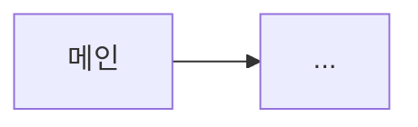

# (가칭) 프로젝트 기획서

> SSAFY 관통 프로젝트 · `/project-interview` 로 작성 중

## 진행 상태

| 단계 | 내용 | 상태 |
|---|---|---|
| Phase 0 | 기본 정보 | ⬜ |
| Phase 1 | 아이디어·타깃·핵심가치 | ⬜ |
| Phase 2 | 기능 명세·MVP | ⬜ |
| Phase 3 | 기술 스택·아키텍처·ERD | ⬜ |
| Phase 4 | 일정·역할 분담 | ⬜ |
| Phase 5 | 리스크·정리 | ⬜ |

(⬜ 시작 전 · 🟡 진행 중 · ✅ 완료)

---

## 0. 기본 정보

| 항목 | 내용 |
|---|---|
| 팀 구성 | |
| 기간 | |
| 필수 기술 스택 | |
| 관통 필수 요구사항 | |
| 주제 제한 | |

## 1. 프로젝트 개요

- **한 줄 정의**:
- **서비스 이름(가칭)**:
- **해결할 문제**:
- **타깃 사용자 / 페르소나**:
- **기존 대안과 한계**:
- **핵심 가치·차별점**:

## 2. 기능 명세

### 핵심 사용자 시나리오

1.

### 기능 목록

| ID | 기능 | 설명 | 우선순위 (P0/P1/P2) | 관련 필수 요구사항 |
|---|---|---|---|---|
| F-01 | | | | |

### MVP 범위

-

### 화면 목록 및 흐름

## 3. 기술 스택·아키텍처

| 구분 | 선택 | 이유 |
|---|---|---|
| Frontend | | |
| Backend | | |
| DB | | |
| 외부 API / AI | | |
| 배포 | | |

### 아키텍처 개요

-

### ERD 초안

### 주요 API

| 메서드 | URL | 설명 | 관련 기능 |
|---|---|---|---|
| | | | |

## 4. 일정·역할

### 마일스톤

| 기간 | 목표 | 산출물 |
|---|---|---|
| | | |

### 역할 분담

| 이름 | 담당 |
|---|---|
| | |

### 협업 규칙

- Git 브랜치 전략:
- 커밋 컨벤션:
- 회의/리뷰:

## 5. 리스크·오픈 이슈

| 구분 | 내용 | 대응 |
|---|---|---|
| 리스크 | | |
| 오픈 이슈 | | |

### 다음 액션

1.

---

## 결정 로그

| 날짜 | 결정 | 근거 | 검토한 대안 |
|---|---|---|---|
| | | | |
