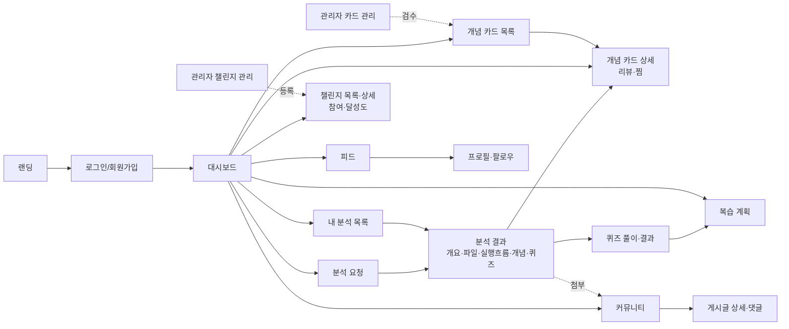
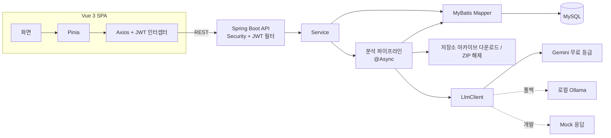

# 바이브노트 (VibeNote) 기획서

> SSAFY 관통 프로젝트 · `/project-interview` 로 작성 중

## 진행 상태

| 단계 | 내용 | 상태 |
|---|---|---|
| Phase 0 | 기본 정보 | ✅ |
| Phase 1 | 아이디어·타깃·핵심가치 | ✅ |
| Phase 2 | 기능 명세·MVP | ✅ |
| Phase 3 | 기술 스택·아키텍처·ERD | ✅ |
| Phase 4 | 일정·역할 분담 | ✅ |
| Phase 5 | 리스크·정리 | ✅ |

(⬜ 시작 전 · 🟡 진행 중 · ✅ 완료)

---

## 0. 기본 정보

| 항목 | 내용 |
|---|---|
| 팀 구성 | 2인. 릴레이식 개발: 시간대별로, 또는 AI 코딩 도구 토큰이 부족할 때 교대로 같은 코드베이스를 이어서 작업 (인수인계 문서 필수) |
| 기간 | 2026-11-17 시작 ~ 2026-12-24 발표 (약 5주) |
| 필수 기술 스택 | **BE** Java 17+, Spring Boot, MyBatis, Tomcat · **FE** HTML/CSS/JavaScript, Vue.js · **DB** MySQL · **도구** STS, VS Code, MySQL Workbench, Git/GitLab |
| 관통 필수 요구사항 | ① 로그인·로그아웃 ② 회원가입 ③ 커뮤니티 게시판 ④ 커뮤니티 댓글 ⑤ 회원 프로필 관리 ⑥ 팔로우/팔로잉 ⑦ 콘텐츠 데이터 관리 ⑧ 콘텐츠 목록 조회/검색 ⑨ 콘텐츠 상세 정보 조회 ⑩ 리뷰 작성/조회 ⑪ 콘텐츠 찜/즐겨찾기 ⑫ 추가(계획/챌린지) 기능 ⑬ AI 활용 알고리즘 |
| 주제 제한 | IT/개발 관련 도메인 안에서 자유. 계획/챌린지와 AI 알고리즘의 세부 조건은 따로 없음 |
| 공식 명세서 | Final Project 명세서(Java Track, 13회차 "냠냠코치"). 자율 프로젝트라 주제는 따르지 않지만 **필수·추가·심화 기능 구조와 제출 산출물 목록**은 따른다 (2절 "명세서 구조 매핑", 산출물은 `docs/산출물/`과 루트 `README.md` 참고). 명세서는 대외비이므로 저장소에 올리지 않는다 |
| 저장소 | 개발은 **GitHub private 저장소**(Actions CI), 최종 산출물만 **lab.ssafy.com(GitLab)**에 제출 |
| 제출물 | 설계 문서(요구사항 정의서, Use-Case Diagram, ERD, WBS, Gantt Chart, 화면 설계서), 구현 결과물(BE·FE 소스, DB Schema.sql, 활용 데이터 셋), 결과 정리(최종 보고서, 발표 자료, 외부 API·생성형 AI 활용 문서). `Final_[주제명]_지역_반_성명1_성명2.zip` |

## 1. 프로젝트 개요

- **한 줄 정의**: AI로 코딩하는 주니어와 개발자 지망생을 위해, AI가 쓴 코드를 **내 수준에 맞는 구조 설명과 개념 카드**로 풀어 주고, **퀴즈와 복습**으로 진짜 내 지식으로 만드는 코드 이해 학습 플랫폼
- **서비스 이름(가칭)**: 바이브노트 (VibeNote)

### 해결할 문제

AI 기반 바이브 코딩이 퍼지면서 비전공자와 주니어도 소프트웨어를 빠르게 만들 수 있게 되었다. 하지만 AI가 쓴 코드를 충분히 이해하지 못한 채 개발이 진행되면서 다음 문제가 생긴다.

1. **AI 생성 코드를 이해하지 못함**: 코드가 정상 동작해도 전체 구조, 실행 흐름, 설계 의도를 알지 못한다.
2. **검증 결과를 판단하기 어려움**: AI 코드 리뷰·검증 도구는 많다. 하지만 결과에 담긴 기술 개념이나 수정 권장 사항을 이해하지 못해, 검증 결과를 다시 다른 AI에 물어보게 된다.
3. **토큰과 문맥 관리 부담**: 코드를 이해하려고 프롬프트를 반복해서 써야 하고, 쉬운 설명을 요청할 때마다 토큰이 추가로 든다. 프로젝트가 커질수록 전체 문맥을 전달하고 유지하기 어려워진다.
4. **프로젝트 전체 구조가 보이지 않음**: 파일이나 함수 단위 설명만으로는 프로젝트 전체가 어떻게 동작하는지 알기 어렵다.
5. **이해한 내용이 학습으로 이어지지 않음**: AI의 설명과 수정 제안이 일회성 대화로 끝나서, 알게 된 지식을 기록하고 복습하기 어렵다.
6. **팀 안에서 지식을 공유하기 어려움**: 팀원마다 코드를 이해하는 수준이 다르고, 분석 결과와 학습 내용을 함께 관리할 환경이 없다.

### 타깃 사용자 / 페르소나

| 페르소나 | 상황 | 원하는 것 |
|---|---|---|
| **A. 비전공 개발자 지망생** (부트캠프·SSAFY 교육생) | AI로 프로젝트를 완성했지만 면접에서 "이 코드 왜 이렇게 짰어요?"라는 질문에 답하지 못한다 | 내 프로젝트 코드를 쉬운 말로 이해하고, 모르는 개념을 체계적으로 공부하고 싶다 |
| **B. 1~3년차 주니어 개발자** | 업무에서 Copilot이나 Claude로 코드를 생성하지만, 리뷰 지적 사항이나 설계 의도를 완전히 이해하지 못한다 | 생성된 코드를 검증할 수 있을 만큼 이해하고, 팀과 지식을 공유하고 싶다 |

### 기존 대안과 한계

| 대안 | 한계 |
|---|---|
| ChatGPT·Claude·Copilot Chat에 직접 질문 | 대화가 일회성이라 기록이 남지 않는다. 매번 문맥을 다시 전달해야 해서 토큰 부담이 크고, 설명 수준이 들쭉날쭉하다 |
| CodeRabbit 등 AI 코드 리뷰 도구 | 전문용어 중심이라 주니어가 지적 사항이 맞는지 판단하기 어렵다. 이해와 학습을 돕는 기능이 없다 |
| 블로그·강의로 따로 학습 | 내 코드와 연결되지 않아 실제 코드에 적용하기 어렵다 |

### 핵심 가치·차별점

1. **분석이 학습 자산으로 남는다**: 코드를 분석하면 개념 카드, 퀴즈, 복습 일정이 만들어져 계속 쌓인다.
2. **수준별 설명**: 비전공자나 주니어 수준에 맞춰 설명하므로, 결과를 다시 다른 AI에 물어볼 필요가 없다.
3. **팀 지식 공유**: 분석 결과, 개념 카드, 이해도를 팀과 공유한다. (확장 기능)

### 서비스 범위의 핵심 정의

- **콘텐츠 = 개념 학습 카드**: 코드 분석에서 추출한 개념(JWT, 트랜잭션, DI 등)을 쉬운 설명과 예제 코드가 담긴 카드로 만들어 모아 둔다. 필수 요구사항 ⑦~⑪(관리, 목록/검색, 상세, 리뷰, 찜)이 모두 개념 카드를 대상으로 한다. 이미 만들어진 카드를 재사용하므로 AI 호출과 토큰도 줄어든다.
- **분석 입력**: 공개 GitHub/GitLab 저장소 URL 또는 ZIP 업로드
- **분석 범위 제한**: 지원 스택은 Java, Spring, MyBatis, JavaScript, Vue로 한정한다. 최대 200개 파일, 10MB까지 받고 node_modules와 빌드 산출물은 제외한다. 비공개 저장소는 지원하지 않는다.
- **계획/챌린지 (필수 ⑫)**: ① 내 코드를 바탕으로 한 이해 퀴즈와 복습 계획 ② 학습 챌린지(관리자가 기간·목표를 정하고 사용자가 참여, 달성도 자동 집계) ③ 팀 챌린지(모듈별 이해도 공유, P2)
- **확장 기능 후보**: 팀 협업 공간, 쉬운 말로 풀어 쓴 검증 결과, 프로젝트 구조 시각화 → 우선순위는 Phase 2에서 정한다

## 2. 기능 명세

### 핵심 사용자 시나리오

1. **가입**: 회원가입할 때 내 수준(입문/주니어/숙련)을 고른다.
2. **분석 요청**: AI로 만든 내 프로젝트의 공개 저장소 URL을 등록하거나 ZIP 파일을 올린다.
3. **구조 이해**: 내 수준에 맞춘 프로젝트 개요와 파일별 설명을 읽는다. 궁금한 기능(예: 로그인 API)을 골라 실행 흐름 설명을 요청한다.
4. **개념 학습**: 코드에서 추출된 개념 카드(JWT, 트랜잭션 등)를 열어 공부하고, 중요한 카드는 찜한다.
5. **확인**: 내 코드로 만든 이해 퀴즈를 푼다. 틀린 개념은 복습 계획에 자동으로 추가된다.
6. **재방문**: 대시보드에서 오늘 복습할 카드와 맞춤 추천 카드를 학습한다. 참여 중인 학습 챌린지의 달성도를 확인한다. 팔로우한 사람의 활동 피드를 본다.
7. **질문·공유**: 이해가 막히면 분석 결과나 카드를 첨부해 커뮤니티에 질문하고, 댓글로 답을 받는다.

### 기능 목록

| ID | 기능 | 설명 | 우선순위 | 필수 요구사항 |
|---|---|---|---|---|
| F-01 | 회원가입 | 이메일·비밀번호·닉네임 입력, 학습 수준(입문/주니어/숙련) 선택 | P0 | ② |
| F-02 | 로그인·로그아웃 | JWT(Access + Refresh) 발급·재발급, 로그아웃 시 Refresh 토큰 폐기 | P0 | ① |
| F-03 | 프로필 관리·회원 탈퇴 | 닉네임·소개·수준 수정, 학습 통계(분석 수, 학습한 카드, 퀴즈 정답률). 탈퇴는 비활성화(`status=WITHDRAWN`) 방식으로 개인정보를 마스킹하고 Refresh 토큰을 폐기하며, 작성한 글은 "탈퇴한 사용자"로 표시 | P0 | ⑤ |
| F-04 | 팔로우·활동 피드 | 팔로우/언팔로우, 팔로워·팔로잉 목록, 팔로우한 사람의 공개 활동(분석·리뷰·찜·게시글) 피드 | P0 | ⑥ |
| F-05 | 분석 요청 | 공개 GitHub/GitLab URL 또는 ZIP 업로드. 지원 스택과 크기(200파일·10MB) 검증, .env와 키 패턴 제거, 분석할 때마다 수준 변경 가능 | P0 | ⑬ |
| F-06 | 개요·파일별 설명 | 프로젝트 목적, 레이어 구조, 주요 파일의 역할을 수준에 맞춰 설명 | P0 | ⑬ |
| F-07 | 실행 흐름 설명 | 탐지된 API 목록에서 사용자가 고른 1~3개만, 요청할 때 요청→응답 흐름을 단계별로 설명(결과 캐시) | P0 | ⑬ |
| F-08 | 개념 카드 추출·연결 | 코드에 쓰인 개념을 추출해 기존 카드와 연결하고, 없는 개념만 AI가 초안 카드를 생성(검수 대기) | P0 | ⑦ ⑬ |
| F-09 | 개념 카드 목록·검색 | 키워드·카테고리·난이도 필터, 인기순·최신순 정렬 | P0 | ⑧ |
| F-10 | 개념 카드 상세 | 쉬운 설명, 예제 코드, 내 코드에서 등장한 위치, 관련 카드 | P0 | ⑨ |
| F-11 | 카드 리뷰 | 별점과 한 줄 리뷰("이해에 도움이 됐나요?") 작성·조회 | P0 | ⑩ |
| F-12 | 카드 찜 | 찜하기/해제, 내 찜 목록 | P0 | ⑪ |
| F-13 | 관리자 카드 관리 | 시드 카드 등록(80개 이상, 카테고리 6종), AI 초안 검수(수정·공개·삭제) | P0 | ⑦ |
| F-14 | 코드 이해 퀴즈 | 분석한 코드로 객관식 5~10문항을 생성하고 채점·해설. 오답 개념을 기록 | P0 | ⑫ ⑬ |
| F-15 | 복습 계획 | 오답·찜 카드를 날짜별 복습 목록에 담고 완료 체크 | P0 | ⑫ |
| F-16 | 맞춤 개념 카드 추천 | 규칙 기반 가중치 점수(퀴즈 오답, 내 코드에 나온 개념, 찜, 수준)로 다음 학습 카드를 추천하고, AI가 추천 이유를 한 줄로 설명 | P0 | ⑬ |
| F-17 | 커뮤니티 게시판 | 게시판 종류 `QNA`(코드 이해 Q&A)·`REVIEW`(학습 후기)·`FREE`(자유). 게시글 작성·조회·수정·삭제·목록·검색(종류별 필터), 분석 결과나 개념 카드 첨부 | P0 | ③ |
| F-18 | 댓글 | 게시글 댓글 작성·조회·수정·삭제 (수정·삭제는 본인만) | P0 | ④ |
| F-19 | 분석 관리 | 분석의 제목·메모 수정, 공개/비공개 설정, 삭제(파일·흐름·개념 연결 함께 삭제, 퀴즈 풀이 기록은 유지). 공개한 분석은 피드와 게시글 첨부에 사용 | P0 | ③ ⑥ ⑦ |
| F-20 | 팀 챌린지 | 팀 생성·초대, 공동 분석의 모듈별 이해도(퀴즈 결과) 공유, 기간 목표 | P2 | ⑫ 확장 |
| F-21 | 구조 시각화 | 분석 결과로 아키텍처와 데이터 흐름을 mermaid 다이어그램으로 렌더링 | P1 | 확장 |
| F-22 | 쉬운 검증 결과 | 코드 개선점이나 위험 요소를 쉬운 말로 설명하고, 관련 개념 카드와 연결 | P2 | 확장 |
| F-23 | 망각곡선 자동 복습 | 오답 개념을 1·3·7일 간격으로 자동 스케줄링 | P2 | 확장 |
| F-24 | 학습 챌린지 관리 | 관리자가 챌린지를 등록·조회·수정·삭제: 제목, 설명, 기간, 대표 이미지(jpg·png·webp, 2MB 이하), 목표 유형(`REVIEW_COUNT` 개념 복습 n회 / `QUIZ_COUNT` 퀴즈 n회 / `ANALYSIS_COUNT` 분석 n회)과 목표값 | P0 | ⑫ |
| F-25 | 챌린지 참여·달성도 | 챌린지 목록·상세, 참여·취소, 기간 안의 활동(review_plans 완료, quiz_attempts, analyses)으로 달성도 자동 집계, 완료 표시, 내 챌린지 목록. 참여·완료는 피드 활동으로 기록 | P0 | ⑫ ⑥ |

**필수 요구사항 매핑 점검**: ①F-02 ②F-01 ③F-17 ④F-18 ⑤F-03 ⑥F-04 ⑦F-08·F-13·F-19 ⑧F-09 ⑨F-10 ⑩F-11 ⑪F-12 ⑫F-14·F-15·F-24·F-25 ⑬F-05~08·F-14·F-16. 13개 모두 P0에 매핑됨 ✅

### 명세서 구조 매핑

공식 명세서(냠냠코치)의 필수·추가·심화 구조를 바이브노트 기능에 대응시킨 표다. 평가 기준에 빠지는 항목이 없도록 이 표로 점검한다.

| 명세서 구분 | 명세서 요구사항 (냠냠코치 기준) | 바이브노트 기능 |
|---|---|---|
| 필수 · 핵심 데이터 | 식단 작성·조회(목록·상세)·수정·삭제 (F1301~F1304) | 분석: F-05 작성, F-06 상세 조회, 내 분석 목록, F-19 수정·삭제 |
| 필수 · 분석 | 식단 분석, 점수 등으로 표현 (F1305) | F-06·F-07 수준별 설명, F-14 이해도 퀴즈 점수, F-03 학습 통계 |
| 필수 · 회원 | 가입·조회·수정·삭제(비활성화)·로그인/로그아웃 (F1306~F1310) | F-01, F-02, F-03 |
| 추가 · 회원 | 팔로우 등록·조회·삭제 (F1311) | F-04 |
| 추가 · 챌린지 | 챌린지 정보 CRD(기간·설명·이미지), 참여·달성도 (F1312·F1313) | F-24, F-25 |
| 추가 · 커뮤니티 | 여러 게시판 CRUD, 댓글 CRUD (F1314·F1315) | F-17 (게시판 3종), F-18 |
| 심화 · AI | 생성형 AI 기능 2개 (F1316·F1317) | F-06·F-07 수준별 설명, F-08 개념 추출, F-14 퀴즈 생성, F-16 추천 이유 |
| 비기능 | 편의성·가용성(다양한 디바이스)·응답성·정확성 (NF1301~NF1304) | 아래 비기능 요구사항 NF-01~NF-07 |

### 비기능 요구사항

| ID | 분류 | 요구사항 | 검증 방법 |
|---|---|---|---|
| NF-01 | 사용성 | 사전 지식이 없는 사용자도 가입 후 안내 없이 분석 요청까지 할 수 있다. 랜딩에서 샘플 분석 결과를 미리 보여 준다 | 시연 시나리오 점검 |
| NF-02 | 반응형 | 375px(모바일)~1440px(데스크톱) 폭에서 가로 스크롤 없이 모든 화면을 사용할 수 있다 | `ui-verifier` 모바일·데스크톱 점검 |
| NF-03 | 응답성 | 목록·검색 API는 시드 데이터 기준 500ms 이내에 응답한다. 분석 요청은 1초 이내에 202로 접수하고 처리는 비동기로 한다 | 통합 테스트 응답 시간 측정 |
| NF-04 | 정확성 | 공개되는 개념 카드는 관리자 검수(`PUBLISHED`)를 거친 것만 노출한다. LLM 출력은 JSON 스키마로 검증하고 실패하면 1회 재시도한다. 지원 스택 외 코드는 분석하지 않는다 | 단위·통합 테스트, `prompt-evaluator` |
| NF-05 | 보안 | 비밀번호 BCrypt 해시, JWT 인증·인가, 업로드 파일 형식·크기 제한, Zip Slip·SSRF 방어, 업로드 코드의 `.env`·키 패턴 제거 | `reviewer` 보안 점검 항목, 테스트 |
| NF-06 | 가용성 | LLM 장애나 한도 초과 시 Ollama로 자동 전환하고, 생성 결과(카드, 흐름, 추천 이유)는 캐시해 재사용한다 | Mock 장애 테스트 |
| NF-07 | 비용 | 사용자별 일일 분석 횟수를 제한하고 모든 LLM 호출의 토큰 사용량을 기록한다 | `llm_usage_logs` 집계 |

### MVP 범위

- **P0 (F-01~F-19, F-24, F-25)**: 개인 학습 흐름(분석 → 설명 → 개념 카드 → 퀴즈 → 복습·추천), 학습 챌린지, 필수 요구사항 13개와 명세서의 필수·추가 구조를 모두 포함한다.
- **P1 (F-21)**: P0가 완성되면 구조 시각화를 붙인다(난이도 낮음).
- **P2 (F-20, F-22, F-23)**: 시간이 남을 때만 진행한다. 팀 챌린지는 학습 챌린지(F-24·F-25)가 챌린지 요구사항을 충족하므로 P2로 내렸다.

### 화면 목록 및 흐름

| 화면 | 주요 내용 | 관련 기능 |
|---|---|---|
| 랜딩 | 서비스 소개, 샘플 분석 미리보기 | - |
| 로그인 / 회원가입 | 수준 선택 포함 | F-01, F-02 |
| 대시보드 | 오늘 복습할 카드, 맞춤 추천 카드, 최근 분석 | F-15, F-16 |
| 분석 요청 | URL 입력 또는 ZIP 업로드, 수준 선택 | F-05 |
| 내 분석 목록 | 분석 이력, 상태(진행 중/완료), 공개 설정 | F-19 |
| 분석 결과 | 탭: 개요 / 파일 / 실행 흐름 / 개념 / 퀴즈 | F-06, F-07, F-08, F-14 |
| 퀴즈 풀이·결과 | 문항, 채점, 해설, 오답을 복습에 추가 | F-14, F-15 |
| 개념 카드 목록 | 검색·필터·정렬 | F-09 |
| 개념 카드 상세 | 설명, 예제, 내 코드 위치, 리뷰, 찜 | F-10, F-11, F-12 |
| 복습 계획 | 날짜별 복습 목록, 완료 체크 | F-15 |
| 챌린지 목록 / 상세 | 진행 중·예정·종료 챌린지, 참여·취소, 내 달성도 | F-25 |
| 커뮤니티 목록 / 상세 / 작성 | 게시판 종류 탭(Q&A·학습 후기·자유), 첨부, 댓글 | F-17, F-18 |
| 피드 | 팔로우한 사람의 공개 활동 | F-04 |
| 프로필 (내 / 타인) | 학습 통계, 팔로우, 찜 목록, 참여 챌린지, 정보 수정·회원 탈퇴 | F-03, F-04, F-12, F-25 |
| 관리자 카드 관리 | 카드 등록, AI 초안 검수 | F-13 |
| 관리자 챌린지 관리 | 챌린지 등록·수정·삭제, 이미지 업로드 | F-24 |

## 3. 기술 스택·아키텍처

| 구분 | 선택 | 이유 |
|---|---|---|
| Frontend | Vue 3 + Vite, Pinia, Vue Router, Axios | 필수 스택. Pinia로 로그인 상태와 사용자 수준을 전역 관리 |
| Backend | Java 21, Spring Boot 4.1, Spring Security + JWT(Access + Refresh), MyBatis, Jackson 3, 내장 Tomcat | 필수 스택. SPA와 REST API를 분리한 구조에 JWT가 적합 |
| DB | MySQL 8 | 필수 스택. 분석 세부 결과는 JSON 컬럼에 저장 |
| AI | `LlmClient` 추상화: Gemini(무료 등급, 기본) → 한도 초과나 장애 시 Ollama(로컬)로 자동 전환, 개발용 Mock 모드 | 유료 결제를 할 수 없고 SSAFY 키 제공 시점도 미정. 키가 나오면 설정만 바꿔 교체 |
| 저장소 수집 | GitHub·GitLab 공개 저장소의 아카이브 ZIP을 다운로드 | ZIP 업로드와 같은 처리 과정을 재사용하고, git clone이 필요 없음 |
| API 문서 | Swagger (springdoc-openapi). `/swagger-ui/index.html`, 테스트가 `docs/api/openapi.json`을 추출 | 명세서 참고자료. REST API 명세 산출물과 FE·BE 계약 검사의 정본으로 사용 |
| 파일 저장 | 챌린지 이미지는 로컬 `uploads/`에 UUID 파일명으로 저장하고 정적 경로로 제공 | 외부 스토리지 비용·설정 없이 시연 가능 |
| 형상 관리·CI | GitHub private 저장소 + GitHub Actions(PR마다 BE·FE 검증). 제출은 lab.ssafy.com | 무료 플랜 범위에서 자동 검증. private 무료 플랜은 브랜치 보호가 적용되지 않아 로컬 hook과 팀 규칙으로 보완 |
| 배포 | 로컬 시연을 우선하고, P0 완성 후 여유가 있으면 AWS EC2나 Docker로 배포 | 배포 때문에 생기는 일정 리스크를 줄이기 위해 |

### 아키텍처 개요

- **비동기 분석**: `POST /api/analyses` 요청을 받으면 바로 `analysisId`를 돌려준다. 분석은 `@Async`로 백그라운드에서 진행하며 단계별 상태를 DB에 기록하고, 프론트는 2~3초마다 상태를 조회(폴링)한다.
- **분석 파이프라인 단계**: `FETCHING`(코드 수집) → `FILTERING`(지원 스택·200파일·10MB 검사, node_modules·빌드 산출물·.env·키 패턴 제거) → `SELECTING`(Controller·Service·Mapper·Vue 컴포넌트 등 주요 파일 선별) → `EXPLAINING`(수준별 개요·파일 설명) → `EXTRACTING`(개념 추출, 기존 카드와 매칭, 없는 개념은 초안 카드 생성) → `QUIZ`(퀴즈 생성) → `DONE` / `FAILED`
- **실행 흐름**: 분석이 끝나면 탐지된 API 목록에서 사용자가 1~3개를 고르고, 고른 것에 대해서만 생성한다. 결과는 `analysis_flows`에 캐시한다.
- **코드 보관**: 분석에 쓴 주요 파일 내용만 `analysis_files`에 저장한다. 원본 ZIP과 압축 해제 폴더는 분석이 끝나면 삭제한다.
- **AI 비용 관리**: 모든 호출을 `llm_usage_logs`에 기록하고 사용자별 일일 분석 횟수를 제한한다. 개념 카드와 추천 이유는 저장해 두고 재사용한다.
- **맞춤 추천 알고리즘(F-16)**: 카드별 점수 = 퀴즈 오답 수 ×3 + 내 분석에 등장 ×2 + 찜한 카드와 같은 카테고리 ×1 + 수준 적합도(±1). 이미 복습을 완료한 카드는 제외한다. 상위 N개 카드의 추천 이유는 AI가 한 줄로 생성하고 `recommendation_reasons`에 캐시한다.

### ERD 초안

> 위 다이어그램에는 핵심 컬럼만 적었다. `refresh_tokens`, `concept_wishes`, `quizzes`, `quiz_attempts`, `quiz_answers`, `recommendation_reasons`, `comments`, `llm_usage_logs`는 관계만 표시했다. P2용 테이블(`teams`, `team_members`, `team_challenges`)은 P2를 시작할 때 추가한다. 탈퇴한 사용자의 게시글·댓글은 남기고 작성자를 "탈퇴한 사용자"로 표시한다(`users.status`로 판단).

### 주요 API

| 메서드 | URL | 설명 | 관련 기능 |
|---|---|---|---|
| POST | /api/auth/signup | 회원가입(수준 포함) | F-01 |
| POST | /api/auth/login · /logout · /refresh | 로그인, 로그아웃, 토큰 재발급 | F-02 |
| GET·PATCH·DELETE | /api/users/me | 내 프로필 조회·수정, 회원 탈퇴(비활성화) | F-03 |
| GET | /api/users/{id} · /{id}/stats | 타인 프로필, 학습 통계 | F-03 |
| POST·DELETE | /api/users/{id}/follow | 팔로우, 언팔로우 | F-04 |
| GET | /api/users/{id}/followers · /followings | 팔로워·팔로잉 목록 | F-04 |
| GET | /api/feed | 팔로우한 사람의 공개 활동 피드 | F-04 |
| POST | /api/analyses | 분석 요청(URL 또는 ZIP multipart) → analysisId 반환 | F-05 |
| GET | /api/analyses · /{id} · /{id}/status | 내 분석 목록, 분석 결과(개요), 진행 상태 | F-05, F-06 |
| PATCH·DELETE | /api/analyses/{id} | 분석 제목·메모 수정, 분석 삭제 | F-19 |
| GET | /api/analyses/{id}/files · /files/{fileId} | 파일별 설명 목록, 파일 단건(코드 포함) | F-06 |
| POST·GET | /api/analyses/{id}/flows | 실행 흐름 생성 요청(1~3개) 및 조회 | F-07 |
| GET | /api/analyses/{id}/concepts | 이 분석에서 추출한 개념 카드 | F-08 |
| PATCH | /api/analyses/{id}/visibility | 공개/비공개 설정 | F-19 |
| GET | /api/concepts?keyword=&category=&difficulty=&sort= | 카드 목록·검색 | F-09 |
| GET | /api/concepts/{id} | 카드 상세(내 코드 등장 위치 포함) | F-10 |
| GET·POST | /api/concepts/{id}/reviews | 리뷰 조회·작성 | F-11 |
| POST·DELETE | /api/concepts/{id}/wish | 찜, 찜 해제 | F-12 |
| GET·POST·PUT·DELETE | /api/admin/concepts | 카드 관리, AI 초안 검수(status 변경) | F-13 |
| GET | /api/analyses/{id}/quiz | 퀴즈 조회 | F-14 |
| POST | /api/quizzes/{id}/attempts | 답안 제출 → 채점·해설, 오답을 복습에 추가 | F-14, F-15 |
| GET·POST·PATCH·DELETE | /api/review-plans | 복습 계획 조회(날짜별)·추가·완료 체크·삭제 | F-15 |
| GET | /api/recommendations | 맞춤 카드 추천(점수와 추천 이유) | F-16 |
| GET·POST·PUT·DELETE | /api/posts?boardType=&keyword= | 게시글 CRUD·검색(게시판 종류 필터, 분석·카드 첨부) | F-17 |
| GET·POST | /api/posts/{postId}/comments | 댓글 조회·작성 | F-18 |
| PUT·DELETE | /api/posts/{postId}/comments/{id} | 댓글 수정·삭제(본인) | F-18 |
| GET·POST·PUT·DELETE | /api/admin/challenges | 챌린지 관리(multipart 이미지 업로드) | F-24 |
| GET | /api/challenges?status= · /{id} | 챌린지 목록(진행 중·예정·종료)·상세(내 달성도 포함) | F-25 |
| POST·DELETE | /api/challenges/{id}/participation | 챌린지 참여·취소 | F-25 |
| GET | /api/users/me/challenges | 내 챌린지 목록·달성도 | F-25 |

### P0 기능 구현 매핑 점검

| 기능 | 테이블 | API |
|---|---|---|
| F-01~03 회원·프로필·탈퇴 | users, refresh_tokens | /api/auth/*, /api/users/* |
| F-04 팔로우·피드 | follows, activities | /api/users/{id}/follow, /api/feed |
| F-05~08 분석 | analyses, analysis_files, analysis_flows, analysis_concepts, concepts, llm_usage_logs | /api/analyses/* |
| F-09~13 개념 카드 | concepts, concept_reviews, concept_wishes | /api/concepts/*, /api/admin/concepts |
| F-14 퀴즈 | quizzes, quiz_questions, quiz_attempts, quiz_answers | /api/analyses/{id}/quiz, /api/quizzes/* |
| F-15 복습 계획 | review_plans | /api/review-plans |
| F-16 추천 | quiz_answers, analysis_concepts, concept_wishes, review_plans → recommendation_reasons | /api/recommendations |
| F-17·18 커뮤니티 | posts(board_type), comments | /api/posts/* |
| F-19 분석 관리 | analyses(title, memo, is_public), activities | PATCH·DELETE /api/analyses/{id}, /api/analyses/{id}/visibility |
| F-24·25 학습 챌린지 | challenges, challenge_participants, activities (달성도 집계: review_plans, quiz_attempts, analyses) | /api/admin/challenges, /api/challenges/*, /api/users/me/challenges |

## 4. 일정·역할

### 마일스톤

| 기간 | 목표 | 산출물 |
|---|---|---|
| **W1** 11/17~11/23 | 기획·ERD·API 확정, 하네스·프로젝트 세팅(Swagger·CI 포함), 회원/JWT, LlmClient(Mock·Gemini) 연결 확인, 시드 개념 카드 80개 이상 작성, **설계 산출물**(요구사항 정의서, 유스케이스, WBS, 간트) | 기획서 확정본, DDL, BE·FE 초기 프로젝트, F-01~03, 시드 데이터, `docs/산출물/01~05` |
| **W2** 11/24~11/30 | 분석 파이프라인(수집 → 필터 → 설명), 개념 카드 목록·검색·상세, 화면 설계서 초안 | F-05, F-06, F-09, F-10, `06-화면설계서` 초안 |
| **W3** 12/01~12/07 | 개념 추출, 퀴즈, 복습 계획, 리뷰·찜 | F-08, F-11, F-12, F-14, F-15 · ★ **핵심 흐름 완성** (분석 → 카드 → 퀴즈 → 복습) |
| **W4** 12/08~12/14 | 커뮤니티·댓글, 팔로우·피드, 추천, 실행 흐름, 관리자 검수, 분석 관리, **학습 챌린지** | F-04, F-07, F-13, F-16~19, F-24, F-25 · ★ **P0 전체 완성** |
| **W5** 12/15~12/20 | P1(구조 시각화), 통합 테스트, UI 다듬기, **산출물 정리**(ERD·화면 설계서 최종본, REST API 명세, Schema.sql, 데이터 셋, AI 활용 문서, 최종 보고서 초안) | F-21, 버그 수정, `docs/산출물/` 전체 |
| **버퍼** 12/21~12/24 | 시연용 분석 미리 실행, 발표 자료, 제출 zip 작성과 **lab.ssafy.com 제출**, (여유가 있으면 배포) | 시연 시나리오, 발표 PPT/PDF, `Final_바이브노트_지역_반_성명1_성명2.zip` |

> **일정 판단 기준**: W3 마감(12/07)에 핵심 흐름이 완성되지 않았으면 P1을 모두 포기하고, W4는 P0 완성에만 집중한다.

### 역할 분담

릴레이 방식이므로 시간대별로, 또는 AI 도구 토큰이 떨어지면 교대한다. 두 사람이 같은 브랜치와 같은 기능을 이어서 작업한다. 다만 리뷰와 품질 책임을 분명히 하기 위해 **영역 오너**를 둔다. 오너는 직접 다 구현하는 사람이 아니라, 해당 영역의 PR 머지(자동 리뷰 지적 반영 확인)와 최종 동작 확인을 책임지는 사람이다. 코드 리뷰는 사람이 아니라 reviewer 에이전트와 Codex 봇이 한다.

| 팀원 | 영역 오너 (리뷰·최종 확인) |
|---|---|
| 팀원 A | **AI·분석**: 분석 파이프라인, LlmClient(Gemini·Ollama·Mock), 개념 추출, 퀴즈 생성, 실행 흐름, 맞춤 추천, 분석 관리 (F-05~08, F-14, F-16, F-19, F-21) |
| 팀원 B | **학습·소셜**: 회원·JWT, 개념 카드·리뷰·찜·관리자, 복습 계획, 커뮤니티·댓글, 팔로우·피드, 학습 챌린지 (F-01~04, F-09~13, F-15, F-17, F-18, F-20, F-24, F-25) |

> 오너는 기능 영역 단위로 FE와 BE를 함께 책임진다. 팀원 이름은 정해지면 채운다.

### 협업 규칙

- **인수인계**: 3가지를 운영한다.
  - `CLAUDE.md`: 프로젝트 규칙, 폴더 구조, 실행 방법, 코딩 컨벤션. AI 코딩 도구가 문맥을 바로 파악하게 한다.
  - `docs/작업로그.md`: 교대할 때마다 `날짜·작업자 / 한 일 / 다음 할 일 / 막힌 점 / 현재 브랜치`를 적는다.
  - GitHub Issues: 남은 작업을 기능 ID(F-xx) 단위로 관리한다.
  - 교대하기 전에는 반드시 커밋하고 push한다. 작업 중인 코드는 `wip(F-xx):` 커밋으로 남긴다.
- **저장소**: 개발은 GitHub private 저장소(`origin`), 최종 제출은 lab.ssafy.com GitLab(`gitlab` 원격). GitLab push는 제출 때 사람이 직접 한다.
- **Git 브랜치 전략**: `main`(마일스톤 단위 안정 버전) ← `develop`(통합) ← `feature/F-05-analysis` 형식. feature 브랜치는 develop에 **PR**로 합친다. 릴레이로 교대할 때는 같은 feature 브랜치를 이어서 작업한다.
- **CI와 머지 규칙**: PR마다 GitHub Actions가 BE·FE 검증과 API 명세(openapi.json) 일치 여부를 검사한다. **CI가 초록일 때만** 영역 오너가 머지한다. wip 커밋이 섞인 PR은 Squash 머지한다. 무료 private 저장소는 브랜치 보호가 적용되지 않으므로 이 규칙과 로컬 git hook으로 지킨다.
- **커밋 컨벤션**: `타입(기능ID): 요약`. 예: `feat(F-05): 분석 요청 API 추가`. 타입은 `feat` / `fix` / `refactor` / `docs` / `chore` / `test` / `wip`
- **회의/리뷰**: 정기 회의 없이 비동기로 운영한다. 작업로그와 GitHub Issues, PR 코멘트로 소통하고, PR은 해당 영역 오너가 리뷰한다. 마일스톤 마감일(일요일)에는 각자 작업로그에 진척 상황을 기록해 일정 판단 기준에 맞는지 점검한다.

## 5. 리스크·오픈 이슈

| 구분 | 내용 | 대응 |
|---|---|---|
| 리스크 | 범위 과다: URL과 ZIP 입력, 퀴즈와 팀 챌린지, 확장 기능까지 모두 넣으면 2인 5주에 벅참 | 팀 챌린지와 구조 시각화는 P1, 검증 결과와 망각곡선은 P2로 분리. 12/07 판단 기준으로 P1 포기 여부 결정 |
| 리스크 | LLM 비용과 토큰 한도: 저장소 전체를 분석하면 호출량이 많음 | 주요 파일만 골라 분석하고, 분석 결과와 개념 카드를 DB에 캐시해 재사용. 사용자별 일일 분석 횟수 제한 |
| 리스크 | 저장소 분석 품질: 구조나 흐름을 잘못 설명할 수 있음 | 지원 스택을 제한하고 프롬프트 템플릿을 고정. 시연용 샘플 저장소로 미리 검증 |
| 리스크 | 업로드 코드 보안: 코드에 API 키나 비밀번호가 들어 있을 수 있음 | 분석 전에 .env와 키 패턴을 걸러냄. 분석에 쓴 파일만 DB에 저장하고 원본 ZIP과 압축 해제 폴더는 삭제 |
| 리스크 | 기술 난이도: Spring의 @Async, 파일 업로드, 외부 HTTP 호출, JSON 컬럼 매핑을 처음 다룸 | W1에 LlmClient 연결과 ZIP 처리를 먼저 프로토타입으로 검증 |
| 리스크 | 비동기 협업만 하면 릴레이 중에 방향이 어긋날 수 있음 | 작업로그 작성을 필수로 하고, 교대 전 push 규칙 지키기. 일요일 마일스톤 점검 기록 |
| 리스크 | P0 기능이 19개로 많음. 분석 4종과 추천 때문에 AI 호출량과 개발량이 큼 | 3주차까지 분석→카드→퀴즈 핵심 흐름을 먼저 완성. 분석 단계별 결과를 DB에 저장해 재호출 방지 |
| 리스크 | 무료 LLM 한도: Gemini 무료 등급의 분당·일일 호출 한도에 걸리면 시연 중 실패할 수 있음 | Ollama 폴백, 결과 캐시, 시연용 분석은 미리 실행해 저장 |
| 리스크 | 무료 등급 데이터 정책: 입력한 코드가 모델 학습에 쓰일 수 있음 | 이용 안내에 명시하고, 시연에는 샘플 저장소 사용 |
| 리스크 | 명세서 대비 누락: 자율 주제라 명세서의 필수·추가 구조나 제출 산출물을 놓칠 수 있음 | 2절 "명세서 구조 매핑"과 `/progress`의 산출물 준비 현황으로 매주 점검 |
| 리스크 | W4 과부하: 학습 챌린지(F-24·F-25) 추가로 W4 기능이 많아짐 | 챌린지 달성도는 기존 테이블 집계로 단순하게 구현. 12/07 판단 기준에 걸리면 F-07·F-16 범위를 줄임 |
| 리스크 | GitHub 무료 private 저장소는 브랜치 보호가 적용되지 않음 | 로컬 git hook, Claude hook, "CI 초록 후 머지" 규칙 |
| 리스크 | 산출물 몰아 쓰기: 보고서·다이어그램을 마지막 주에 몰아서 만들면 품질 저하 | 설계 산출물은 W1에 완성하고, 작업로그에 AI 활용 사례를 계속 기록 |
| 리스크 | 데이터 라이선스: 공식 문서·오픈소스 코드를 복사하거나 라이선스 없는 저장소를 쓰면 제출물에 문제 | 카드는 직접 작성 + `reference_url`, Oracle·Swagger·MDN 글은 링크만, 외부 데이터는 `data/datasets.json` 등록 후 사용 (`09-데이터셋.md`) |
| 리스크 | 평가 데이터 누수·사전학습 오염으로 분석 품질이 부풀려짐 | dev/eval 분리, 팀 생성 평가 저장소, 블라인드 라벨, 오염 그룹 분리 보고 |
| 오픈 이슈 | SSAFY LLM 키 제공 시점과 사용 가능한 모델 | 키를 받으면 LlmClient 구현체만 추가 |
| 오픈 이슈 | Gemini 무료 등급의 현재 호출 한도, 두 사람 PC의 Ollama 구동 가능 여부 | 개발 1주차에 확인 |

### 다음 액션

1. **LLM 확인 (가장 큰 리스크)**: Gemini API 키를 발급받고 무료 한도를 확인한다. 두 사람 PC에서 Ollama가 도는지 테스트하고, SSAFY 키 제공 일정을 문의한다.
2. **프로젝트 뼈대**: GitHub private 저장소를 연결하고 Spring Boot·Vue 초기 프로젝트(Swagger, CI 포함)를 만든다. (`CLAUDE.md`, `docs/작업로그.md`, 하네스는 완료)
3. **DB와 시드 데이터**: ERD를 MySQL DDL로 옮기고, 시드 개념 카드 목록(80개 이상, 카테고리 6종)을 정한다.
4. (선택) GitHub Issues·Milestones로 F-01~F-25와 W1~W5를 등록한다.

---

## 결정 로그

| 날짜 | 결정 | 근거 | 검토한 대안 |
|---|---|---|---|
| 2026-11-17 | 스택: Spring Boot + MyBatis + Vue.js + MySQL | 관통 프로젝트 필수 스택 공지 | - |
| 2026-11-17 | 도메인 범위: IT/개발 | 관통 공지의 주제 제한 | - |
| 2026-11-17 | 개발 방식: 2인 릴레이(교대) | 팀 작업 방식. 인수인계 문서 운영 규칙은 Phase 4에서 확정 | FE/BE 분담, 페어 프로그래밍 |
| 2026-11-17 | 주제: AI 생성 코드 이해·학습 플랫폼 "바이브노트" | 바이브 코딩의 확산으로 생긴 실제 문제이고, 팀이 직접 겪는 문제 | 기술 서적, 알고리즘 문제, 개발 강의 |
| 2026-11-17 | 타깃: 개발자 지망생(비전공 포함) + 1~3년차 주니어 | AI 코드를 이해하지 못하는 문제가 가장 큰 집단 | 컴퓨터 관련 전공 대학생 |
| 2026-11-17 | 한 줄 정의: 이해·학습 중심. 협업과 검증은 확장 기능 | 5주 동안 핵심 가치에 집중하기 위해 | 협업 중심, 검증 중심 |
| 2026-11-17 | 콘텐츠 = 개념 학습 카드 | 필수 ⑦~⑪과 자연스럽게 연결되고, 학습 단절 문제와 토큰 절감 문제를 함께 해결 | 공개 분석 리포트, 둘 다 |
| 2026-11-17 | 분석 입력: 공개 저장소 URL + ZIP, Java/Spring/MyBatis/JS/Vue, 200파일·10MB | 사용 편의와 구현 범위의 균형. OAuth와 토큰 보안 부담을 피함 | ZIP만, 코드 조각만, 비공개 저장소 지원 |
| 2026-11-17 | 챌린지: 코드 이해 퀴즈·복습 계획 + 팀 챌린지 | 학습 정착 문제와 팀 공유 문제 해결 | 개념 카드 스트릭 |
| 2026-11-17 | 분석 결과물 P0: 개요·파일 설명, 개념 카드, 퀴즈, 실행 흐름(요청 시 1~3개) | 이해부터 학습까지 이어지는 흐름을 완성. 실행 흐름은 비용 때문에 요청할 때만 생성 | 실행 흐름 자동 생성, 실행 흐름 P1 |
| 2026-11-17 | 확장 기능: 팀 챌린지·구조 시각화 P1, 검증 결과 P2 | 개인 학습 흐름을 먼저 완성 | 팀 챌린지 P0, 확장 기능 모두 P2 |
| 2026-11-17 | 개념 카드: 시드 + AI 초안 + 관리자 검수 | 시연할 때 목록이 비어 보이지 않고 품질도 관리 가능 | AI 자동 공개, 사용자 위키 |
| 2026-11-17 | 커뮤니티: 코드 이해 Q&A + 분석·카드 첨부 | 서비스 핵심 흐름과 연결 | 자유게시판, 학습 인증 피드 |
| 2026-11-17 | 수준 3단계, 가입 시 선택 + 분석마다 변경 | 프롬프트 템플릿 3개로 구현 가능 | 진단 퀴즈, 실시간 전환 |
| 2026-11-17 | AI 알고리즘: 규칙 기반 가중치 맞춤 카드 추천 + AI 추천 이유 | 추천 논리를 발표에서 설명할 수 있음 | 망각곡선(P2로 이동) |
| 2026-11-17 | 팔로우: 공개 활동 피드 + 프로필 학습 통계 | 소셜 요구사항을 학습 동기 부여와 연결 | 목록만, 팀 초대 연동 |
| 2026-11-17 | 인증: JWT(Access + Refresh) | SPA와 REST API 분리 구조에 적합하고 자료가 많음 | 세션+쿠키, 소셜 로그인 |
| 2026-11-17 | LLM: LlmClient 추상화, Gemini 무료 등급 → Ollama 폴백, Mock 모드 | 결제할 수 없고 SSAFY 키 제공 시점이 미정이라 교체 가능한 구조가 필요 | Groq, Ollama 단독 |
| 2026-11-17 | 분석 처리: @Async + 상태 폴링 | 구현이 가장 단순하고 타임아웃을 피할 수 있음 | SSE, 동기 처리 |
| 2026-11-17 | 코드 보관: 분석에 쓴 파일만 DB에 저장, 원본은 삭제 | 카드의 코드 위치 표시와 실행 흐름에 필요한 만큼만 보관 | 원본 전체 보관, 결과만 보관 |
| 2026-11-17 | 결과 저장: 테이블과 JSON 혼합 | 조회·집계 대상만 정규화해 매퍼 작업량을 줄임 | 전부 정규화, JSON 하나 |
| 2026-11-17 | 배포: 로컬 시연 우선 | 일정 리스크 감소 | EC2 필수, Docker Compose |
| 2026-11-17 | 일정: W3 핵심 흐름, W4 P0 완성, 마지막 4일 버퍼 | 발표일에서 역산. 가장 위험한 분석 파이프라인을 먼저 개발 | 더 보수적인 안(P0를 12/17에 완성) |
| 2026-11-17 | 인수인계: CLAUDE.md + 작업로그 + GitLab 이슈 | 릴레이로 교대할 때 문맥을 다시 설명하는 비용과 토큰을 줄임 | 작업로그만, 구두 공유 |
| 2026-11-17 | Git: main + develop + feature/*, 커밋 `타입(F-xx): 요약` | 기능 명세와 추적 가능하게 연결 | main 단일, 자유 형식 |
| 2026-11-17 | 영역 오너: A는 AI·분석, B는 학습·소셜 | 기능 영역별로 FE와 BE를 함께 책임져 리뷰 기준을 명확히 함 | BE/FE 분리, 공동 책임 |
| 2026-11-17 | 회의: 정기 회의 없이 비동기(작업로그·이슈·MR) | 릴레이 방식의 팀 작업 성향 | 매일 싱크 + 주간 회고, 주 2회 |
| 2026-11-17 | 하네스: 강한 수준(spec 주도 + 서브에이전트 + 테스트 게이트), `.claude/` 전체를 저장소로 공유 | 두 사람 모두 Claude Code 사용. 릴레이에서 AI가 같은 규칙으로 일하고 스스로 검증해야 함 | 가벼움(CLAUDE.md + 작업로그), 중간 |
| 2026-11-17 | 저장소: 모노레포 `backend/` + `frontend/` | 기능 단위(FE+BE) 오너십, 하네스·작업로그를 한 벌로 관리 | BE/FE 분리 레포 |
| 2026-11-17 | 교대 체크포인트: `docs/handoff/NOW.md`를 작업 단위마다 갱신(Stop hook이 누락을 잡음) + AI 없이 실행하는 `scripts/handoff.mjs` | 토큰 소진으로 세션이 갑자기 끊기는 상황 대비, 서로 다른 PC라 push까지 필요 | 매 턴 자동 wip 커밋·push, 수동 /handoff만 |
| 2026-11-17 | 구현 흐름: `/spec` → 사람 승인 → AC별 실패 테스트 → 구현 | AI가 구현에 맞춰 테스트를 쓰는 것을 방지하고 완료 기준을 고정 | spec → 구현 → 테스트, spec 없이 |
| 2026-11-17 | 테스트 게이트: git `commit-msg` hook(사람·AI 공통), `wip` 커밋은 예외. CI 없음 | 교대 직전 저장은 막지 않으면서 정식 커밋은 검증된 상태로 유지 | 매 응답 Stop hook, GitLab CI |
| 2026-11-17 | DB: Flyway 마이그레이션 + 테스트는 Testcontainers MySQL 8 | 두 PC의 스키마를 자동으로 맞추고, JSON 컬럼 등 MySQL 동작을 그대로 테스트 | schema.sql 단일 파일, 로컬 MySQL test 스키마, H2 |
| 2026-11-17 | 서브에이전트: verifier, reviewer, contract-checker, ui-verifier, prompt-evaluator(수동) | 긴 로그로 인한 토큰 낭비 방지, FE·BE 계약 어긋남 방지, 화면·프롬프트 품질 피드백 | 4개(ui-verifier 제외) |
| 2026-11-17 | 저장소: 개발은 GitHub private + Actions CI, 제출만 lab.ssafy.com | 팀 개발 환경 선택. 무료 플랜에서 private은 CI만 쓰고 브랜치 보호는 로컬 hook과 팀 규칙으로 대신 | public + 브랜치 보호, 학생 Pro 플랜 |
| 2026-11-17 | API 문서: Swagger(springdoc-openapi), 테스트가 openapi.json 추출 → CI에서 일치 검사 | 명세서 참고자료. REST API 명세 산출물과 FE·BE 계약 검사의 정본을 하나로 | 수기 API 명세 |
| 2026-11-17 | 명세서 구조에 맞춰 기능 보강: 회원 탈퇴, 분석 수정·삭제, 게시판 3종·댓글 수정, 학습 챌린지(F-24·F-25), 비기능 요구사항 | 자율 주제여도 명세서의 필수·추가 구조가 평가 기준이 될 가능성이 높음 | 기존 기획 유지 |
| 2026-11-17 | 팀 챌린지 P1 → P2 | 학습 챌린지가 명세서의 챌린지 요구사항을 충족하고 W4가 무거워짐 | P1 유지 |
| 2026-11-17 | 산출물: `docs/산출물/` Markdown 원본 + 제출 때 이미지·docx·pptx로 변환. 개발 과정의 AI(하네스) 활용도 제출·문서화 | 릴레이 중 AI가 계속 갱신할 수 있고 diff 가능. 주제(AI 코드 이해)와 연결되는 발표 소재 | Word·PPT 중심, 서비스 AI만 문서화 |
| 2026-11-17 | 데이터: 대규모 코드 코퍼스 미사용. 공식 문서(링크·직접 작성) + MIT·Apache 샘플 저장소 8건(SHA 고정) + 팀 생성 평가 저장소 + GitHub·GitLab 아카이브 API | 스택 맥락이 맞는 소량 선별 데이터가 필요하고, 재배포·Gemini 전송 조건을 만족해야 함. SonarSource(AI 사용 금지 약관), AI Hub(재배포·국외 반출 제한), 라이선스 없는 저장소는 제외 | CodeSearchNet·The Stack v2 등 대규모 데이터셋 |
| 2026-11-17 | 평가: dev/eval/demo 분리, 오염 위험 그룹별 보고, 블라인드 라벨 | 데이터 누수와 LLM 사전학습 오염으로 평가가 부풀려지는 것을 방지 | 시연 저장소로 평가 |
| 2026-11-17 | 백엔드 버전: Spring Boot 3.5.16 고정(Gradle 8.14, Testcontainers mysql:8.4), V1에 ERD P0 테이블 22개를 한 번에 생성 | 기술 스택이 Boot 3 기준이고 Initializr는 Boot 4만 제공. 스키마를 먼저 고정해 두 PC가 같은 DB에서 기능을 병렬로 개발 | Boot 4, 기능별로 테이블을 나눠 추가 |
| 2026-11-18 | 분석 삭제는 soft delete(`analyses.deleted_at`), 복습 계획 UNIQUE(user, concept, date), 리뷰 사용자당 1개, 작성물 user FK는 RESTRICT, 챌린지 활동 JOIN/COMPLETE 분리 (V2) | 실제 삭제는 CASCADE로 퀴즈 풀이 기록까지 지워 F-19·통계·추천·챌린지·일일 한도가 깨짐(reviewer 지적). V1은 커밋되어 V2로 보강 | 실제 삭제 + FK SET NULL, 머지 전 V1 직접 수정 |
| 2026-11-18 | 인증: Refresh 토큰은 HttpOnly 쿠키(SameSite=Strict, Path=/api/auth)·14일·매 재발급 시 회전, Access는 FE 메모리. 가입 후 자동 로그인, F-01·F-02를 한 PR로 구현 | XSS로 Refresh 탈취를 막고, Vite 프록시로 같은 출처라 CORS 부담 없음. 가입→로그인 화면 왕복 없이 NF-01 충족 | 응답 본문 + localStorage, 회전 없는 7일, 가입 후 로그인 화면 이동 |
| 2026-11-18 | 탈퇴: 즉시 마스킹(email `withdrawn:{id}`, nickname `#탈퇴{id}`)·재가입 허용, 비밀번호 재확인, Refresh 토큰 전부·follows 양방향 삭제, 작성물·퀴즈 기록 유지. 학습 통계의 "학습한 카드" = 퀴즈 정답 카드 ∪ 복습 완료 카드 (F-03) | 마이그레이션 없이 UNIQUE 충돌을 피하고, 탈취된 Access 토큰으로 탈퇴하지 못하게 함. 팔로우·피드에 탈퇴 회원이 남지 않게 함. 퀴즈만 풀어도 통계가 올라 시연에서 의미가 보임 | 이메일 해시 보관·30일 재가입 금지, 재확인 없이 확인 대화상자, 복습 완료만 집계 |
| 2026-11-18 | 리뷰: 사람 리뷰 없이 reviewer 에이전트(`/pr-review`) + Codex 봇으로 한다. CI 초록 + Codex COMPLETE면 영역 오너가 머지 | 릴레이 개발이라 두 사람이 동시에 리뷰하기 어렵고, 두 자동 리뷰가 이미 실질 지적을 잡음(PR #6·#7) | 상대 영역 오너의 리뷰 승인 필수 |
| 2026-11-18 | LlmClient: provider별 빈 1개를 `LlmConfig`가 조립(gemini = Fallback(Logging(Gemini), Logging(Ollama))). Gemini 429·5xx·타임아웃은 재시도 없이 즉시 Ollama, 둘 다 실패하면 `LLM_503`. 사용량 기록은 데코레이터로 시도마다 1행. 실제 연결은 `@Tag("live")` + `liveTest`로 사람이 수동 확인 (WBS 2.4) | 무료 한도를 아끼고 지연을 줄임. 기록을 호출 계층에 두면 이후 모든 기능이 NF-07을 자동 충족. 자동 테스트가 무료 한도를 쓰지 않게 함 | 1회 재시도 후 전환, 사용량 기록은 F-05에서, prompt-evaluator로만 연결 확인 |
| 2026-11-18 | LLM 기본 모델: Gemini `gemini-3.5-flash-lite`, Ollama `qwen2.5-coder:7b` (환경변수로 교체). provider=ollama 단독도 `Fallback(Logging(Ollama))`로 감싸 실패를 `LLM_503`으로 통일 (F-00 구현 시 AC1 조정) | 공식 문서(11-18) 기준 `gemini-2.5-flash`는 deprecated(12/1부터 3.5-flash-lite로 자동 전환). 3.8-flash는 무료 하루 한도가 더 적다는 보고가 있어 분석 1건당 여러 번 호출하는 구조에 불리 | `gemini-3.8-flash`, ollama 단독은 별도 변환 래퍼 |
| 2026-11-18 | 시드 개념 카드: 카테고리 소문자 6종(java·spring·web·security·mybatis·vue, F-09 필터·F-08 매칭 기준), 난이도 3단계. **30~50개 상한을 없애고 폭넓게 포함**(85개). 최신 문법·실무 위주로 쓰고 Java 21 문법(패턴 매칭 switch, 가상 스레드)도 정식 카드로 둠(빌드는 17, 본문에 명시). `R__seed_concepts.sql`은 `name` 기준 upsert라 파일을 고치면 관리자 수정분이 덮어써짐 → 카드 이름 변경 금지, 공개 후 제거는 DELETE 대신 `HIDDEN` (WBS 2.5) | 학습자가 분석하는 AI 코드는 범위가 넓어 F-08 매칭·F-16 추천 후보가 많을수록 유리. AI 코드에는 최신 문법과 Boot 2 시절 문법(javax, WebSecurityConfigurerAdapter)이 섞여 나오므로 카드가 둘을 구분해 줘야 함 | 30~50개 기초 위주, Java 17 문법만, 시드는 V 파일로 1회 삽입 |
| 2026-11-18 | 환경 최신화: Spring Boot 4.1.2·Java 21 toolchain(foojay가 JDK 21 자동 다운로드, JAVA_HOME은 17 이상이면 됨)·Gradle 9.9·Jackson 3(호환 모드 없이 기본값)·Testcontainers 2·MyBatis 4.1·springdoc 3.2, CI temurin 21. FE는 vitest 5·jsdom 31·oxlint 1.94. MySQL 8.4 LTS·Node 24 유지. 11-17의 "Boot 3.5 고정" 결정을 대체 (PR #12·후속 PR) | 개발 초기라 바꿀 코드가 적을 때 올리는 것이 가장 싸고, 학습자가 분석할 최신 AI 코드도 Boot 4·Jackson 3 기준으로 나옴. 필수 스택 Java 17+를 충족 | Boot 3.5 유지, Jackson 2 호환 모드(`use-jackson2-defaults`), MySQL 9 |
| 2026-11-18 | F-05를 F-05a(ZIP 업로드 + 수집·필터·선별 파이프라인 + 상태·목록 + FE)와 F-05b(공개 저장소 URL 수집)로 분할. 일일 분석 한도 5회(오늘 KST 생성분 중 FAILED 제외, soft delete 포함, 설정값). ZIP은 디스크에 풀지 않고 스트리밍으로 읽고, 실패 사유 코드를 `analyses.error_code`(V3)에 저장 | F-05 전체는 PR 하나(1~3일)를 넘음. 파이프라인을 ZIP으로 먼저 검증하고 URL은 수집기만 더함. 5회는 분석 1건당 LLM 여러 번 호출 구조에서 Gemini 무료 한도 안에 개발·시연이 가능한 수준이고, 입력 오류로 실패한 요청이 한도를 깎지 않게 함. 스트리밍 읽기는 Zip Slip을 원천 차단하고 압축 해제 폴더 정리가 필요 없음 | F-05 한 번에, BE/FE 분할, 한도 3·10회, 압축 해제 후 처리 |
| 2026-11-18 | F-05a 설정 파일 비밀 값 마스킹을 2단계로: 줄 단위 정규식(형식이 깨져도 동작) + 실제 파서(SnakeYAML SafeConstructor·java.util.Properties)로 비밀 키 아래 문자열 값을 모아 본문 전체에서 가림 | Codex가 정규식만으로는 다음 줄 값·공백 구분 properties·흐름 매핑 등 형식 변형마다 누출을 계속 찾아냄. 파서는 형식 변형을 한 번에 덮고, 줄 단위는 해석 실패 시 안전망 | 변형마다 정규식 패치, 해석 불가 파일은 분석 거부 |
| 2026-11-18 | 운영 보완: (1) 머지 후 정리 PR을 없애고 spec DONE·WBS·간트 실적을 머지 전 마지막 커밋으로 PR 안에서 처리 (2) 후속 작업은 GitHub Issues `follow-up` 라벨 (3) 리뷰 지적은 spec AC·보안 기준을 깨는 것만 같은 PR에서 고치고 나머지는 이슈로, 같은 주제 재리뷰 2회 뒤에는 사람이 결정 (4) 노션 팀 대시보드(사람용 요약·AI 활용 사례 DB, 정본은 저장소) | 정리 PR이 기능마다 세션·CI를 한 번씩 더 씀(PR #5·#9·#11·#15). 후속 작업이 문장 속에 흩어져 잊힘. PR #14에서 Codex 형식 변형 지적을 쫓다 재리뷰 한도 소진. 발표·산출물 08 소재를 한곳에 모을 필요 | 정리 PR 유지, 노션을 할 일 관리에도 사용, 리뷰 지적 전부 반영 |
| 2026-11-18 | F-06 설명 생성: 개요 1회 + 파일 6개 묶음 호출(분석 1건당 최대 6회, 파일당 6,000자), 묶음 실패는 그 파일만 설명 없이 DONE(개요 실패는 FAILED `LLM_503`·`LLM_502`), API 목록은 Controller 어노테이션 규칙 기반 탐지(F-07 선택지), 파일 API는 목록(본문 제외) + 단건(`/files/{fileId}`), 파일 역할 한 줄은 `analysis_files.role`(V4), Ollama `num_ctx` 16384 | Gemini 무료 등급 분당 한도와 Ollama 기본 컨텍스트(약 4K) 안에 머묾. 한도를 쓴 분석이 일부 실패로 통째로 날아가지 않게 함. 규칙 탐지는 결정적이라 테스트 가능하고 F-07 입력이 안정적. 목록 응답이 수 MB가 되지 않게 함 | 파일마다 1회 호출, 상위 N개만 설명, 하나라도 실패하면 FAILED, LLM이 API 추출, 목록에 본문 포함 |
| 2026-11-19 | F-07 실행 흐름: 요청 시 비동기 생성(POST 202 → analysisExecutor, 화면은 3초 폴링, `analysis_flows`에 status·summary·error_code·updated_at 추가 V5), 분석당 FAILED가 아닌 흐름 누적 3개, 입력 파일은 컨트롤러에서 타입 이름으로 service→mapper를 최대 2단계 규칙 추적(8파일·24,000자), 이슈 #19(@RestController로 controller 판정)·#21(연결식 매핑 경로 건너뛰기)을 F-07에 포함 | LLM 1회가 폴백까지 최대 180초라 동기 응답은 HTTP 타임아웃 위험. 분석 1건당 비용 상한이 명확. 규칙 추적은 결정적이라 테스트 가능하고 호출 수가 늘지 않음. 선택지 품질 수정과 리뷰 사이클을 한 PR로 묶음 | 동기 응답, 요청당 3개·누적 무제한, 같은 도메인 이름 파일·LLM이 파일 선택, #19·#21 별도 선행 PR |
