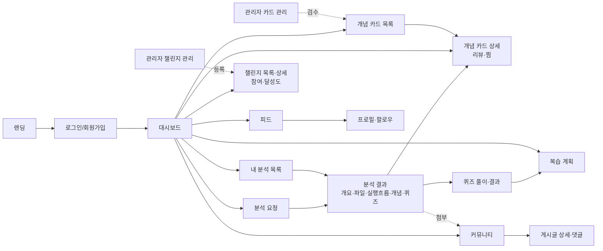
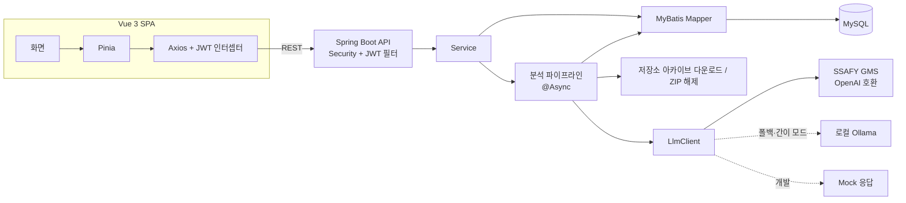
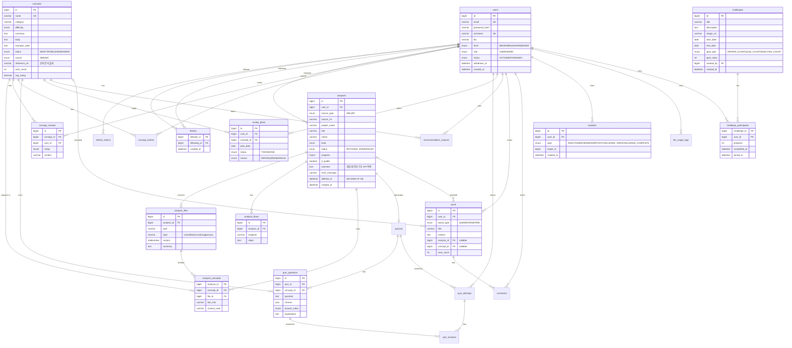

# 바이브노트 (VibeNote) 기획서

> SSAFY 관통 프로젝트 · `/project-interview` 로 작성 중

## 진행 상태

| 단계 | 내용 | 상태 |
|---|---|---|
| Phase 0 | 기본 정보 | ✅ |
| Phase 1 | 아이디어·타깃·핵심가치 | ✅ |
| Phase 2 | 기능 명세·MVP | ✅ |
| Phase 3 | 기술 스택·아키텍처·ERD | ✅ |
| Phase 4 | 일정·역할 분담 | ✅ |
| Phase 5 | 리스크·정리 | ✅ |
| Phase 6 | 2차 기획 (MVP 이후): 검증·기능 확장·UI·AI (6절) | ✅ (11-25, 김준섭 합의 11-26 대면 확정, 7.5절) |
| Phase 6.1 | 2차 점검 세부 (11-26): 1단계 학습 루프·AI 기준·카드 → 2단계 UI → 3단계~ 운영 (6.1절) | 🟡 1단계·일정 재배치 (11-26) → 7절 재인터뷰의 후보로 |
| Phase 7 | 재인터뷰: 문제 정의에서 다시 (팀 수준 차이·면접 대비 포함, 7절) | 🟡 1~4단계 ✅ (문제·목표, 해결 방식, 재정렬, 일정·역할) · 김준섭 합의 ✅ (11-26 대면, 7.5절) · 5단계 UI(11/27 Figma 뒤) · 6단계 운영 🟡 (배포·시연 데이터·한도 ✅ 7.6절, 모델 배정·보안 가드 남음) · 하네스 동결 해제·로드맵·개선 7.7절 |

(⬜ 시작 전 · 🟡 진행 중 · ✅ 완료)

---

## 0. 기본 정보

| 항목 | 내용 |
|---|---|
| 팀 구성 | 2인 (김동환·김준섭). W1은 릴레이(교대)로, 11-19부터는 **영역별 병렬 개발**(4절 역할 분담). 같은 사람의 PC 사이에서는 인계 문서로 교대 |
| 기간 | 2026-11-17 시작 ~ 2026-12-24 발표 (약 5주) |
| 필수 기술 스택 | **BE** Java 17+, Spring Boot, MyBatis, Tomcat · **FE** HTML/CSS/JavaScript, Vue.js · **DB** MySQL · **도구** STS, VS Code, MySQL Workbench, Git/GitLab |
| 관통 필수 요구사항 | ① 로그인·로그아웃 ② 회원가입 ③ 커뮤니티 게시판 ④ 커뮤니티 댓글 ⑤ 회원 프로필 관리 ⑥ 팔로우/팔로잉 ⑦ 콘텐츠 데이터 관리 ⑧ 콘텐츠 목록 조회/검색 ⑨ 콘텐츠 상세 정보 조회 ⑩ 리뷰 작성/조회 ⑪ 콘텐츠 찜/즐겨찾기 ⑫ 추가(계획/챌린지) 기능 ⑬ AI 활용 알고리즘 |
| 주제 제한 | IT/개발 관련 도메인 안에서 자유. 계획/챌린지와 AI 알고리즘의 세부 조건은 따로 없음 |
| 공식 명세서 | Final Project 명세서(Java Track, 13회차 "냠냠코치"). 자율 프로젝트라 주제는 따르지 않지만 **필수·추가·심화 기능 구조와 제출 산출물 목록**은 따른다 (2절 "명세서 구조 매핑", 산출물은 `docs/산출물/`과 루트 `README.md` 참고). 명세서는 대외비이므로 저장소에 올리지 않는다 |
| 저장소 | 개발은 **GitHub private 저장소**(Actions CI), 최종 산출물만 **lab.ssafy.com(GitLab)**에 제출 |
| 제출물 | 설계 문서(요구사항 정의서, Use-Case Diagram, ERD, WBS, Gantt Chart, 화면 설계서), 구현 결과물(BE·FE 소스, DB Schema.sql, 활용 데이터 셋), 결과 정리(최종 보고서, 발표 자료, 외부 API·생성형 AI 활용 문서). `Final_[주제명]_지역_반_성명1_성명2.zip` |

## 1. 프로젝트 개요

- **한 줄 정의** (11-26 개정): AI로 개인·팀 프로젝트를 만드는 개발자 지망생과 주니어가, AI가 쓴 코드를 **내 수준에 맞는 설명·개념 카드·퀴즈**로 진짜 내 지식으로 만들고, **(팀이라면 팀원과 함께) 내 프로젝트를 근거를 들어 설명할 수 있게** 되는 코드 이해 학습 플랫폼
- **서비스 목표(성공 기준)** (11-26): 사용자가 내 프로젝트의 구조·핵심 흐름·기술 선택 이유를 설명하고, **내가 만들지 않은 부분을 포함한** 예상 질문에 코드 근거(파일:줄)를 들어 답할 수 있게 된다. 퀴즈 정답·학습한 카드·복습은 그 과정 지표다.
- **시연 주인공** (11-26): AI로 팀 프로젝트를 만든 팀. 입문 팀원이 다른 팀원이 만든 부분(예: 로그인·JWT)을 내 수준으로 이해 → 퀴즈·오답 노트 → 팀 약점 레이어 → 예상 질문에 근거를 들어 답하기 (문제 1·5·6·7을 한 이야기로)
- 이전 한 줄 정의(11-17): AI로 코딩하는 주니어와 개발자 지망생을 위해, AI가 쓴 코드를 내 수준에 맞는 구조 설명과 개념 카드로 풀어 주고, 퀴즈와 복습으로 진짜 내 지식으로 만드는 코드 이해 학습 플랫폼
- **서비스 이름(가칭)**: 바이브노트 (VibeNote)

### 해결할 문제

AI 기반 바이브 코딩이 퍼지면서 비전공자와 주니어도 소프트웨어를 빠르게 만들 수 있게 되었다. 하지만 AI가 쓴 코드를 충분히 이해하지 못한 채 개발이 진행되면서 다음 문제가 생긴다.

1. **AI 생성 코드를 이해하지 못함**: 코드가 정상 동작해도 전체 구조, 실행 흐름, 설계 의도를 알지 못한다.
2. **검증 결과를 판단하기 어려움**: AI 코드 리뷰·검증 도구는 많다. 하지만 결과에 담긴 기술 개념이나 수정 권장 사항을 이해하지 못해, 검증 결과를 다시 다른 AI에 물어보게 된다.
3. **토큰과 문맥 관리 부담**: 코드를 이해하려고 프롬프트를 반복해서 써야 하고, 쉬운 설명을 요청할 때마다 토큰이 추가로 든다. 프로젝트가 커질수록 전체 문맥을 전달하고 유지하기 어려워진다.
4. **프로젝트 전체 구조가 보이지 않음**: 파일이나 함수 단위 설명만으로는 프로젝트 전체가 어떻게 동작하는지 알기 어렵다.
5. **이해한 내용이 학습으로 이어지지 않음**: AI의 설명과 수정 제안이 일회성 대화로 끝나서, 알게 된 지식을 기록하고 복습하기 어렵다.
6. **팀원마다 수준이 달라 같은 프로젝트를 다르게 이해함** (11-26 재정의): 같은 팀 프로젝트를 AI로 만들어도 팀원마다 수준이 달라 이해하는 부분이 다르고, 내가 만들지 않은 부분은 설명하지 못한다. 분석 결과와 학습 내용을 팀이 함께 볼 환경도 없다.
7. **내 프로젝트를 설명하지 못함 (포트폴리오·면접)** (11-26 추가): AI로 만든 프로젝트를 포트폴리오로 내지만, 전체 구조와 기술 선택의 이유를 남에게 설명하지 못하고 면접의 "이 코드 왜 이렇게 짰어요?", "다른 팀원이 만든 부분은요?"에 답하지 못한다. 문제 1~6을 해결한 결과가 마지막으로 시험받는 자리다.

> **문제 2의 대응 방식** (11-26): 별도 검증 도구(F-22)를 만들지 않고, 설명의 "근거 있는 위험"(senior)·흔한 오해·개념 카드 연결로 **지적 사항을 이해할 바탕**을 준다.

### 타깃 사용자 / 페르소나

| 페르소나 | 상황 | 원하는 것 |
|---|---|---|
| **A. 비전공 개발자 지망생** (부트캠프·SSAFY 교육생) | AI로 프로젝트를 완성했지만 면접에서 "이 코드 왜 이렇게 짰어요?"라는 질문에 답하지 못한다 | 내 프로젝트 코드를 쉬운 말로 이해하고, 모르는 개념을 체계적으로 공부하고 싶다 |
| **B. 1~3년차 주니어 개발자** | 업무에서 Copilot이나 Claude로 코드를 생성하지만, 리뷰 지적 사항이나 설계 의도를 완전히 이해하지 못한다 | 생성된 코드를 검증할 수 있을 만큼 이해하고, 팀과 지식을 공유하고 싶다 |

**주 타깃은 A** (11-26): 기능 우선순위·시연 시나리오는 A(AI로 개인·팀 프로젝트를 만들어 포트폴리오·면접에 쓰는 지망생)를 기준으로 정한다. 개인 프로젝트도 같은 흐름(팀 기능만 빠짐)으로 쓸 수 있어야 한다. B는 같은 기능의 senior 수준으로 다룬다.

### 기존 대안과 한계

| 대안 | 한계 |
|---|---|
| ChatGPT·Claude·Copilot Chat에 직접 질문 | 대화가 일회성이라 기록이 남지 않는다. 매번 문맥을 다시 전달해야 해서 토큰 부담이 크고, 설명 수준이 들쭉날쭉하다 |
| CodeRabbit 등 AI 코드 리뷰 도구 | 전문용어 중심이라 주니어가 지적 사항이 맞는지 판단하기 어렵다. 이해와 학습을 돕는 기능이 없다 |
| 블로그·강의로 따로 학습 | 내 코드와 연결되지 않아 실제 코드에 적용하기 어렵다 |

### 핵심 가치·차별점

1. **분석이 학습 자산으로 남는다**: 코드를 분석하면 개념 카드, 퀴즈, 복습 일정이 만들어져 계속 쌓인다.
2. **수준별 설명**: 비전공자나 주니어 수준에 맞춰 설명하므로, 결과를 다시 다른 AI에 물어볼 필요가 없다.
3. **팀 지식 공유**: 분석 결과, 개념 카드, 이해도를 팀과 공유한다. (확장 기능) → 11-26: **같은 프로젝트를 팀원이 각자 수준으로 이해**하고, 팀이 약한 부분을 함께 메운다 (문제 6).
4. **내 프로젝트를 설명할 수 있게 된다** (11-26 추가, 문제 7): 일반 AI 대화로도 면접 질문은 만들 수 있지만, 바이브노트는 **내 코드에 근거(파일:줄)를 둔 질문과 답**을 만들고, 답하지 못한 부분을 카드·퀴즈·복습으로 이어 기록으로 남긴다.

### 서비스 범위의 핵심 정의

- **콘텐츠 = 개념 학습 카드**: 코드 분석에서 추출한 개념(JWT, 트랜잭션, DI 등)을 쉬운 설명과 예제 코드가 담긴 카드로 만들어 모아 둔다. 필수 요구사항 ⑦~⑪(관리, 목록/검색, 상세, 리뷰, 찜)이 모두 개념 카드를 대상으로 한다. 이미 만들어진 카드를 재사용하므로 AI 호출과 토큰도 줄어든다.
- **분석 입력**: 공개 GitHub/GitLab 저장소 URL 또는 ZIP 업로드
- **분석 범위 제한**: 지원 스택은 Java, Spring, MyBatis, JavaScript, Vue로 한정한다. 최대 200개 파일, 10MB까지 받고 node_modules와 빌드 산출물은 제외한다. 비공개 저장소는 지원하지 않는다.
- **계획/챌린지 (필수 ⑫)**: ① 내 코드를 바탕으로 한 이해 퀴즈와 복습 계획 ② 학습 챌린지(관리자가 기간·목표를 정하고 사용자가 참여, 달성도 자동 집계) ③ 팀 챌린지(모듈별 이해도 공유, P2)
- **확장 기능 후보**: 팀 협업 공간, 쉬운 말로 풀어 쓴 검증 결과, 프로젝트 구조 시각화 → 우선순위는 Phase 2에서 정한다

## 2. 기능 명세

### 핵심 사용자 시나리오

1. **가입**: 회원가입할 때 내 수준(입문/주니어/숙련)을 고른다.
2. **분석 요청**: AI로 만든 내 프로젝트의 공개 저장소 URL을 등록하거나 ZIP 파일을 올린다.
3. **구조 이해**: 내 수준에 맞춘 프로젝트 개요와 파일별 설명을 읽는다. 궁금한 기능(예: 로그인 API)을 골라 실행 흐름 설명을 요청한다.
4. **개념 학습**: 코드에서 추출된 개념 카드(JWT, 트랜잭션 등)를 열어 공부하고, 중요한 카드는 찜한다.
5. **확인**: 내 코드로 만든 이해 퀴즈를 푼다. 틀린 개념은 복습 계획에 자동으로 추가된다.
6. **재방문**: 대시보드에서 오늘 복습할 카드와 맞춤 추천 카드를 학습한다. 참여 중인 학습 챌린지의 달성도를 확인한다. 팔로우한 사람의 활동 피드를 본다.
7. **질문·공유**: 이해가 막히면 분석 결과나 카드를 첨부해 커뮤니티에 질문하고, 댓글로 답을 받는다.

### 기능 목록

| ID | 기능 | 설명 | 우선순위 | 필수 요구사항 |
|---|---|---|---|---|
| F-01 | 회원가입 | 이메일·비밀번호·닉네임 입력, 학습 수준(입문/주니어/숙련) 선택 | P0 | ② |
| F-02 | 로그인·로그아웃 | JWT(Access + Refresh) 발급·재발급, 로그아웃 시 Refresh 토큰 폐기 | P0 | ① |
| F-03 | 프로필 관리·회원 탈퇴 | 닉네임·소개·수준 수정, 학습 통계(분석 수, 학습한 카드, 퀴즈 정답률). 탈퇴는 비활성화(`status=WITHDRAWN`) 방식으로 개인정보를 마스킹하고 Refresh 토큰을 폐기하며, 작성한 글은 "탈퇴한 사용자"로 표시 | P0 | ⑤ |
| F-04 | 팔로우·활동 피드 | 팔로우/언팔로우, 팔로워·팔로잉 목록, 팔로우한 사람의 공개 활동(분석·리뷰·찜·게시글) 피드 | P0 | ⑥ |
| F-05 | 분석 요청 | 공개 GitHub/GitLab URL 또는 ZIP 업로드. 지원 스택과 크기(200파일·10MB) 검증, .env와 키 패턴 제거, 분석할 때마다 수준 변경 가능 | P0 | ⑬ |
| F-06 | 개요·파일별 설명 | 프로젝트 목적, 레이어 구조, 주요 파일의 역할을 수준에 맞춰 설명 | P0 | ⑬ |
| F-07 | 실행 흐름 설명 | 탐지된 API 목록에서 사용자가 고른 1~3개만, 요청할 때 요청→응답 흐름을 단계별로 설명(결과 캐시) | P0 | ⑬ |
| F-08 | 개념 카드 추출·연결 | 코드에 쓰인 개념을 추출해 기존 카드와 연결하고, 없는 개념만 AI가 초안 카드를 생성(검수 대기) | P0 | ⑦ ⑬ |
| F-09 | 개념 카드 목록·검색 | 키워드·카테고리·난이도 필터, 인기순·최신순 정렬 | P0 | ⑧ |
| F-10 | 개념 카드 상세 | 쉬운 설명, 예제 코드, 내 코드에서 등장한 위치, 관련 카드 | P0 | ⑨ |
| F-11 | 카드 리뷰 | 별점과 한 줄 리뷰("이해에 도움이 됐나요?") 작성·조회 | P0 | ⑩ |
| F-12 | 카드 찜 | 찜하기/해제, 내 찜 목록 | P0 | ⑪ |
| F-13 | 관리자 카드 관리 | 시드 카드 등록(80개 이상, 카테고리 6종), AI 초안 검수(수정·공개·삭제) | P0 | ⑦ |
| F-14 | 코드 이해 퀴즈 | 분석한 코드로 객관식 5~10문항을 생성하고 채점·해설. 오답 개념을 기록 | P0 | ⑫ ⑬ |
| F-15 | 복습 계획 | 오답·찜 카드를 날짜별 복습 목록에 담고 완료 체크 | P0 | ⑫ |
| F-16 | 맞춤 개념 카드 추천 | 규칙 기반 가중치 점수(퀴즈 오답, 내 코드에 나온 개념, 찜, 수준)로 다음 학습 카드를 추천하고, AI가 추천 이유를 한 줄로 설명 | P0 | ⑬ |
| F-17 | 커뮤니티 게시판 | 게시판 종류 `QNA`(코드 이해 Q&A)·`REVIEW`(학습 후기)·`FREE`(자유). 게시글 작성·조회·수정·삭제·목록·검색(종류별 필터), 분석 결과나 개념 카드 첨부 | P0 | ③ |
| F-18 | 댓글 | 게시글 댓글 작성·조회·수정·삭제 (수정·삭제는 본인만) | P0 | ④ |
| F-19 | 분석 관리 | 분석의 제목·메모 수정, 공개/비공개 설정, 삭제(파일·흐름·개념 연결 함께 삭제, 퀴즈 풀이 기록은 유지). 공개한 분석은 피드와 게시글 첨부에 사용 | P0 | ③ ⑥ ⑦ |
| F-20 | 팀 챌린지 | 팀 생성·초대, 공동 분석의 모듈별 이해도(퀴즈 결과) 공유, 기간 목표 | P2 | ⑫ 확장 |
| F-21 | 구조 시각화 | 분석 결과로 아키텍처와 데이터 흐름을 mermaid 다이어그램으로 렌더링 | P1 | 확장 |
| F-22 | 쉬운 검증 결과 | 코드 개선점이나 위험 요소를 쉬운 말로 설명하고, 관련 개념 카드와 연결 | P2 | 확장 (2차 T3: 동결 때 버릴 1순위, 6절) |
| F-23 | 망각곡선 자동 복습 | 오답 개념을 1·3·7일 간격으로 자동 스케줄링 | P2 | 확장 (2차 T2, 6절) |
| F-24 | 학습 챌린지 관리 | 관리자가 챌린지를 등록·조회·수정·삭제: 제목, 설명, 기간, 대표 이미지(jpg·png·webp, 2MB 이하), 목표 유형(`REVIEW_COUNT` 개념 복습 n회 / `QUIZ_COUNT` 퀴즈 n회 / `ANALYSIS_COUNT` 분석 n회)과 목표값 | P0 | ⑫ |
| F-25 | 챌린지 참여·달성도 | 챌린지 목록·상세, 참여·취소, 기간 안의 활동(review_plans 완료, quiz_attempts, analyses)으로 달성도 자동 집계, 완료 표시, 내 챌린지 목록. 참여·완료는 피드 활동으로 기록 | P0 | ⑫ ⑥ |

**필수 요구사항 매핑 점검**: ①F-02 ②F-01 ③F-17 ④F-18 ⑤F-03 ⑥F-04 ⑦F-08·F-13·F-19 ⑧F-09 ⑨F-10 ⑩F-11 ⑪F-12 ⑫F-14·F-15·F-24·F-25 ⑬F-05~08·F-14·F-16. 13개 모두 P0에 매핑됨 ✅

### 명세서 구조 매핑

공식 명세서(냠냠코치)의 필수·추가·심화 구조를 바이브노트 기능에 대응시킨 표다. 평가 기준에 빠지는 항목이 없도록 이 표로 점검한다.

| 명세서 구분 | 명세서 요구사항 (냠냠코치 기준) | 바이브노트 기능 |
|---|---|---|
| 필수 · 핵심 데이터 | 식단 작성·조회(목록·상세)·수정·삭제 (F1301~F1304) | 분석: F-05 작성, F-06 상세 조회, 내 분석 목록, F-19 수정·삭제 |
| 필수 · 분석 | 식단 분석, 점수 등으로 표현 (F1305) | F-06·F-07 수준별 설명, F-14 이해도 퀴즈 점수, F-03 학습 통계 |
| 필수 · 회원 | 가입·조회·수정·삭제(비활성화)·로그인/로그아웃 (F1306~F1310) | F-01, F-02, F-03 |
| 추가 · 회원 | 팔로우 등록·조회·삭제 (F1311) | F-04 |
| 추가 · 챌린지 | 챌린지 정보 CRD(기간·설명·이미지), 참여·달성도 (F1312·F1313) | F-24, F-25 |
| 추가 · 커뮤니티 | 여러 게시판 CRUD, 댓글 CRUD (F1314·F1315) | F-17 (게시판 3종), F-18 |
| 심화 · AI | 생성형 AI 기능 2개 (F1316·F1317) | F-06·F-07 수준별 설명, F-08 개념 추출, F-14 퀴즈 생성, F-16 추천 이유 |
| 비기능 | 편의성·가용성(다양한 디바이스)·응답성·정확성 (NF1301~NF1304) | 아래 비기능 요구사항 NF-01~NF-07 |

### 비기능 요구사항

| ID | 분류 | 요구사항 | 검증 방법 |
|---|---|---|---|
| NF-01 | 사용성 | 사전 지식이 없는 사용자도 가입 후 안내 없이 분석 요청까지 할 수 있다. 랜딩에서 샘플 분석 결과를 미리 보여 준다 | 시연 시나리오 점검 |
| NF-02 | 반응형 | 375px(모바일)~1440px(데스크톱) 폭에서 가로 스크롤 없이 모든 화면을 사용할 수 있다 | `ui-verifier` 모바일·데스크톱 점검 |
| NF-03 | 응답성 | 목록·검색 API는 시드 데이터 기준 500ms 이내에 응답한다. 분석 요청은 1초 이내에 202로 접수하고 처리는 비동기로 한다 | 통합 테스트 응답 시간 측정 |
| NF-04 | 정확성 | 공개되는 개념 카드는 관리자 검수(`PUBLISHED`)를 거친 것만 노출한다. LLM 출력은 JSON 스키마로 검증하고 실패하면 1회 재시도한다. 지원 스택 외 코드는 분석하지 않는다 | 단위·통합 테스트, `prompt-evaluator` |
| NF-05 | 보안 | 비밀번호 BCrypt 해시, JWT 인증·인가, 업로드 파일 형식·크기 제한, Zip Slip·SSRF 방어, 업로드 코드의 `.env`·키 패턴 제거 | `reviewer` 보안 점검 항목, 테스트 |
| NF-06 | 가용성 | LLM 장애나 한도 초과 시 Ollama로 자동 전환하고, 생성 결과(카드, 흐름, 추천 이유)는 캐시해 재사용한다 | Mock 장애 테스트 |
| NF-07 | 비용 | 사용자별 일일 분석 횟수를 제한하고 모든 LLM 호출의 토큰 사용량을 기록한다 | `llm_usage_logs` 집계 |

### MVP 범위

- **P0 (F-01~F-19, F-24, F-25)**: 개인 학습 흐름(분석 → 설명 → 개념 카드 → 퀴즈 → 복습·추천), 학습 챌린지, 필수 요구사항 13개와 명세서의 필수·추가 구조를 모두 포함한다.
- **P1 (F-21)**: P0가 완성되면 구조 시각화를 붙인다(난이도 낮음).
- **P2 (F-20, F-22, F-23)**: 시간이 남을 때만 진행한다. 팀 챌린지는 학습 챌린지(F-24·F-25)가 챌린지 요구사항을 충족하므로 P2로 내렸다.

### 화면 목록 및 흐름

| 화면 | 주요 내용 | 관련 기능 |
|---|---|---|
| 랜딩 | 서비스 소개, 샘플 분석 미리보기 | - |
| 로그인 / 회원가입 | 수준 선택 포함 | F-01, F-02 |
| 대시보드 | 오늘 복습할 카드, 맞춤 추천 카드, 최근 분석 | F-15, F-16 |
| 분석 요청 | URL 입력 또는 ZIP 업로드, 수준 선택 | F-05 |
| 내 분석 목록 | 분석 이력, 상태(진행 중/완료), 공개 설정 | F-19 |
| 분석 결과 | 탭: 개요 / 파일 / 실행 흐름 / 개념 / 퀴즈 | F-06, F-07, F-08, F-14 |
| 퀴즈 풀이·결과 | 문항, 채점, 해설, 오답을 복습에 추가 | F-14, F-15 |
| 개념 카드 목록 | 검색·필터·정렬 | F-09 |
| 개념 카드 상세 | 설명, 예제, 내 코드 위치, 리뷰, 찜 | F-10, F-11, F-12 |
| 복습 계획 | 날짜별 복습 목록, 완료 체크 | F-15 |
| 챌린지 목록 / 상세 | 진행 중·예정·종료 챌린지, 참여·취소, 내 달성도 | F-25 |
| 커뮤니티 목록 / 상세 / 작성 | 게시판 종류 탭(Q&A·학습 후기·자유), 첨부, 댓글 | F-17, F-18 |
| 피드 | 팔로우한 사람의 공개 활동 | F-04 |
| 프로필 (내 / 타인) | 학습 통계, 팔로우, 찜 목록, 참여 챌린지, 정보 수정·회원 탈퇴 | F-03, F-04, F-12, F-25 |
| 관리자 카드 관리 | 카드 등록, AI 초안 검수 | F-13 |
| 관리자 챌린지 관리 | 챌린지 등록·수정·삭제, 이미지 업로드 | F-24 |

## 3. 기술 스택·아키텍처

| 구분 | 선택 | 이유 |
|---|---|---|
| Frontend | Vue 3 + Vite, Pinia, Vue Router, Axios | 필수 스택. Pinia로 로그인 상태와 사용자 수준을 전역 관리 |
| Backend | Java 21, Spring Boot 4.1, Spring Security + JWT(Access + Refresh), MyBatis, Jackson 3, 내장 Tomcat | 필수 스택. SPA와 REST API를 분리한 구조에 JWT가 적합 |
| DB | MySQL 8 | 필수 스택. 분석 세부 결과는 JSON 컬럼에 저장 |
| AI | `LlmClient` 추상화: SSAFY GMS(OpenAI 호환, 기본 `gpt-4.1-mini`, JSON 스키마로 출력 강제) → 실패하면 재시도 없이 Ollama(로컬, 간이 모드 표시)로 전환, 개발·테스트는 Mock. Gemini는 평가 비교용 | 처음에는 Gemini 무료 등급이 기본이었으나 11-25 SSAFY GMS 키가 나와 교체했다 (F-27, 결정로그 11-25) |
| 저장소 수집 | GitHub·GitLab 공개 저장소의 아카이브 ZIP을 다운로드 | ZIP 업로드와 같은 처리 과정을 재사용하고, git clone이 필요 없음 |
| API 문서 | Swagger (springdoc-openapi). `/swagger-ui/index.html`, 테스트가 `docs/api/openapi.json`을 추출 | 명세서 참고자료. REST API 명세 산출물과 FE·BE 계약 검사의 정본으로 사용 |
| 파일 저장 | 챌린지 이미지는 로컬 `uploads/`에 UUID 파일명으로 저장하고 정적 경로로 제공 | 외부 스토리지 비용·설정 없이 시연 가능 |
| 형상 관리·CI | GitHub 저장소 + GitHub Actions(PR마다 BE·FE 검증). 제출은 lab.ssafy.com | private 무료 플랜의 Actions 한도를 다 써서 11-26부터 개발이 끝날 때까지 public으로 두고, develop·main에 브랜치 보호(PR·필수 CI 5개, 관리자 포함)를 건다. 로컬 hook과 팀 규칙은 그대로 |
| 배포 | Docker Compose(BE·FE nginx·MySQL)를 팀 PC 한 대에서 띄우고 Cloudflare Tunnel로 공개 주소를 낸다 (O-1, 7.6절). 발표는 그 PC 로컬로도 가능 | SSAFY EC2를 받을 수 없고(11-26) 비용·카드 없이 공개 주소가 필요하다. 처음 계획은 로컬 시연 우선 + 여유 시 EC2 |

### 아키텍처 개요

- **비동기 분석**: `POST /api/analyses` 요청을 받으면 바로 `analysisId`를 돌려준다. 분석은 `@Async`로 백그라운드에서 진행하며 단계별 상태를 DB에 기록하고, 프론트는 2~3초마다 상태를 조회(폴링)한다.
- **분석 파이프라인 단계**: `FETCHING`(코드 수집) → `FILTERING`(지원 스택 검사, node_modules·빌드 산출물·.env·키 패턴 제거, 인덱스 상한 파일 2,000개·30MB를 넘는 파일은 버리고 센다, F-26a) → `SELECTING`(Controller·Service·Mapper·Vue 컴포넌트 등 주요 파일 선별) → `EXPLAINING`(수준별 개요·파일 설명) → `EXTRACTING`(개념 추출, 기존 카드와 매칭, 없는 개념은 초안 카드 생성) → `QUIZ`(퀴즈 생성) → `DONE` / `FAILED`
- **실행 흐름**: 분석이 끝나면 탐지된 API 목록에서 사용자가 1~3개를 고르고, 고른 것에 대해서만 생성한다. 결과는 `analysis_flows`에 캐시한다.
- **코드 보관**: 분석에 쓴 주요 파일 내용만 `analysis_files`에 저장한다. 원본 ZIP과 압축 해제 폴더는 분석이 끝나면 삭제한다.
- **AI 비용 관리**: 모든 호출을 `llm_usage_logs`에 기록하고 사용자별 일일 분석 횟수를 제한한다. 개념 카드와 추천 이유는 저장해 두고 재사용한다.
- **맞춤 추천 알고리즘(F-16)**: 카드별 점수 = 퀴즈 오답 수 ×3 + 내 분석에 등장 ×2 + 찜한 카드와 같은 카테고리 ×1 + 수준 적합도(±1). 이미 복습을 완료한 카드는 제외한다. 상위 N개 카드의 추천 이유는 AI가 한 줄로 생성하고 `recommendation_reasons`에 캐시한다.

### ERD 초안

> 위 다이어그램에는 핵심 컬럼만 적었다. `refresh_tokens`, `concept_wishes`, `quizzes`, `quiz_attempts`, `quiz_answers`, `recommendation_reasons`, `comments`, `llm_usage_logs`는 관계만 표시했다. P2용 테이블(`teams`, `team_members`, `team_challenges`)은 P2를 시작할 때 추가한다. 탈퇴한 사용자의 게시글·댓글은 남기고 작성자를 "탈퇴한 사용자"로 표시한다(`users.status`로 판단).

### 주요 API

| 메서드 | URL | 설명 | 관련 기능 |
|---|---|---|---|
| POST | /api/auth/signup | 회원가입(수준 포함) | F-01 |
| POST | /api/auth/login · /logout · /refresh | 로그인, 로그아웃, 토큰 재발급 | F-02 |
| GET·PATCH·DELETE | /api/users/me | 내 프로필 조회·수정, 회원 탈퇴(비활성화) | F-03 |
| GET | /api/users/{id} · /{id}/stats | 타인 프로필, 학습 통계 | F-03 |
| POST·DELETE | /api/users/{id}/follow | 팔로우, 언팔로우 | F-04 |
| GET | /api/users/{id}/followers · /followings | 팔로워·팔로잉 목록 | F-04 |
| GET | /api/feed | 팔로우한 사람의 공개 활동 피드 | F-04 |
| POST | /api/analyses | 분석 요청(URL 또는 ZIP multipart) → analysisId 반환 | F-05 |
| GET | /api/analyses · /{id} · /{id}/status | 내 분석 목록, 분석 결과(개요), 진행 상태 | F-05, F-06 |
| PATCH·DELETE | /api/analyses/{id} | 분석 제목·메모 수정, 분석 삭제 | F-19 |
| GET | /api/analyses/{id}/files · /files/{fileId} | 파일별 설명 목록, 파일 단건(코드 포함) | F-06 |
| POST·GET | /api/analyses/{id}/flows | 실행 흐름 생성 요청(1~3개) 및 조회 | F-07 |
| GET | /api/analyses/{id}/concepts | 이 분석에서 추출한 개념 카드 | F-08 |
| PATCH | /api/analyses/{id}/visibility | 공개/비공개 설정 | F-19 |
| GET | /api/concepts?keyword=&category=&difficulty=&sort= | 카드 목록·검색 | F-09 |
| GET | /api/concepts/{id} | 카드 상세(내 코드 등장 위치 포함) | F-10 |
| GET·POST | /api/concepts/{id}/reviews | 리뷰 조회·작성 | F-11 |
| POST·DELETE | /api/concepts/{id}/wish | 찜, 찜 해제 | F-12 |
| GET·POST·PUT·DELETE | /api/admin/concepts | 카드 관리, AI 초안 검수(status 변경) | F-13 |
| GET | /api/analyses/{id}/quiz | 퀴즈 조회 | F-14 |
| POST | /api/quizzes/{id}/attempts | 답안 제출 → 채점·해설, 오답을 복습에 추가 | F-14, F-15 |
| GET·POST·PATCH·DELETE | /api/review-plans | 복습 계획 조회(날짜별)·추가·완료 체크·삭제 | F-15 |
| GET | /api/recommendations | 맞춤 카드 추천(점수와 추천 이유) | F-16 |
| GET·POST·PUT·DELETE | /api/posts?boardType=&keyword= | 게시글 CRUD·검색(게시판 종류 필터, 분석·카드 첨부) | F-17 |
| GET·POST | /api/posts/{postId}/comments | 댓글 조회·작성 | F-18 |
| PUT·DELETE | /api/posts/{postId}/comments/{id} | 댓글 수정·삭제(본인) | F-18 |
| GET·POST·PUT·DELETE | /api/admin/challenges | 챌린지 관리(multipart 이미지 업로드) | F-24 |
| GET | /api/challenges?status= · /{id} | 챌린지 목록(진행 중·예정·종료)·상세(내 달성도 포함) | F-25 |
| POST·DELETE | /api/challenges/{id}/participation | 챌린지 참여·취소 | F-25 |
| GET | /api/users/me/challenges | 내 챌린지 목록·달성도 | F-25 |

### P0 기능 구현 매핑 점검

| 기능 | 테이블 | API |
|---|---|---|
| F-01~03 회원·프로필·탈퇴 | users, refresh_tokens | /api/auth/*, /api/users/* |
| F-04 팔로우·피드 | follows, activities | /api/users/{id}/follow, /api/feed |
| F-05~08 분석 | analyses, analysis_files, analysis_flows, analysis_concepts, concepts, llm_usage_logs | /api/analyses/* |
| F-09~13 개념 카드 | concepts, concept_reviews, concept_wishes | /api/concepts/*, /api/admin/concepts |
| F-14 퀴즈 | quizzes, quiz_questions, quiz_attempts, quiz_answers | /api/analyses/{id}/quiz, /api/quizzes/* |
| F-15 복습 계획 | review_plans | /api/review-plans |
| F-16 추천 | quiz_answers, analysis_concepts, concept_wishes, review_plans → recommendation_reasons | /api/recommendations |
| F-17·18 커뮤니티 | posts(board_type), comments | /api/posts/* |
| F-19 분석 관리 | analyses(title, memo, is_public), activities | PATCH·DELETE /api/analyses/{id}, /api/analyses/{id}/visibility |
| F-24·25 학습 챌린지 | challenges, challenge_participants, activities (달성도 집계: review_plans, quiz_attempts, analyses) | /api/admin/challenges, /api/challenges/*, /api/users/me/challenges |

## 4. 일정·역할

### 마일스톤

| 기간 | 목표 | 산출물 |
|---|---|---|
| **W1** 11/17~11/23 | 기획·ERD·API 확정, 하네스·프로젝트 세팅(Swagger·CI 포함), 회원/JWT, LlmClient(Mock·Gemini) 연결 확인, 시드 개념 카드 80개 이상 작성, **설계 산출물**(요구사항 정의서, 유스케이스, WBS, 간트) | 기획서 확정본, DDL, BE·FE 초기 프로젝트, F-01~03, 시드 데이터, `docs/산출물/01~05` |
| **W2** 11/24~11/30 | 분석 파이프라인(수집 → 필터 → 설명), 개념 카드 목록·검색·상세, 화면 설계서 초안 | F-05, F-06, F-09, F-10, `06-화면설계서` 초안 |
| **W3** 12/01~12/07 | 개념 추출, 퀴즈, 복습 계획, 리뷰·찜 | F-08, F-11, F-12, F-14, F-15 · ★ **핵심 흐름 완성** (분석 → 카드 → 퀴즈 → 복습) |
| **W4** 12/08~12/14 | 커뮤니티·댓글, 팔로우·피드, 추천, 실행 흐름, 관리자 검수, 분석 관리, **학습 챌린지** | F-04, F-07, F-13, F-16~19, F-24, F-25 · ★ **P0 전체 완성** |
| **W5** 12/15~12/20 | P1(구조 시각화), 통합 테스트, UI 다듬기, **산출물 정리**(ERD·화면 설계서 최종본, REST API 명세, Schema.sql, 데이터 셋, AI 활용 문서, 최종 보고서 초안) | F-21, 버그 수정, `docs/산출물/` 전체 |
| **버퍼** 12/21~12/24 | 시연용 분석 미리 실행, 발표 자료, 제출 zip 작성과 **lab.ssafy.com 제출**, (여유가 있으면 배포) | 시연 시나리오, 발표 PPT/PDF, `Final_바이브노트_지역_반_성명1_성명2.zip` |

> **일정 판단 기준**: W3 마감(12/07)에 핵심 흐름이 완성되지 않았으면 P1을 모두 포기하고, W4는 P0 완성에만 집중한다.
>
> **11-25 재계획**: P0 21개를 11/24에 끝내 W2~W5를 2차 개발(6절)로 다시 짰다. W2 하네스 개편·감사, W3 GMS·수집 개편·평가 기준선(12/04), W4 커버리지·근거 검증·신뢰성·사용량·재미 요소 → **12/14 T0·T1 기능 동결(M4)**, W5 안정화·시연 E2E·T2·산출물. 작업별 날짜는 `docs/산출물/04-WBS.md` 4·6절.

### 역할 분담

**영역별 병렬 개발**을 한다 (11-19 전환, 그 전 W1은 릴레이). 두 사람이 각자 영역의 기능을 자기 `feature/F-xx-slug` 브랜치에서 동시에 개발하고, 같은 사람의 PC 사이(SSAFY 교육장 ↔ 집)에서는 사람별 NOW 파일(`docs/handoff/NOW-dh.md`·`NOW-js.md`)로 교대한다. **영역 오너**는 자기 영역의 FE·BE 구현, PR 머지(CI·Codex·reviewer 지적 반영 확인), 최종 동작 확인을 책임진다. 코드 리뷰는 사람이 아니라 reviewer 에이전트와 Codex 봇이 한다.

| 팀원 (GitHub, PC) | 영역 오너 (구현·머지·최종 확인) |
|---|---|
| A 김동환 (`whans1996`, dh-ssafy·dh-home) | **AI·분석·학습 루프**: 분석 파이프라인, LlmClient(Gemini·Ollama·Mock), 개념 추출, 실행 흐름, 퀴즈, 복습 계획, 맞춤 추천, 분석 관리, 학습 챌린지 (F-00, F-05~08, F-14, F-15, F-16, F-19, F-24, F-25, P1 F-21). 하네스 유지보수, 주간 `/progress`. **11-26 합의로 팀(F-20a~c·T-1)·시드 카드 생성·검수(K-3)·S-1과 자기 기능 FE도 A** (7.5절) |
| B 김준섭 (`JoonseobKim`, js-ssafy·js-home) | **카드·소셜**: 회원·JWT, 개념 카드 목록·상세·리뷰·찜·관리자, 커뮤니티·댓글, 팔로우·피드 (F-01~04, F-09~13, F-17, F-18, P2 F-20). 시드 카드(`R__seed_concepts.sql`). **11-26 합의로 팀·시드 생성은 A로 넘기고 F-29·LP-1·U-1·평가 실행에 집중** (7.5절) |

> F-01~03은 W1 릴레이 중 김동환이 구현했다. F-15·F-24·F-25는 11-19에 B에서 A로 옮겼다 (남은 기능 8 : 8, `docs/결정로그.md`).
> 산출물 담당은 WBS(`docs/산출물/04-WBS.md`)의 A/B 표기를 따른다.

### 협업 규칙

- **상태 기록**: 3가지를 운영한다.
  - `CLAUDE.md`: 프로젝트 규칙, 폴더 구조, 실행 방법, 코딩 컨벤션. AI 코딩 도구가 문맥을 바로 파악하게 한다.
  - 사람별 NOW 파일(`docs/handoff/NOW-<dh|js>.md`, 덮어쓰기)과 `docs/작업로그.md`(맨 아래 추가, 헤더 `## 날짜 시각 · 작업자 · PC id · 브랜치`는 `node scripts/stamp.mjs --log`로 쓴다).
  - GitHub Issues: 후속 작업을 `follow-up` 라벨로 관리한다.
  - PC를 옮기기 전에는 반드시 커밋하고 push한다. 작업 중인 코드는 `wip(F-xx):` 커밋으로 남긴다.
- **저장소**: 개발은 GitHub private 저장소(`origin`), 최종 제출은 lab.ssafy.com GitLab(`gitlab` 원격). GitLab push는 제출 때 사람이 직접 한다.
- **Git 브랜치 전략**: `main`(마일스톤 단위 안정 버전) ← `develop`(통합) ← `feature/F-05-analysis` 형식. feature 브랜치는 develop에 **PR**로 합친다. 상대가 develop에 머지한 것은 `git merge origin/develop`으로 받는다 (rebase·force push 금지). 상대 브랜치에는 커밋하지 않는다.
- **공유 파일**: 작업로그·결정 로그는 `merge=union`이라 충돌하지 않는다. 진행현황·WBS·간트는 주간 `/progress` docs PR로만 고친다. `docs/api/openapi.json`이 충돌하면 한쪽을 고른 뒤 `OpenApiExportTest`로 다시 생성한다. Flyway 번호는 `node scripts/next-migration.mjs`로 확인한다.
- **CI와 머지 규칙**: PR마다 GitHub Actions가 BE·FE 검증, API 명세(openapi.json) 일치, 마이그레이션 번호, 하네스 스크립트를 검사한다. **CI가 초록일 때만** 영역 오너가 자기 PR을 머지한다. 공통 코드(설정·보안·전역 예외·라우터·레이아웃·공용 컴포넌트)를 바꾼 PR은 본문에서 상대를 @멘션한다. wip 커밋이 섞인 PR은 Squash 머지한다. 11-24에 저장소를 public으로 바꾸고 11-26부터 develop·main에 브랜치 보호(PR 필수, 필수 CI 5개, 관리자 포함)를 걸었다. Codex COMPLETE는 필수 체크가 아니라 이 규칙과 로컬 git hook으로 지킨다.
- **커밋 컨벤션**: `타입(기능ID): 요약`. 예: `feat(F-05): 분석 요청 API 추가`. 타입은 `feat` / `fix` / `refactor` / `docs` / `chore` / `test` / `wip`
- **회의/리뷰**: 정기 회의 없이 비동기로 운영한다. 작업로그와 GitHub Issues, PR 코멘트로 소통한다. 리뷰는 reviewer 에이전트와 Codex 봇이 하고, 영역 오너는 지적 반영을 확인한 뒤 머지한다. 마일스톤 마감일(일요일)에는 `/progress`로 일정 판단 기준에 맞는지 점검한다.

## 5. 리스크·오픈 이슈

| 구분 | 내용 | 대응 |
|---|---|---|
| 리스크 | 범위 과다: URL과 ZIP 입력, 퀴즈와 팀 챌린지, 확장 기능까지 모두 넣으면 2인 5주에 벅참 | 팀 챌린지와 구조 시각화는 P1, 검증 결과와 망각곡선은 P2로 분리. 12/07 판단 기준으로 P1 포기 여부 결정 |
| 리스크 | LLM 비용과 토큰 한도: 저장소 전체를 분석하면 호출량이 많음 | 주요 파일만 골라 분석하고, 분석 결과와 개념 카드를 DB에 캐시해 재사용. 사용자별 일일 분석 횟수 제한 |
| 리스크 | 저장소 분석 품질: 구조나 흐름을 잘못 설명할 수 있음 | 지원 스택을 제한하고 프롬프트 템플릿을 고정. 시연용 샘플 저장소로 미리 검증 |
| 리스크 | 업로드 코드 보안: 코드에 API 키나 비밀번호가 들어 있을 수 있음 | 분석 전에 .env와 키 패턴을 걸러냄. 분석에 쓴 파일만 DB에 저장하고 원본 ZIP과 압축 해제 폴더는 삭제 |
| 리스크 | 기술 난이도: Spring의 @Async, 파일 업로드, 외부 HTTP 호출, JSON 컬럼 매핑을 처음 다룸 | W1에 LlmClient 연결과 ZIP 처리를 먼저 프로토타입으로 검증 |
| 리스크 | 병렬 개발 중 공유 파일(마이그레이션 번호, openapi.json, 공통 코드)이 충돌하거나 방향이 어긋날 수 있음 | 사람별 NOW 파일, 기록 파일 union 머지, 마이그레이션 번호 CI 검사, 공통 코드 PR은 상대 @멘션, 일요일 `/progress` 점검 |
| 리스크 | P0 기능이 19개로 많음. 분석 4종과 추천 때문에 AI 호출량과 개발량이 큼 | 3주차까지 분석→카드→퀴즈 핵심 흐름을 먼저 완성. 분석 단계별 결과를 DB에 저장해 재호출 방지 |
| 리스크 | 무료 LLM 한도: Gemini 무료 등급의 분당·일일 호출 한도에 걸리면 시연 중 실패할 수 있음 | Ollama 폴백, 결과 캐시, 시연용 분석은 미리 실행해 저장 |
| 리스크 | 무료 등급 데이터 정책: 입력한 코드가 모델 학습에 쓰일 수 있음 | 이용 안내에 명시하고, 시연에는 샘플 저장소 사용 |
| 리스크 | 명세서 대비 누락: 자율 주제라 명세서의 필수·추가 구조나 제출 산출물을 놓칠 수 있음 | 2절 "명세서 구조 매핑"과 `/progress`의 산출물 준비 현황으로 매주 점검 |
| 리스크 | W4 과부하: 학습 챌린지(F-24·F-25) 추가로 W4 기능이 많아짐 | 챌린지 달성도는 기존 테이블 집계로 단순하게 구현. 12/07 판단 기준에 걸리면 F-07·F-16 범위를 줄임 |
| 리스크 | (public 전환 전) GitHub 무료 private 저장소는 브랜치 보호가 적용되지 않음. 11-26 브랜치 보호 뒤에는 Codex COMPLETE만 필수 체크 밖에 남음 | 브랜치 보호(PR·필수 CI 5개), 로컬 git hook, Claude hook, "Codex COMPLETE 후 머지" 규칙 |
| 리스크 | 산출물 몰아 쓰기: 보고서·다이어그램을 마지막 주에 몰아서 만들면 품질 저하 | 설계 산출물은 W1에 완성하고, 작업로그에 AI 활용 사례를 계속 기록 |
| 리스크 | 데이터 라이선스: 공식 문서·오픈소스 코드를 복사하거나 라이선스 없는 저장소를 쓰면 제출물에 문제 | 카드는 직접 작성 + `reference_url`, Oracle·Swagger·MDN 글은 링크만, 외부 데이터는 `data/datasets.json` 등록 후 사용 (`09-데이터셋.md`) |
| 리스크 | 평가 데이터 누수·사전학습 오염으로 분석 품질이 부풀려짐 | dev/eval 분리, 팀 생성 평가 저장소, 블라인드 라벨, 오염 그룹 분리 보고 |
| 오픈 이슈 | SSAFY LLM 키 제공 시점과 사용 가능한 모델 | 키를 받으면 LlmClient 구현체만 추가 |
| 오픈 이슈 | Gemini 무료 등급의 현재 호출 한도, 두 사람 PC의 Ollama 구동 가능 여부 | 개발 1주차에 확인 |

### 다음 액션

1. **LLM 확인 (가장 큰 리스크)**: Gemini API 키를 발급받고 무료 한도를 확인한다. 두 사람 PC에서 Ollama가 도는지 테스트하고, SSAFY 키 제공 일정을 문의한다.
2. **프로젝트 뼈대**: GitHub private 저장소를 연결하고 Spring Boot·Vue 초기 프로젝트(Swagger, CI 포함)를 만든다. (`CLAUDE.md`, `docs/작업로그.md`, 하네스는 완료)
3. **DB와 시드 데이터**: ERD를 MySQL DDL로 옮기고, 시드 개념 카드 목록(80개 이상, 카테고리 6종)을 정한다.
4. (선택) GitHub Issues·Milestones로 F-01~F-25와 W1~W5를 등록한다.

---

## 6. 2차 기획 (MVP 이후)

> 11-23 결정. `/project-interview`가 위 "진행 상태" 표의 Phase 6에서 이 절을 채운다.

**시작 조건**: P0 21개(F-01~F-19, F-24, F-25)가 모두 develop에 머지된 직후에 시작한다. 그 전에 `/project-interview`를 실행하면 Phase 6은 건너뛴다. 그때까지 떠오르는 아이디어는 GitHub 이슈 **`idea` 라벨**로 모은다. 제목 접두어는 `[검증]`·`[확장]`·`[UI]`·`[AI]`로 쓰고, `follow-up` 라벨은 붙이지 않는다(MVP 작업 배너·`/progress` 집계와 분리).

**준비물** (인터뷰 전에 모은다)
- `docs/진행현황.md`, 열린 follow-up 이슈, `gh issue list --label idea`
- `docs/산출물/screens/` 스크린샷 (UI 검토)
- `llm_usage_logs` 토큰 집계, 사람이 요청하면 `prompt-evaluator` 기준선 (Gemini 한도 소모)
- `data/datasets.json`의 eval 분할 (평가 데이터 누수 금지 규칙 확인)

**트랙과 안내 질문**

| 트랙 | 다룰 질문 |
|---|---|
| 검증 | AI 출력 품질을 어떻게 평가할까(WBS 4.1을 앞당길지, eval 저장소·지표), E2E 시연 시나리오, 사용성 테스트 대상, NF-03 응답 시간 측정 |
| 기능 확장 | P1 F-21, P2 F-20b·F-22·F-23, `idea` 이슈 중 무엇을 하고 무엇을 버릴지 |
| UI 변경 | 디자인 방향(일관된 스타일·컴포넌트), 랜딩 SC-01, 반응형·접근성(WBS 4.3) |
| AI | 모델 선택(SSAFY 키 여부), 프롬프트 개선, 비용·한도, 새 AI 기능 |

**산출**: 트랙별 결정을 아래 2차 백로그 표로 정리하고 `docs/결정로그.md`에 남긴 뒤, WBS·간트를 재계획한다(근거를 결정로그에 기록).

> 11-25 인터뷰 결과 (김동환, 김준섭 초안 11-25 08:08 반영). 결정 근거는 `docs/결정로그.md` 11-25 행. **12/14 기능 동결**(T0·T1 대상. T2는 W5에 티어 순서대로 하다가 12/20에 멈춘다, WBS 재계획 결정), 우선순위(T0 → T3)가 곧 컷 순서다. 동결 때 끝나지 않은 뒤 티어는 버린다. ID는 제안이며 `/spec` 때 확정한다.

**확인한 문제 (11-25 감사)**: 분석은 지원 파일 200개를 넘으면 전체 거부(413)되고, 30개 선별이 layer 순서·경로 알파벳순으로 잘려 큰 백엔드 저장소는 FE 파일이 0개 선택된다. ts·tsx·jsx·README는 수집하지 않고, 테스트 파일이 선별 자리를 차지하며, 긴 파일은 앞부분만 남긴다(선별 30개 중 16개 잘림). 흐름은 Spring 전용 2홉, 요청 인터셉터가 있으면 구조 그래프의 FE→BE 간선이 사라진다. Codex 지적 73건(40 PR) 중 62%가 자작 파서 엣지케이스, 14%가 FE 늦은 응답·상태 경합이고, 리뷰·CI는 모두 diff 단위다.

| ID | 내용 | 트랙 | 우선순위 | 영역 | 주차 |
|---|---|---|---|---|---|
| H-1 | 하네스 개편: 커밋 hook은 포맷·린트·관련 단위 테스트만(전체는 pre-push·CI, Gradle 잠금 직렬화), NOW·작업로그·진행현황 자동 초안 + 메모 3줄, guard-bash 셸 토큰 파서화, 안전 명령 허용 목록 확대, `doctor` 점검 명령, 주간 지표(Codex 라운드·가드 차단·토큰). #29 흡수. 끝나면 재동결 | 하네스 | T0 | A | W2 (11/26~28) |
| V-1 | MVP 전체 코드 감사 1회(영역별 에이전트, 검증된 것만 follow-up) + follow-up 즉시 처리(#73·#94·#91) | 검증 | T0 | A·B | W2~W3 |
| F-27 | GMS 공급자: OpenAI 호환 클라이언트, 구조화 출력(JSON 스키마 강제), 단계별 모델 설정, 체인 GMS → Ollama 간이 모드(화면 표시), 동의 문구 GMS 기준 | AI | T0 | A | W3 |
| F-26a | 수집·선별 개편: 413 거부 제거(테스트·생성물·마이그레이션 제외 후 넓게 인덱싱), ts·tsx·jsx·md 수집, 그래프 중심성 기반 중요도 선별, layer 오판 수정, README를 개요 입력에 | AI | T0 | A | W3 |
| F-29 | 디자인 시스템: 11/27 Figma 공동 세션(방향·브랜드 색·토큰), 토큰(라이트·다크, OS 설정 + 토글), Tailwind v4 + Reka UI 공통 PR, 핵심 화면 개편 | UI | T0 | B(공통 PR)·화면은 영역 오너 | W2~W4 |
| V-2 | AI 품질 평가: 김준섭 초안(지표 A~E, DS-03 5개, DS-04 라벨) + 커버리지 지표(파일·FE 반영률, 근거 유효율). 기준선 12/04(GMS v1·Ollama v1), v2 12/12. DS-03·04 12/03 마감(B), DS-03에 200개 초과·TS/React 저장소 포함 → 11-25: 평가 세트 5종 = DS-03 팀 생성 3개 + 공개 DS-02-09·10 (결정로그) | 검증 | T0 | A·B | W3~W4 |
| F-26b | 커버리지 개편: 파일 → 모듈 → 개요 계층 요약, 긴 파일 메서드 단위 분할, 그래프를 따라 흐름 입력 채우기(F-21b 흡수, #24·#26·#121~#125 흡수) | AI | T1 | A | W3~W4 |
| F-21b | #108 근거(파일:줄) 필수 + 기계 검증(존재·그래프 일치), 근거 없는 문장은 버리거나 '추정' 표시 | AI | T1 | A | W4 |
| F-27b | 신뢰성: 수준 기준표 + 수준별 예시(dev 데이터만), 2차 점검 호출(퀴즈 정답 유일성·설명-코드 일치), 단계별 모델 배정(eval로 결정) | AI | T1 | A | W4 |
| F-28 | AI 사용량: 기능별 일일 한도(분석 5회 유지, 질문·오답 해설 신설) + 남은 횟수 표시, 커버리지 표시('분석 n/m 파일')와 요청 시 파일 설명, #113 단계별 진행·부분 결과 | AI·UI | T1 | A(BE)·B(FE) | W4 |
| U-1 | 재미 요소: 실행 흐름 재생(Shiki 하이라이트 이동), 인터랙티브 구조 그래프(mermaid → Vue Flow), 퀴즈·복습 마이크로 보상, 랜딩 스크롤 연출(GSAP) | UI | T1 | B | W4~W5 |
| V-3 | 중간 점검 장치: CI 정적 분석(SpotBugs/PMD)·ArchUnit·JaCoCo, 과거 지적 패턴을 reviewer·`/implement` 체크리스트로, 파서 속성 기반 테스트(jqwik), 주간 전체 감사(일요일 `/progress`와 함께) | 검증 | T1 | A | W3 |
| V-4 | 공통 패턴 정비: FE 늦은 응답 무시·요청 취소 composable, BE 동시 갱신 규칙(원자적 UPDATE·잠금 순서)·활성 회원 확인을 기존 코드에 일괄 적용(#104·#105 흡수) | 검증 | T1 | A(BE)·B(FE) | W3~W4 |
| V-5 | 시연 준비: 핵심 경로 Playwright E2E 자동화, DS-09 데모 데이터, 사전 분석 + 소형 저장소 1개 실시간(실패 시 사전 결과로 전환), 리허설 2회 | 검증 | T1 | 공동 | W5 |
| F-30 | #110 품질 신호: 설명 '이해됐어요/어려워요', 퀴즈 문항 신고 | AI | T2-1 | A | W4~W5 |
| F-31 | #109 퀴즈 오답 개인화 해설(내 코드 기준) + 변형 문항 | AI | T2-2 | A | W5 |
| F-23 | 망각곡선 자동 복습 (F-15 위) | 확장 | T2-3 | A | W5 |
| F-32 | #114 AI 초안 카드 검수 병목: 소유자 미리보기, 중복 후보 표시 | 확장 | T2-4 | A·B | W5 |
| F-33 | #111 코드 Q&A: 저장소 전체 RAG(임베딩, F-26 인덱스 공유), 답변에 근거 필수, 학습 흐름 안 문맥 버튼 + 채팅 패널 | AI | T2-5 | A(BE)·B(FE) | W5 |
| O-1 | 배포(Docker·EC2, 서버는 GMS만) | 확장 | T2-6 | 공동 | W5 |
| F-22 | 쉬운 검증 결과 | 확장 | T3 (버릴 1순위) | - | - |

**역할 재분배** (11-26에 바뀜: A가 자기 기능 FE·K-3·S-1을 맡는다, 6.1절 "역할·운영"): A의 AI 범위가 약 30일 분량(남은 개발일 약 17일)이라, AI 기능의 FE(사용량·커버리지·진행 표시·채팅·피드백 버튼)는 B가 디자인 개편과 함께 맡고 A는 BE·AI에 집중한다 (김준섭 합의 대상).

**트랙별 요약**
- **AI**: Colab 학습은 하지 않는다(GMS 대형 모델 대비 품질 이득 없음). 확실한 분석은 "사실은 정적 분석이, 해설은 AI가" 구조와 근거 검증으로 만든다. 지원 범위는 Spring·Vue 깊게(구조·흐름), 그 외 스택은 수집·요약만 하는 '일반 모드'.
- **UI**: 김준섭 초안(어두운 터미널 질감)을 쓰지 않고 방향을 다시 잡았다. 레퍼런스를 따라 하지 않는다. 화면별 주인공 인상(랜딩·대시보드=세련, 분석·구조=신뢰, 퀴즈·복습·챌린지=재미, 입문 설명·안내=친근), 시그니처는 **형광펜(코드 줄) + 코드 지도(저장소, 이해한 영역이 밝아짐)**, 모션은 학습 순간에 집중(reduced-motion 준수), 일러스트는 추상·손글씨 포인트만.
- **검증**: Codex는 3회차부터 P2를 follow-up으로 넘긴다(P1·보안·spec 위반은 계속 수정).
- **follow-up 흡수**: #121~#125·#24·#26 → F-26b, #104·#105 → V-4, #29 → H-1, #91 → 탈퇴 시 분석 데이터 삭제(V-1).

### 6.1 2차 점검 세부 (11-26 인터뷰)

> `docs/점검/2026-11-26-2차점검.md`의 새 항목(L-1·E-1·K-1~3)의 범위를 정한다. 근거는 `docs/결정로그.md` 11-26 행. 1단계 = 학습 루프·AI 기준·카드, 2단계 = UI(11/27 Figma), 3단계 이후 = 모델 배정·한도·시연·배포·보안 가드.

**학습 루프 (L-1)**
- **재실행(L-1a)**: GitHub URL 분석만 같은 설정으로 다시 실행한다. ZIP 분석이 실패하면 "다시 올려 주세요"로 안내한다(원본을 보관하지 않는다). 퀴즈 생성 실패는 재생성 버튼으로 다시 만든다.
- **"학습함" 정의(L-1c)**: 그 개념의 퀴즈 문항이 있으면 **정답을 맞혀야** 학습함이다. 체크만 하면 "읽음"으로 남는다. 문항이 없는 개념만 체크로 학습함이 된다. 통계·챌린지 달성도·추천 가중치가 모두 이 정의를 쓴다.
- **오답 노트(L-1b)**: 분석 퀴즈 화면에 문항별 내 답·정답·해설 기록, 대시보드·복습에서 여는 전체 "오답 노트"(개념별로 묶음), 해당 분석 퀴즈 다시 풀기(선지 순서 새로 섞음). 오답만 모은 새 퀴즈 세트는 만들지 않는다(F-31 변형 문항과 겹침).
- **F-31 앞당김** (Max 처리량 반영): 오답 개인화 해설(내 코드 기준)·변형 문항을 **T2-2 → T1, L-1b 뒤**로 옮긴다. 오답 노트에서 "왜 틀렸나 → 변형 문항"으로 이어져 시연에서 학습 루프가 완성된다. 한도는 F-28 "오답 해설"을 쓴다.
- **분석 접근 규칙 통합(X-2)**: 일정이 일찍 끝나면 진행한다(동결 뒤 T2 끝). 시연에 보이는 C-1(비공개 분석 첨부)·J2-08("← 내 분석")은 점검 문서 4절대로 시연 전에 고친다.

**AI 기준 (F-27b·E-1)**
- **수준 기준표**: beginner = 비유·용어 풀이, junior = 실제 메서드·호출 순서·왜 이 순서인가, **senior = 기본 동작 설명을 생략하고 설계 의도("왜 이렇게 나눴고 무엇을 포기했나")·다른 선택지·이 코드에서 실제로 생길 위험(근거 있는 것만)**. 수준별 예시는 dev 데이터로만 만든다.
- **v2 합격선 (12/12)**: 모든 지표가 기준선(12/01)보다 나빠지지 않고, 절대 하한을 넘는다 — 스키마 통과 100%, 근거(파일:줄) 유효율 90% 이상, 수준 구분 정확도 70% 이상(우연 33%), 퀴즈 정답 유일 100%. 못 넘는 항목은 시연 프롬프트 확정 전에 고친다. 점수는 산출물 08·보고서에 쓴다.
- **설명 스키마 학습 필드**: 파일 설명에 `whyThisWay`(왜 이렇게 썼나)·`commonMisconception`(흔한 오해)을 LLM 필드로 더한다(수준별 난이도). "다음에 볼 파일"은 LLM이 쓰지 않고 구조 그래프 연결·readingOrder로 계산한다. 흔한 오해는 퀴즈 오답 보기 소재로 다시 쓴다.
- **mock fixture**: 수준별 3세트로 나눈다. DS-02-01(dev) GMS 출력을 다듬어 만들고 eval 분할은 쓰지 않는다. 로컬·스크린샷·E2E에서도 수준 차이가 보이게 하고 `09-데이터셋.md` DS-06 설명과 맞춘다.

**카드 (K-1~K-3)·TS·React**
- **카테고리 12종**: 기존 6종(java·spring·web·security·mybatis·vue) + database·javascript·**tooling**(Git·Gradle·npm·Vite·Docker·환경변수)·**typescript·react**·**cs**(아래 웹 흐름·CS 학습).
- **TS·React 지원 깊이**: ① 구조(ts·tsx·jsx import 그래프·중심성 선별)와 ② FE→BE 간선(axios·fetch 호출을 Spring API에 잇기, Vue 인식 코드 재사용)을 F-26b에 넣는다. ③ React 컴포넌트 → hook → API 흐름은 하지 않는다(새 자작 파서, 동결 전 위험). 효과는 DS-03의 TS·React 저장소 점수로 확인한다.
- **배분**: dev 저장소 분석의 DRAFT 이름 빈도순으로 채우되 카테고리마다 최소 12장(12종 × 12 = 144장이 바닥, 나머지는 빈도순).
- **시드 검수 4단계** (사람이 사실을 판단하지 않아도 되게): ① 형식(스키마·길이·카테고리·이름 중복·비슷한 요약) → ② 예제 코드 실행(Java 컴파일, JS·TS 문법·타입 검사, SQL은 Testcontainers MySQL, Vue는 SFC 컴파일) → ③ 출처 대조(`reference_url`이 공식 문서 도메인 허용 목록에 있고 열리는지, 그 페이지 본문으로 **초안과 다른 모델**이 문장별 근거 판정) → ④ 플래그된 카드만 사람이 문서 발췌와 나란히 보고 고침 + 표본 20%(카테고리별 최소 3장)는 "주니어가 읽고 이해되나" 관점. **K-3 전체(후보 추출 → 초안 → 검수 스크립트·실행 → `R__seed_concepts.sql` PR)는 A**가 하고, B는 플래그된 카드 확인과 이해도 표본만 맡는다. 초안은 Claude Code(김동환 Max 계정)가 쓰고 출처 대조 판정은 다른 계열인 GMS 모델이 한다(같은 모델이 자기 글을 통과시키지 않게). GMS 비용은 판정만이라 수백 크레딧.
- **카드 수준 맞춤** (Max 처리량 반영해 재결정): **시드 카드는 수준별 본문 3개**를 Claude Code가 미리 쓰고 4단계 검수를 거친다(기존 85장 포함). 분석 중 생기는 **AI 초안 카드는 수준별 한 줄 요약 3개만** 만든다(GMS 비용·관리자 검수 부담 유지). 카드 상세는 `users.level`의 본문이 있으면 그것을, 없으면 공통 본문 + 내 수준 요약을 보여 주고, 목록 기본 정렬·추천은 내 수준 카드를 앞에 둔다. 런타임 생성·캐시 테이블·사용자별 실시간 재설명은 하지 않는다.

**웹 흐름·CS 학습 (W-1·K-1)**
- 지금 실행 흐름(F-07)은 내 코드 안의 Controller → Service → Mapper만 보여 주고, web 카드는 프레임워크 사용법 위주라 CS 원리 카드가 없다. "내 코드 → 그 뒤의 웹 흐름 → 그 아래 CS 원리"를 한 줄로 잇는다.
- **W-1 흐름에 웹 바깥 층 (T1, F-26b 뒤 12/09~14, A)**: 내 코드 단계 앞뒤에 브라우저 이벤트 → (내 Vue·React 컴포넌트·axios) → HTTP 요청 → 필터·DispatcherServlet → (내 코드) → 트랜잭션 커밋·JSON 직렬화 → HTTP 응답 → 화면 갱신을 끼운다. 프레임워크·웹 단계는 LLM이 쓰지 않고 **고정 템플릿**으로 넣고(코드에 근거가 있을 때만, 예: 필터·인터셉터 클래스가 있으면 그 단계 표시), 해당 개념 카드에 연결한다. 브라우저 시작점은 F-26b ②의 FE→BE 간선으로 찾는다. 화면 연출은 U-1(B)이 더한다.
- **`cs` 카테고리 (카테고리 12종)**: HTTP/HTTPS·TLS, DNS, TCP·커넥션 풀, 브라우저 렌더링, 트랜잭션 격리·락, 인덱스, 캐시, 스레드·동시성, JWT 서명 원리 등 약 20장. **내 코드에 근거가 있을 때만** 연결한다(예: `@Transactional` → 격리 수준, HikariCP → 커넥션 풀). 출처는 MDN·RFC·공식 DB 문서로 검수 4단계를 그대로 쓴다. 코드와 무관한 CS 학습 트랙은 만들지 않는다(기존 CS 강의와 구별되지 않고 범위 과다).

**역할·운영 (처리량 차이 반영)**
- 김동환은 Claude Max 계정이라 Claude 작업 처리량이 김준섭보다 훨씬 크다. 그래서 **AI 처리량이 크고 디자인 판단이 적은 일**을 A로 옮긴다: **K-3 시드 카드 생성·검수**, **S-1 관리자 검수 화면**. 디자인 방향과 얽힌 F-29·LP-1·U-1, B 화면을 넓게 건드리는 V-4 FE는 B에 남긴다. (김준섭 합의 필요)
- 사람 병목(결정·머지·Codex 라운드·CI 대기)은 그대로라, A는 **서로 다른 파일을 건드리는 작업을 같은 날 별도 브랜치·워크트리 세션으로 병렬** 진행한다(예: K-3 시드 생성 ↔ F-26b 파서). PR은 1~2일 분량을 유지한다. 트랙 배치·넘겨주는 시점은 `docs/점검/2026-11-26-2차점검.md` 2절이 정본이다(F-31은 T1로, F-23은 동결 뒤 T2로, T2 순서 F-30 → F-23 → F-32 → F-33 → X-2).
- B는 시드·S-1이 빠진 여유를 쉬운 순서로 C-4 글 Markdown → J3-11·12(카드 상세 내 복습 상태·완료 버튼)에 쓰고 나머지는 버퍼로 둔다. 카드 상세의 내 수준 본문·요약 화면은 B가 F-29 개편 때 만든다(A는 K-1에서 API·openapi·mock을 12/02에 넘김).

## 7. 재인터뷰 (11-26~): 문제 정의에서 다시

> 사용자 요청(11-26): **서비스 목표와 문제 정의를 기준으로** 처음부터 다시 인터뷰한다. 6절·6.1절·결정로그의 결정은 지우지 않고 **후보**로 두며, 재인터뷰에서 문제 1~6과 페르소나에 비추어 유지·조정·철회한다. 새로 볼 관점: ① 팀원 사이의 수준 차이 ② 포트폴리오 프로젝트를 이해하고 면접에 대비하기.

### 7.1 기준
- 1절의 한 줄 정의, 해결할 문제 1~6, 페르소나 A(비전공 지망생, 면접에서 "왜 이렇게 짰어요?"에 답하지 못함)·B(1~3년차 주니어, 생성 코드를 검증할 만큼 이해하고 팀과 공유하고 싶음). 재인터뷰에서 바꾸면 1절을 고치고 결정로그에 남긴다.
- 바꾸지 않는 제약: 필수 요구사항 13개·명세서 구조(0절·2절), 12/14 기능 동결, 12/24 발표, 2인, 김동환 Claude Max(처리량 큼, 사람 병목은 그대로).

### 7.2 문제별 현재 대응 (11-26 점검)

| 문제·페르소나 | 지금 있는 것 (머지됨) | 계획 (6절·6.1절) | 공백 |
|---|---|---|---|
| 1 AI 코드를 이해하지 못함 | 수준별 개요·파일 설명(F-06), 실행 흐름(F-07), 수집·선별 개편(F-26a), GMS(F-27) | F-26b 커버리지, F-21b 근거, F-27b 수준 기준표(senior=설계 의도)·`whyThisWay`·`commonMisconception`, W-1 웹 바깥 층 | 설계 의도는 이제 막 계획 |
| 2 검증 결과를 판단하기 어려움 | 없음 | F-22 쉬운 검증 결과는 **T3, 버릴 1순위** | **사실상 비어 있음** (AI 리뷰·검증 결과를 쉬운 말·카드로 풀어 주지 못함) |
| 3 토큰·문맥 관리 부담 | 분석 결과·흐름·카드 저장과 재사용 | F-33 RAG Q&A(T2-5), F-28 사용량 | 분석 뒤 "내 코드에 대해 질문"할 곳이 T2에만 있음 |
| 4 전체 구조가 보이지 않음 | 개요, 구조 그래프(F-21a) | F-26b, W-1, U-1 그래프 연출 | — |
| 5 학습으로 이어지지 않음 | 카드·퀴즈·복습·추천·챌린지(F-08~F-16, F-24·F-25) | L-1 루프 닫기, 오답 노트, F-31, K-1~K-3(카드 12종·200장+·수준별 본문), cs 카드 | 가장 두꺼움 |
| 6 팀 지식 공유·**수준 차이** | 팀·초대(F-20a), 공유 분석 **퀴즈만** 풀기·레이어별 정답률(F-20b), 팀 기간 목표(F-20c) | 2차에서 팀 기능 **동결**, 팀 약점 → 카드·복습은 발표 뒤로 | **팀원은 공유 분석의 설명을 볼 수 없고(퀴즈만), 수준이 다른 팀원에게 맞춘 설명·학습 경로가 없음** |
| 페르소나 A: 면접 대비 | 없음 | `whyThisWay`·senior 설계 의도가 간접적으로 도움 | **내 프로젝트를 설명하고 "왜?"에 답하는 연습이 없음** |

### 7.3 지금까지의 결정 (후보, 재인터뷰에서 다시 확인)
- **11-25 2차 백로그** (6절 표): T0 H-1·V-1·F-27·F-26a·F-29·V-2, T1 F-26b·F-21b·F-27b·F-28·U-1·V-3·V-4·V-5, T2 F-30·F-31·F-23·F-32·F-33·O-1, T3 F-22. Colab 학습 안 함.
- **11-26 2차 점검** (`docs/점검/2026-11-26-2차점검.md`): GMS 키 재발급, public 유지·브랜치 보호, F-33 T2-5 유지, A가 자기 FE, 카드 200장+·카탈로그 개편, 엉킴 방지 규칙 6개, 새 항목 D-1·E-1·L-1a~c·K-1~3·S-1·LP-1.
- **11-26 인터뷰 1단계** (6.1절): L-1 범위(URL 재실행, "학습함"=정답 우선, 오답 노트), AI 기준(senior 기준, v2 합격선, 학습 필드, 수준별 mock), 카드(12종·TS·React 구조+간선·검수 4단계·시드 수준별 본문), 웹 흐름·CS(W-1·cs 카드), Max 반영(K-3·S-1 → A, F-31 → T1, F-23 → T2), A 두 트랙 일정.

### 7.4a 해결 방식 (재인터뷰 2단계, 11-26)

| ID | 문제 | 내용 |
|---|---|---|
| T-1 | 6·7 | **팀 프로젝트 = 같은 저장소 묶음**: 팀에 저장소를 등록하면 팀원이 "내 수준으로 분석"을 한 번에 요청한다(개인 한도 사용, 새 LLM 경로 없이 기존 분석 재사용). 팀원은 **담당 폴더·레이어를 직접 고르고**(저장소를 압축 파일로 받아 git 기록이 없음), 나머지가 "내가 안 만든 부분"이 된다. 팀 화면은 팀원별 분석·퀴즈를 모아 레이어별 이해도를 보여 주고, 약한 레이어를 누르면 **내 분석의 그 파일 설명·카드·복습**으로 이동한다. 개인 프로젝트는 팀 없이 전부 "내 부분"으로 같은 흐름을 쓴다 |
| I-1 | 7 | **면접 준비 탭** (분석마다): 예상 질문 8~12개(구조·기술 선택 이유·핵심 흐름·한계와 개선·**내가 안 만든 부분**), 질문마다 근거(파일:줄)·답의 핵심 포인트·관련 카드. 내 답을 쓰면 AI가 빠진 포인트·개념 오류를 짚고(F-28 한도), 못 답한 개념은 복습에 추가한다 |
| I-2 | 7 | **프로젝트 소개 스크립트**(30초·2분) + **기술 선택 이유 정리**(기술마다 이 코드에서의 역할·대안·포기한 것, senior 기준표·`whyThisWay`와 같은 소재) + **포트폴리오 문서 Markdown 내보내기** |
| I-3 | 6·7 | 팀원끼리 모의 면접(서로의 담당 부분 질문·답) — **추가 확장 기능** (동결 뒤 여유 시) |
| P-1 | 1·5·6·7 | **프로젝트 → 버전 + 증분 재분석** (개발 중인 프로젝트 갱신): 프로젝트(저장소 단위, 개인·팀 공통, T-1과 같은 개체) 아래 분석을 버전으로 쌓는다. 갱신은 **수동**이고, 프로젝트를 열 때 GitHub API로 기본 브랜치 최신 커밋을 확인해 "새 커밋이 있어요" 배지를 보인다(ZIP은 다시 올리기, 폴링·웹훅 없음). 재분석은 이전 버전과 파일 해시를 비교해 **바뀐·새 파일만 설명을 다시 만들고** 안 바뀐 파일 설명·개념 연결은 복사, 개요는 다시, 흐름은 요청 시 다시, 퀴즈는 새로 만든다(문항 부분 교체는 나중). **"이번 버전에서 바뀐 부분"** 보기로 새로 생긴 부분을 학습하고 면접 예상 질문도 갱신한다. 학습 기록(카드·복습·오답)은 개념 기준이라 이어진다. **팀은 같은 버전·같은 수준 분석을 공유**하고 다른 수준은 그 팀원이 처음 열 때 생성(비용 = 서로 다른 수준 수). **이전 버전은 모두 보관**하되 파일 원문은 해시로 공유해 같은 내용을 한 번만 저장한다 |

### 7.4b 백로그 재정렬 (재인터뷰 3단계, 11-26)

문제 정의와 시연 줄거리(팀 프로젝트 → 내 수준 이해 → 퀴즈·오답 → 팀 약점 → 면접에서 근거 들어 답하기)를 기준으로 6절·6.1절 후보를 다시 줄 세웠다. 6절 표의 티어보다 이 표가 우선한다.

| 티어 | A (김동환, 병렬 트랙) | B (김준섭) |
|---|---|---|
| **T0** 시연 줄거리 | **P-1a** 프로젝트·버전 묶음·새 커밋 배지 · **T-1** 팀 프로젝트(`team` BE·FE 전체를 A로 이관, 7.5절) · **I-1** 면접 준비 · **I-2** 소개 스크립트·기술 선택 이유·내보내기 · L-1a·b·c · E-1 · D-1 · K-1 · O-1 · E2E 스모크 | F-29 · LP-1 · 기준선·v2 평가 |
| **T1** | P-1b 증분 재분석·바뀐 부분 · F-26b ① · F-27b · K-2 · K-3(200장+cs, 수준별 본문은 빈도 상위부터, 동결 때 남은 건 요약만) · F-28 · W-1 | U-1(원래 범위, 7.5절) · V-4 FE · 카드 상세 내 수준 화면 · DS-09 · 시드 플래그 확인 |
| **T2** 동결 뒤 순서 | F-31(I-1 AI 피드백과 엔진 공유) → F-26b ② TS·React 간선 → S-1 → F-30 → F-23 → F-32 → F-33 → X-2 → I-3 | C-4 · J3-11·12 |
| T3 | F-22 (문제 2는 다른 기능으로 대응) | |

6.1절에서 바뀌는 것: F-31 T1 → T2, F-26b ②·S-1 T1 → T2, W-1은 면접 단골 질문("요청이 어떻게 처리되나요?")에 직결돼 T1 유지, cs 카드는 CS 면접 대비라 유지.

### 7.5 김준섭 합의 (11-26 대면, PR #174 체크리스트)

| # | 항목 | 결과 |
|---|---|---|
| 1 | 새 문제 정의(문제 6 재정의·문제 7 면접 대비)·한 줄 정의·시연 주인공(팀)·문제 2는 다른 기능으로 대응 | 그대로 동의 |
| 2 | T-1 팀 프로젝트와 `team` 코드 | **`team` 전체(BE `team` 패키지·`mapper/team`, FE `views/team`·`components/team`·`api/teams.js`·`routes/team.js`, spec F-20a~c, 관련 follow-up)를 A로 이관**한다. 공통 PR·@멘션 방식보다 경계가 단순하고 T-1을 한 사람이 끝까지 만든다. CODEOWNERS는 D-1 PR(#175) 머지 뒤 바꾼다 |
| 3 | K-3 시드 카드 생성·검수, S-1 관리자 검수 화면 | 둘 다 A. 그 기간 `R__seed_concepts.sql`도 A가 고친다. B는 시드 플래그 확인·이해도 표본(12/05·12/10 각 1일) |
| 4 | A의 자기 기능 FE(F-28·L-1·I-1·I-2·T-1·P-1 화면) | A가 맡는다. F-29 공통 PR(12/02) 전에는 로직만, 그 뒤 공통 토큰·컴포넌트로 화면 |
| 5 | 카드 수준별 본문·요약 | A가 K-1(12/02)에서 열·API·openapi·mock, 카드 상세의 내 수준 화면은 B가 F-29 개편 때 |
| 6 | 날짜 | DS-03·04 평가 세트 고정 **11/28** → 기준선 **12/01** → F-29 공통 PR **12/02** |
| 7 | B의 여유 (team·K-3·S-1이 빠짐) | **U-1을 원래 범위로 되돌린다**(흐름 재생 Shiki·인터랙티브 구조 그래프 Vue Flow·퀴즈·복습 보상·랜딩 스크롤 연출 GSAP). 남으면 C-4 글 Markdown → J3-11·12 |

B 영역은 이제 F-29·LP-1·U-1·평가 실행(기준선·v2)·V-4 FE·카드 상세 수준 화면·DS-09·시드 플래그 확인과 기존 카드(F-09~F-13 화면)·팔로우·커뮤니티다.

### 7.6 운영 (재인터뷰 6단계 일부, 11-26 대면)

| 항목 | 결정 |
|---|---|
| 배포 (O-1, A) | **SSAFY EC2를 받을 수 없다.** Docker Compose(BE·FE nginx·MySQL, 서버 LLM은 GMS만)로 패키징하고, 팀 PC 한 대에서 띄워 **Cloudflare Tunnel**로 공개 주소를 낸다. 비용·카드 없음. 그 PC가 켜져 있을 때만 접속되므로 발표는 그 PC에서 로컬로도 할 수 있게 한다. 관리자 계정 부트스트랩(F-9)을 local 프로필 밖에서도 쓰게 같이 고친다 |
| 시연 데이터 (DS-09, B) | **시연용 소형 팀 저장소**를 새로 만든다 (Spring + Vue 소형 프로젝트를 두 사람이 담당 폴더를 나눠 만든 것처럼 준비, Claude로 생성). 분석 시간·설명 품질을 통제하고, 새 커밋을 하나 더 넣어 P-1 버전 갱신까지 보여 준다. eval 분할 저장소는 쓰지 않는다 |
| AI 한도 (F-28) | 사용자별 하루 **분석 5회**(재분석·팀 일괄 분석도 개인 한도에서 차감), **면접 답변 피드백 10회**, **오답 해설 20회**. 설정값으로 두고 시연 계정은 따로 늘린다 |
| 제출 zip 이름 | 지역·반은 제출 주(버퍼)에 정한다 (오픈 이슈) |
| 남은 6단계 | 단계별 모델 배정(기준선 12/01 뒤 eval로, F-27b)·보안 가드(하네스 비밀·eval 읽기 가드)는 A가 정한다 |

### 7.7 하네스 동결 해제·로드맵·개선 (11-26)

**동결 해제** (사용자 결정): 11-25 재동결을 풀고 하네스(`scripts/`·`.claude/`·hook)도 고칠 것은 고치고 필요한 기능은 넣는다.

**로드맵 표시 (R-1)**
- 정본은 **`docs/로드맵.md`** 하나다. 기간 × 사람 × 트랙 할 일, 넘겨주는 시점, 공통 일정을 정해진 표 형식(항목 ID·담당·기간·의존)으로 쓰고 하네스가 읽는다. 점검 문서 2절·기획서 7절은 근거로 남기고 일정은 로드맵에서만 고친다.
- 보이는 곳: **세션 시작 배너**(이번 기간 내 트랙별 다음 항목, 다음 넘겨주는 시점 D-n), **`/pickup` 보고의 로드맵 블록**(내 남은 항목과 순서, 상대 항목, 공통 일정, 지금 세션에서 할 일), **`/handoff`·PR 머지 뒤 "다음 항목"**(추천 모델·effort 포함).
- 상태(⬜ → 🔨 → ✅)는 **파일에 쓰지 않고 계산**한다. 머지된 PR 본문의 `Roadmap: <ID>` 줄 → ✅, 그 ID의 열린 PR·원격 브랜치 → 🔨. develop은 브랜치 보호로 워크플로가 직접 커밋할 수 없고, 상태를 파일에 쓰지 않으면 두 사람이 같은 줄을 고치다 충돌할 일도 없다. `/pr-review`가 PR 본문에 `Roadmap:` 줄을 넣는다.
- 넘겨주는 시점은 **D-2부터 주는 쪽·받는 쪽 배너에 D-n**, 날짜가 지났는데 끝나지 않았으면 ⚠️와 Mattermost 한 번.

**고르게 된 개선 항목**
| ID | 묶음 | 내용 |
|---|---|---|
| HX-1 | 보안 | 비밀 읽기 가드(`node -e`·`python -c`·MCP 파일 도구의 `.env`·키 파일 읽기 차단) + #135 guard.jsonl에 차단 명령 원문 남기지 않기 |
| HX-2 | 보안 | eval 가드: 김동환 PC에서 `data/raw/eval/` 읽기 차단, 자동 fetch가 상대 eval 기록 브랜치를 끌어오지 않게 |
| HX-3 | 보안 | CODEOWNERS 주인 없는 파일 검사(하네스 테스트, CI) |
| HX-4 | 버그 | #165 docs만 PR의 Codex 첫 리뷰 실패 → 자동 재요청 또는 루프 정리 |
| HX-5 | 버그 | #166 NOW·작업로그 형식을 커밋 hook에서 검사 |
| HX-6 | 표시 | 상태 표시줄(PC·브랜치·컨텍스트 크기·내 PR CI/Codex·다음 로드맵 항목·마감 D-n) |
| HX-7 | 표시 | `peer-watch` 결과(상대 머지·자동 동기화)를 사람 화면에도 표시 |
| HX-8 | 표시 | 진행 보고 규칙(도구만 쓰는 긴 작업 중 한 줄 알림) — CLAUDE.md 세션 운영에 반영함 |
| HX-9 | 기록 | 작업로그·결정로그 주차별 보관(지난 주를 `docs/기록/`으로) |
| HX-10 | 문서 | `docs/산출물/07-REST-API-명세.md` 생성 스크립트(openapi.json →), Schema.sql 추출 |

**하네스 점검 추가 항목** (11-26 읽기 전용 점검, 코드로 확인한 것만)
| ID | 묶음 | 내용 | 근거 |
|---|---|---|---|
| H-1 | 가드 | Desktop Commander MCP의 셸(`start_process`·`interact_with_process`)·쓰기(`write_file`·`edit_block`·`move_file`) 도구에 가드가 걸리지 않아 force push·`--no-verify`·`.env` 읽기·V 파일·상대 NOW 수정을 모두 우회한다 → 같은 가드에 matcher 연결 | `.claude/settings.json` PreToolUse |
| H-2 | 비밀 | public인데 GitHub secret scanning·push protection이 꺼져 있었다 → **11-26 켬**. `guard-files`에 `github_pat_`·웹훅 URL·GMS 키 형식, 커밋 hook에 비밀값 검사 추가 | `guard-files.mjs:47-53` |
| H-3 | 가드 | `git checkout -f`·`switch --discard-changes`·`restore`(디렉터리)·`stash drop/clear`가 통과한다 (`reset --hard`와 같은 결과) | `guard.mjs:405-416` |
| H-4 | 가드 | 오탐: grep·rg의 검색 패턴을 파일로 보고 `\`를 `/`로 바꿔 `grep "\.env" src`를 `.env` 읽기로 막는다 | `guard.mjs:337-341,488` |
| H-5 | 세션 시작 | SessionStart 전체 시간 상한이 없어 hook 제한(15초)을 넘기면 NOW 주입이 통째로 사라진다 → 시간 예산, 넘으면 자동 병합·브랜치 조회 건너뜀 | `session-start.mjs`, `sync.mjs:15` |
| H-6 | 동기화 | 자동 병합 뒤 `package-lock.json`·`build.gradle` 변경 시 `npm ci` 등 안내가 없다 | `sync.mjs:46-51` |
| H-7 | 동기화 | 김동환 PC마다 git `user.name`이 달라(`whans1996`·`whans1996@naver.com`) peer-watch가 내 다른 PC 커밋을 상대 변화로 알린다 → 작성자 판정을 pcs.json 계정·이메일 기준으로, env-check에서 이름 경고 | `peer.mjs:280`, `env-check.mjs:102` |
| H-9 | 검증 | verifier가 `gradlew --tests`를 직접 불러 gradle 잠금을 우회한다 → `verify.mjs be --tests <패턴>` | `agents/verifier.md:22` |
| H-10 | 검증 | 하네스 영역이 `.mjs`만 매핑돼 `settings.json`·`pcs.json`·`CODEOWNERS`·`datasets.json` 변경이 검증을 건너뛴다. 실제 settings.json의 hook 경로 존재 테스트 없음 | `related.mjs:5` |
| H-11 | 검증 | checkpoint-nudge·guard-files 판정에 단위 테스트가 없고, 코드를 커밋한 뒤 NOW 없이 멈추면 막지 못한다 | `checkpoint-nudge.mjs:54-95` |
| H-12 | CI | `scripts/`·워크플로가 조금만 바뀌어도 BE·FE 전체를 돌린다 → 영향 있는 파일로 좁힘 | `ci.yml:74-81` |

보류(follow-up으로): H-8 codex-loop 3분 재확인 공백, H-13 이슈 조회 50개 제한, H-14 `.harness/logs` 정리(310개·6.5MB), H-15 weekly가 실행 PC 기록만 집계, H-16 `codex-review.mjs:24` 낡은 주석.

**일정·PR**: A의 **트랙 4(하네스)**로 11/26~29에 별도 워크트리 세션에서 진행한다(`scripts/`·`.claude/`만 건드려 다른 트랙과 파일이 겹치지 않는다). PR은 묶음별로 나눈다: ① 보안·가드(HX-1·2·3, H-1~4) → ② 로드맵 R-1 + `docs/로드맵.md` → ③ 세션 시작·표시(H-5~7, HX-6·7) → ④ 검증·CI·버그(#165·#166, H-9~12) → ⑤ 기록·문서(HX-9·10). PR마다 1일 안팎.

### 7.4 재인터뷰 순서
1. **문제·목표 재확인**: 문제 우선순위, 면접 대비·팀 수준 차이를 문제 정의에 어떻게 넣을지, 문제 2를 어떻게 할지
2. **해결 방식**: 팀 수준 차이, 면접 대비, (필요 시) 검증 결과
3. **백로그 재정렬**: 7.3 후보를 문제 기준으로 유지·조정·철회, 동결 전 용량 안에 맞추기
4. **일정·역할**: 점검 문서 2절 일정표 재확인, 김준섭 합의 항목 (✅ 7.5절, 11-26 대면)
5. **UI** (11/27 Figma 뒤)
6. **운영**: 모델 배정·한도·시연·배포·보안 가드 (🟡 7.6절)

---

## 결정 로그

기획·운영 결정 기록은 [docs/결정로그.md](결정로그.md)로 옮겼다 (11-19, 병렬 작업 중 충돌 방지).
