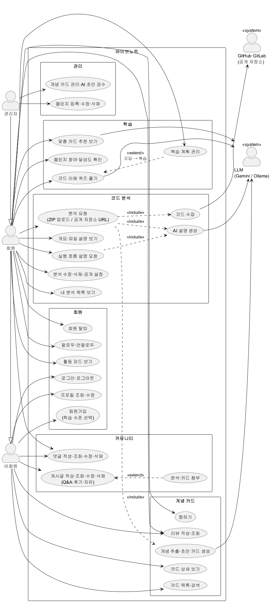

# Use-Case Diagram — 바이브노트

> 작성 상태: 🟡 초안 (2026-11-17) · 다이어그램 소스: [`diagrams/usecase.puml`](diagrams/usecase.puml) (PlantUML)
> 이미지(`diagrams/usecase.png`)는 제출 단계에서 렌더링해 아래에 넣는다. GitHub는 PlantUML을 바로 렌더링하지 않으므로 소스와 이미지를 함께 둔다.

<!-- 렌더링 후:  -->

## 액터

| 액터 | 설명 |
|---|---|
| 비회원 | 가입·로그인, 공개 개념 카드와 게시글 조회 |
| 회원 | 비회원 기능 + 분석, 학습(퀴즈·복습·추천·챌린지), 리뷰·찜, 커뮤니티 작성, 팔로우 |
| 관리자 | 회원 기능 + 개념 카드 검수, 챌린지 관리 |
| LLM (Gemini / Ollama) | 외부 시스템. 설명·개념 추출·퀴즈·추천 이유 생성 |
| GitHub·GitLab | 외부 시스템. 공개 저장소 아카이브 제공 |

## 유스케이스 명세

| ID | 유스케이스 | 주 액터 | 관련 기능 | 설명 |
|---|---|---|---|---|
| UC01 | 회원가입 | 비회원 | F-01 | 이메일·비밀번호·닉네임·학습 수준 입력 |
| UC02 | 로그인·로그아웃 | 비회원/회원 | F-02 | JWT 발급·재발급·폐기 |
| UC03 | 프로필 조회·수정 | 회원 | F-03 | 정보와 학습 통계 |
| UC04 | 회원 탈퇴 | 회원 | F-03 | 비활성화, 개인정보 마스킹 |
| UC05 | 팔로우·언팔로우 | 회원 | F-04 | 팔로워·팔로잉 목록 포함 |
| UC06 | 활동 피드 보기 | 회원 | F-04 | 팔로우한 사람의 공개 활동 |
| UC10 | 분석 요청 | 회원 | F-05 | URL/ZIP 입력 → 코드 수집, AI 설명, 개념 추출을 포함(include) |
| UC11 | 개요·파일 설명 보기 | 회원 | F-06 | 수준별 설명 |
| UC12 | 실행 흐름 설명 요청 | 회원 | F-07 | API 1~3개 선택 |
| UC13 | 분석 수정·삭제·공개 설정 | 회원 | F-19 | 제목·메모, 공개 여부, 삭제 |
| UC14 | 코드 수집 | (시스템) | F-05 | 저장소 아카이브 다운로드, 필터링 |
| UC15 | AI 설명 생성 | (시스템) | F-06, F-07 | LLM 호출 |
| UC20 | 카드 목록·검색 | 비회원/회원 | F-09 | 필터·정렬 |
| UC21 | 카드 상세 보기 | 비회원/회원 | F-10 | 내 코드 등장 위치는 회원만 |
| UC22 | 리뷰 작성·조회 | 회원 | F-11 | 별점 + 한 줄 |
| UC23 | 찜하기 | 회원 | F-12 | |
| UC24 | 개념 추출·초안 카드 생성 | (시스템) | F-08 | 없는 개념은 검수 대기 초안 |
| UC30 | 코드 이해 퀴즈 풀기 | 회원 | F-14 | 오답은 복습 계획으로 확장(extend) |
| UC31 | 복습 계획 관리 | 회원 | F-15 | |
| UC32 | 맞춤 카드 추천 보기 | 회원 | F-16 | 추천 이유는 LLM |
| UC33 | 챌린지 참여·달성도 확인 | 회원 | F-25 | |
| UC40 | 게시글 CRUD | 비회원(조회)/회원 | F-17 | 게시판 3종 |
| UC41 | 댓글 CRUD | 회원 | F-18 | |
| UC42 | 분석·카드 첨부 | 회원 | F-17 | 게시글 작성의 확장 |
| UC50 | 개념 카드 관리·검수 | 관리자 | F-13 | |
| UC51 | 챌린지 관리 | 관리자 | F-24 | 이미지 업로드 포함 |

## 유스케이스 흐름

### UC01 회원가입 (F-01, `docs/specs/F-01-signup.md`)

1. 비회원이 `/signup`에서 이메일·비밀번호·닉네임을 입력하고 학습 수준(입문·주니어·숙련)을 고른다.
2. 시스템이 입력을 검증한다 (비밀번호 8~64자 영문+숫자, 닉네임 2~20자 한글·영문·숫자·_).
3. 시스템이 회원을 만들고(비밀번호는 BCrypt 해시) 같은 자격 증명으로 바로 로그인시킨 뒤 원래 가려던 화면이나 홈으로 보낸다.
- 대안 흐름: 검증 실패 → 필드 아래 사유 표시 (COMMON_400) / 이메일·닉네임 중복 → 해당 필드에 안내 (USER_409)

### UC02 로그인·로그아웃 (F-02, `docs/specs/F-02-login-jwt.md`)

1. 회원이 `/login`에서 이메일·비밀번호로 로그인한다.
2. 시스템이 Access 토큰(30분)과 Refresh 토큰(14일, HttpOnly 쿠키)을 발급한다.
3. Access 토큰이 만료되면 화면이 자동으로 재발급을 받아 요청을 이어 간다(Refresh 토큰은 매번 교체). 새로고침해도 로그인이 유지된다.
4. 로그아웃하면 그 기기의 Refresh 토큰을 폐기한다.
- 대안 흐름: 이메일·비밀번호 불일치 또는 탈퇴 회원 → 같은 안내 문구 (AUTH_001) / 재발급 실패(만료·폐기·탈퇴) → 로그인 화면으로 이동 (AUTH_002)

### UC03 프로필 조회·수정 (F-03, `docs/specs/F-03-profile.md`)

1. 누구나 `/users/:id`에서 회원의 닉네임·수준·소개와 학습 통계(완료한 분석 수, 학습한 카드 수, 퀴즈 정답률)를 본다.
2. 회원이 `/me/settings`에서 닉네임·소개·학습 수준을 고쳐 저장한다.
3. 시스템이 보낸 항목만 바꾸고, 바뀐 닉네임·수준을 화면 헤더에 바로 반영한다. 수준은 이후 분석 설명의 기본 난이도가 된다.
- 대안 흐름: 규칙 위반 → 필드별 사유 (COMMON_400) / 다른 회원이 쓰는 닉네임 → USER_409 / 없거나 탈퇴한 회원의 프로필 → USER_404

### UC04 회원 탈퇴 (F-03)

1. 회원이 `/me/settings`에서 현재 비밀번호를 입력하고 "되돌릴 수 없음"을 확인한 뒤 탈퇴한다.
2. 시스템이 비밀번호를 확인하고, 회원을 비활성화(WITHDRAWN)하며 이메일·닉네임·소개를 마스킹한다.
3. 시스템이 모든 기기의 Refresh 토큰과 팔로우 관계를 지운다. 작성한 글·댓글·리뷰와 퀴즈 기록은 남고 작성자는 "탈퇴한 사용자"로 표시된다.
4. 이 기기는 로그아웃 상태로 홈으로 이동한다. 같은 이메일로 다시 가입할 수 있다(새 계정).
- 대안 흐름: 비밀번호 불일치 → USER_001, 아무것도 바뀌지 않음 / 탈퇴 후 다른 기기의 세션 → 재발급 실패로 로그인 화면 (AUTH_002)
