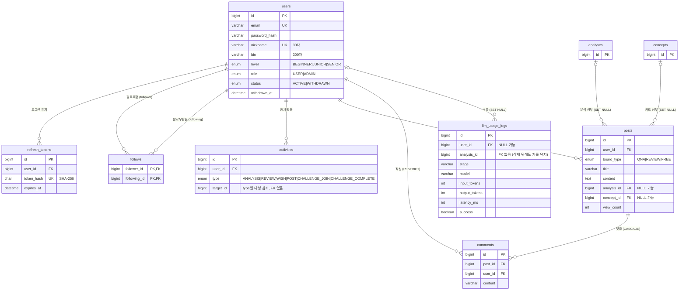
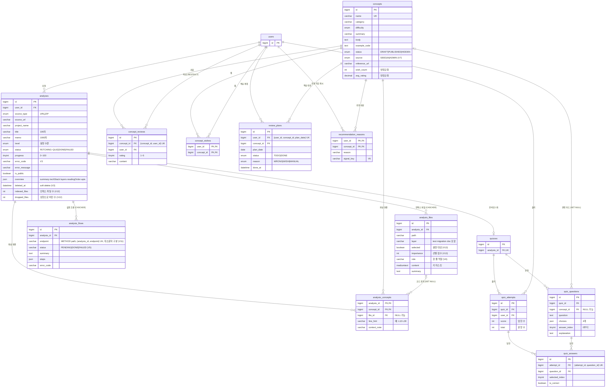
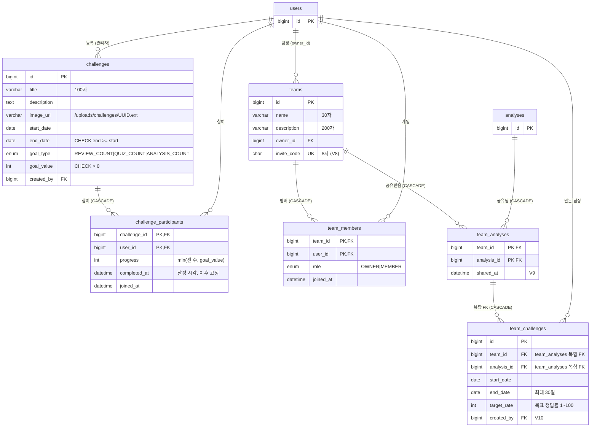

# ER Diagram — 바이브노트

> 작성 상태: 🟡 초안 (Flyway **V1~V10** 반영, 2026-11-24). **DDL 정본은 `backend/src/main/resources/db/migration/`**(`V1__init.sql` 이후 V2+)이고, 이 문서는 그 DDL을 읽어 그린 것이다. `docs/기획서.md` 3절 "ERD 초안"은 기획 단계의 설계 기록이라 V7 이후(카드 출처 ADMIN, 팀·팀 챌린지)를 담고 있지 않다.
> **최종본**은 구현이 끝난 뒤 실제 DB(Flyway 적용 후)에서 MySQL Workbench Reverse Engineer로 만든 이미지(`diagrams/erd.png`)를 아래 도메인별 다이어그램 앞에 붙인다 (W5).

<!-- 최종:  -->

## 다이어그램

테이블 26개를 도메인 세 묶음으로 나눠 그린다. 묶음 사이를 잇는 `users`·`analyses`·`concepts`는 각 그림에 키만 다시 적었다. 컬럼은 키와 업무상 의미가 있는 것만 적고, `created_at`·`updated_at`은 생략했다 (전체 컬럼은 DDL).

### 1. 회원·소셜·커뮤니티 (F-01~04, F-17·18, NF-07)

### 2. 분석·개념 카드·학습 루프 (F-05~16, F-19)

### 3. 학습 챌린지·팀 (F-20a~c, F-24·25)

## 테이블 목록

| 테이블 | 설명 | 주요 관계 | 기능 |
|---|---|---|---|
| users | 회원 (이메일·닉네임 UNIQUE, 수준 `level`, 역할 `USER`·`ADMIN`, 상태 `ACTIVE`·`WITHDRAWN`, 탈퇴 시각). 탈퇴는 행을 지우지 않고 `status=WITHDRAWN`으로 바꾸며 이메일·닉네임·소개를 즉시 마스킹한다(F-03). 같은 트랜잭션에서 그 회원의 Refresh 토큰 전부와 팔로우(양방향)를 지우고, 팀은 팀장이면 팀 삭제·멤버면 탈퇴 처리한다(F-20a). 그 회원의 분석은 진행 중이면 중단하고 F-19 삭제처럼 soft delete하며 파일·흐름·개념 연결을 지운다(#91). 게시글·댓글·리뷰·풀이·찜은 남기고, 화면은 `status`를 보고 작성자를 "탈퇴한 사용자"로 보여 준다 | - | F-01~03 |
| refresh_tokens | Refresh 토큰. 원문 대신 SHA-256 해시(`token_hash` UNIQUE)와 만료 시각을 저장한다 | users 1:N | F-02 |
| follows | 팔로우 PK `(follower_id, following_id)`, 역방향 조회용 `idx_follows_following`. 팔로우 수는 반정규화 없이 `COUNT(*)`로 센다. 팔로우 자체는 활동을 남기지 않는다 | users N:M users | F-04 |
| activities | 공개 활동 기록(팔로우 피드의 원천). `type`은 `ANALYSIS`·`REVIEW`·`WISH`·`POST`·`CHALLENGE_JOIN`·`CHALLENGE_COMPLETE`(V2에서 챌린지를 참여·달성으로 나눔). `target_id`는 type에 따라 분석·리뷰·카드·게시글·챌린지 id를 가리키는 **다형 참조라 FK가 없다**. 대상이 지워지거나 비공개가 돼도 행은 남기고, 피드 쿼리가 대상 테이블과 `LEFT JOIN`해 보일 것만 고른다. 예외로 챌린지 참여를 취소하면 그 `CHALLENGE_JOIN` 행은 지운다(F-25) | users 1:N | F-04, F-05a, F-11, F-12, F-17, F-25 |
| analyses | 분석 요청과 결과 개요(JSON: summary·techStack·layers·readingOrder·apis, F-06 5.3절), 상태·진행률·실패 사유(error_code·error_message, V3), 인덱스 수치(`indexed_files`·`dropped_files`, V12), 공개 여부, 제목·메모, 삭제 시각(soft delete, V2). 삭제하면 서비스가 파일·흐름·개념 연결을 지우고 `deleted_at`을 채운다. 퀴즈·풀이는 남는다(통계·챌린지·일일 한도가 읽음) | users 1:N | F-05a, F-06, F-19 |
| analysis_files | 저장소 인덱스 전체(코드·test·migration·doc, 최대 2,000개, 키 마스킹된 content). 그중 설명 대상으로 고른 최대 30개만 `selected = TRUE`(중요도 `importance`, V12)이고 설명·개념·퀴즈·흐름·구조·파일 API는 이 행만 본다. 한 줄 역할(role, V4)과 설명(summary) | analyses 1:N | F-05a, F-06, F-26a |
| analysis_flows | API 실행 흐름(endpoint `"{METHOD} {path}"`, 분석 안에서 UNIQUE, 상태 PENDING·DONE·FAILED, 요약·단계 JSON 캐시·실패 코드, V5) | analyses 1:N | F-07 |
| concepts | 개념 카드 (상태 DRAFT/PUBLISHED/HIDDEN, 출처 SEED/AI/ADMIN — ADMIN은 관리자가 직접 만든 카드, V7). AI 초안은 분석의 EXTRACTING 단계가 `DRAFT·AI`로 만들고 예제 코드·출처는 비워 둔다(관리자 검수 F-13에서 채움). `name` UNIQUE라 같은 이름이면 기존 카드를 쓴다. 관리자는 DRAFT만 삭제할 수 있고(연결은 FK CASCADE), 시드 재적용(`R__seed_concepts.sql`)은 내용만 덮어쓰고 상태·`wish_count`·`avg_rating`은 유지한다 | - | F-08~13 |
| analysis_concepts | 분석 ↔ 개념 연결과 코드 위치(파일 `file_id`, 줄 `line_hint` 예: L12-L30, 맥락 `context_note`). EXTRACTING 단계(F-08)가 채우고, PK `(analysis_id, concept_id)`라 한 분석에서 개념 하나는 위치 하나다. 분석당 최대 15개 | analyses N:M concepts | F-08, F-10 |
| concept_reviews | 카드 리뷰(별점 1~5 CHECK, 내용). 회원당 카드 하나에 리뷰 1개(UNIQUE `(concept_id, user_id)`, V2). 쓰고 고치고 지울 때마다 같은 트랜잭션에서 카드 행을 잠그고 `concepts.avg_rating`을 다시 계산한다. 작성자 FK는 RESTRICT(V2)라 탈퇴해도 리뷰가 남는다 | concepts 1:N, users 1:N | F-11 |
| concept_wishes | 카드 찜 PK `(user_id, concept_id)`. 찜·해제 때 카드 행을 잠그고 `concepts.wish_count`를 행 수로 다시 센다(탈퇴 회원의 찜도 센다). 찜하면 내일 복습 계획(`WISH`)과 `WISH` 활동이 한 번 생긴다 | concepts N:M users | F-12 |
| quizzes, quiz_questions | 분석별 퀴즈와 문항(선택지 4개 JSON 문자열 배열, 정답 위치 0부터, 해설, 관련 카드 `concept_id` NULL 가능). 분석 파이프라인 QUIZ 단계(F-14)가 분석당 1번 만들고(`analysis_id` UNIQUE, 재생성 없음) 문항 번호는 id 순서다. 생성이 실패하면 행이 없다 | analyses 1:1, concepts 1:N | F-14 |
| quiz_attempts, quiz_answers | 풀이 기록(`score` 맞힌 수, `total` 문항 수)과 문항별 답안(UNIQUE `(attempt_id, question_id)`). 같은 퀴즈를 다시 풀면 새 풀이로 쌓인다. 분석을 soft delete해도 남는다(통계·챌린지가 읽음) | users·quizzes 1:N | F-14 |
| review_plans | 날짜별 복습 계획. 퀴즈 제출 때 틀린 공개 개념이 `reason=WRONG`(F-14), 찜할 때 `WISH`(F-12가 `ReviewPlanService.addWish` 호출), 카드 상세 "복습에 추가"로 `MANUAL`(F-15)이 들어간다. 자동 추가는 내일 날짜, 모두 TODO로 시작하고 한 회원·카드의 TODO는 하나만 둔다. 완료하면 `status=DONE`·`done_at`(학습 통계·챌린지가 센다). 공개되지 않은 카드의 계획은 목록·API에서 빠진다(행은 둔다). UNIQUE `(user_id, concept_id, plan_date)` | users·concepts 1:N | F-14, F-15 |
| recommendation_reasons | 추천 이유 캐시. PK `(user_id, concept_id)`, 이유를 만들 때의 신호 키 `signal_key`(예: `w2c1k0l1`, V6)가 지금 신호와 다르면 다시 만든다. LLM이 실패해 규칙 문장을 준 카드는 저장하지 않는다 | users·concepts | F-16 |
| posts | 게시글 (게시판 `board_type` QNA/REVIEW/FREE, 제목·본문, 조회수, 분석·카드 첨부 각 0~1개). 제목 100자·본문 5000자는 애플리케이션 검증이다. 첨부 분석이 soft delete되면 `analysis_id`는 남고 첨부가 `viewable: false`로 보인다. 공개 분석이라도 **주인이 탈퇴했으면** 작성자 본인 외에는 `viewable: false`다(#92). 카드가 실제로 지워지면 FK `ON DELETE SET NULL`로 첨부가 사라진다. 작성자 FK는 RESTRICT(V2), 글을 지우면 댓글은 CASCADE | users 1:N, analyses·concepts 0..1:N | F-17 |
| comments | 댓글(500자는 애플리케이션 검증). 목록은 `idx_comments_post_created`로 작성순. 내용이 바뀔 때만 서비스가 `updated_at`을 앱 시각으로 넣어 "수정됨"을 판정한다. 작성자 FK는 RESTRICT(V2), 활동은 남기지 않는다 | posts 1:N, users 1:N | F-18 |
| challenges | 학습 챌린지 (제목 100자, 설명, 대표 이미지 경로 `/uploads/challenges/{UUID}.{ext}`, 기간 `start_date`~`end_date` CHECK, 목표 유형 `REVIEW_COUNT`·`QUIZ_COUNT`·`ANALYSIS_COUNT`와 목표값 CHECK > 0, 등록 관리자 `created_by`). 시작한 챌린지는 목표 유형·값·시작일을 바꿀 수 없다. 삭제는 실제 삭제이고 참여 기록은 CASCADE로 함께 지워진다 | users(등록 관리자) 1:N | F-24 |
| challenge_participants | 챌린지 참여 PK `(challenge_id, user_id)`와 달성도. `progress`는 복습 완료·퀴즈 풀이·분석 완료가 생길 때 기간 안 활동을 다시 세어 `min(센 수, goal_value)`로 저장하고, 목표에 닿는 순간 `completed_at`을 채우고 `CHALLENGE_COMPLETE` 활동을 남긴다. **달성한 뒤에는 다시 세지 않는다**(되돌려도 고정). 조회 API는 저장값만 읽는다. 참여 취소는 달성 전·종료 전에만 되고 행을 지운다 | challenges N:M users | F-25 |
| teams | 팀 (이름 30자, 소개 200자, 팀장 `owner_id`, 초대 코드 `invite_code` CHAR(8) UNIQUE — I·O·0·1을 뺀 32자에서 생성, 재발급하면 이전 코드는 무효, V8). 팀장이 탈퇴하면 팀을 지운다 | users(팀장) 1:N | F-20a |
| team_members | 팀 멤버 PK `(team_id, user_id)`, 역할 `OWNER`·`MEMBER`(역할의 정본, 팀당 OWNER 1명·위임 없음), 가입 시각. 팀당 10명·1인 5팀은 서비스가 `teams` 행 잠금 후 센다. 팀 삭제·회원 탈퇴 시 지워진다(FK CASCADE·탈퇴 정리, V8) | teams N:M users | F-20a |
| team_analyses | 팀 공유 분석 PK `(team_id, analysis_id)`, 공유 시각. 공유한 사람 = 분석 주인(`analyses.user_id`). 팀당 미삭제 10개(서비스가 `teams` 행 잠금 후 셈), 같은 분석을 여러 팀에 공유 가능. 공유받은 팀 멤버는 그 퀴즈만 풀 수 있다. soft delete된 분석은 지우지 않고 조회·권한에서 거른다. 팀 삭제·분석 삭제 시 CASCADE, 공유자가 팀을 떠나거나 탈퇴하면 서비스가 지운다 (V9) | teams N:M analyses | F-20b |
| team_challenges | 팀 기간 목표: 공유 분석 하나 + 기간(`start_date`~`end_date`, Asia/Seoul 날짜·양끝 포함·최대 30일) + 목표 정답률 `target_rate`(1~100), 만든 팀장 `created_by`. 달성은 저장하지 않고 조회 때 지금 멤버의 기간 안 최근 풀이로 계산한다. 분석마다 끝나지 않은 목표 1개·팀당 20개(서비스가 `teams` 행 잠금 후 셈). `(team_id, analysis_id)` → `team_analyses` 복합 FK CASCADE라 공유 해제·공유자 탈퇴·팀 삭제 때 함께 지워진다. soft delete된 분석의 목표는 조회·상한에서 거른다 (V10) | team_analyses 1:N | F-20c |
| llm_usage_logs | LLM 호출 사용량(단계 `stage`, 모델, 입력·출력 토큰, 지연 시간, 성공 여부·오류). 분석이 지워져도 기록을 남기려고 `analysis_id`에는 FK를 걸지 않았고, 회원 FK는 `SET NULL`이다 | users 0..1:N | NF-07 |

## 마이그레이션 이력

| 버전 | 내용 | 기능 |
|---|---|---|
| V1 | 초기 스키마 (테이블 22개) | 전체 |
| V2 | 분석 soft delete(`deleted_at`), 복습 계획·리뷰 UNIQUE, 작성물 작성자 FK RESTRICT, 활동 `CHALLENGE_JOIN`·`CHALLENGE_COMPLETE` 분리 | F-11, F-17~19, F-25 |
| V3 | `analyses.error_code` | F-05a |
| V4 | `analysis_files.role` | F-06 |
| V5 | `analysis_flows` 상태·요약·실패 코드·`updated_at` | F-07 |
| V6 | `recommendation_reasons.signal_key` | F-16 |
| V7 | `concepts.source`에 `ADMIN` 추가 | F-13 |
| V8 | `teams`, `team_members` | F-20a |
| V9 | `team_analyses` | F-20b |
| V10 | `team_challenges` | F-20c |
| V11 | `analysis_flows.endpoint` collation `utf8mb4_0900_bin` (대소문자 구분) | F-07 (#26) |
| V12 | `analysis_files.selected`·`importance`, `analyses.indexed_files`·`dropped_files` (기존 행은 `selected = TRUE`) | F-26a |
| R | `R__seed_concepts.sql` 시드 카드 (반복 적용, 내용만 덮어씀, DS-05) | F-09 |

## 정규화 메모

- 조회·집계 대상(파일, 개념 연결, 퀴즈 문항, 리뷰, 찜, 복습)은 테이블로 정규화하고, 화면에 통째로 보여 주는 분석 개요와 실행 흐름 단계는 JSON 컬럼으로 저장했다 (기획서 결정 로그 "결과 저장: 테이블과 JSON 혼합").
- `concepts.wish_count`, `concepts.avg_rating`은 목록 정렬 성능을 위한 의도적인 비정규화(반정규화) 컬럼이며, 찜·리뷰 변경 시 같은 트랜잭션에서 카드 행을 잠그고 원천 행으로 다시 계산한다 (증감이 아니라 재계산이라 어긋나지 않는다).
- 개인 챌린지 달성도는 `challenge_participants.progress`·`completed_at`에 **저장**한다. 원천은 review_plans·quiz_attempts·analyses이며 활동이 생길 때 다시 센다. 피드에 실제 달성 시각을 남기고, 달성 뒤에는 값을 고정하기 위해서다. 반대로 팀 기간 목표(`team_challenges`)는 멤버 구성이 바뀌면 결과도 바뀌어야 해서 저장하지 않고 조회 때 계산한다.
- 회원 탈퇴는 soft(`users.status`)라 `users` 행이 지워지지 않는다. 그래서 회원 FK의 CASCADE는 실제로 동작하지 않고, 탈퇴 때 지울 것(토큰·팔로우·팀 멤버십·팀 공유)은 서비스가 직접 지운다. 작성물 FK(posts·comments·concept_reviews)는 RESTRICT(V2)로 두어 혹시 회원 행을 지우려 해도 글이 함께 사라지지 않게 막았다.
- `activities.target_id`와 `llm_usage_logs.analysis_id`는 대상이 지워진 뒤에도 기록을 남기려고 일부러 FK를 걸지 않았다.
