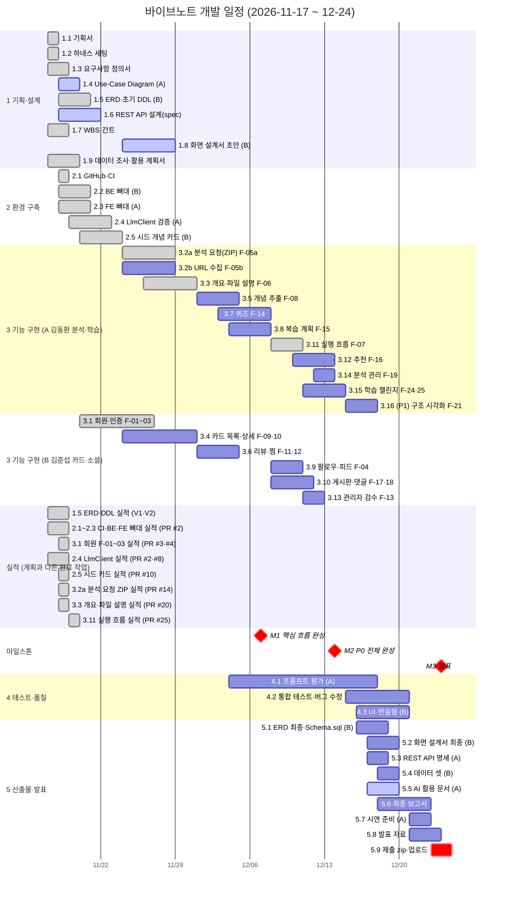

# Gantt Chart — 바이브노트

> 작성 상태: ✅ 초판 (2026-11-17) · 실적 갱신 2026-11-19 · 작업 ID는 [04-WBS.md](04-WBS.md)와 같다. 일정이 바뀌면 두 문서를 함께 고친다.
> GitHub·GitLab에서 mermaid로 바로 렌더링된다. 제출용 이미지는 제출 단계에서 `diagrams/gantt.png`로 만든다.
> 막대 날짜는 계획(기준선)이고 태그로 상태를 표시한다(`done` 완료, `active` 진행 중). 계획과 실제 날짜가 다른 완료 작업은 맨 아래 `실적` 섹션에 실제 막대를 따로 그린다 (관리 방식은 [04-WBS.md](04-WBS.md) "일정 관리 방식").

