# Gantt Chart — 바이브노트

> 일정 정본은 `docs/로드맵.md`(R-1)다. 이 차트의 `6 로드맵` 구간은 그 항목 표(기간·담당·트랙)를 옮긴 것이다.
> 작성 상태: ✅ 초판 (2026-11-17) · 실적 갱신 2026-11-26 · **재계획 2026-11-25** (2차 기획: 4절 재조정, 6절 2차 개발 추가, M4 기능 동결 12/14. 4.1·4.3의 기준선 날짜는 WBS 기간 열에 남겼다) · **로드맵 반영 2026-11-27** (6 구간을 로드맵 항목으로 다시 그림, 12/08 중간 점검 추가) · 작업 ID는 [04-WBS.md](04-WBS.md)와 같다 (6절은 로드맵 ID). 일정이 바뀌면 로드맵을 먼저 고치고 두 문서를 함께 맞춘다.
> GitHub·GitLab에서 mermaid로 바로 렌더링된다. 제출용 이미지는 제출 단계에서 `diagrams/gantt.png`로 만든다.
> 1~5 구간의 막대 날짜는 계획(기준선)이고 태그로 상태를 표시한다(`done` 완료, `active` 진행 중). 계획과 실제 날짜가 다른 완료 작업은 `실적` 섹션에 실제 막대를 따로 그린다 (관리 방식은 [04-WBS.md](04-WBS.md) "일정 관리 방식").
> `6 로드맵` 구간은 로드맵 날짜를 그대로 쓴다. 로드맵은 끝난 항목의 끝을 머지일(KST)로 고치므로 `done` 막대가 곧 실제 기간이다 (로드맵 이전에 끝낸 H-1·F-27·F-26a만 기준선 막대 + `실적` 막대). 상태는 `node scripts/roadmap.mjs` 계산(11-27 기준)이다. 4 구간(11-25 재계획)의 작업은 6 로드맵 항목이 이어받는다 (WBS 4절 주석).

```mermaid
gantt
  title 바이브노트 개발 일정 (2026-11-17 ~ 12-24)
  dateFormat YYYY-MM-DD
  axisFormat %m/%d
  todayMarker off

  section 1 기획·설계
  1.1 기획서                     :done,    t11, 2026-11-17, 1d
  1.2 하네스 세팅                :done,    t12, 2026-11-17, 1d
  1.3 요구사항 정의서            :done,    t13, 2026-11-17, 2d
  1.4 Use-Case Diagram (A)       :done,    t14, 2026-11-18, 2d
  1.5 ERD·초기 DDL (B)           :done,    t15, 2026-11-18, 3d
  1.6 REST API 설계(spec)        :done,    t16, 2026-11-18, 4d
  1.7 WBS·간트                   :done,    t17, 2026-11-17, 2d
  1.8 화면 설계서 초안 (B)       :done,    t18, 2026-11-24, 5d
  1.9 데이터 조사·활용 계획서    :done,    t19, 2026-11-17, 3d

  section 2 환경 구축
  2.1 GitHub·CI                  :done,    t21, 2026-11-18, 1d
  2.2 BE 뼈대 (B)                :done,    t22, 2026-11-18, 3d
  2.3 FE 뼈대 (A)                :done,    t23, 2026-11-18, 3d
  2.4 LlmClient 검증 (A)         :done,    t24, 2026-11-19, 4d
  2.5 시드 개념 카드 (B)         :done,    t25, 2026-11-20, 4d

  section 3 기능 구현 (A 김동환 분석·학습)
  3.2a 분석 요청(ZIP) F-05a     :done,    t32a, 2026-11-24, 5d
  3.2b URL 수집 F-05b            :done,    t32b, 2026-11-24, 5d
  3.3 개요·파일 설명 F-06        :done,    t33, 2026-11-26, 5d
  3.5 개념 추출 F-08             :done,    t35, 2026-12-01, 4d
  3.7 퀴즈 F-14                  :done,    t37, 2026-12-03, 5d
  3.8 복습 계획 F-15             :done,    t38, 2026-12-04, 4d
  3.11 실행 흐름 F-07            :done,    t311, 2026-12-08, 3d
  3.12 추천 F-16                 :done,    t312, 2026-12-10, 4d
  3.14 분석 관리 F-19            :done,    t314, 2026-12-12, 2d
  3.15 학습 챌린지 F-24·25       :done,    t315, 2026-12-11, 4d
  3.16 (P1) 구조 시각화 F-21     :done,    t316, 2026-12-15, 3d

  section 3 기능 구현 (B 김준섭 카드·소셜)
  3.1 회원·인증 F-01~03          :done,    t31, 2026-11-20, 7d
  3.4 카드 목록·상세 F-09·10     :done,    t34, 2026-11-24, 7d
  3.6 리뷰·찜 F-11·12            :done,    t36, 2026-12-01, 4d
  3.9 팔로우·피드 F-04           :done,    t39, 2026-12-08, 3d
  3.10 게시판·댓글 F-17·18       :done,    t310, 2026-12-08, 4d
  3.13 관리자 검수 F-13          :done,    t313, 2026-12-11, 2d

  section 실적 (계획과 다른 완료 작업)
  1.5 ERD·DDL 실적 (V1·V2)       :done,    a15, 2026-11-17, 2d
  2.1~2.3 CI·BE·FE 뼈대 실적 (PR #2) :done, a21, 2026-11-17, 2d
  3.1 회원 F-01~03 실적 (PR #3·#4) :done,  a31, 2026-11-18, 1d
  2.4 LlmClient 실적 (PR #2·#8) :done,    a24, 2026-11-17, 2d
  2.5 시드 카드 실적 (PR #10)    :done,    a25, 2026-11-18, 1d
  3.2a 분석 요청 ZIP 실적 (PR #14) :done,  a32a, 2026-11-18, 1d
  3.3 개요·파일 설명 실적 (PR #20) :done,  a33, 2026-11-18, 1d
  3.11 실행 흐름 실적 (PR #25)   :done,    a311, 2026-11-19, 1d
  1.4 유스케이스 실적 (PR #43)   :done,    a14, 2026-11-17, 3d
  2.6 공통 기반 F-00b (PR #42)   :done,    a26, 2026-11-19, 1d
  3.4 카드 목록·상세 실적 (PR #47·#52) :done, a34, 2026-11-19, 1d
  3.5 개념 추출 실적 (PR #50)    :done,    a35, 2026-11-19, 1d
  3.7 퀴즈 실적 (PR #56)         :done,    a37, 2026-11-19, 2d
  3.6 리뷰·찜 실적 (PR #58·#65)  :done,    a36, 2026-11-20, 1d
  3.8 복습 계획 실적 (PR #59)    :done,    a38, 2026-11-20, 1d
  3.9 팔로우·피드 실적 (PR #71)  :done,    a39, 2026-11-20, 1d
  3.10 게시판·댓글 실적 (PR #61·#68) :done, a310, 2026-11-20, 1d
  3.12 추천 실적 (PR #62)        :done,    a312, 2026-11-20, 1d
  M1 핵심 흐름 실적              :milestone, am1, 2026-11-20, 0d
  3.2b URL 수집 실적 (PR #82)    :done,    a32b, 2026-11-23, 1d
  3.13 관리자 검수 실적 (PR #75) :done,    a313, 2026-11-23, 1d
  3.17 (P2) 팀 F-20a (PR #83)    :done,    a317, 2026-11-23, 1d
  1.6 spec 실적 (30개 DONE)      :done,    a16, 2026-11-18, 9d
  3.14 분석 관리 실적 (PR #93)   :done,    a314, 2026-11-24, 1d
  3.15 챌린지 F-24·25 실적 (PR #97·#106) :done, a315, 2026-11-24, 1d
  3.17 (P2) 팀 F-20b·c (PR #90·#98) :done, a317b, 2026-11-24, 1d
  M2 P0 전체 실적                :milestone, am2, 2026-11-24, 0d
  3.16 (P1) F-21a 실적 (PR #118) :done,    a316, 2026-11-24, 2d
  1.8 화면 설계서 초안 실적 (PR #147) :done, a18, 2026-11-18, 8d
  H-1 하네스 개편 실적 (PR #138) :done,  a61, 2026-11-25, 1d
  F-26a 실적 (PR #157·#160)      :done,    a63, 2026-11-25, 1d
  F-27 실적 (PR #161)            :done,    a62, 2026-11-25, 2d

  section 마일스톤
  M1 핵심 흐름 완성              :milestone, crit, m1, 2026-12-07, 0d
  M2 P0 전체 완성                :milestone, crit, m2, 2026-12-14, 0d
  중간 점검 (로드맵)             :milestone, crit, mmid, 2026-12-08, 0d
  M4 기능 동결 (T0·T1)           :milestone, crit, m4, 2026-12-14, 0d
  M3 발표                        :milestone, crit, m3, 2026-12-24, 0d

  section 4 테스트·품질 (11-25 재계획)
  4.1 AI 품질 평가 V-2 (A·B)     :active,  t41, 2026-11-26, 17d
  4.2 통합 테스트·버그 수정      :         t42, 2026-12-15, 6d
  4.3 디자인 개편 F-29 (B)       :         t43, 2026-11-27, 24d
  4.4 MVP 전체 감사 V-1 (A·B)    :         t44, 2026-11-29, 4d
  4.5 중간 점검 장치 V-3 (A)     :         t45, 2026-12-03, 5d
  4.6 공통 패턴 정비 V-4 (A·B)   :         t46, 2026-12-03, 8d
  4.7 시연 E2E·리허설 V-5        :         t47, 2026-12-15, 6d

  section 6 로드맵 트랙 1 분석·프로젝트 (A)
  F-27 GMS 공급자 (로드맵 이전)  :done,    t62, 2026-12-01, 3d
  F-26a 수집·선별 (로드맵 이전)  :done,    t63, 2026-12-02, 4d
  D-1 문서 정정 (PR #175)        :done,    rd1, 2026-11-26, 1d
  E-1 평가 러너·채점기 (PR #220) :done,    re1, 2026-11-26, 1d
  P-1a 프로젝트·버전 묶음        :active,  rp1a, 2026-11-27, 6d
  P-1b 증분 재분석               :         rp1b, 2026-12-03, 6d
  F-26b ① TS·React 구조          :         rf26b, 2026-12-03, 6d
  SD-1 랜딩 샘플 데이터          :         rsd1, 2026-12-03, 1d
  E-2 평가 D·E·쌍 비교 채점기    :         re2, 2026-12-03, 6d
  F-27b 수준 기준표·v2 프롬프트  :         rf27b, 2026-12-09, 3d
  W-1 실행 흐름 웹 바깥 층       :         rw1, 2026-12-09, 6d
  O-1 최소 배포 Compose·Tunnel   :         ro1, 2026-12-09, 6d
  V-3 JaCoCo·E2E CI 스모크       :         rv3, 2026-12-09, 6d
  AM-1 A 화면 Tailwind 이전      :         ram1, 2026-12-09, 3d

  section 6 로드맵 트랙 2 학습·팀·면접 (A)
  FU-1 follow-up 등록 (PR #212)  :done,    rfu1, 2026-11-26, 1d
  L-1a 재실행·퀴즈 재생성 (PR #227) :done, rl1a, 2026-11-26, 1d
  L-1b 풀이 기록·오답 노트       :         rl1b, 2026-11-28, 5d
  I-1a 면접 준비 BE              :         ri1a, 2026-11-28, 5d
  T-1 팀 프로젝트                :         rt1, 2026-12-03, 6d
  I-1b 면접 답변 AI 피드백       :         ri1b, 2026-12-03, 6d
  I-2 소개 스크립트·내보내기     :         ri2, 2026-12-03, 6d
  L-1c 루프 닫기                 :         rl1c, 2026-12-03, 6d
  F-28 사용량·한도               :         rf28, 2026-12-09, 6d
  NT-2 헤더 알림 A 이벤트        :         rnt2, 2026-12-12, 3d

  section 6 로드맵 트랙 3 카드 (A)
  K-3a 시드 검수 ①② (PR #234)    :done,    rk3a, 2026-11-26, 2d
  K-1 카테고리·수준 본문·요약    :         rk1, 2026-11-28, 5d
  K-3b 시드 검수 ③출처 대조      :         rk3b, 2026-11-28, 5d
  K-3c 시드 1차 +60장            :         rk3c, 2026-12-03, 3d
  K-2 카탈로그 개편              :         rk2, 2026-12-03, 6d
  K-3d 시드 2차 200장+           :         rk3d, 2026-12-09, 2d

  section 6 로드맵 트랙 4 하네스 (A)
  H-1 하네스 개편 (로드맵 이전)  :done,    t61, 2026-11-26, 3d
  HP-1 보안·가드 (PR #192)       :done,    rhp1, 2026-11-26, 1d
  HP-2 로드맵 R-1 (PR #195)      :done,    rhp2, 2026-11-26, 1d
  HP-3 세션 시작·표시 (PR #230)  :done,    rhp3, 2026-11-26, 1d
  HP-4 검증·CI·버그 (PR #238)    :done,    rhp4, 2026-11-27, 1d
  HP-5 기록·문서 (PR #239)       :done,    rhp5, 2026-11-27, 1d
  HP-6 남은 follow-up            :         rhp6, 2026-12-09, 2d

  section 6 로드맵 B (김준섭)
  V-1b 감사 B 영역 (PR #215·#216) :done,   rv1b, 2026-11-26, 1d
  V-2 평가 세트 고정 (PR #217)   :done,    rv2, 2026-11-26, 1d
  EV-1 기준선 평가 (PR #240)     :done,    rev1, 2026-11-27, 1d
  F-29 디자인 공통 (PR #244·#247) :done,   rf29, 2026-11-27, 1d
  V-4 useLatestRequest (PR #252) :done,    rv4, 2026-11-27, 1d
  NT-1 헤더 알림 기반            :         rnt1, 2026-11-28, 5d
  LP-1 랜딩 SC-01                :         rlp1, 2026-12-03, 6d
  CD-1 카드 상세 수준 화면       :         rcd1, 2026-12-03, 6d
  SF-1 시드 1차 플래그 확인      :         rsf1, 2026-12-05, 2d
  U-1 재미 요소                  :         ru1, 2026-12-09, 6d
  DS-09 데모 데이터              :         rds09, 2026-12-09, 6d
  SF-2 시드 2차 플래그 확인      :         rsf2, 2026-12-10, 2d
  EV-2 v2 평가                   :         rev2, 2026-12-12, 2d

  section 6 로드맵 T2 동결 뒤 (12/20 중단)
  F-31 T2-1 오답 해설·변형 문항  :         rf31, 2026-12-15, 6d
  F-26b2 T2-2 TS·React 간선      :         rf26b2, 2026-12-15, 6d
  S-1 T2-3 관리자 검수 화면      :         rs1, 2026-12-15, 6d

  section 공통 안정화·발표 (A·B)
  ST-1 안정화·사전 분석·산출물   :         rst1, 2026-12-15, 6d
  REL-1 리허설·보고서·발표·제출  :         rrel1, 2026-12-21, 4d

  section 5 산출물·발표
  5.1 ERD 최종·Schema.sql (B)    :         t51, 2026-12-16, 3d
  5.2 화면 설계서 최종 (B)       :         t52, 2026-12-17, 3d
  5.3 REST API 명세 (A)          :         t53, 2026-12-17, 2d
  5.4 데이터 셋 (B)              :         t54, 2026-12-18, 2d
  5.5 AI 활용 문서 (A)           :active,  t55, 2026-12-17, 3d
  5.6 최종 보고서                :         t56, 2026-12-18, 5d
  5.7 시연 준비 (A)              :         t57, 2026-12-21, 2d
  5.8 발표 자료                  :         t58, 2026-12-21, 3d
  5.9 제출 zip·업로드            :crit,    t59, 2026-12-23, 2d
```

