# 화면 설계서 — 바이브노트

> 작성 상태: 🟡 초안 (2026-11-18 시작 · 11-25 기준 SC-01~24 초안 작성·스크린샷. SC-01은 현재 자리 표시 화면 + 계획 와이어프레임) · 초안 W2(WBS 1.8), 최종본 W5(WBS 5.2)
> 스크린샷은 기능 PR마다 ui-verifier 결과(`.harness/screens/`)를 [`screens/`](screens/)에 `SC-xx-이름-{desktop,mobile}.png`로 옮겨 각 화면 절에 넣는다 (`/pr-review` 5단계). 최종본(W5)에서 다시 찍어 교체한다.

## 1. 화면 목록

| ID | 화면 | 라우트 | 권한 | 주요 구성 요소 | 연결 API | 기능 |
|---|---|---|---|---|---|---|
| SC-01 | 랜딩 | `/` | 공개 | 서비스 소개, 샘플 분석 미리보기, 시작하기 | - | NF-01 |
| SC-02 | 로그인 | `/login` | 공개 | 이메일·비밀번호, 회원가입 링크 | `POST /api/auth/login` | F-02 |
| SC-03 | 회원가입 | `/signup` | 공개 | 이메일·비밀번호·닉네임, 학습 수준 선택 | `POST /api/auth/signup` | F-01 |
| SC-04 | 대시보드 | `/dashboard` | 회원 | 오늘 복습할 카드, 맞춤 추천 카드, 최근 분석, 참여 중 챌린지 | `/api/review-plans`, `/api/recommendations`, `/api/analyses`, `/api/users/me/challenges` | F-15, F-16, F-25 |
| SC-05 | 분석 요청 | `/analyses/new` | 회원 | 입력 방식(ZIP 업로드·저장소 주소), 수준 선택, Gemini 전송 고지·동의, 제한 안내 | `POST /api/analyses` | F-05a, F-05b |
| SC-06 | 내 분석 목록 | `/analyses` | 회원 | 분석 카드(상태·진행률, 공개 배지, 메모 첫 줄) | `GET /api/analyses` | F-05a(목록), F-19 |
| SC-07 | 분석 결과 | `/analyses/:id` | 회원(공개·완료 분석은 다른 회원도 읽기 전용) | 진행 상태 폴링, URL 분석은 "저장소 보기" 링크, 주인 관리 영역(수정·공개·삭제)·"커뮤니티에 질문하기", 탭: 개요 / 구조 / 파일 / 실행 흐름 / 개념 / 퀴즈(주인만) | `/api/analyses/{id}/*`, `PATCH·DELETE /api/analyses/{id}` | F-05a(진행 상태), F-06~F-08, F-14, F-19, F-21a |
| SC-08 | 퀴즈 풀이·결과 | `/analyses/:id/quiz` | 회원 | 문항, 제출, 채점·해설, 오답을 복습에 추가 | `/api/analyses/{id}/quiz`, `POST /api/quizzes/{id}/attempts` | F-14, F-15 |
| SC-09 | 개념 카드 목록 | `/concepts` | 공개 | 검색창, 카테고리·난이도 필터, 정렬, 카드 그리드 | `GET /api/concepts` | F-09 |
| SC-10 | 개념 카드 상세 | `/concepts/:id` | 공개(일부 회원) | 설명, 예제 코드, 내 코드 등장 위치, 관련 카드, 리뷰, 찜 | `/api/concepts/{id}`, `/reviews`, `/wish` | F-10~F-12 |
| SC-11 | 복습 계획 | `/review-plans` | 회원 | 날짜별 목록, 완료 체크, 추가·삭제 | `/api/review-plans` | F-15 |
| SC-12 | 챌린지 목록 | `/challenges` | 공개 | 진행 중·예정·종료(+회원 "내 챌린지") 탭, 챌린지 카드(이미지·기간·목표·참여자 수·참여 중 배지) | `GET /api/challenges`, `/api/users/me/challenges` | F-25 |
| SC-13 | 챌린지 상세 | `/challenges/:id` | 공개(참여는 회원) | 설명, 기간, 목표, 참여·취소, 내 달성도 바 | `/api/challenges/{id}`, `/participation` | F-25 |
| SC-14 | 커뮤니티 목록 | `/community` | 공개 | 게시판 탭(Q&A·학습 후기·자유), 검색, 글쓰기 | `GET /api/posts` | F-17 |
| SC-15 | 게시글 상세 | `/community/:id` | 공개(댓글 작성은 회원) | 본문, 첨부(분석·카드), 수정·삭제, 댓글 CRUD | `/api/posts/{id}`, `/comments` | F-17, F-18 |
| SC-16 | 게시글 작성·수정 | `/community/write`, `/community/:id/edit` | 회원 | 게시판 선택, 제목, 본문, 첨부 선택 | `POST·PUT /api/posts` | F-17 |
| SC-17 | 피드 | `/feed` | 회원 | 팔로우한 사람의 공개 활동 | `GET /api/feed` | F-04 |
| SC-18 | 프로필 | `/users/:id` | 공개 | 프로필, 학습 통계, 팔로우 버튼, 팔로워·팔로잉, 찜, 참여 챌린지 | `/api/users/{id}`, `/stats`, `/follow` | F-03, F-04, F-12 |
| SC-19 | 내 정보 수정·탈퇴 | `/me/settings` | 회원 | 닉네임·소개·수준 수정, 회원 탈퇴(확인 단계) | `PATCH·DELETE /api/users/me` | F-03 |
| SC-20 | 관리자 카드 관리 | `/admin/concepts`, `/admin/concepts/new`, `/admin/concepts/:id/edit` | 관리자 | 카드 목록(상태 탭·출처·검색), 등록·수정, AI 초안 검수, 초안 삭제 | `/api/admin/concepts` | F-13 |
| SC-21 | 관리자 챌린지 관리 | `/admin/challenges` | 관리자 | 챌린지 목록, 등록·수정(이미지 업로드)·삭제 | `/api/admin/challenges` | F-24 |
| SC-22 | 내 팀 | `/teams` | 회원 | 내 팀 카드(역할·인원), 팀 만들기, 초대 코드로 가입(`?code=` 미리 채움) | `GET /api/users/me/teams`, `POST /api/teams`, `POST /api/teams/join` | F-20a |
| SC-23 | 팀 상세 | `/teams/:id` | 팀 멤버 | 팀 정보, 멤버 목록, 팀장: 초대 코드(복사·재발급)·수정·삭제·내보내기, 팀원: 탈퇴, 팀 목표 목록·삭제, 공유 분석 목록·공유·해제 | `/api/teams/{id}`, `/invite-code`, `/members/*`, `/challenges`, `/analyses` | F-20a, F-20b, F-20c |
| SC-24 | 팀 이해도 | `/teams/:id/analyses/:analysisId` | 팀 멤버 | 공유 분석의 팀 목표 진행·팀장 목표 만들기, 모듈별 정답률 막대·가장 약한 모듈, 멤버 × 모듈 표, 퀴즈 풀기 | `GET /api/teams/{id}/analyses/{analysisId}/understanding`, `GET·POST /api/teams/{id}/challenges` | F-20b, F-20c |

> 관리자 화면 공통 구조 (F-00b): SC-20·21은 `/admin` 아래 자식 화면이다. `AdminLayout`이 왼쪽 사이드 메뉴(좁은 폭에서는 본문 위 가로 메뉴)와 본문을 나누고, `/admin` 첫 화면은 "관리할 항목을 고르세요" 안내다. 헤더의 "관리자" 메뉴는 ADMIN에게만 보인다.

## 2. 화면 흐름 (User Flow)

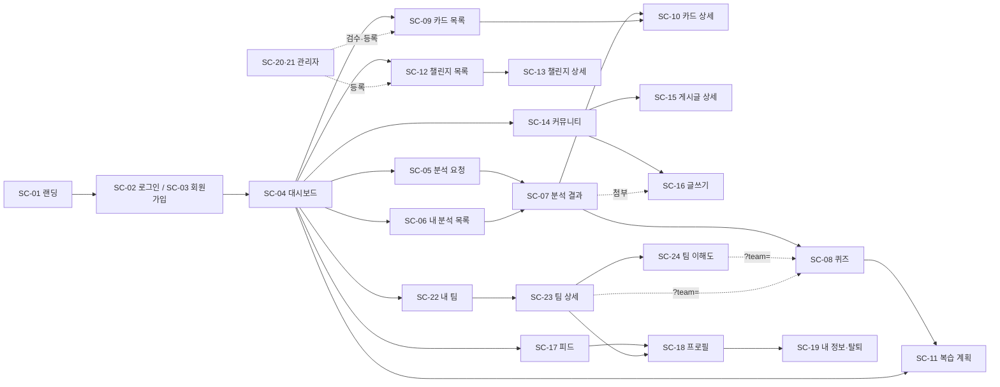

## 3. 화면별 설계

> 각 화면: 와이어프레임(초안) → 스크린샷(최종), 구성 요소 설명, 상태별 UI(로딩·빈 목록·에러), 모바일 배치.

### SC-01 랜딩 (`/`, 공개 · NF-01)

- 목적: 처음 온 방문자가 "AI가 쓴 코드를 이해하게 돕는 서비스"임을 한 화면에서 알고 회원가입 → 분석 요청(SC-05)까지 안내 없이 가게 한다 (NF-01). 화면 인상은 **세련**이다 (결정로그 11-25 UI 방향)
- 현재 구현 (11-25): `views/HomeView.vue`는 자리 표시만 있다. 제목 "바이브노트"와 소개 한 줄("AI가 쓴 코드를 수준별 설명 → 개념 카드 → 퀴즈·복습으로 이해합니다.")만 있고 API를 부르지 않는다. 헤더는 공통이다 (비로그인: 개념 카드·커뮤니티·챌린지·로그인·회원가입, 로그인: 대시보드 등 회원 메뉴 + 닉네임·로그아웃)
- 계획 구성 (초안, 위에서 아래로):
  1. 히어로: 한 줄 가치 제안 + 보조 문구, 주 버튼 "무료로 시작하기"(SC-03, 로그인 상태면 SC-05. `/signup`은 비회원 전용이라 그대로 두면 `/`로 되돌아와 버튼이 안 눌린 것처럼 보인다), 보조 버튼 "샘플 분석 보기"(아래 2로 스크롤)
  2. 샘플 분석 미리보기: 작은 저장소 하나의 분석 결과를 읽기 전용으로 축약해 보여 준다. 수준 탭(입문·주니어·숙련)으로 같은 코드의 설명 차이, 코드 줄 형광펜과 연결된 개념 카드 2~3개, 퀴즈 1문항
  3. 학습 흐름 3단계: 코드 올리기(ZIP·저장소 주소) → 수준별 설명·개념 카드 → 퀴즈·복습 (각 단계 아이콘 + 한 줄)
  4. 개념 카드 둘러보기: 공개 카드 몇 장(`GET /api/concepts`, F-09 공개 API) + "전체 보기"(SC-09)
  5. 마무리 CTA: "내 코드로 시작하기"(SC-03, 로그인 상태면 SC-05)
- 상태별 UI (계획): 샘플 미리보기는 서버 호출 없이 그려 실패가 없게 한다 / 개념 카드 절은 로딩 중 "불러오는 중…", 에러면 그 절 안에 서버 `message` + "다시 시도" 버튼(SC-04와 같은 방식), 빈 목록(공개 카드 0장)이면 그 절을 숨긴다. 어느 경우에도 다른 절에는 영향이 없다
- 모바일: 한 열. 히어로 버튼은 세로로 쌓고, 샘플 미리보기의 수준 탭은 가로 스크롤 없이 3칸 균등, 코드 영역만 가로 스크롤을 허용한다. 375px에서 페이지 가로 스크롤은 없다
- 결정 필요 (SC-01 랜딩 구현 때 정한다. 시각 스타일·브랜드 색은 11/27 Figma 세션(F-29), 스크롤 연출은 U-1 GSAP):
  - 샘플 분석 데이터 출처: FE 고정 데이터(시연 데이터 split 확인, eval 데이터 금지) vs 공개 분석 API(지금은 회원만 읽을 수 있음)
  - 로그인한 회원이 `/`에 오면 대시보드(SC-04)로 보낼지 (F-16 spec 9절에서 SC-01 랜딩으로 미룸)
  - 비회원 랜딩 추천: F-16 추천은 회원 전용이라 랜딩에서는 추천을 하지 않고 4절 공개 카드(인기순)로 대신할지 (F-16 spec 9절에서 함께 미룸)

```
데스크톱                                         모바일(375px)
┌ 헤더: 바이브노트 · 개념 카드 커뮤니티 … 로그인 ┐   ┌ 바이브노트  로그인 ┐
│  AI가 쓴 코드, 이제 내가 설명할 수 있게        │   │ AI가 쓴 코드,      │
│  [무료로 시작하기]  [샘플 분석 보기]           │   │ 이제 내가 …        │
│ ┌ 샘플 분석 ─────────────────────────────────┐ │   │ [무료로 시작하기]  │
│ │ (입문)(주니어)(숙련)                        │ │   │ [샘플 분석 보기]   │
│ │ 코드 ▮▮형광펜▮▮     │ 설명 · 개념 카드 2장  │ │   │ ┌ 샘플 분석 ─────┐ │
│ │                     │ 퀴즈 1문항            │ │   │ │(입문)(주니)(숙련)│ │
│ └─────────────────────────────────────────────┘ │   │ │ 코드 → 설명    │ │
│  ① 코드 올리기 → ② 설명·카드 → ③ 퀴즈·복습    │   │ └────────────────┘ │
│  개념 카드 [카드][카드][카드]  전체 보기       │   │ ① → ② → ③ (세로)  │
│  [내 코드로 시작하기]                          │   │ [내 코드로 시작]   │
└────────────────────────────────────────────────┘   └────────────────────┘
```

| 데스크톱 (1280px, 현재 자리 표시) | 모바일 (375px, 현재 자리 표시) |
|---|---|
| 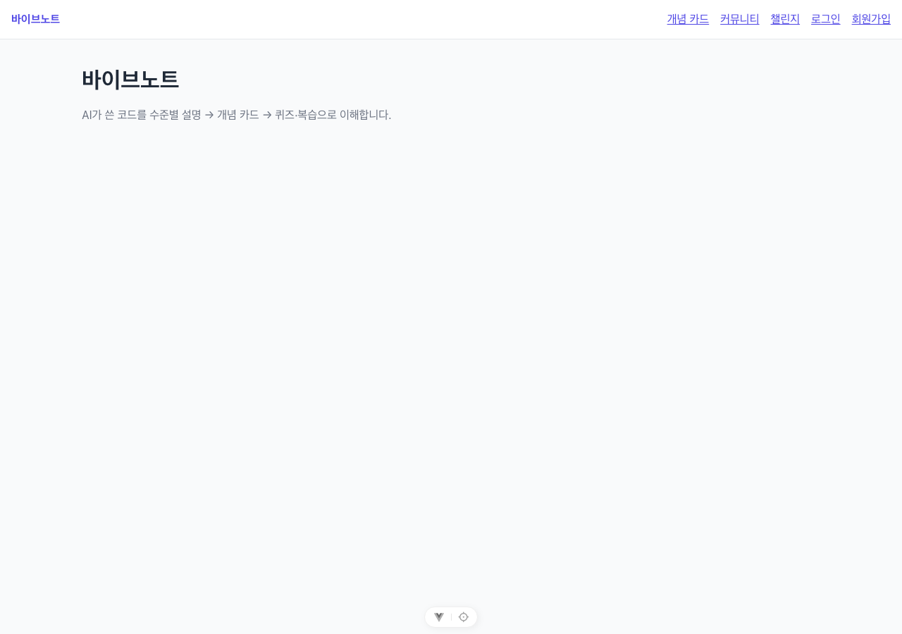 | 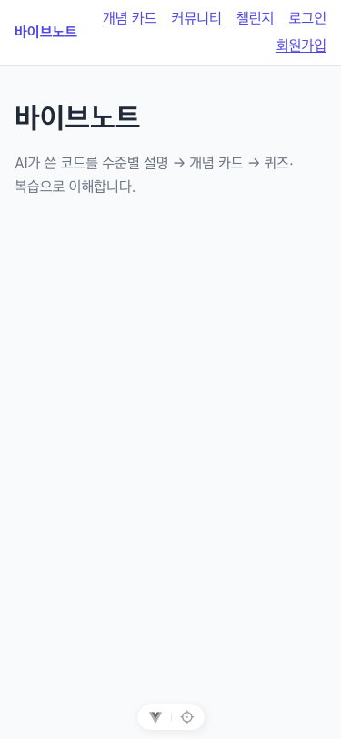 |

### SC-02 로그인 (`/login`, F-02)

- 구성: 이메일, 비밀번호, 로그인 버튼, "계정이 없나요? 회원가입" 링크. 상단 헤더에는 비로그인 시 로그인·회원가입 링크, 로그인 시 닉네임과 로그아웃 버튼
- 상태별 UI: 제출 중 버튼 비활성화("로그인 중…") / 빈 입력은 필드 아래 안내 / 로그인 실패(AUTH_001)는 폼 위 빨간 문구, 입력 유지
- 동작: 성공 시 `redirect` 쿼리(앱 내부 경로만) 또는 홈으로 이동. 로그인 상태로 들어오면 홈으로
- 모바일: 한 열, 최대 폭 420px

| 데스크톱 (1280px) | 모바일 (375px) |
|---|---|
|  | 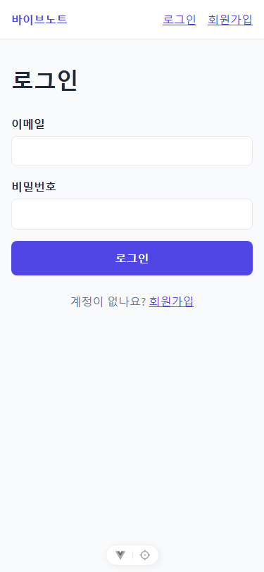 |

### SC-03 회원가입 (`/signup`, F-01)

- 구성: 이메일, 비밀번호(규칙 힌트), 닉네임(규칙 힌트), 학습 수준 라디오 카드 3개(입문·주니어·숙련 + 한 줄 설명), 가입하기 버튼, 로그인 링크
- 상태별 UI: 클라이언트 검증 실패와 서버 `details`(COMMON_400, USER_409)는 해당 필드 아래 빨간 문구 / 그 밖의 에러는 폼 위 문구 / 제출 중 버튼 비활성화
- 동작: 가입 성공 → 자동 로그인 → `redirect` 또는 홈
- 모바일: 한 열, 최대 폭 480px

| 데스크톱 (1280px) | 모바일 (375px) |
|---|---|
|  |  |

### SC-04 대시보드 (`/dashboard`, F-16 · 챌린지 절 F-25)

- 진입: 헤더 "대시보드" 메뉴(로그인 회원, 맨 앞), 로그인·가입 성공 후 `redirect`가 없을 때의 기본 이동. 비로그인으로 주소를 열면 로그인 화면으로 간다
- 구성: 제목 "대시보드". 위 줄에 "오늘 복습할 카드"와 "최근 분석" 두 칸(데스크톱 2열), 아래에 "맞춤 추천" 카드 그리드. 세 절은 **각각 따로** 불러와서 한 절이 실패해도 나머지는 보인다
  - 오늘 복습할 카드 {n}개: 밀린 복습 + 오늘 날짜의 TODO(`GET /api/review-plans`의 `today` 기준)를 `ConceptCard`로 최대 5개, 넘으면 "외 k개". "복습 계획 보기"(SC-11). 없으면 "오늘 복습할 카드가 없습니다."
  - 최근 분석: 최신 3개의 제목(없으면 프로젝트 이름)·상태 라벨·요청일(M월 D일), 누르면 SC-07. "전체 보기"(SC-06). 없으면 "아직 분석한 코드가 없습니다." + "분석 요청"(SC-05)
  - 맞춤 추천: `RecommendationCard` 5개 = `ConceptCard` + 추천 이유 한 줄(AI가 만든 이유면 "AI" 표시) + 근거 배지 "오답 n회"·"내 코드"·"찜한 분야"·"수준 맞음"
- 상태별 UI: 절마다 "불러오는 중…"(추천은 "추천을 만드는 중…") / 빈 안내 / 서버 `message` + "다시 시도"(그 절만 다시 부른다)
- 모바일: 본문 최대 폭 960px. 720px 이하에서 모든 절이 1열, 추천 그리드는 `auto-fill, minmax(260px, 1fr)`라 375px에서 1열 (가로 스크롤 없음)
- 참여 중 챌린지 (F-25): 위 두 칸 아래, 맞춤 추천 위. 진행 중인 참여 챌린지 최대 3개의 제목·"D-n"(종료일까지, 서울 오늘 기준)·달성도 바 "3 / 10회"·달성이면 "달성" 배지, 누르면 SC-13. "전체 보기"(`/challenges?status=MY`). 없으면 "참여 중인 챌린지가 없습니다." + "챌린지 둘러보기"(SC-12). 실패하면 절 안에 서버 `message` + "다시 시도"
- 구현: `views/dashboard/DashboardView.vue`, `components/recommendation/RecommendationCard.vue`·`RecommendationList.vue`, API `api/recommendations.js` (F-16 PR). 챌린지 절은 `components/challenge/MyChallengeList.vue`, API `api/challenges.js` (F-25 PR)

```
데스크톱                                   모바일(375px)
┌ 대시보드 ─────────────────────────────┐   ┌ 대시보드 ──────────┐
│ ┌ 오늘 복습할 카드 3개 ┐┌ 최근 분석 ──┐│   │ 오늘 복습할 카드 3개│
│ │ [카드][카드][카드]   ││ 제목 · 완료 ││   │ [카드] [카드] ...   │
│ │ 복습 계획 보기       ││ 전체 보기   ││   │ 최근 분석           │
│ └──────────────────────┘└─────────────┘│   │ 맞춤 추천           │
│ ┌ 맞춤 추천 ───────────────────────────┐│   │ [카드]              │
│ │ [카드+AI 이유+배지] [카드…] [카드…]  ││   │ AI 이유 한 줄       │
│ └──────────────────────────────────────┘│   │ (오답 2회)(내 코드) │
└─────────────────────────────────────────┘   └─────────────────────┘
```

| 데스크톱 (1280px) | 모바일 (375px) |
|---|---|
| 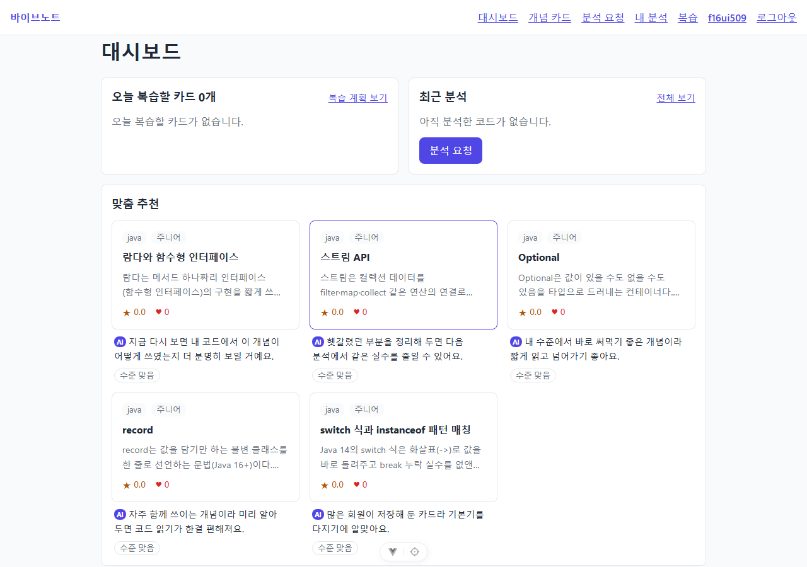 | 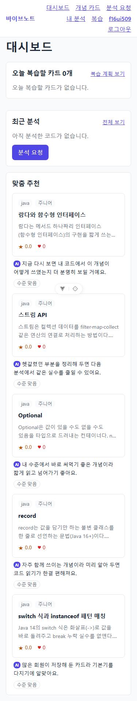 |
| 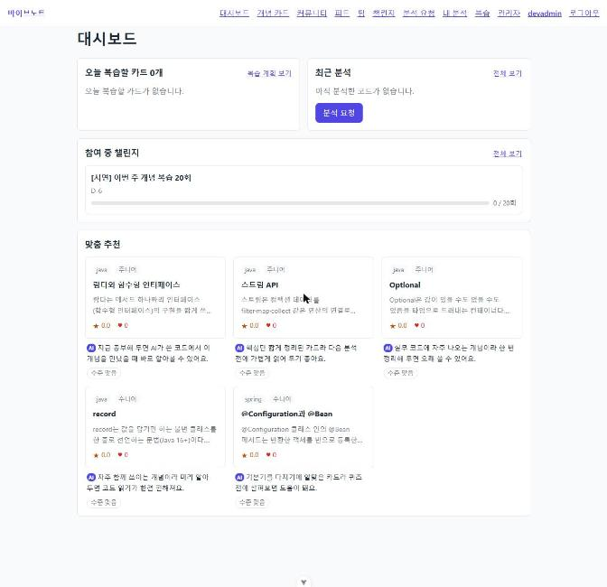 (F-25 참여 중 챌린지 절) | |

### SC-05 분석 요청 (`/analyses/new`, F-05a · URL 입력 F-05b)

- 구성: 입력 방식 라디오("ZIP 업로드" 기본 / "저장소 주소"), 방식에 따라 프로젝트 ZIP 파일 선택 또는 저장소 주소 칸(placeholder `https://github.com/owner/repo`, 안내 "공개 GitHub·GitLab(gitlab.com) 저장소의 기본 브랜치를 분석합니다. 저장소 주소만 입력하세요."), 설명 수준 라디오 카드 3개(내 수준이 기본 선택), Gemini 무료 등급 전송 고지와 동의 체크, 제한 안내("하루 5회 · 지원 스택 Java/Spring/MyBatis/JavaScript/Vue · 코드 파일 200개 · 10MB 이하", 주소 방식은 "· 저장소 아카이브 30MB 이하" 추가), 분석 요청 버튼. 헤더(로그인 시)에 "분석 요청"·"내 분석" 링크
- 상태별 UI: 파일(또는 공백 아닌 주소)과 동의가 모두 있어야 버튼 활성화 / 방식을 바꾸면 다른 방식의 입력값을 비움 / 10MB 초과 파일은 업로드 전에 필드 아래 안내 / 요청 중 버튼 비활성화("요청 중…") / 429·413·400은 폼 위 서버 문구, `details`는 해당 필드 아래(`details.sourceUrl`은 주소 칸 아래)
- 동작: 202면 SC-07(`/analyses/{analysisId}`)로 이동. 회원가입 직후 이동하는 첫 화면(NF-01)
- 모바일: 한 열, 최대 폭 560px

| 데스크톱 (1280px) | 모바일 (375px) |
|---|---|
|  |  |
| 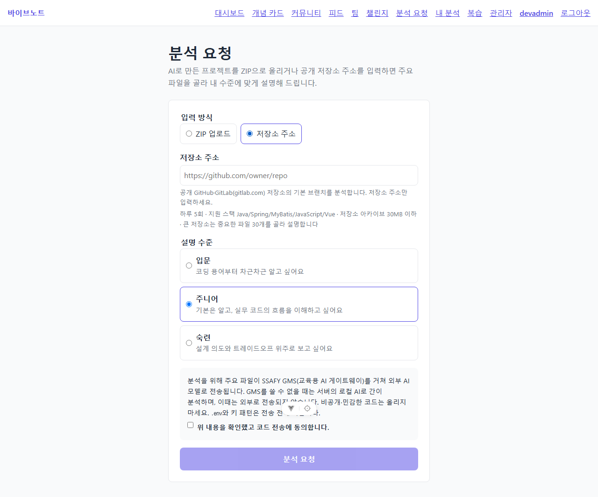 | 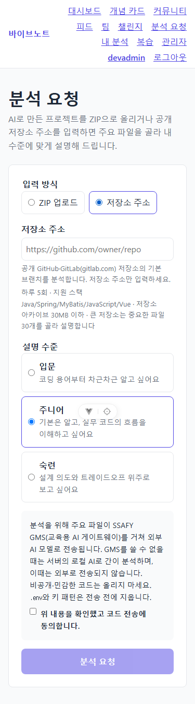 |

### SC-06 내 분석 목록 (`/analyses`, F-05a · 공개 배지·메모 F-19)

- 구성: 분석 카드(제목(없으면 프로젝트 이름 → "제목 없는 분석"), 공개면 "공개" 배지, 메모가 있으면 첫 줄(한 줄 말줄임), 수준, 요청일, 상태 배지, 진행 중이면 진행률 막대), 상단 "분석 요청" 버튼, 20개 단위 이전·다음. 수정·공개·삭제는 SC-07 관리 영역에서만 한다 (F-19)
- 상태별 UI: 로딩 문구 / 빈 목록은 "아직 분석이 없습니다" + "첫 분석 요청하기" / 에러는 서버 문구
- 동작: 카드를 누르면 SC-07
- 모바일: 카드 한 열(최소 폭 260px 그리드). 헤더 링크는 줄바꿈된다

| 데스크톱 (1280px) | 모바일 (375px) |
|---|---|
|  | 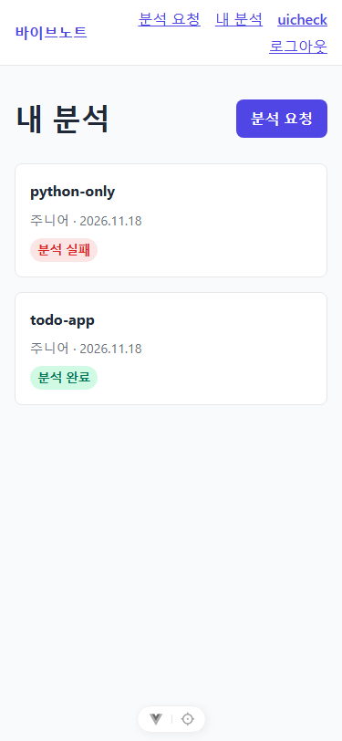 |

### SC-07 분석 결과 — 진행 상태 (`/analyses/:id`, F-05a · 결과 탭 F-06~)

- 구성: URL 분석이 끝나거나 실패하면 제목 아래 "저장소 보기"(정규화한 저장소 주소, 새 탭) 링크(F-05b, 실패는 F-19 #81), 단계 배지(코드 수집 중 → 파일 검사 중 → 주요 파일 선별 중 → … → 분석 완료/실패), 진행률 막대, "내 분석"으로 돌아가기
- 상태별 UI: 로딩 / 진행 중(2초마다 폴링) / 완료 "분석이 끝났습니다." / 실패는 `errorMessage`(저장소 수집 실패 ANALYSIS_004·502·503 문구 포함)와 "다시 요청하기"(SC-05) / 404 "분석을 찾을 수 없습니다."
- 동작: DONE·FAILED·404이거나 화면을 떠나면 폴링을 멈춘다. 일시적 오류는 문구를 보이고 다음 주기에 다시 조회
- 스크린샷: 실패 상태(지원 스택 밖 ZIP, ANALYSIS_415)

| 데스크톱 (1280px) | 모바일 (375px) |
|---|---|
|  |  |

### SC-07 분석 결과 — 개요·파일 탭 (`/analyses/:id?tab=overview|files&file=:fileId`, F-06)

- 진입: 상태가 DONE이면(처음부터든 폴링 중 전환이든) `GET /api/analyses/{id}`를 1회 불러와 제목(h1), 완료 배지, "분석이 끝났습니다. {수준} 수준 · 설명한 파일 n/m개", 탭을 보여 준다. 기본 탭은 개요
- 개요 탭: 프로젝트 요약, 기술 스택 칩, 레이어별 역할(컨트롤러·서비스·매퍼(DB)·화면(Vue)·스크립트·설정·도메인·DTO·기타, 선별 우선순위 순), "이 순서로 읽어 보세요"(누르면 파일 탭에서 그 파일 선택), API 표(메서드 색 배지·경로·"코드 보기" 링크)
- 파일 탭: 왼쪽 레이어별 파일 목록(경로·한 줄 역할, 선택 강조) / 오른쪽 레이어 배지·경로·역할·설명·줄 번호가 붙은 코드(`CodeViewer`, 하이라이트 없음)
- 상태별 UI: 상세·목록·단건 각각 로딩 문구 / 에러는 서버 `message` + "다시 시도" / 빈 API 목록 "탐지된 API가 없습니다." / 설명 없는 파일 "이 파일은 설명을 만들지 못했습니다." / 없는 파일(ANALYSIS_001) "파일을 찾을 수 없습니다."(목록은 유지) / 파일 미선택 안내
- 동작: 탭과 선택 파일은 쿼리에 남아 새로고침·뒤로 가기로 복원된다
- 모바일: 768px 이하에서 목록 위·내용 아래 한 열. 긴 코드는 코드 상자 안에서만 가로 스크롤(페이지 가로 스크롤 없음)
- 스크린샷: mock LLM fixture로 만든 분석 (ui-check 측정: 375px에서 페이지 scrollWidth 375 = clientWidth, 코드 상자만 스크롤)

| 화면 | 데스크톱 (1280px) | 모바일 (375px) |
|---|---|---|
| 개요 탭 |  | 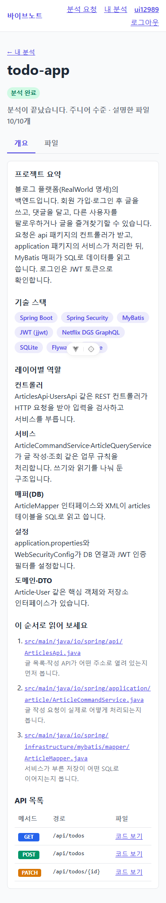 |
| 파일 탭 |  |  |

### SC-07 분석 결과 — 관리 영역·공개 분석 열람 (`/analyses/:id`, F-19)

- 주인(`mine`): 제목 아래 메모(줄바꿈 유지)와 관리 영역. "제목·메모 수정"(폼, 글자 수 100/1000, 저장 중 버튼 비활성, 실패는 서버 문구), "공개" 토글(완료일 때만 켜짐, "공개하면 팔로워 피드와 게시글 첨부에서 보이고, 로그인한 다른 회원도 이 분석의 코드와 설명을 읽을 수 있습니다." 안내, 실패하면 이전 값으로 되돌림), "삭제"(완료·실패일 때만, 확인 창 "이 분석을 삭제할까요? 퀴즈 풀이 기록은 남습니다." 후 SC-06으로 이동, 409는 서버 문구). 완료면 "커뮤니티에 질문하기"(SC-24 `/community/write?analysisId=`, #60)
- 관리 영역은 진행 중에도 보인다. 진행 중에는 제목·메모 수정만 되고(공개 토글 꺼짐, 삭제 없음), 상세는 처음 1회와 완료·실패로 바뀔 때 1회 더 불러온다. 상세를 못 불러오면 서버 문구와 "다시 시도"
- 다른 회원(공개·완료 분석, 피드·게시글 "분석 보기"로 진입): 제목 아래 "{닉네임}님의 분석"(SC-18 링크). 관리 영역·질문 버튼·메모가 없고 탭은 개요·파일·실행 흐름·개념(퀴즈 없음, `?tab=quiz`면 개요). 실행 흐름 탭은 흐름 카드만(API 선택·만들기·다시 만들기 없음)
- 볼 수 없는 분석(비공개·미완료·삭제·주인 탈퇴)은 "분석을 찾을 수 없습니다."
- 모바일: 관리 버튼은 줄바꿈되고 페이지 가로 스크롤이 없다
- 스크린샷: mock LLM fixture로 만든 분석 (ui-verifier 측정: 375px에서 scrollWidth 375 = clientWidth, 세 화면 모두)

| 화면 | 데스크톱 (1280px) | 모바일 (375px) |
|---|---|---|
| 주인 관리 영역 | 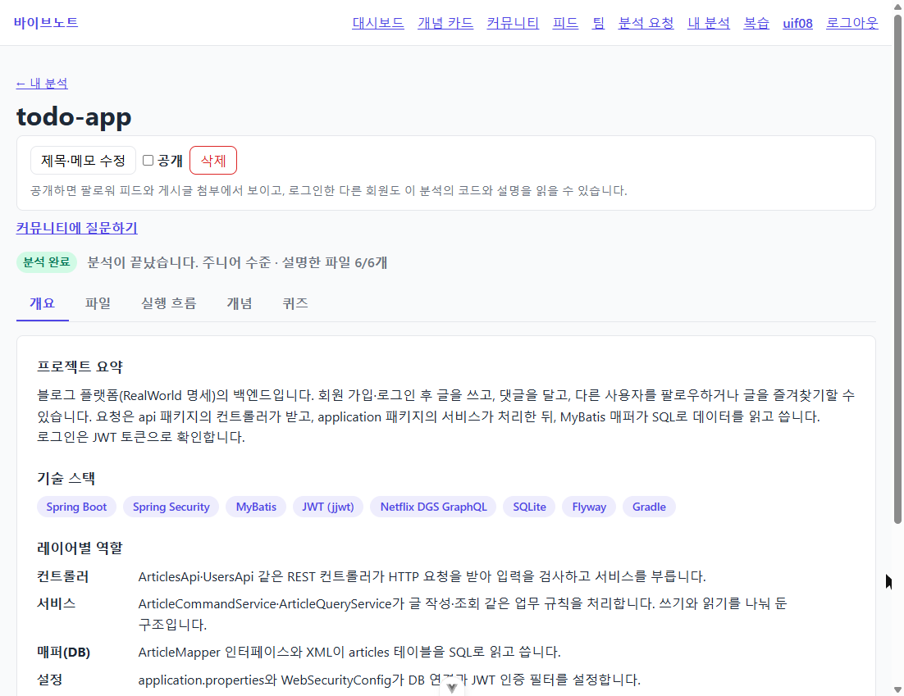 | 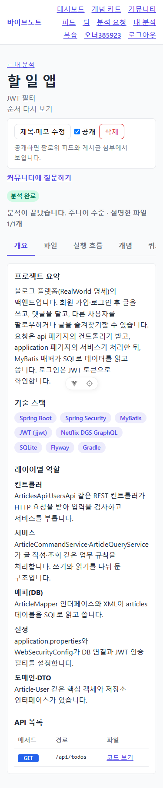 |
| 제목·메모 수정 폼 | 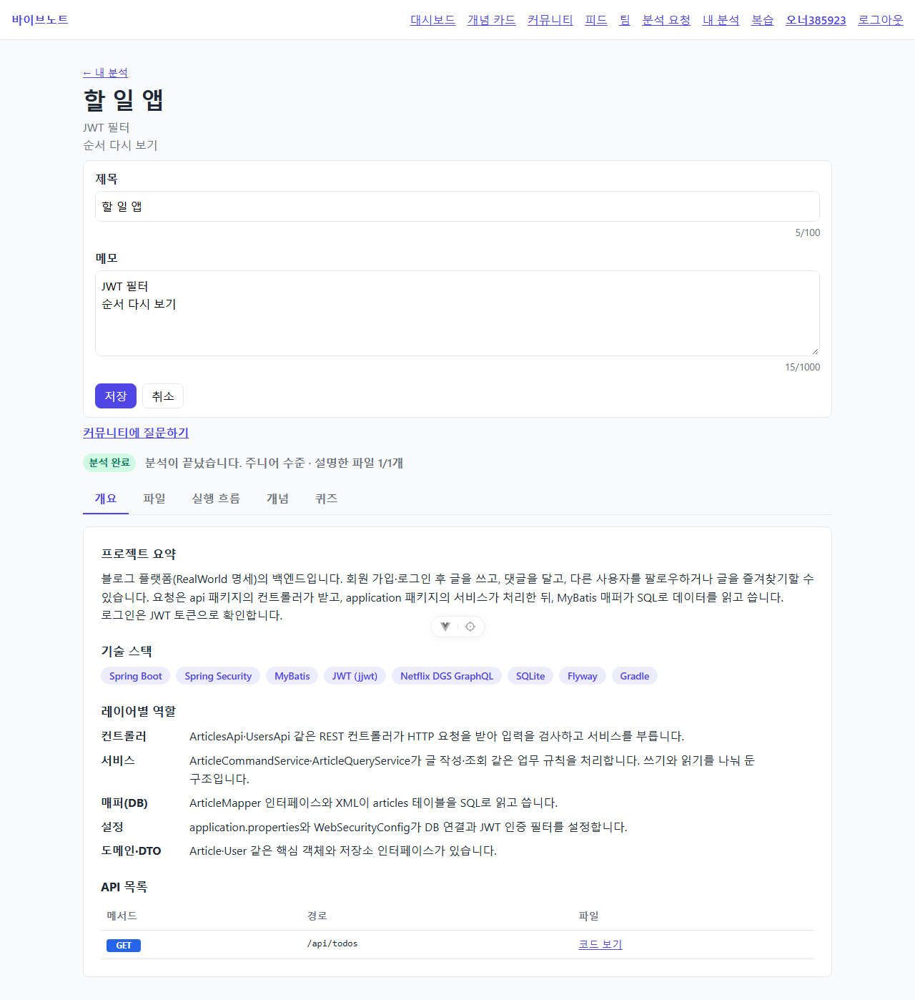 | 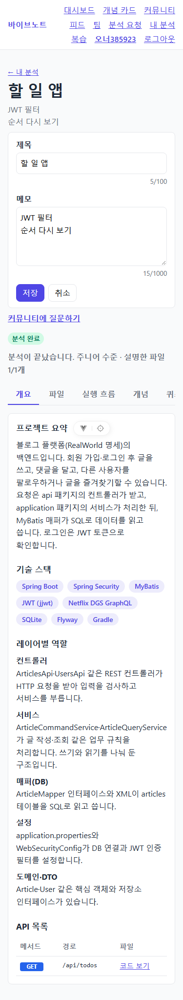 |
| 다른 회원 열람 | 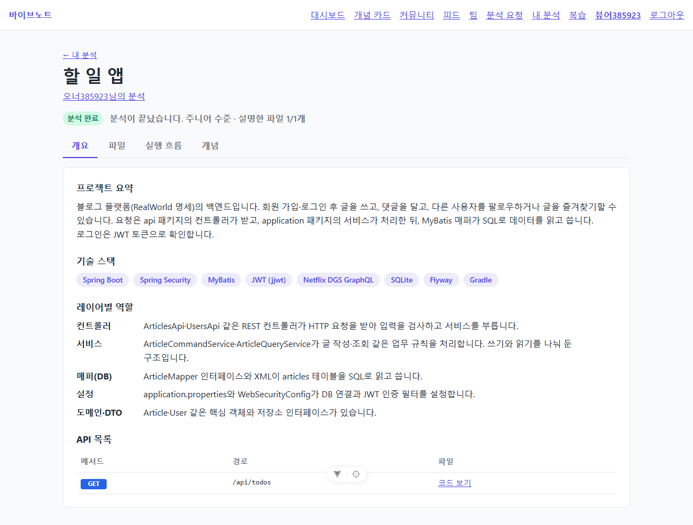 | 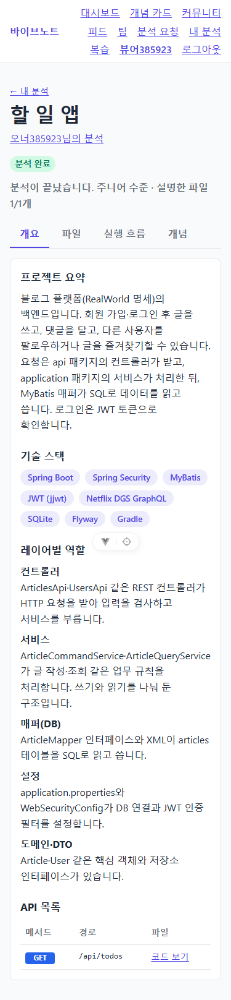 |
| SC-06 공개 배지·메모 | 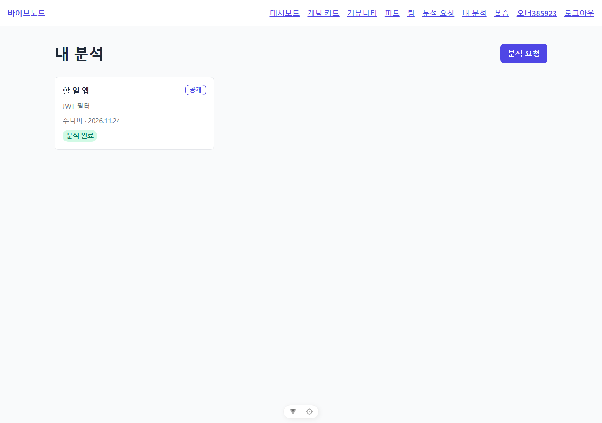 | 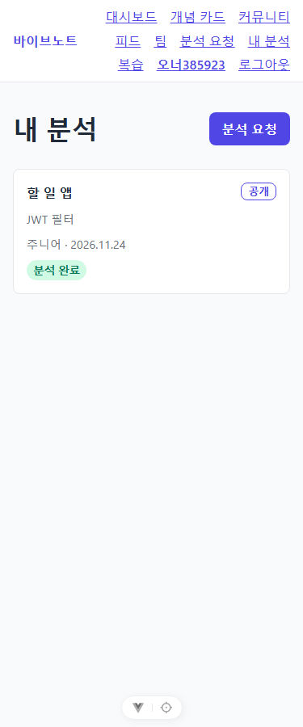 |

### SC-07 분석 결과 — 구조 탭 (`/analyses/:id?tab=structure`, F-21a)

- 진입: 개요 다음 탭(공개 분석을 보는 다른 회원에게도 보임). 열면 `GET /api/analyses/{id}/structure`를 1회 불러오고, 그릴 때만 mermaid를 동적으로 불러온다(`securityLevel: 'strict'`)
- 구성: 범례 "실선 = 코드 참조 · 점선 = API 호출 · 코드에서 확정한 연결만 그립니다" → 파일 의존 그림(`flowchart LR`, 레이어별 묶음, 노드 = 파일 이름, `HTTP` 점선) → "mermaid 코드 보기"(접힘, 원본 + "복사") → "연결 없는 파일 n개"(접힘, 경로) → "연결 목록"(접힘, `TodoView.vue:3 → todoApi.js (코드 참조)`, 파일 이름을 누르면 파일 탭에서 그 파일) → "확인하지 못한 연결 n개"(접힘, `파일:줄 · 사유 · 근거`)
- 상태별 UI: 로딩 "구조를 불러오는 중입니다…" / 간선 150개 초과 "연결이 많아 150개까지만 보여 줍니다." / 간선 0개 "파일 사이 연결을 찾지 못했습니다." + 레이어별 파일 목록 / 렌더링 실패 "다이어그램을 그리지 못했습니다."(목록·원본은 그대로) / 실패는 서버 `message` + "다시 시도"
- 모바일: 그림은 그림 상자 안에서만 가로 스크롤하고 페이지는 가로 스크롤하지 않는다. 긴 경로·근거는 줄바꿈
- 스크린샷: dev 저장소(DS-02-01 realworld) URL 분석을 mock LLM으로 만든 결과다. 파일 30개·연결 27개·확인하지 못한 연결 76개(모두 선별 밖 파일 참조). 백엔드만 있는 저장소라 `HTTP` 점선은 없다 (Playwright 측정: 375px에서 scrollWidth 375 = innerWidth, 그림 상자 scrollWidth 1792, 콘솔 에러 없음)

| 화면 | 데스크톱 (1280px) | 모바일 (375px) |
|---|---|---|
| 구조 탭 | 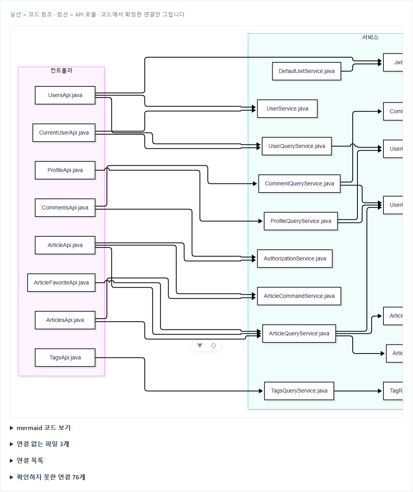 | 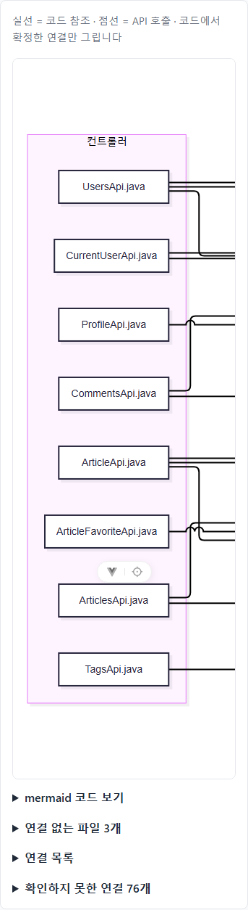 |

### SC-07 분석 결과 — 실행 흐름 탭 (`/analyses/:id?tab=flows`, F-07)

- 진입: 탭을 열면 `GET /api/analyses/{id}/flows`를 불러온다. 왼쪽은 개요 API 목록 체크박스(메서드 색 배지·경로, 이미 흐름이 있으면 "생성 중"·"완료"·"실패" 배지와 함께 체크 불가), 오른쪽은 흐름 카드
- 선택: 남은 개수(3 − FAILED가 아닌 흐름 수)까지만 체크되고 "실행 흐름 만들기 (n개)"는 1개 이상 고를 때만 켜진다. 누르면 `POST /flows`(202)
- 흐름 카드: PENDING "실행 흐름을 만드는 중입니다…" / DONE 요약 + 단계 목록(번호, 레이어 라벨, 제목, `Class.method`, 설명, 경로. 분석 파일이면 경로를 눌러 파일 탭으로) / FAILED 사유 + "다시 만들기"(그 API 하나만 POST)
- 상태별 UI: 로딩 / API 없음 "탐지된 API가 없어 실행 흐름을 만들 수 없습니다." / 남은 개수 0 "실행 흐름은 분석 하나에 3개까지 만들 수 있습니다." / 흐름 없음 안내 / 요청·조회 실패는 서버 `message` + "다시 시도"(체크한 선택 유지)
- 동작: PENDING이 있으면 3초마다 목록을 다시 불러오고, 모두 끝나거나 탭·화면을 떠나면 멈춘다
- 모바일: 768px 이하에서 API 선택 위·카드 아래 한 열, 긴 경로는 `/` 뒤에서 줄바꿈
- 스크린샷: mock LLM fixture로 만든 흐름이라 단계 경로가 이 분석 파일이 아니어서 링크가 아니다 (ui-verifier 측정: 375px에서 scrollWidth 375 = innerWidth)

| 화면 | 데스크톱 (1280px) | 모바일 (375px) |
|---|---|---|
| 실행 흐름 탭 | 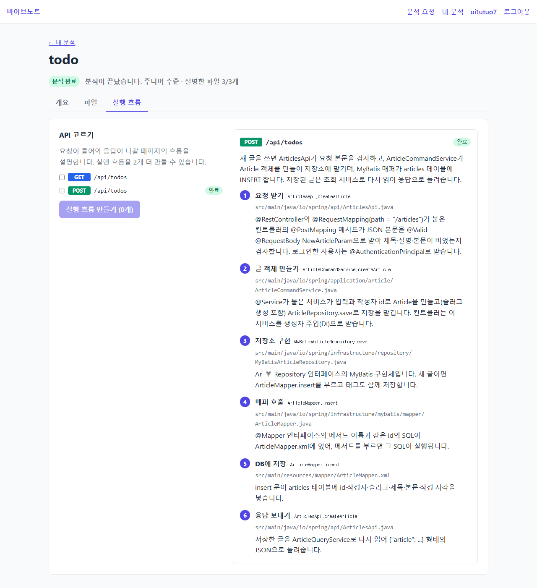 |  |

### SC-07 분석 결과 — 개념 탭 (`/analyses/:id?tab=concepts`, F-08)

- 진입: 실행 흐름 다음 탭. 열면 `GET /api/analyses/{id}/concepts`를 1회 불러온다
- 구성: 공개 카드마다 `ConceptCard`(카테고리·난이도·이름·요약·별점·찜, 누르면 `/concepts/{id}` 상세 F-10) + 그 아래 위치("파일 경로 · L12-L30", 누르면 파일 탭에서 그 파일 선택) + 맥락 문장. 파일이 없는 개념은 위치 줄을 그리지 않는다
- 상태별 UI: 로딩 "개념을 불러오는 중…" / 검수 대기 초안이 있으면 "새 개념 n개는 관리자 검수 후 카드로 공개됩니다." / 연결 없음 "이 분석에서 연결된 개념 카드가 없습니다."(추출 실패도 이 문구) / 실패는 서버 `message` + "다시 시도"
- 모바일: 카드 한 열(데스크톱은 폭에 따라 2~3열 그리드), 긴 경로는 `/` 뒤에서 줄바꿈
- 스크린샷: dev 저장소(DS-02-01 realworld) ZIP을 mock LLM으로 분석한 결과다. fixture는 시드 카드를 이름으로 가리키고 Mock이 카드 목록에서 id로 바꾸므로(#49) DB가 달라도 카드와 맥락 문장이 맞는다. 위치의 파일은 fixture의 파일 번호(`fileNo`)로 정해져 맥락 문장의 파일과 다를 수 있다 (ui-check: 375px 가로 스크롤·콘솔 에러 없음)

| 화면 | 데스크톱 (1280px) | 모바일 (375px) |
|---|---|---|
| 개념 탭 | 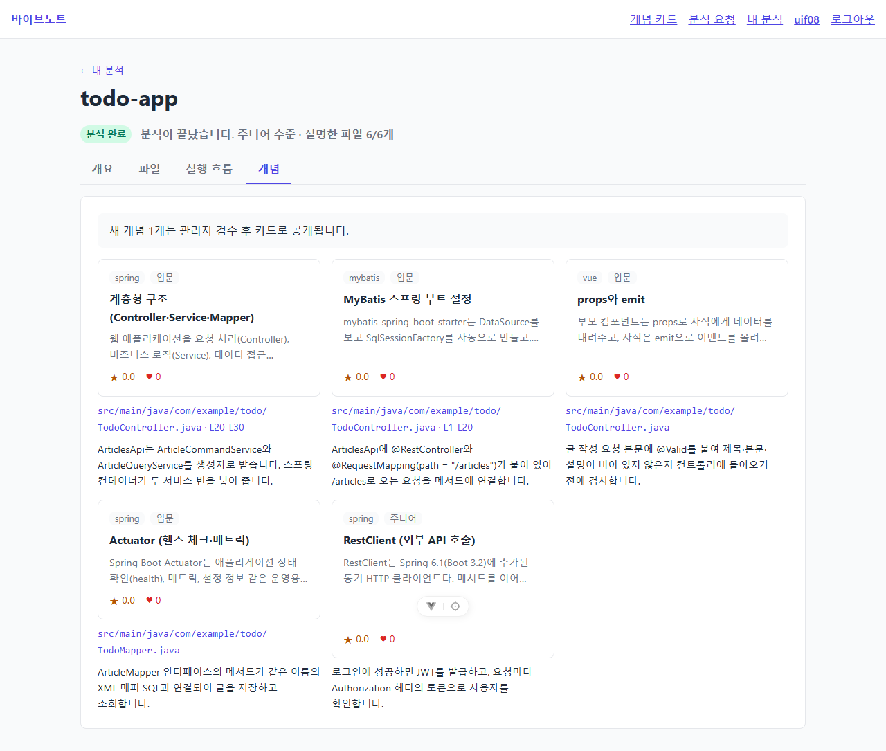 | 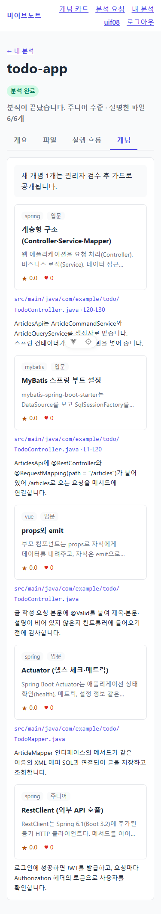 |

### SC-07 분석 결과 — 퀴즈 탭 (`/analyses/:id?tab=quiz`, F-14)

- 진입: 개념 다음 탭. 열면 `GET /api/analyses/{id}/quiz`를 1회 불러온다
- 구성: "객관식 n문항", 지난 풀이가 있으면 "지난 풀이 {점수}/{문항 수} · {M/D HH:mm}", 버튼 "퀴즈 풀기"(지난 풀이가 있으면 "다시 풀기") → SC-08
- 상태별 UI: 로딩 "퀴즈를 불러오는 중…" / 퀴즈 없음(`QUIZ_404`, 생성 실패) "이 분석은 퀴즈를 만들지 못했습니다." / 그 밖의 실패는 서버 `message` + "다시 시도"
- 모바일: 탭 5개는 한 줄을 유지하고 넘치면 가로로 스크롤하며, 선택된 탭이 보이게 스크롤한다
- 스크린샷: dev 저장소(DS-02-01 realworld)를 mock LLM으로 분석한 결과다. quiz fixture도 시드 카드를 이름으로 가리켜(#49 방식) DB가 달라도 문항 5개가 카드에 연결되고 1개는 카드가 없다 (ui-check: 375px 가로 스크롤·콘솔 에러 없음)

| 화면 | 데스크톱 (1280px) | 모바일 (375px) |
|---|---|---|
| 퀴즈 탭 | 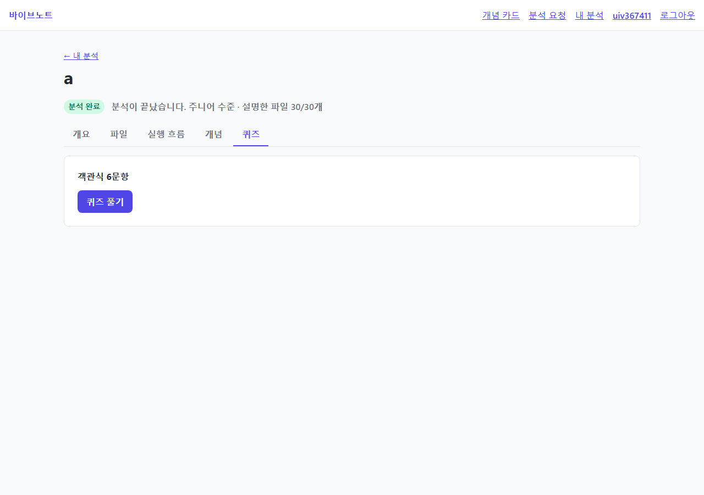 | 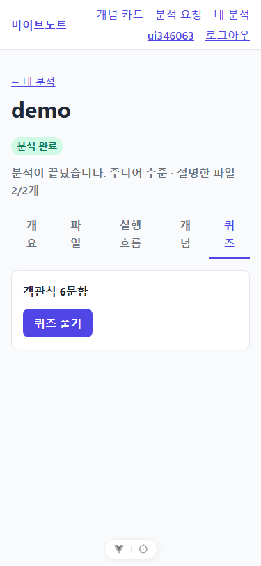 |

### SC-08 퀴즈 풀이·결과 (`/analyses/:id/quiz`, F-14)

- 진입: SC-07 퀴즈 탭의 "퀴즈 풀기". 로그인 필요, 본인 분석만
- 풀이: 위에 "{답한 수}/{n} 답함", 문항마다 번호·질문(줄바꿈 유지)과 4지선다 라디오(한 열). 모든 문항에 답해야 "제출"이 켜지고, 제출 중에는 "채점 중…"으로 꺼진다
- 결과: 점수 "{맞힌 수}/{문항 수}", 문항마다 정답·오답 표시, 선택지에 "정답"·"내 답" 표시, 해설, 관련 공개 개념이 있으면 `ConceptCard`(누르면 `/concepts/{id}`). 틀린 공개 개념을 복습 계획에 넣었으면 "틀린 개념 k개를 M월 D일 복습 계획에 추가했습니다."와 그 아래 "복습 계획 보기"(SC-11 링크, F-15)
- 팀 공유 분석(F-20b): 분석을 공유받은 팀 멤버도 들어올 수 있다. SC-23·SC-24에서 `?team={T}`로 들어오면 "← 분석으로 돌아가기" 대신 "← 팀으로 돌아가기"(`/teams/{T}`, 조회 실패·결과 화면 포함). 숫자가 아닌 `team`은 무시한다
- 동작: "다시 풀기"는 답을 비우고 풀이로 돌아간다(새 풀이로 기록). "← 분석으로 돌아가기"는 `/analyses/{id}?tab=quiz`. 제출이 실패하면 서버 `message`를 보여 주고 고른 답은 유지한다
- 조회 상태별 UI: SC-07 퀴즈 탭과 같다
- 모바일: 선택지 한 열, 긴 질문·선택지·코드 이름은 줄바꿈 (375px 가로 스크롤 없음)
- 스크린샷: 위와 같은 분석. 결과는 일부 문항을 일부러 틀려 복습 추가 안내가 보이게 했다

| 화면 | 데스크톱 (1280px) | 모바일 (375px) |
|---|---|---|
| 풀이 |  | 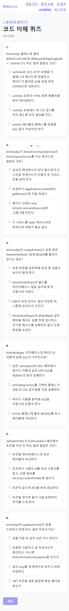 |
| 결과 |  |  |

### SC-09 개념 카드 목록 (`/concepts?keyword=&category=&difficulty=&sort=&page=`, F-09)

- 진입: 상단 nav "개념 카드"(비로그인에도 보임), 대시보드, 랜딩. 공개 화면이라 로그인 없이 볼 수 있고, `PUBLISHED` 카드만 나온다
- 구성: 제목 "개념 카드"와 전체 개수("n개"), 필터 바(검색창 + 검색 버튼, 카테고리 선택(전체·Java·Spring·Web·Security·MyBatis·Vue), 난이도 선택(전체·입문·주니어·숙련), 정렬 선택(인기순·최신순)), 카드 그리드, 이전·다음 페이지(20개 단위)
- 카드(`ConceptCard`): 이름, 카테고리 칩, 난이도 배지, 요약(2줄에서 말줄임), 찜 수 ♥, 평점 ★. 카드를 누르면 SC-10 카드 상세
- 상태별 UI: 로딩 문구 / 0건은 "조건에 맞는 개념 카드가 없습니다" + "필터 초기화"(조건 없이 `/concepts`로) / 에러는 서버 `message` / 잘못된 쿼리(COMMON_400)도 서버 `message`
- 동작: 검색은 Enter나 검색 버튼을 누를 때 한다(입력할 때마다 조회하지 않음). 필터·정렬은 바꾸는 즉시 다시 조회한다. 검색·필터·정렬을 바꾸면 1페이지로 돌아간다. 모든 조건은 URL 쿼리에 남아 새로고침·뒤로 가기·링크 공유로 복원되고, 기본값(인기순, 1페이지, 빈 값)은 쿼리에 넣지 않는다
- 정렬 기준: 인기순 = 찜 수 → 평점 → 등록 순서(동점이면 시드 순서), 최신순 = 등록일 역순. 키워드는 카드 이름과 요약에서 찾는다(대소문자 무시)
- 모바일: 카드 그리드 최소 폭 260px(`auto-fill`)라 375px에서 한 열. 필터 바는 검색창 한 줄, 선택 상자 3개는 다음 줄에 줄바꿈. 가로 스크롤 없음
- 구현: `views/concept/ConceptListView.vue`, 필터 바 `components/concept/ConceptFilterBar.vue`, 카테고리 상수 `utils/conceptCategories.js` (F-09 PR)
- 스크린샷: 아래 와이어프레임 뒤에 둔 F-09 구현 화면 (ui-verifier)

```
데스크톱 (1280px)
┌──────────────────────────────────────────────────────────────────────┐
│ 바이브노트   분석  개념 카드  커뮤니티 ...                 닉네임 ▾ │
├──────────────────────────────────────────────────────────────────────┤
│ 개념 카드  85개                                                      │
│ ┌──────────────────────────────┐[검색] [카테고리 ▾][난이도 ▾][인기순 ▾]│
│ │ 🔍 개념 이름이나 설명으로 검색 │                                    │
│ └──────────────────────────────┘                                     │
│ ┌──────────────────┐ ┌──────────────────┐ ┌──────────────────┐       │
│ │ JWT 기반 인증    │ │ 트랜잭션 전파와… │ │ 반응성 (ref·…)   │       │
│ │ security · 숙련  │ │ spring · 숙련    │ │ vue · 입문       │       │
│ │ JWT는 사용자 정보│ │ 트랜잭션 메서드가│ │ ref와 reactive로 │       │
│ │ 와 만료 시간을...│ │ 다른 트랜잭션... │ │ 바뀌는 값을 ...  │       │
│ │ ♥ 12   ★ 4.5     │ │ ♥ 8    ★ 4.2     │ │ ♥ 5    ★ 0.0     │       │
│ └──────────────────┘ └──────────────────┘ └──────────────────┘       │
│                     ...                                              │
│                      [‹ 이전]  1 / 5  [다음 ›]                       │
└──────────────────────────────────────────────────────────────────────┘

모바일 (375px)             0건
┌─────────────────────┐    ┌─────────────────────┐
│ 바이브노트       ☰  │    │ 개념 카드  0개      │
├─────────────────────┤    │ [ python      ][검색]│
│ 개념 카드  85개     │    │                     │
│ [🔍 검색어   ][검색]│    │  조건에 맞는 개념   │
│ [카테고리▾][난이도▾]│    │  카드가 없습니다    │
│ [인기순▾]           │    │   [필터 초기화]     │
│ ┌─────────────────┐ │    └─────────────────────┘
│ │ JWT 기반 인증   │ │
│ │ security · 숙련 │ │
│ │ JWT는 사용자... │ │
│ │ ♥ 12   ★ 4.5    │ │
│ └─────────────────┘ │
│ [‹ 이전] 1/5 [다음›]│
└─────────────────────┘
```

| 데스크톱 (1280px) | 모바일 (375px) | 0건 (375px) |
|---|---|---|
| 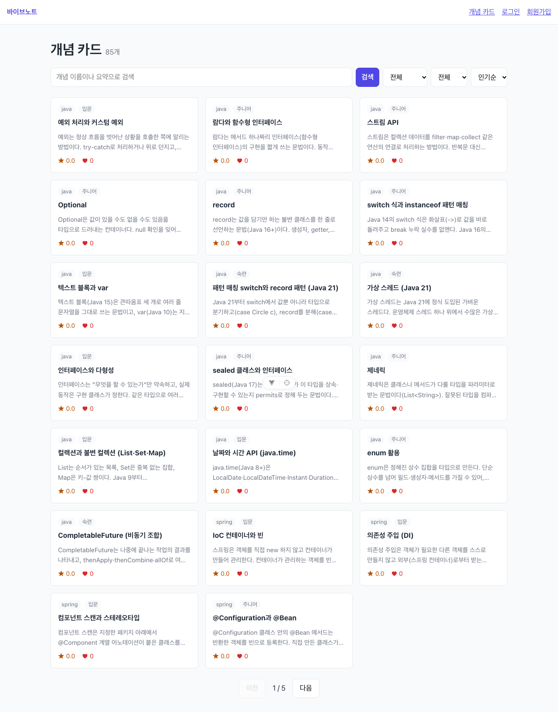 |  | 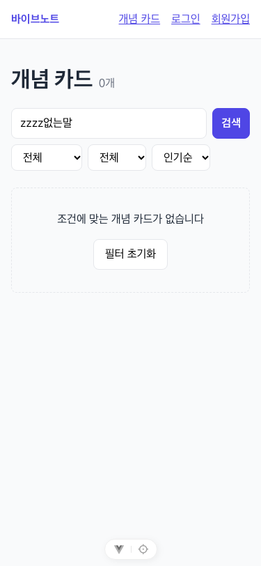 |

### SC-10 개념 카드 상세 (`/concepts/:id`, F-10 · 리뷰 F-11 · 찜 F-12)

- 진입: SC-09 카드, SC-07 개념 탭, 대시보드의 복습·추천 카드, 게시글에 첨부된 카드(SC-15), 프로필 찜 목록(SC-18). 공개 화면이라 비로그인도 볼 수 있지만 `PUBLISHED` 카드만 열린다
- 구성 (위에서 아래로)
  - 헤더: "← 목록으로"(직전 화면이 SC-09면 뒤로 가서 검색 조건을 그대로 복원, 아니면 `/concepts`), 카드 이름, 카테고리 칩, 난이도 배지, ♥ 찜 버튼(F-12), ★ 평균 평점(소수 1자리), "· 리뷰 N"(F-11)
  - 요약(한두 문장) → 쉬운 설명 본문(`body`, Markdown 렌더링) → 예제 코드(코드 블록, 복사 버튼. 누르면 2초간 "복사됨", 실패하면 "복사하지 못했습니다.") → 출처(`reference_url`, 공식 문서 새 창 링크). 값이 없는 절은 제목째 숨긴다. 언어 표시·문법 강조는 언어 컬럼이 없어 넣지 않는다 (F-10 spec 8절)
  - 본문 렌더링: 의존성 없는 자체 최소 렌더러(`v-html` 없음). `##`·`###` 제목, `-` 목록(한 단계 중첩), ``` 코드 블록, 문단, 인라인 코드·굵게만 지원하고 링크·표·HTML은 글자 그대로 보인다
  - 내 코드에서 등장한 위치 (회원 전용): 내 분석(삭제되지 않은 완료 분석, 최신 10개) 중 이 개념이 나온 곳을 "분석 제목 · 파일 경로 · 줄 힌트 · 한 줄 맥락"으로 나열한다(빈 값은 건너뜀). 누르면 SC-07 파일 탭(`/analyses/:id?tab=files&file=:fileId`), 파일이 없으면 분석 상세로 간다. 등장한 곳이 없거나 비로그인이면 영역 전체를 숨긴다
  - 관련 카드: `ConceptCard` 최대 4개(같은 분석에 함께 등장한 횟수순, 모자라면 같은 카테고리 인기순). 누르면 해당 카드 상세로 가고 맨 위로 스크롤한다
  - 리뷰 (F-11): 맨 위는 상태에 따라 하나만 보인다 — 비로그인 "로그인하고 리뷰 남기기" 버튼 / 리뷰를 안 쓴 회원은 작성 폼(별 버튼 1~5 + "이해에 도움이 됐나요?" 입력(앞뒤 공백 제외 1~200자, "n/200") + "등록", 별 미선택·공백뿐이면 비활성) / 쓴 회원은 "내 리뷰" 상자(별점, 내용, "수정"·"삭제"). "수정"은 값이 채워진 폼("저장"·"취소"), "삭제"는 확인 대화상자 후 지운다. 아래는 리뷰 목록(별점, 내용, 닉네임, 작성일 `YYYY-MM-DD`, 최신순 10개씩 "더 보기"). 닉네임을 누르면 SC-18 프로필로 가고, 탈퇴한 작성자는 링크 없는 "탈퇴한 사용자"다. 카드당 1인 1리뷰
- 찜 (F-12): 헤더의 찜 버튼이 "♥ N"(찜함, 강조색) / "♡ N"(안 함)을 보여 주고 `aria-pressed`·`aria-label`("찜하기 N"/"찜 해제 N")을 단다. 누르면 즉시 바꾸고(낙관적 갱신) 요청 중에는 끈 뒤 응답 값으로 맞춘다. 새로 찜해 내일 복습 계획이 생기면 버튼 아래 "M월 D일 복습 계획에 추가했습니다. 복습 계획 보기"(SC-11). 실패하면 원래대로 되돌리고 서버 메시지. 해제는 확인 없이 바로 하고 복습 계획은 남는다. 비로그인이 누르면 로그인 화면으로 갔다가 이 카드로 돌아온다. 찜 토글은 이 화면에서만 한다(목록 카드는 찜 수만)
- 커뮤니티 (F-17): 요약 아래 "이 카드로 글쓰기" 버튼. 누르면 이 카드를 첨부한 SC-16(`/community/write?conceptId=`)으로 가고, 비로그인은 로그인한 뒤 돌아온다
- 권한: 비로그인은 설명·예제·관련 카드·리뷰 목록을 본다. 찜 버튼이나 리뷰 폼을 누르면 로그인 화면(SC-02)으로 보내고, 로그인한 뒤 이 화면으로 돌아온다
- 상태별 UI: 불러오는 중 / 없거나 공개되지 않은 카드(`CONCEPT_404`)는 "개념 카드를 찾을 수 없습니다." + "목록으로" / 리뷰 "리뷰를 불러오는 중…" / 리뷰 0건은 "아직 리뷰가 없습니다. 첫 리뷰를 남겨 주세요" / 리뷰 목록 실패는 리뷰 절 안에만 서버 `message`(카드 본문은 그대로) / 리뷰 입력 검증 실패(`COMMON_400`)는 필드 아래에 서버 `details` / 이미 쓴 카드(`CONCEPT_409`)는 메시지와 함께 내 리뷰 상자로 바뀐다 / 그 밖의 에러는 서버 `message`
- 동작: 찜은 누르는 즉시 하트·숫자를 바꾸고(낙관적 갱신) 요청이 실패하면 되돌리면서 메시지를 띄운다. 리뷰를 등록하면 목록 맨 위에 붙고, 등록·수정·삭제 때마다 헤더의 평균 평점·리뷰 수가 서버 응답 값으로 갱신된다(카드 상세를 다시 부르지 않는다). 관련 카드로 이동하면 리뷰 절을 초기화하고 다시 불러온다
- 모바일: 한 열. 헤더의 찜·평점은 이름 아래 줄로 내린다. 긴 예제 코드는 페이지가 아니라 코드 블록 안에서만 가로 스크롤한다. 관련 카드는 한 열
- 정한 것 (F-10 spec): 관련 카드 기준(함께 등장 횟수 + 같은 카테고리 인기순), 본문 렌더러, 언어 표시 제외. 정한 것 (F-11 spec): 1인 1리뷰 + 내 리뷰 수정·삭제(`/reviews/me`), 내용 필수 1~200자, "더 보기" 10개씩
- 구현: `views/concept/ConceptDetailView.vue`, 본문 `components/concept/MarkdownBody.vue`·`markdown.js`, 예제 `CodeBlock.vue`, 등장 위치 `ConceptAppearances.vue` (F-10 PR), 리뷰 `ConceptReviews.vue`·`ReviewForm.vue`·`StarRating.vue` (F-11 PR)
- 복습에 추가 (F-15): 헤더 요약 아래 "복습에 추가" 버튼(로그인 회원만). 누르면 내일 날짜로 복습 계획(MANUAL)에 넣고 "M월 D일 복습 계획에 추가했습니다." + "복습 계획 보기"(SC-11), 이미 있으면 서버 `message`(`REVIEW_PLAN_409`)를 버튼 옆에 보여 준다. 요청 중 버튼을 끈다 (`components/reviewplan/ReviewPlanAddButton.vue`)
- 스크린샷: 아래 와이어프레임 뒤에 둔 구현 화면. 첫 줄은 F-10(리뷰·찜 없음), 둘째 줄은 F-11 리뷰 절(비로그인, 리뷰 1건). 찜 버튼은 F-12에서 붙는다

```
데스크톱 (1280px)
┌──────────────────────────────────────────────────────────────────────┐
│ 바이브노트   분석  개념 카드  커뮤니티 ...                 닉네임 ▾ │
├──────────────────────────────────────────────────────────────────────┤
│ ← 목록으로                                                           │
│ JWT 기반 인증   [security] [숙련]               [♥ 12]  ★ 4.5 (8)   │
│ JWT는 사용자 정보와 만료 시간을 서명된 토큰에 담아 ...               │
│ ─────────────────────────────────────────────────────────────────── │
│ 쉬운 설명                                                            │
│ 로그인하면 서버가 "출입증"을 발급하고, 이후 요청마다 ...             │
│ 예제 코드                                                 [복사]     │
│ ┌──────────────────────────────────────────────────────────────────┐ │
│ │ String token = Jwts.builder().subject(email)...                  │ │
│ └──────────────────────────────────────────────────────────────────┘ │
│ 출처: Spring Security Reference ↗                                    │
│ ─────────────────────────────────────────────────────────────────── │
│ 내 코드에서 등장한 위치                                              │
│  · 쇼핑몰 과제 · security/JwtProvider.java · L24-40 · 토큰 생성      │
│  · 쇼핑몰 과제 · config/SecurityConfig.java · L18 · 필터 등록        │
│ 관련 카드                                                            │
│ [Spring Security 필터] [Refresh 토큰] [CORS] [비밀번호 해싱]         │
│ ─────────────────────────────────────────────────────────────────── │
│ 리뷰 8                                                               │
│ ☆☆☆☆☆ [이해에 도움이 됐나요? 한 줄로 남겨 주세요        ] [등록]   │
│ ★★★★★ 출입증 비유 덕분에 바로 이해했어요 · 코딩초보 · 11/20       │
│ ★★★★☆ 예제가 짧아서 좋았습니다 · java러버 · 11/19                 │
│                           [더 보기]                                  │
└──────────────────────────────────────────────────────────────────────┘

모바일 (375px)             없는 카드 (CONCEPT_404)
┌─────────────────────┐    ┌─────────────────────┐
│ 바이브노트       ☰  │    │ 바이브노트       ☰  │
├─────────────────────┤    ├─────────────────────┤
│ ← 목록으로          │    │                     │
│ JWT 기반 인증       │    │ 개념 카드를 찾을 수 │
│ [security] [숙련]   │    │ 없습니다.           │
│ [♥ 12]  ★ 4.5 (8)   │    │    [목록으로]       │
│ JWT는 사용자 정보...│    └─────────────────────┘
│ 쉬운 설명 ...       │
│ ┌─────────────────┐ │
│ │ String token =→ │ │  ← 코드 블록 안에서만 가로 스크롤
│ └─────────────────┘ │
│ 내 코드에서 등장... │
│ 관련 카드 (한 열)   │
│ 리뷰 8  ☆☆☆☆☆      │
│ [한 줄 리뷰   ][등록]│
└─────────────────────┘
```

| 데스크톱 (1280px) | 모바일 (375px) |
|---|---|
| 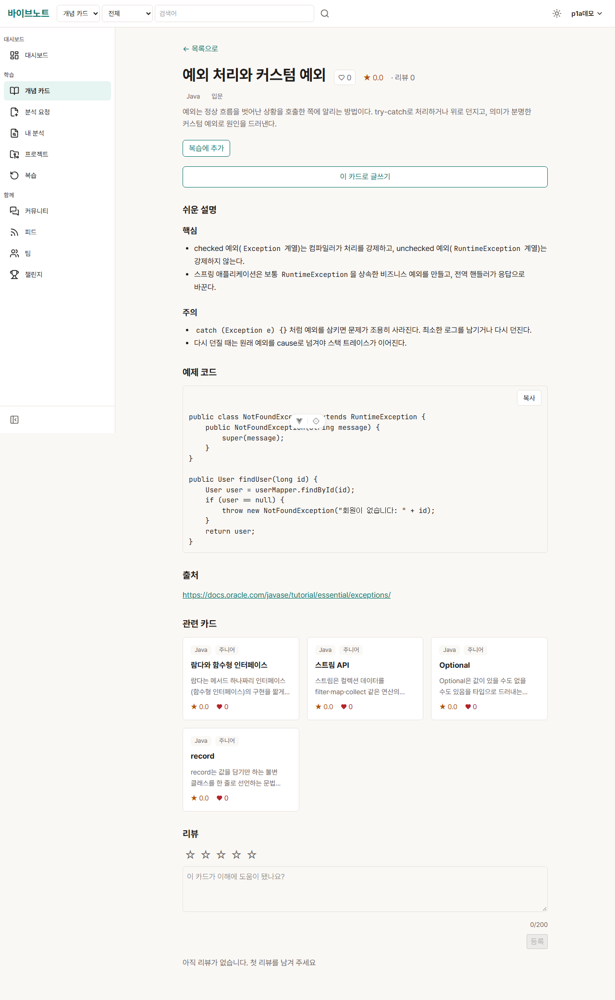 | 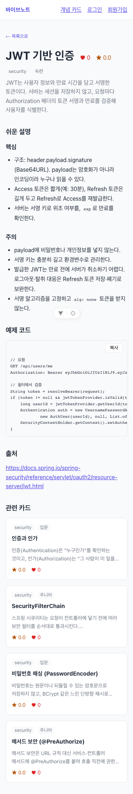 |
|  (F-11 리뷰 절, 비로그인) | 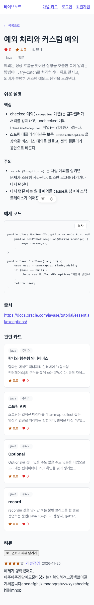 |
| 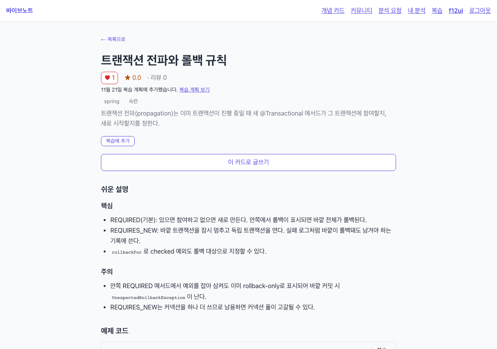 (F-12 찜 직후 복습 안내) | 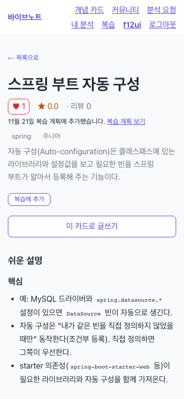 |

### SC-11 복습 계획 (`/review-plans`, F-15)

- 진입: 헤더 "복습" 메뉴(로그인 회원), SC-08 결과·SC-10 추가 안내의 "복습 계획 보기". 비로그인으로 주소를 열면 로그인 화면으로 간다
- 구성: 제목 "복습 계획", 기간 "M월 D일 ~ M월 D일"과 "◀ 이전 7일"·"오늘"·"다음 7일 ▶". 기간이 오늘부터일 때만 맨 위에 "밀린 복습 {n}개"(지난 날짜의 TODO, 없으면 숨김). 그 아래 항목이 있는 날짜마다 "M월 D일 (요일)" 머리글(오늘이면 " · 오늘")과 항목
- 항목: 완료 체크박스 · `ConceptCard`(누르면 `/concepts/{id}`) · 이유 배지(오답·찜·직접) · "삭제". DONE은 흐리게, 체크된 채로 보인다
- 동작: 체크·삭제 요청 중에는 그 항목의 체크박스·버튼을 끈다. 성공하면 응답으로 항목을 바꾸고(밀린 복습을 완료하면 그 절에서 빠지고 개수가 준다), 삭제는 목록에서 뺀다. 실패하면 체크를 되돌리고 서버 `message`를 항목 아래에 보여 준다. 확인 대화상자는 없다. 기간 이동은 서버가 준 `today`·`from` 기준 ±7일
- 상태별 UI: "불러오는 중…" / 밀린 복습과 기간 안에 항목이 없으면 "이 기간에 복습할 카드가 없습니다." + "개념 카드 둘러보기"(`/concepts`)와 그 아래 "이런 카드부터 시작해 보세요" 추천 3개(F-16 `RecommendationCard`. 처음 빈 상태일 때 한 번만 부르고, 실패하거나 비면 절을 숨긴다) / 조회 실패는 서버 `message` + "다시 시도"
- 모바일: 본문 최대 폭 760px. 375px에서는 배지·삭제가 카드 아래 줄로 내려간다 (가로 스크롤 없음)
- 구현: `views/reviewplan/ReviewPlanView.vue`, 항목 `components/reviewplan/ReviewPlanItem.vue`, API `api/reviewPlans.js` (F-15 PR). 빈 상태 추천은 `components/recommendation/RecommendationList.vue`(F-16)

| 데스크톱 (1280px) | 모바일 (375px) |
|---|---|
|  |  |
| 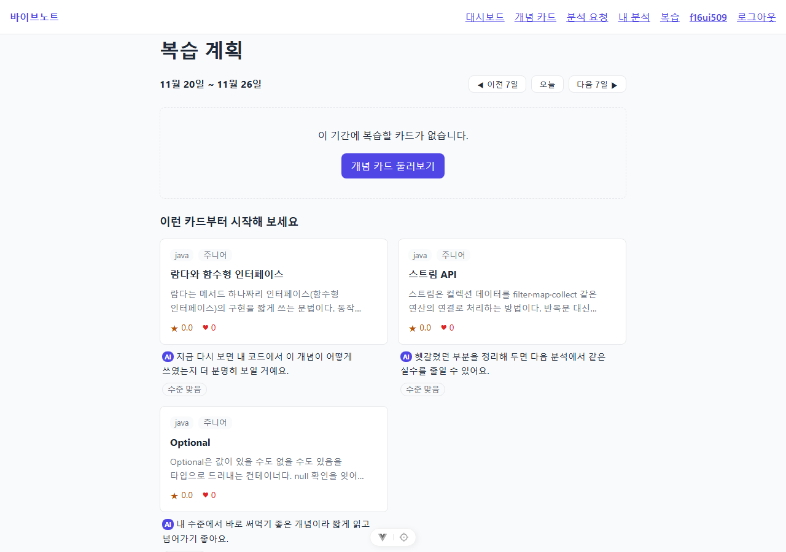 (빈 상태 추천, F-16) | 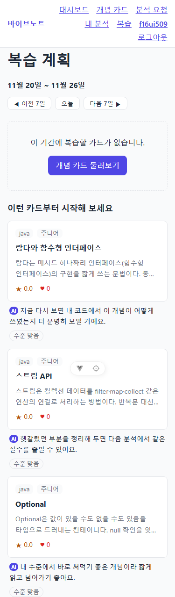 |

### SC-12 챌린지 목록 (`/challenges?status=&page=`, F-25)

- 진입: 헤더 "챌린지" 메뉴(비로그인 포함, 팀 다음), SC-04 "전체 보기"·"챌린지 둘러보기", SC-18 "챌린지 둘러보기"
- 구성: 제목 "챌린지", 상태 탭 "진행 중"(기본)·"예정"·"종료", 로그인했으면 "내 챌린지" 추가. 탭은 주소의 `status`(`ONGOING`·`UPCOMING`·`ENDED`·`MY`)와 맞추고, 모르는 값이나 비로그인의 `MY`는 진행 중으로 본다. 그 아래 `ChallengeCard` 격자 12개씩과 `PageNav`
- 카드: 대표 이미지(없으면 목표 유형별 그림 📚·📝·🔍) · 참여 중이면 "참여 중" 배지 · 제목 · 기간 "2026.12.01 ~ 12.31" · 목표 "퀴즈 10회 · 참여자 n명". "내 챌린지" 탭의 카드는 참여자 수 대신 달성도 바 "3 / 10회"와, 달성이면 "달성" 배지. 누르면 SC-13
- 정렬: 진행 중은 종료가 가까운 순, 예정은 시작이 가까운 순, 종료는 최근에 끝난 순. 내 챌린지는 참여한 시각 최신순
- 상태별 UI: "불러오는 중…" / 탭별 빈 안내 "진행 중인 챌린지가 없습니다."·"예정된 챌린지가 없습니다."·"종료된 챌린지가 없습니다."·"참여한 챌린지가 없습니다."(+ "진행 중 챌린지 보기") / 서버 `message` + "다시 시도" / 범위를 넘은 `page`는 마지막 페이지로
- 모바일: 본문 최대 폭 1080px, 격자는 `auto-fill, minmax(240px, 1fr)`이고 480px 이하 1열. 탭은 가로로 넘친다
- 구현: `views/challenge/ChallengeListView.vue`, `components/challenge/ChallengeCard.vue`·`ChallengeProgressBar.vue`·`labels.js`(관리자 화면과 같이 씀), API `api/challenges.js`

| 데스크톱 (1280px) | 모바일 (375px) |
|---|---|
| 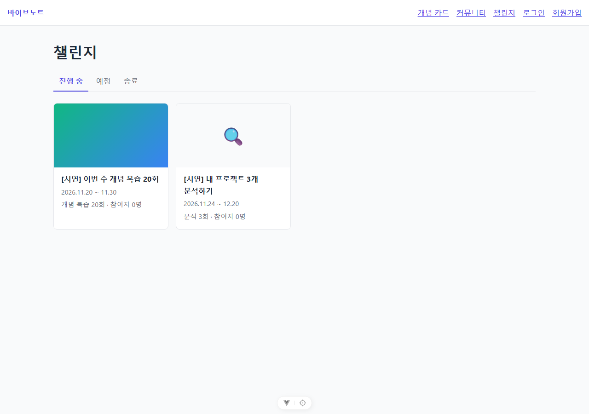 | 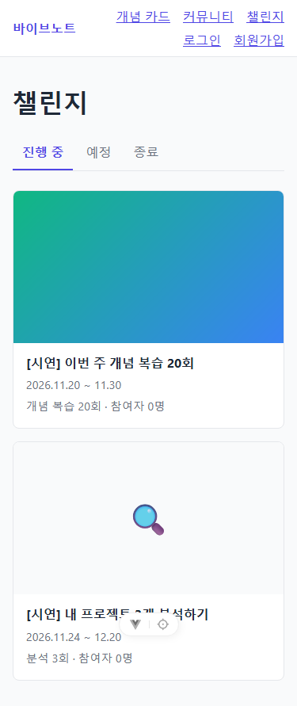 |

### SC-13 챌린지 상세 (`/challenges/:id`, F-25)

- 구성: 대표 이미지(없으면 목표 유형별 그림) · 상태 배지(예정·진행 중·종료) · 제목 · 기간과 "D-n"(진행 중은 종료일까지, 예정은 시작일까지, 서울 오늘 기준. 그날이면 "D-day") · 목표 · "참여자 n명" · 참여 영역 · 설명(줄바꿈 유지)
- 참여 영역 (`ChallengeJoinPanel`): 비로그인 "참여하기" → 로그인 후 이 화면으로 돌아옴 / 미참여 "참여하기" / 참여 중 달성도 바 "3 / 10회" + "참여 취소" / 달성 "달성 완료 · 11월 24일" 배지(취소 없음) / 종료된 챌린지는 버튼 없이 "종료된 챌린지입니다."(참여했으면 달성도 바와 함께)
- 동작: 참여·취소 요청 중에는 버튼을 끈다. 응답으로 참여자 수와 달성도를 바꾼다. 참여 직후 기간 안의 지난 활동이 이미 세어져 있어 바로 달성할 수도 있다. "참여 취소"는 화면 안 대화상자("참여를 취소할까요?", 달성도가 사라지고 다시 참여하면 시작일부터 다시 센다는 안내, "닫기"·"참여 취소")로 확인한다. 409(종료 `CHALLENGE_002`·달성 `CHALLENGE_003`)와 그 밖의 실패는 버튼 아래에 서버 `message`
- 상태별 UI: "불러오는 중…" / 없는 id는 "챌린지를 찾을 수 없습니다." / 그 밖의 에러는 서버 `message`
- 모바일: 본문 최대 폭 720px, 이미지는 16:9로 폭에 맞춘다
- 구현: `views/challenge/ChallengeDetailView.vue`, `components/challenge/ChallengeJoinPanel.vue`, 날짜 `utils/seoulDate.js`(관리자 챌린지 폼의 "오늘"도 이것을 쓴다, #99)

| 데스크톱 (1280px) | 모바일 (375px) |
|---|---|
| 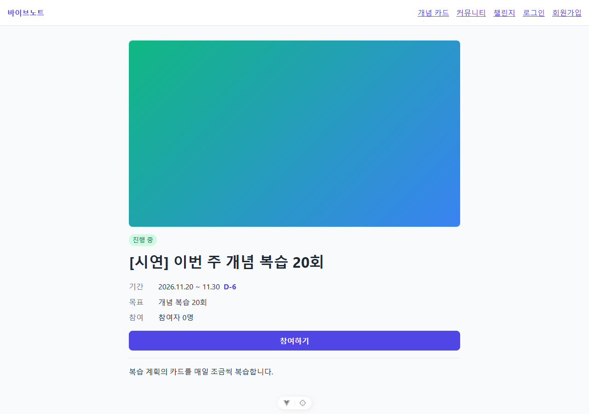 | 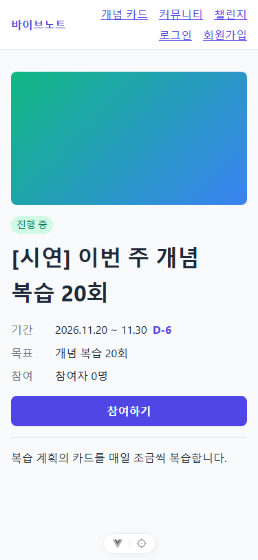 |

### SC-14 커뮤니티 목록 (`/community?boardType=&keyword=&page=`, F-17)

- 진입: 상단 nav "커뮤니티"(비로그인에도 보임), 대시보드. 공개 화면이다
- 구성: 제목 "커뮤니티", 게시판 탭(전체 · 코드 이해 Q&A · 학습 후기 · 자유), 검색창 + 검색 버튼, "글쓰기" 버튼(SC-16), 게시글 목록, 이전·다음 페이지
- 게시글 행: 게시판 칩, 제목, 첨부 표시(📎 분석 / 🃏 카드), 댓글 수 `[3]`, 작성자 닉네임(탈퇴했으면 "탈퇴한 사용자"), 작성일, 조회수. 행을 누르면 SC-15
- 상태별 UI: 불러오는 중 / 0건은 "게시글이 없습니다" + (검색 중이면) "검색 초기화" / 에러는 서버 `message`
- 동작: 탭은 누르는 즉시, 검색은 Enter나 버튼을 누를 때 다시 조회하고 1페이지로 돌아간다. 탭·검색어·페이지는 URL 쿼리에 남는다(SC-09와 같은 규칙). 비로그인이 "글쓰기"를 누르면 로그인 화면으로 보낸다
- 모바일: 탭은 한 줄 가로 스크롤 칩. 게시글 행은 두 줄(1줄: 칩·제목·첨부·댓글 수, 2줄: 작성자·날짜·조회). 글쓰기 버튼은 데스크톱과 같이 제목 오른쪽
- 정한 것 (F-17 spec): 검색은 **제목+본문** 부분 일치(대소문자 무시, 50자까지), 20개씩, **최신순 고정**. 작성일은 `MM/DD`. 비로그인의 "글쓰기"는 `/login?redirect=/community/write`

```
데스크톱 (1280px)
┌──────────────────────────────────────────────────────────────────────┐
│ 커뮤니티                                                  [글쓰기]   │
│ [전체] [코드 이해 Q&A] [학습 후기] [자유]   [🔍 검색어      ][검색]  │
│ ──────────────────────────────────────────────────────────────────── │
│ [Q&A]  @Transactional이 안 먹는 이유가 뭔가요? 📎[3]  코딩초보 11/20 42│
│ [후기] JWT 카드 보고 드디어 이해했습니다 🃏 [1]       java러버 11/19 18│
│ [자유] 스터디 같이 하실 분                    [0]  탈퇴한 사용자 11/18 7│
│                      [‹ 이전]  1 / 3  [다음 ›]                       │
└──────────────────────────────────────────────────────────────────────┘

모바일 (375px)
┌─────────────────────┐
│ 커뮤니티            │
│ [전체][Q&A][후기][→ │
│ [🔍 검색어   ][검색]│
│ [Q&A] @Transactiona…│
│ 코딩초보·11/20·42 [3]│
│ [후기] JWT 카드 보고…│
│ java러버·11/19·18 [1]│
│ [‹ 이전] 1/3 [다음›]│
│                 (✎) │
└─────────────────────┘
```

| 데스크톱 (1280px) | 모바일 (375px) |
|---|---|
| 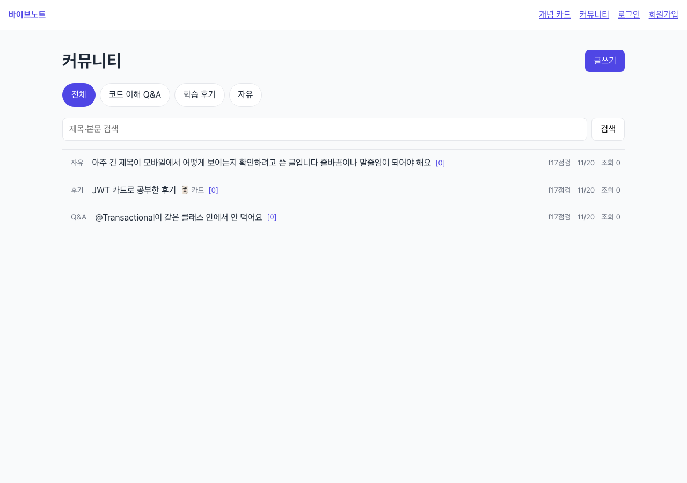 (F-17, 비로그인) | 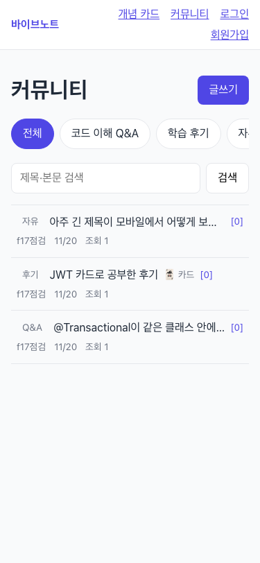 |

### SC-15 게시글 상세 (`/community/:id`, F-17 · 댓글 F-18)

- 구성: 게시판 칩, 제목, 작성자(누르면 SC-18)·작성일·조회수, 본문, 첨부 카드(있을 때만: 분석이면 제목·프로젝트명·"분석 보기"로 SC-07, 개념 카드면 `ConceptCard` 축소형으로 SC-10), 내 글이면 "수정"(SC-16)·"삭제", "← 목록으로"
- 댓글 (F-18): "댓글 N", 작성 폼(회원만, 입력창 + "n/500" + "등록". 비로그인은 "로그인하고 댓글 남기기" 링크), 댓글 목록(닉네임, 작성일, "(수정됨)", 내용). 내 댓글에만 머리 줄에 "수정"·"삭제"가 보이고, 수정은 그 자리에서 입력창("저장"·"취소")으로 바뀐다. 한 번에 한 댓글만 수정한다
- 상태별 UI: 불러오는 중 / 없거나 삭제된 글(`POST_404`)은 "게시글을 찾을 수 없습니다." + 목록으로 / 첨부한 분석이 비공개로 바뀌었거나 삭제됐으면 첨부 영역에 "볼 수 없는 분석입니다" / 댓글 0건은 "첫 댓글을 남겨 주세요" / 댓글을 불러오지 못하면 댓글 절 안에 서버 `message`(본문은 그대로) / 200개를 넘으면 "댓글이 많아 처음 200개만 보입니다" / 댓글 작성·수정 400은 입력창 아래 `details.content` / 남의 글·댓글 수정·삭제 요청이 403·404이면 서버 `message`
- 동작: 글·댓글 삭제는 확인 대화상자를 거친다. 글을 지우면 목록으로 돌아간다. 댓글 등록·수정·삭제 후 댓글 목록만 다시 불러온다. 상세를 열 때 조회수가 1 오른다
- 모바일: 한 열. 첨부 카드는 전체 폭. 댓글 수정·삭제는 데스크톱과 같은 글자 버튼이다 (⋯ 메뉴 없음, 11-20 결정)
- 정한 것 (F-17 spec): 조회수는 **열 때마다 +1**(중복 방지 없음, 작성자 본인도 오름). 본문은 글자 그대로(줄바꿈 유지, HTML·마크다운 해석 안 함). 작성일은 `YYYY-MM-DD HH:mm`. 분석 첨부는 공개이거나 내 분석일 때만 제목·프로젝트명이 보이고(F-19 전에는 모든 분석이 비공개), 카드 첨부는 공개 카드일 때만 이름·카테고리·난이도·요약 상자가 보인다. 글을 지우면 댓글도 함께 지워진다(FK CASCADE)
- 정한 것 (F-18 spec): 댓글은 **오래된순**(작성 시각, id)으로 **페이지 없이 최대 200개**를 한 번에 보여 준다. 내용은 1~500자(앞뒤 공백 제외), 글자 그대로 표시(줄바꿈 유지, HTML 해석 안 함). 같은 내용으로 저장하면 "(수정됨)"이 붙지 않는다. 댓글은 피드 활동을 남기지 않는다

```
데스크톱 (1280px)
┌──────────────────────────────────────────────────────────────────────┐
│ ← 목록으로                                            [수정] [삭제]  │
│ [Q&A] @Transactional이 안 먹는 이유가 뭔가요?                        │
│ 코딩초보 · 11/20 14:02 · 조회 42                                     │
│ ──────────────────────────────────────────────────────────────────── │
│ 같은 클래스 안에서 메서드를 호출하면 트랜잭션이 안 걸린다는데 ...    │
│ ┌ 첨부한 분석 ─────────────────────────────────────┐                 │
│ │ 쇼핑몰 과제 · shop-backend         [분석 보기 →] │                 │
│ └──────────────────────────────────────────────────┘                 │
│ ──────────────────────────────────────────────────────────────────── │
│ 댓글 3                                                               │
│ [댓글을 입력하세요                                        ] [등록]   │
│ java러버 · 2026-11-20 14:10                                          │
│ 프록시를 거치지 않아서 그래요. 트랜잭션 전파 카드를 보세요.          │
│ 코딩초보 · 2026-11-20 15:01 (수정됨)                      수정  삭제 │
│ 감사합니다!                                                          │
└──────────────────────────────────────────────────────────────────────┘
```

| 데스크톱 (1280px) | 모바일 (375px) |
|---|---|
| 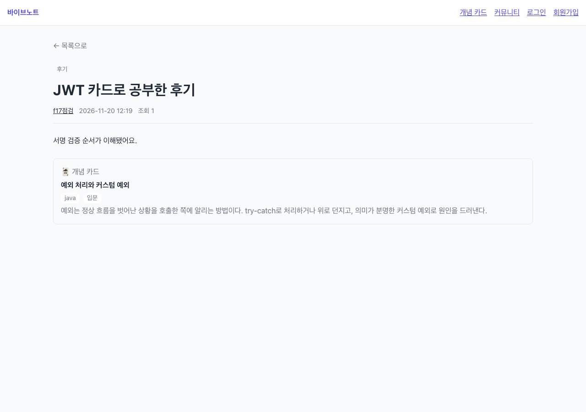 (내 글·내 댓글, 댓글 3개 · F-18) | 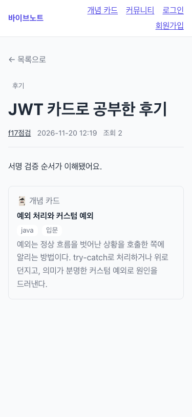 |

### SC-16 게시글 작성·수정 (`/community/write`, 수정 `/community/:id/edit`, F-17)

- 진입: SC-14 "글쓰기", SC-15 "수정", SC-10 "이 카드로 글쓰기"(`/community/write?conceptId=`, 카드 첨부). `?analysisId=`도 받아 두었고, SC-07 "커뮤니티에 질문하기" 버튼은 A 화면이라 follow-up 이슈로 넘긴다
- 구성: 게시판 선택(라디오 3개: 코드 이해 Q&A · 학습 후기 · 자유, 기본 Q&A), 제목(100자), 본문(여러 줄 입력, 5000자, "n/5000"), 첨부 선택(없음 / 내 분석: 최근 100개 중 완료된 분석 선택 상자 / 개념 카드: 검색어로 10개 찾아 고르기 — 하나만 고름, 선택하면 미리보기 칩과 ✕), 등록(수정이면 "저장"). 취소는 "← 목록으로"·뒤로 가기로 대신한다(이탈 확인)
- 상태별 UI: 제목·본문이 공백뿐이면 등록 비활성 / 서버 `details`(`COMMON_400`)는 필드 아래, 첨부 오류(`details.conceptId`·`POST_001`·`POST_002`)는 첨부 아래 / 남의 글 수정 화면에 들어오면 "본인이 쓴 글만 수정할 수 있습니다."를 상세(SC-15) 위에 보여 준다 / 미리 채울 첨부를 불러오지 못하면 "첨부할 수 없는 항목이라 빼고 열었습니다." / 저장 중에는 버튼 비활성화
- 동작: 등록·저장에 성공하면 SC-15로 이동한다. 작성 중에 화면을 벗어나려 하면 "작성 중인 내용이 사라집니다" 확인을 띄운다. 첨부는 분석과 카드 중 하나만 고른다
- 모바일: 한 열, 등록 버튼은 폼 맨 아래
- 정한 것 (F-17 spec): 첨부할 수 있는 분석은 **내 분석 중 완료(DONE)되고 삭제되지 않은 것**(비공개여도 첨부 가능, 보이는 범위는 SC-15), 카드는 공개 카드만. 분석과 카드는 **동시에 첨부할 수 없다**. 제목 100자·본문 5000자(앞뒤 공백 제외)

```
데스크톱 (1280px)
┌──────────────────────────────────────────────────────────────────────┐
│ 글쓰기                                                               │
│ 게시판  (●) 코드 이해 Q&A  ( ) 학습 후기  ( ) 자유                   │
│ 제목    [                                                       ]   │
│ 본문    ┌──────────────────────────────────────────────────────┐    │
│         │                                                      │    │
│         └──────────────────────────────────────────────── 0/5000┘    │
│ 첨부    ( ) 없음  (●) 내 분석 [쇼핑몰 과제 ✕]  ( ) 개념 카드 [고르기▾]│
│                                              [취소]  [등록]          │
└──────────────────────────────────────────────────────────────────────┘
```

| 데스크톱 (1280px) | 모바일 (375px) |
|---|---|
| 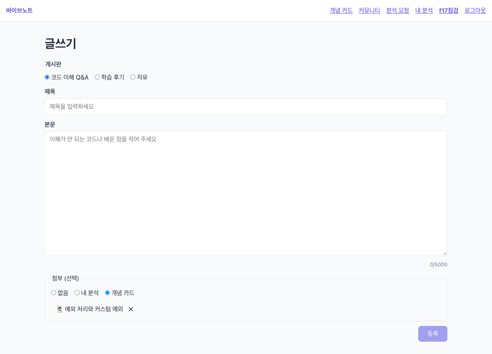 (`?conceptId=`로 카드 첨부를 미리 채움) | 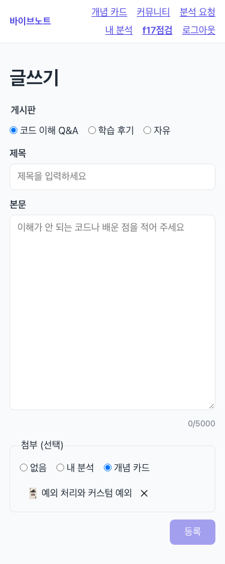 |

### SC-17 피드 (`/feed`, F-04)

- 진입: 상단 nav "피드"(회원만 보임, 커뮤니티 다음). 비로그인이 URL로 들어오면 로그인 화면으로 보내고 로그인 후 돌아온다. 대시보드 진입 링크는 대시보드(A) 쪽 후속
- 구성: 제목 "피드", 팔로우한 사람들의 활동 목록(최신순, 같은 시각이면 나중 활동 먼저), 20개씩 "더 보기"(페이지 번호 방식, 이미 보인 활동은 거름). 내 활동은 넣지 않는다
- 활동 항목: 프로필 이니셜·닉네임(누르면 SC-18), 행동 문장, 대상 링크, 시각("방금 전"·"n분 전"·"n시간 전"·"어제"·"n일 전", 7일 넘으면 `YYYY-MM-DD`). 모르는 종류는 그리지 않는다
  - `ANALYSIS` "새 분석을 공개했어요 · 쇼핑몰 과제" → SC-07 / `REVIEW` "카드에 리뷰를 남겼어요 · JWT 기반 인증 ★5" → SC-10 / `WISH` "카드를 찜했어요" → SC-10 / `POST` "글을 썼어요 · 제목" → SC-15 / `CHALLENGE_JOIN`·`CHALLENGE_COMPLETE` "챌린지에 참여했어요 / 달성했어요" → SC-13
- 상태별 UI: 불러오는 중 / 팔로우가 0명이면 "아직 팔로우한 사람이 없어요" + "커뮤니티 둘러보기"(SC-14) / 팔로우는 있는데 활동이 없으면 "새 활동이 없습니다" / 대상이 비공개·삭제·찜 해제·카드 비공개가 된 항목은 서버가 목록과 개수에서 뺀다 / 에러는 서버 `message`
- 모바일: 한 열, 항목은 두 줄(1줄: 닉네임·시각, 2줄: 행동 문장·대상)
- 정한 것(F-04 spec, 결정로그 11-20): 페이지 번호 + "더 보기", 숨길 대상은 서버에서 거름, 내 활동은 넣지 않음

```
데스크톱 (1280px)                          팔로우 0명
┌─────────────────────────────────────┐    ┌──────────────────────────┐
│ 피드                                │    │ 피드                     │
│ (코) 코딩초보 · 3시간 전            │    │ 아직 팔로우한 사람이     │
│      카드에 리뷰를 남겼어요         │    │ 없어요                   │
│      JWT 기반 인증 ★★★★★          │    │ [커뮤니티 둘러보기]      │
│ (j)  java러버 · 어제                │    └──────────────────────────┘
│      새 분석을 공개했어요 · 쇼핑몰… │
│ (j)  java러버 · 어제                │
│      글을 썼어요 · 스터디 같이 …    │
│              [더 보기]              │
└─────────────────────────────────────┘
```

| 데스크톱 (1280px) | 모바일 (375px) |
|---|---|
| 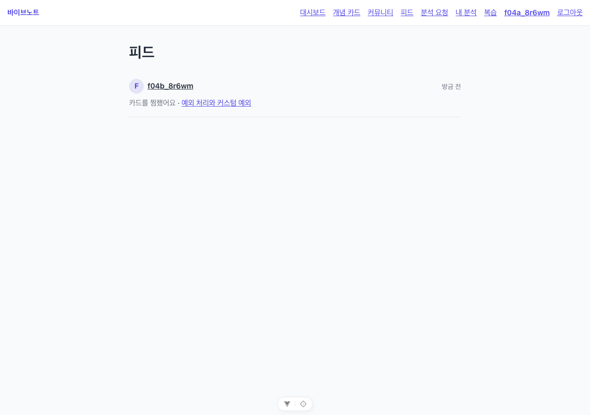 | 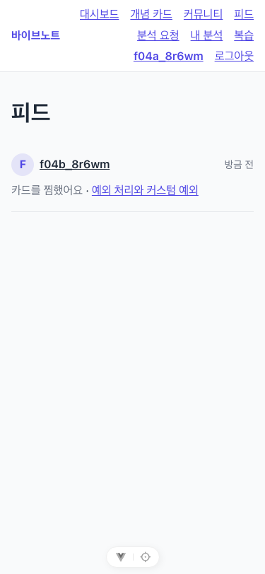 |
| 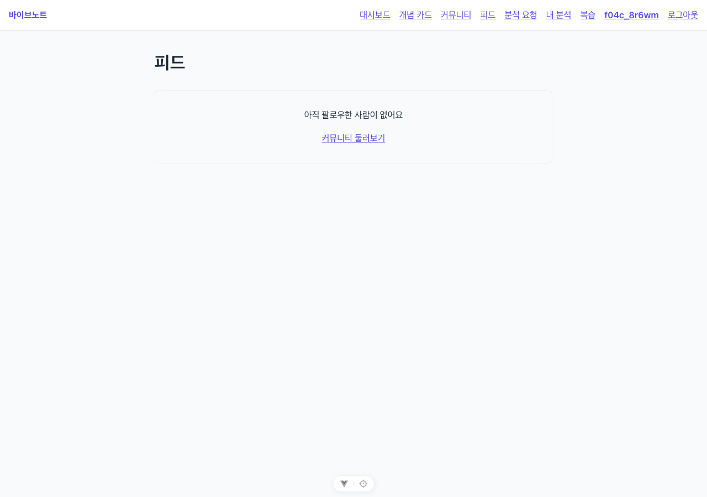 (팔로우 0명) | 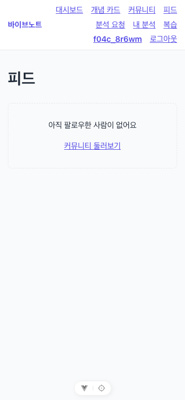 |

### SC-18 프로필 (`/users/:id`, F-03 · 팔로우 F-04 · 찜 F-12 · 챌린지 F-25)

- 구성(F-03): 닉네임, 학습 수준 배지, 가입일, 소개, 학습 통계 타일 3개(완료한 분석 / 학습한 카드 / 퀴즈 정답률). 내 프로필이면 "정보 수정" 링크(SC-19). 헤더의 내 닉네임을 누르면 이 화면으로 온다
- 상태별 UI: 불러오는 중 / 없거나 탈퇴한 회원(USER_404)은 "탈퇴했거나 없는 사용자입니다." / 그 밖의 에러는 서버 메시지 / 정답률은 풀이가 없으면 "-"
- 찜한 카드 (F-12): 통계 아래 "찜한 카드 N" 절. 공개 카드만 찜한 시각 최신순으로 `ConceptCard` 12개 격자(누르면 SC-10), 남으면 "더 보기"가 다음 12개를 붙인다. 0건이면 "아직 찜한 카드가 없습니다."(내 프로필은 "개념 카드 둘러보기" 링크 추가). 이 절만 실패하면 절 안에 서버 메시지를 보이고 프로필은 그대로다. 찜 목록은 누구나 볼 수 있다
- 팔로우 (F-04): 닉네임 아래 "팔로워 N · 팔로잉 N" 링크(팔로우 목록 화면의 해당 탭). 남의 프로필이면 "팔로우" 버튼(팔로우 중이면 "팔로잉", 마우스를 올리면 빨간 "언팔로우"). 누르면 요청 중 비활성 → 응답의 상태·수로 바꾼다. 비로그인이 누르면 로그인 후 이 프로필로 돌아온다. 내 프로필에는 버튼이 없다. 실패하면 버튼 옆에 서버 메시지, 팔로우 영역만 실패하면 영역 안에 메시지를 보이고 프로필은 그대로다
- 팔로우 목록 (`/users/:id/follows?tab=followers|followings`, F-04): 제목 "{닉네임}님의 팔로우", 탭 "팔로워 N"·"팔로잉 N"(주소의 `tab`과 맞추고 잘못된 값이면 팔로워), 항목은 이니셜·닉네임(누르면 SC-18)·수준 배지, 팔로우한 시각 최신순 20명씩 "더 보기". 0명이면 "아직 팔로워가 없습니다."·"아직 팔로우한 사람이 없습니다.", 없거나 탈퇴한 회원은 "탈퇴했거나 없는 사용자입니다.", "← 프로필로" 링크. 누구나 볼 수 있다
- 참여 챌린지 (F-25): 찜한 카드 아래 "참여 챌린지 N" 절. 참여 시각 최신순 6개의 제목·기간·달성도 바(달성이면 "달성" 배지, 누르면 SC-13), 남으면 "더 보기"가 다음 6개를 붙인다. 0건이면 "아직 참여한 챌린지가 없습니다."(내 프로필은 "챌린지 둘러보기" 링크). 이 절만 실패하면 절 안에 서버 메시지를 보이고 프로필은 그대로다. 누구나 볼 수 있다 (`components/challenge/UserChallenges.vue`)
- 동작: 비로그인도 볼 수 있다(email 비공개)
- 모바일: 통계 타일과 찜한 카드 격자를 한 열로 쌓는다. 375px에서 팔로우 버튼은 수 링크 아래로 내려간다. 팔로우 목록은 한 열

| 데스크톱 (1280px) | 모바일 (375px) |
|---|---|
|  |  |
|  (F-12 찜한 카드 절) |  |
|  (F-04 남의 프로필, 팔로우 후 "팔로잉") |  |
|  (F-04 팔로우 목록, 팔로워 탭) |  (팔로잉 탭) |

### SC-19 내 정보 수정·탈퇴 (`/me/settings`, F-03)

- 구성: 정보 수정 카드(이메일 읽기 전용, 닉네임, 소개 300자 카운터, 학습 수준 라디오 카드 3개, 저장하기) + 회원 탈퇴 카드(안내 문구: 마스킹·로그아웃·분석 삭제·작성물 유지, 현재 비밀번호, "되돌릴 수 없음" 확인 체크, 빨간 탈퇴하기 버튼)
- 상태별 UI: 클라이언트 검증·서버 `details`(COMMON_400, USER_409)는 필드 아래 / 저장 성공 시 "저장했습니다." / 비밀번호 불일치(USER_001)는 비밀번호 아래 / 탈퇴 버튼은 비밀번호와 확인 체크가 있어야 활성화
- 동작: 저장하면 헤더 닉네임·수준이 바로 바뀐다. 탈퇴 성공 시 이 기기의 세션을 비우고 홈으로 이동 (서버가 모든 기기의 Refresh 토큰을 폐기)
- 모바일: 한 열, 최대 폭 560px

| 데스크톱 (1280px) | 모바일 (375px) | 탈퇴 실패 (USER_001) |
|---|---|---|
|  |  |  |

### SC-22 내 팀 (`/teams?code=`, F-20a)

- 진입: 상단 nav "팀"(회원만 보임, 피드 다음). 비로그인이 URL로 들어오면 `/login?redirect=/teams`로 보내고 로그인 후 돌아온다. 팀장이 공유한 초대 링크 `/teams?code=K7M2QX9P`로 들어오면 코드 입력란만 미리 채운다 (자동 가입하지 않음)
- 구성: 제목 "내 팀", 내 팀 카드 그리드(내가 가입한 시각 최신순, 최대 5개), 아래에 "팀 만들기"·"초대 코드로 가입" 두 패널(좁은 폭에서는 위아래)
  - 카드: 팀 이름, 역할 칩("팀장"·"팀원"), "{n}명", 소개(없으면 생략). 누르면 SC-23
  - 팀 만들기: 이름(30자)·소개(선택, 200자), "만들기" → SC-23 / 초대 코드로 가입: 코드 8자(입력하는 대로 대문자), "가입" → SC-23
- 상태별 UI: 불러오는 중 / 0개면 "아직 속한 팀이 없습니다. 팀을 만들거나 초대 코드로 가입해 보세요." / 실패는 서버 `message` + "다시 시도" / 이름이 공백뿐이거나 코드가 비면, 그리고 요청 중에는 버튼 비활성 / 400은 `details`를 해당 입력 아래, `TEAM_001`(유효하지 않은 코드)·`TEAM_002`(10명 가득)·`TEAM_003`(5개 초과)·`TEAM_409`(이미 가입)는 그 폼 아래에 서버 `message`, 입력값 유지
- 정한 것(F-20a spec, 결정로그 11-23): 초대 코드 방식(닉네임 초대·수락 대기 없음), 팀당 10명·1인 5팀

```
데스크톱 (1280px)
┌──────────────────────────────────────────────────────┐
│ 내 팀                                                │
│ ┌──────────────────────┐ ┌──────────────────────┐    │
│ │ 스프링 스터디  [팀장] │ │ 알고리즘 방   [팀원] │    │
│ │ 3명                  │ │ 7명                  │    │
│ │ F-05 분석 결과를 …   │ │                      │    │
│ └──────────────────────┘ └──────────────────────┘    │
│ ┌ 팀 만들기 ─────────────┐ ┌ 초대 코드로 가입 ─────┐ │
│ │ 팀 이름 [            ] │ │ 초대 코드 [K7M2QX9P]  │ │
│ │ 소개    [            ] │ │               [가입]  │ │
│ │              [만들기]  │ └───────────────────────┘ │
│ └────────────────────────┘                           │
└──────────────────────────────────────────────────────┘
```

| 데스크톱 (1280px) | 모바일 (375px) |
|---|---|
|  |  |

### SC-23 팀 상세 (`/teams/:id`, F-20a)

- 권한: 그 팀 멤버만 본다. 남의 팀·없는 팀은 같은 404 "팀을 찾을 수 없습니다." + "← 내 팀으로"(SC-22)
- 구성: 팀 이름·소개, (팀장) 초대 코드 상자, "멤버 {n}/10"과 멤버 목록, 맨 아래 동작 버튼
  - 초대 코드 상자(팀장만): 코드, "코드 복사", "초대 링크 복사"(`{origin}/teams?code=코드`), "재발급". 복사 결과 "복사했습니다" / 클립보드를 못 쓰면 "복사하지 못했습니다. 코드를 직접 복사해 주세요."
  - 멤버 행: 닉네임(SC-18 링크), "팀장" 칩, 수준 배지, 가입일 `YYYY-MM-DD`. 팀장 화면이면 팀원 행마다 "내보내기". 팀장이 맨 앞, 나머지는 가입 순
  - 동작: 팀장 "수정"(같은 화면에서 이름·소개 폼으로 바뀜, 저장·취소)·"팀 삭제" / 팀원 "팀 탈퇴". 팀장은 탈퇴할 수 없고 팀을 삭제한다 (위임 없음)
- 팀 목표 영역(F-20c, 멤버 목록과 공유 분석 사이): 진행 중 → 예정 → 종료 순. 항목마다 "{분석 제목 또는 프로젝트 이름} · 정답률 {r}% 이상", "MM-DD ~ MM-DD", 상태 칩(예정 "D-{n}" / 진행 중 "{n}일 남음", 종료일이면 "오늘 마감" / "종료"), "{달성}/{멤버 수}명 달성", 팀 달성이면 "달성" 칩, 종료이고 미달성이면 "미달성" 칩, "이해도 보기"(SC-24). 팀장에게 "삭제"(확인 "이 팀 목표를 삭제할까요?")
  - 빈 상태 "아직 팀 목표가 없습니다." (팀장에게는 "공유 분석의 이해도 화면에서 목표를 만들 수 있습니다." 덧붙임) / 조회 실패는 이 영역에만 서버 `message` + "다시 시도". 공유 해제·팀원 내보내기 뒤 다시 불러온다
- 공유 분석 영역(F-20b, 팀 목표 아래): "공유 분석 {n}/10"과 "분석 공유" 버튼, 항목마다 제목(없으면 프로젝트 이름), "{닉네임} 님 공유 · YYYY-MM-DD", "{푼 멤버}/{멤버 수}명 풀이 · 내 점수 {s}/{t}"(안 풀었으면 "아직 풀지 않음"), "퀴즈 풀기"(SC-08 `?team=`)·"이해도 보기"(SC-24), 공유한 사람·팀장에게 "공유 해제"
  - 분석 공유: 내 분석 중 DONE이고 이 팀에 아직 공유하지 않은 것을 고르는 목록 + "공유". 고를 것이 없으면 "공유할 수 있는 완료된 분석이 없습니다." + "분석 요청하기". 10개면 버튼 비활성. 실패(`TEAM_007`·`008`·`009`·`ANALYSIS_404`)는 목록 아래 서버 `message`, 선택 유지
  - 빈 상태 "아직 공유한 분석이 없습니다. 내 분석을 공유해 팀원과 함께 퀴즈를 풀어 보세요." / 조회 실패는 이 영역에만 서버 `message` + "다시 시도"
- 확인 대화상자: 공유 해제 "이 분석의 공유를 해제할까요? 팀원의 풀이 기록은 남고, 이 분석의 팀 목표는 함께 삭제됩니다." (F-20c) / 재발급 "이전 코드로는 더 가입할 수 없습니다." / 내보내기 "{닉네임} 님을 팀에서 내보낼까요?" / 삭제 "팀과 멤버 정보가 모두 삭제됩니다." / 탈퇴 "팀에서 탈퇴할까요?". 취소하면 요청하지 않는다. 삭제·탈퇴 후 SC-22로
- 상태별 UI: 불러오는 중 / 404 / 그 밖의 실패는 서버 `message` + "다시 시도" / 동작 실패는 버튼 아래 서버 `message`
- 모바일: 한 열, 멤버 행은 닉네임·칩 줄과 가입일·내보내기 줄로 감싼다. 375px에서 가로 스크롤 없음 (NF-02)

```
데스크톱 (1280px, 팀장)
┌──────────────────────────────────────────────────────┐
│ ← 내 팀                                              │
│ 스프링 스터디                                        │
│ F-05 분석 결과를 같이 공부합니다                     │
│ ┌ 초대 코드  K7M2QX9P ───────────────────────────┐   │
│ │ [코드 복사] [초대 링크 복사] [재발급]          │   │
│ └────────────────────────────────────────────────┘   │
│ 멤버 2/10                                            │
│ vibecoder [팀장] [주니어]              2026-11-24    │
│ learner   [입문]              2026-11-25 [내보내기]  │
│                                  [수정] [팀 삭제]    │
└──────────────────────────────────────────────────────┘
```

| 데스크톱 (1280px) | 모바일 (375px) |
|---|---|
|  (팀장) |  |
|  (팀원) |  |
|  (공유 분석 빈 상태, F-20b) |  |
|  (팀 목표 진행 중, F-20c) |  |

### SC-24 팀 이해도 (`/teams/:id/analyses/:analysisId`, F-20b)

- 권한: 팀 멤버만. 없는 팀·남의 팀은 "팀을 찾을 수 없습니다." + "← 내 팀으로"(SC-22), 그 팀에 공유되지 않았거나 삭제된 분석은 "팀에 공유된 분석을 찾을 수 없습니다." + "← 팀으로". 그 밖의 실패는 서버 `message` + "다시 시도"
- 구성: "← 팀으로", 분석 제목(없으면 프로젝트 이름, #89), "{닉네임} 님 공유", "{푼 멤버}/{멤버 수}명 풀이 · 객관식 {n}문항", "퀴즈 풀기"(SC-08 `?team=`)
  - 팀 목표(F-20c, 이해도 위): 예정·진행 중 목표가 있으면 그것, 없으면 가장 최근 종료 목표. "정답률 {r}% 이상 · MM-DD ~ MM-DD", 상태 칩, "{달성}/{멤버 수}명 달성", 멤버마다 닉네임·"{s}/{t} ({정답률}%)" 또는 "기간 안 풀이 없음"·"달성" 칩. 목표가 없으면 "이 분석에 팀 목표가 없습니다." 조회 실패는 이 영역에만 서버 `message` + "다시 시도" (이해도는 그대로)
  - 목표 만들기(팀장, 예정·진행 중 목표가 없을 때): 시작일(기본 오늘, 고를 수 있는 범위 오늘 ~ 오늘 + 365일, #95)·종료일(기본 오늘+6일)·목표 정답률(기본 80, 1~100) + "목표 만들기"(요청 중 비활성). 400은 필드 아래, `TEAM_011`·`TEAM_012`·`TEAM_006`은 폼 아래 서버 `message`, 입력 유지. 기간은 양끝 포함 최대 30일
  - 모듈별 이해도: 레이어 순서(컨트롤러·서비스·매퍼(DB)·화면(Vue)·스크립트·설정·도메인·DTO·기타) 중 문항이 있는 것만. 라벨, "{k}문항", 정답률 막대와 "{r}%"(아무도 안 풀었으면 막대 없이 "풀이 없음"). 정답률이 가장 낮은 모듈 하나에 "가장 약한 모듈" 칩
  - 멤버별: 행 = 멤버(닉네임 → SC-18, 최근 점수 또는 "아직 풀지 않음"), 열 = 모듈, 칸 = "{맞힌 수}/{문항 수}" 또는 "–". 아무도 풀지 않았으면 표 대신 "아직 이 분석의 퀴즈를 푼 팀원이 없습니다."
- 계산 기준: 지금 멤버마다 가장 최근 풀이 1건. 모듈 = 문항 개념이 그 분석에서 연결된 파일의 레이어(없으면 기타)
- 모바일: 한 열. 멤버 표는 표 영역 안에서만 가로 스크롤 (페이지 가로 스크롤 없음, NF-02)

```
데스크톱 (1280px)
┌──────────────────────────────────────────────────────┐
│ ← 팀으로                                             │
│ spring-realworld                                     │
│ vibecoder 님 공유 · 2/3명 풀이 · 객관식 4문항        │
│ [퀴즈 풀기]                                          │
│ 모듈별 이해도                                        │
│ 컨트롤러 2문항          ███████████████░░░░░  75%    │
│ 서비스 1문항 [가장 약한 모듈] ██████████░░░░  50%    │
│ 기타 1문항              ██████████░░░░░░░░░░  50%    │
│ 멤버별                                               │
│ 멤버       최근 점수  컨트롤러  서비스  기타         │
│ vibecoder  2/4        1/2       1/1     0/1          │
│ newbie     아직 풀지 않음  –     –       –           │
└──────────────────────────────────────────────────────┘
```

| 데스크톱 (1280px) | 모바일 (375px) |
|---|---|
|  |  (멤버 표는 표 안에서만 가로 스크롤) |
|  (팀 목표 진행, F-20c) |  |
|  (팀장 목표 만들기, F-20c) |  |

### SC-20·21 관리자 공통 레이아웃 (`/admin`, F-00b)

- 구성: 왼쪽 사이드 메뉴(자식 route의 `meta.adminNav`) + 본문. `/admin` 첫 화면은 "관리자" 제목과 "관리할 항목을 고르세요." 안내
- 상태별 UI: 자식 화면이 아직 없으면 메뉴 자리에 "아직 관리 메뉴가 없습니다."
- 동작: 비로그인은 `/login?redirect=/admin`, USER는 홈으로 보낸다. 헤더의 "관리자" 메뉴는 ADMIN에게만 보인다. SC-20 카드 관리(F-13)·SC-21 챌린지 관리(F-24)가 자식 화면으로 들어온다
- 모바일: 사이드 메뉴가 본문 위 가로 메뉴로 바뀐다

| 데스크톱 (1440px) | 모바일 (375px) |
|---|---|
|  |  |

### SC-20 관리자 카드 관리 (`/admin/concepts?status=&source=&keyword=&page=`, F-13)

- 진입: SC-20·21 관리자 공통 레이아웃의 자식 화면. 헤더 "관리자" 메뉴(ADMIN에게만 보임) → 사이드 메뉴 "개념 카드"(`meta.adminNav`). 권한 처리는 공통 레이아웃을 따른다(비로그인은 `/login?redirect=…`, USER는 홈)
- 목록 구성 (AC13): 상태 탭(검수 대기 n · 공개 n · 숨김 n · 전체, 개수는 `status-counts`), 출처 필터(전체 출처 · 시드 · AI 초안 · 직접 작성), 검색창(이름·요약), "새 카드" 버튼, 표(이름, 카테고리, 난이도, 출처, 상태, 찜, 평점, 수정일, "검수"(DRAFT)/"수정" 버튼). 조건은 URL 쿼리가 정본이라 새로고침·뒤로 가기에도 유지된다. 기본 탭은 검수 대기이고 전체 탭은 `?status=ALL`로 표시한다(API에는 status를 보내지 않음)
- 편집 화면 (AC14, `/admin/concepts/new`, `/admin/concepts/:id/edit`): 이름, 카테고리(6종), 난이도, 요약, 본문(Markdown, 오른쪽 `MarkdownBody` 미리보기), 예제 코드, 참고 링크(http·https만, #51). 위쪽에 상태·출처·찜·평점(리뷰 수). AI 초안이면 "AI가 만든 초안입니다. 사실관계·예제를 확인한 뒤 공개하세요." + "연결된 분석 n개", 시드 카드면 "시드 카드입니다. 이름은 바꿀 수 없고, 시드 파일이 바뀌면 내용이 파일 기준으로 다시 덮어써집니다."와 이름 읽기 전용
- 버튼 (상태별): 새 카드 "초안으로 저장"·"공개"(POST) / 검수 대기 "초안으로 저장"·"공개"·"숨김"·"삭제" / 공개 "저장"·"숨김" / 숨김 "저장"·"공개". 공개·숨김 카드는 검수 대기로 되돌리거나 지울 수 없다(찜·리뷰가 CASCADE로 사라지는 것을 막음, `CONCEPT_003`). 저장하면 들어온 목록 조건으로 돌아가 "공개했습니다." 등 안내를 보인다
- 삭제 (AC15): 검수 대기 카드만. 확인 대화상자 "이 초안과 분석 n개의 연결을 지웁니다. 다시 추출되지 않게 하려면 숨김을 쓰세요." 지운 초안과 같은 이름은 다음 분석에서 다시 초안이 될 수 있고, 숨긴 카드는 다시 만들어지지 않는다
- 상태별 UI: 불러오는 중… / 탭별 빈 문구("검수할 초안이 없습니다." · "공개된 카드가 없습니다." · "숨긴 카드가 없습니다.", 검색·출처 조건이 있으면 "조건에 맞는 카드가 없습니다.") / 조회 실패는 서버 메시지 + "다시 시도" / 검증 실패(`COMMON_400`)·이름 중복(`CONCEPT_002`)은 필드 아래, 입력값 유지 / 저장 중 버튼 비활성 / 없는 카드는 "카드를 찾을 수 없습니다." + 목록 링크
- 모바일: 375px(640px 이하)에서는 표 대신 카드형 행(각 칸 앞에 이름표)으로 바꾸고, 편집 화면의 본문 미리보기는 "편집/미리보기" 탭으로 전환한다
- 정하지 않은 것: 검수 대기 수 헤더 배지, 처음 추출된 분석 링크 (F-13 spec 8절 범위 밖)

| 목록 1280px | 목록 375px |
|---|---|
|  |  |

| 편집 1280px | 편집 375px |
|---|---|
|  |  |

```
데스크톱 (1280px) — 목록
┌──────────────────────────────────────────────────────────────────────┐
│ 개념 카드 관리                                           [새 카드]   │
│ [검수 대기 3] [공개 85] [숨김 2] [전체]  출처[전체▾] [🔍       ][검색]│
│ ┌────────────────┬─────────┬──────┬──────┬──────┬────────┬────────┐  │
│ │ 이름           │ 카테고리│ 난이도│ 출처 │ 상태 │ 수정일 │        │  │
│ ├────────────────┼─────────┼──────┼──────┼──────┼────────┼────────┤  │
│ │ 낙관적 락      │ spring  │ 숙련 │ AI   │ DRAFT│ 11/20  │ [검수] │  │
│ │ Pinia 스토어   │ vue     │ 입문 │ AI   │ DRAFT│ 11/20  │ [검수] │  │
│ └────────────────┴─────────┴──────┴──────┴──────┴────────┴────────┘  │
└──────────────────────────────────────────────────────────────────────┘

데스크톱 (1280px) — 검수(편집)
┌──────────────────────────────────────────────────────────────────────┐
│ ⚠ AI가 만든 초안입니다. 사실관계·예제를 확인한 뒤 공개하세요         │
│   처음 추출된 분석: 쇼핑몰 과제 ↗                                    │
│ 이름 [낙관적 락        ] 카테고리 [spring ▾] 난이도 [숙련 ▾]         │
│ 요약 [                                                         ]    │
│ 본문 (Markdown)               │ 미리보기                             │
│ ┌───────────────────────────┐ │ 낙관적 락은 충돌이 드물다고 보고 ... │
│ └───────────────────────────┘ │                                      │
│ 예제 코드 [...]   출처 URL [https://docs.spring.io/...]              │
│                          [삭제]   [숨김]   [저장]   [공개]           │
└──────────────────────────────────────────────────────────────────────┘
```

### SC-21 관리자 챌린지 관리 (`/admin/challenges?status=&page=`, F-24)

- 진입: SC-20·21 관리자 공통 레이아웃의 자식 화면. 사이드 메뉴 "챌린지"(`meta.adminNav` order 20, "개념 카드" 다음). 권한 처리는 공통 레이아웃을 따른다
- 목록 구성 (AC11): 상태 탭(전체 · 예정 · 진행 중 · 종료, 상태는 오늘 기준으로 서버가 계산), "새 챌린지" 버튼, 표(썸네일(이미지가 없으면 목표 유형별 기본 그림 📚 복습 · 📝 퀴즈 · 🔍 분석), 제목, 기간 "2026.12.01 ~ 12.31"(연도가 바뀌면 끝에도 연도), 목표 "퀴즈 10회", 상태 배지, 참여자 수, "수정"·"삭제"). 정렬은 시작일 최신순. 조건은 URL 쿼리가 정본이고 전체 탭은 쿼리를 비운다. 20개씩 `PageNav`
- 삭제 (AC12): 브라우저 confirm 대신 화면 안 대화상자 "챌린지를 삭제할까요?" + 제목 + "참여자 n명의 참여 기록도 함께 지워집니다. 되돌릴 수 없습니다." [취소] [삭제]. 확인하면 지우고 목록을 다시 불러오며 "…챌린지를 삭제했습니다."를 보인다. 실패하면 목록 위에 서버 메시지
- 편집 화면 (AC13, `/admin/challenges/new`, `/admin/challenges/:id/edit`): 제목(100자), 설명(선택, 2,000자), 시작일·종료일(날짜 선택, 90일 이하), 목표 유형(개념 복습·퀴즈·분석)·목표 횟수(1~1,000), 대표 이미지(선택, jpg·png·webp 2MB. 고르면 바로 미리보기, "이미지 바꾸기"·"이미지 제거"). 수정 화면 위쪽에 상태·참여자 수. 저장 전에 같은 규칙으로 클라이언트 검증을 하고, 서버 400 `details`도 같은 필드 아래에 보인다. 저장하면 들어온 목록 조건으로 돌아가 "챌린지를 등록했습니다."·"저장했습니다."
- 시작한 챌린지 (AC7·AC13): 진행 중·종료 챌린지의 수정 화면은 목표 유형·목표 횟수·시작일 입력이 비활성이고 "이미 시작한 챌린지는 목표와 시작일을 바꿀 수 없습니다."를 보인다(서버 409 `CHALLENGE_001`도 같은 문구). 종료일은 늘릴 수 있고, 지난 종료일을 그대로 두면 제목·설명·이미지만 고칠 수 있다
- 상태별 UI: 불러오는 중… / 탭별 빈 문구("등록된 챌린지가 없습니다." + [챌린지 등록], "예정된 챌린지가 없습니다." 등) / 조회 실패는 서버 메시지 + "다시 시도" / 저장 중 버튼 비활성("저장 중…") / 없는 챌린지는 "챌린지를 찾을 수 없습니다." + 목록 링크
- 모바일: 640px 이하에서는 표 대신 카드형 행(썸네일이 위에 넓게, 각 칸 앞에 이름표), 편집 화면의 날짜·목표 칸은 한 줄에 하나씩
- 이미지 제공: 업로드한 이미지는 `/uploads/challenges/{UUID}.{ext}`로 누구나 받을 수 있다. 같은 업로드 폴더의 다른 파일(분석 ZIP 임시 파일 등)은 제공하지 않는다 (AC10)

| 목록 1280px | 목록 375px |
|---|---|
|  |  |

| 편집 1280px | 삭제 확인 |
|---|---|
|  |  |

```
데스크톱 (1280px) — 목록
┌──────────────────────────────────────────────────────────────────────┐
│ 챌린지                                                 [새 챌린지]   │
│ [전체] [예정] [진행 중] [종료]                                       │
│ ┌──────┬──────────────┬──────────────────┬─────────┬──────┬────┬──────────┐
│ │ 🖼   │ 12월 퀴즈    │ 2026.12.01~12.31 │ 퀴즈 10회│ 예정 │  0 │[수정][삭제]│
│ │ 📚   │ 복습 챌린지  │ 2026.11.20~11.30 │ 복습 20회│진행 중│  2 │[수정][삭제]│
│ └──────┴──────────────┴──────────────────┴─────────┴──────┴────┴──────────┘
└──────────────────────────────────────────────────────────────────────┘

데스크톱 (1280px) — 수정 (진행 중)
┌──────────────────────────────────────────────────────────────────────┐
│ 상태 진행 중   참여자 2명                                            │
│ 제목 [복습 챌린지                    ]                               │
│ 설명 [                                                         ]    │
│ ⚠ 이미 시작한 챌린지는 목표와 시작일을 바꿀 수 없습니다.             │
│ 시작일 [2026-11-20](잠김)   종료일 [2026-11-30]                      │
│ 목표 유형 [개념 복습▾](잠김)  목표 횟수 [20](잠김)                    │
│ 대표 이미지 [미리보기]  [이미지 바꾸기] [이미지 제거]                │
│                                               [취소] [저장]          │
└──────────────────────────────────────────────────────────────────────┘
```

<!-- 나머지 화면도 같은 형식으로 추가 -->
