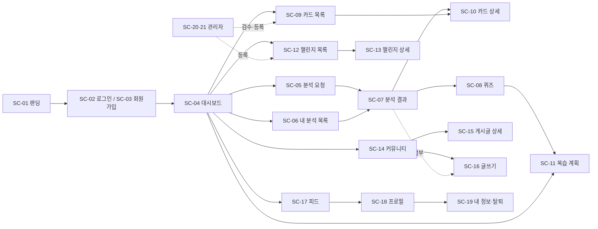

# 화면 설계서 — 바이브노트

> 작성 상태: ⬜ 골격 (2026-11-17) · 초안 W2(WBS 1.8), 최종본 W5(WBS 5.2)
> 최종본은 실제 화면 스크린샷(`node scripts/ui-check.mjs <route> --mobile` → `.harness/screens/`)을 `screens/` 폴더로 옮겨 각 화면 절에 넣는다.

## 1. 화면 목록

| ID | 화면 | 라우트 | 권한 | 주요 구성 요소 | 연결 API | 기능 |
|---|---|---|---|---|---|---|
| SC-01 | 랜딩 | `/` | 공개 | 서비스 소개, 샘플 분석 미리보기, 시작하기 | - | NF-01 |
| SC-02 | 로그인 | `/login` | 공개 | 이메일·비밀번호, 회원가입 링크 | `POST /api/auth/login` | F-02 |
| SC-03 | 회원가입 | `/signup` | 공개 | 이메일·비밀번호·닉네임, 학습 수준 선택 | `POST /api/auth/signup` | F-01 |
| SC-04 | 대시보드 | `/dashboard` | 회원 | 오늘 복습할 카드, 맞춤 추천 카드, 최근 분석, 참여 중 챌린지 | `/api/review-plans`, `/api/recommendations`, `/api/analyses`, `/api/users/me/challenges` | F-15, F-16, F-25 |
| SC-05 | 분석 요청 | `/analyses/new` | 회원 | URL 입력 / ZIP 업로드 탭, 수준 선택, 제한 안내 | `POST /api/analyses` | F-05 |
| SC-06 | 내 분석 목록 | `/analyses` | 회원 | 분석 카드(상태·진행률), 공개 설정, 제목 수정, 삭제 | `GET·PATCH·DELETE /api/analyses` | F-19 |
| SC-07 | 분석 결과 | `/analyses/:id` | 회원(공개 분석은 공개) | 진행 상태 폴링, 탭: 개요 / 파일 / 실행 흐름 / 개념 / 퀴즈 | `/api/analyses/{id}/*` | F-06~F-08, F-14 |
| SC-08 | 퀴즈 풀이·결과 | `/analyses/:id/quiz` | 회원 | 문항, 제출, 채점·해설, 오답을 복습에 추가 | `/api/analyses/{id}/quiz`, `POST /api/quizzes/{id}/attempts` | F-14, F-15 |
| SC-09 | 개념 카드 목록 | `/concepts` | 공개 | 검색창, 카테고리·난이도 필터, 정렬, 카드 그리드 | `GET /api/concepts` | F-09 |
| SC-10 | 개념 카드 상세 | `/concepts/:id` | 공개(일부 회원) | 설명, 예제 코드, 내 코드 등장 위치, 관련 카드, 리뷰, 찜 | `/api/concepts/{id}`, `/reviews`, `/wish` | F-10~F-12 |
| SC-11 | 복습 계획 | `/review-plans` | 회원 | 날짜별 목록, 완료 체크, 추가·삭제 | `/api/review-plans` | F-15 |
| SC-12 | 챌린지 목록 | `/challenges` | 공개 | 진행 중·예정·종료 탭, 챌린지 카드(이미지·기간·참여자 수) | `GET /api/challenges` | F-25 |
| SC-13 | 챌린지 상세 | `/challenges/:id` | 공개(참여는 회원) | 설명, 기간, 목표, 참여·취소, 내 달성도 바 | `/api/challenges/{id}`, `/participation` | F-25 |
| SC-14 | 커뮤니티 목록 | `/community` | 공개 | 게시판 탭(Q&A·학습 후기·자유), 검색, 글쓰기 | `GET /api/posts` | F-17 |
| SC-15 | 게시글 상세 | `/community/:id` | 공개(댓글 작성은 회원) | 본문, 첨부(분석·카드), 수정·삭제, 댓글 CRUD | `/api/posts/{id}`, `/comments` | F-17, F-18 |
| SC-16 | 게시글 작성·수정 | `/community/write` | 회원 | 게시판 선택, 제목, 본문, 첨부 선택 | `POST·PUT /api/posts` | F-17 |
| SC-17 | 피드 | `/feed` | 회원 | 팔로우한 사람의 공개 활동 | `GET /api/feed` | F-04 |
| SC-18 | 프로필 | `/users/:id` | 공개 | 프로필, 학습 통계, 팔로우 버튼, 팔로워·팔로잉, 찜, 참여 챌린지 | `/api/users/{id}`, `/stats`, `/follow` | F-03, F-04, F-12 |
| SC-19 | 내 정보 수정·탈퇴 | `/me/settings` | 회원 | 닉네임·소개·수준 수정, 회원 탈퇴(확인 단계) | `PATCH·DELETE /api/users/me` | F-03 |
| SC-20 | 관리자 카드 관리 | `/admin/concepts` | 관리자 | 카드 목록(상태 필터), 등록·수정, AI 초안 검수 | `/api/admin/concepts` | F-13 |
| SC-21 | 관리자 챌린지 관리 | `/admin/challenges` | 관리자 | 챌린지 목록, 등록·수정(이미지 업로드)·삭제 | `/api/admin/challenges` | F-24 |

## 2. 화면 흐름 (User Flow)

## 3. 화면별 설계

> 각 화면: 와이어프레임(초안) → 스크린샷(최종), 구성 요소 설명, 상태별 UI(로딩·빈 목록·에러), 모바일 배치.

### SC-01 랜딩
(W2 초안 작성 예정)

### SC-02 로그인 (`/login`, F-02)

- 구성: 이메일, 비밀번호, 로그인 버튼, "계정이 없나요? 회원가입" 링크. 상단 헤더에는 비로그인 시 로그인·회원가입 링크, 로그인 시 닉네임과 로그아웃 버튼
- 상태별 UI: 제출 중 버튼 비활성화("로그인 중…") / 빈 입력은 필드 아래 안내 / 로그인 실패(AUTH_001)는 폼 위 빨간 문구, 입력 유지
- 동작: 성공 시 `redirect` 쿼리(앱 내부 경로만) 또는 홈으로 이동. 로그인 상태로 들어오면 홈으로
- 모바일: 한 열, 최대 폭 420px

### SC-03 회원가입 (`/signup`, F-01)

- 구성: 이메일, 비밀번호(규칙 힌트), 닉네임(규칙 힌트), 학습 수준 라디오 카드 3개(입문·주니어·숙련 + 한 줄 설명), 가입하기 버튼, 로그인 링크
- 상태별 UI: 클라이언트 검증 실패와 서버 `details`(COMMON_400, USER_409)는 해당 필드 아래 빨간 문구 / 그 밖의 에러는 폼 위 문구 / 제출 중 버튼 비활성화
- 동작: 가입 성공 → 자동 로그인 → `redirect` 또는 홈
- 모바일: 한 열, 최대 폭 480px. 스크린샷은 W5 최종본에서 추가

<!-- 나머지 화면도 같은 형식으로 추가 -->
