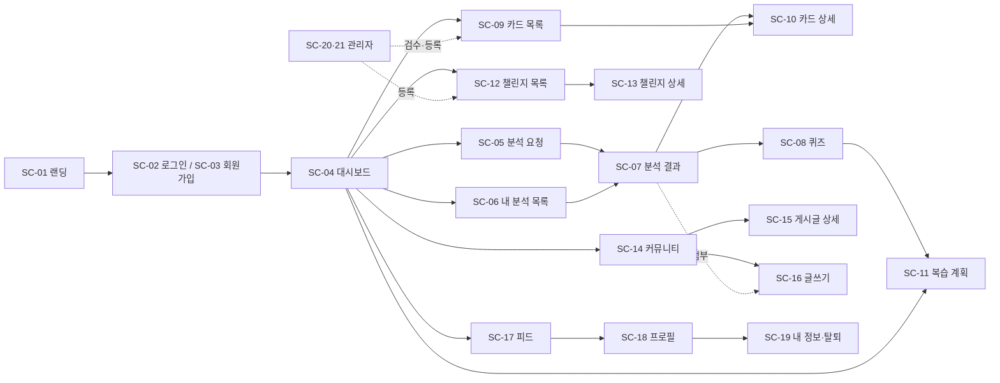
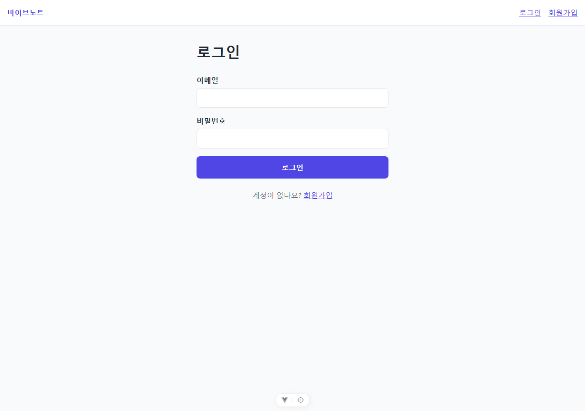
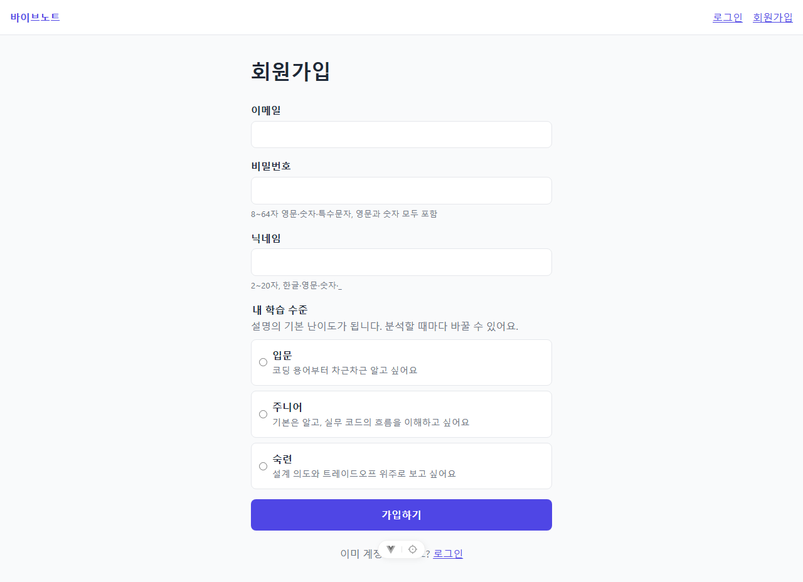
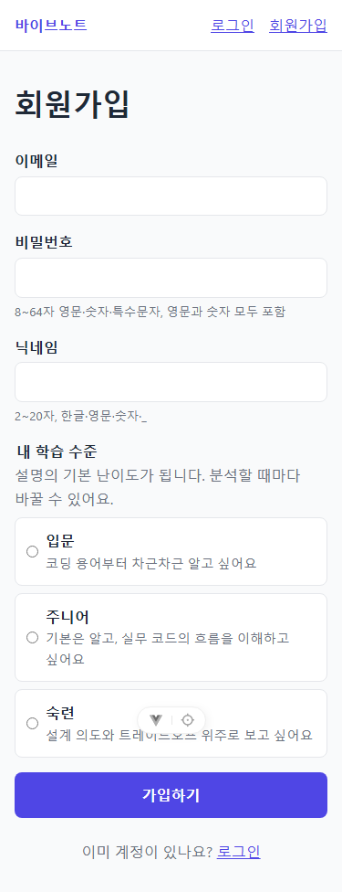
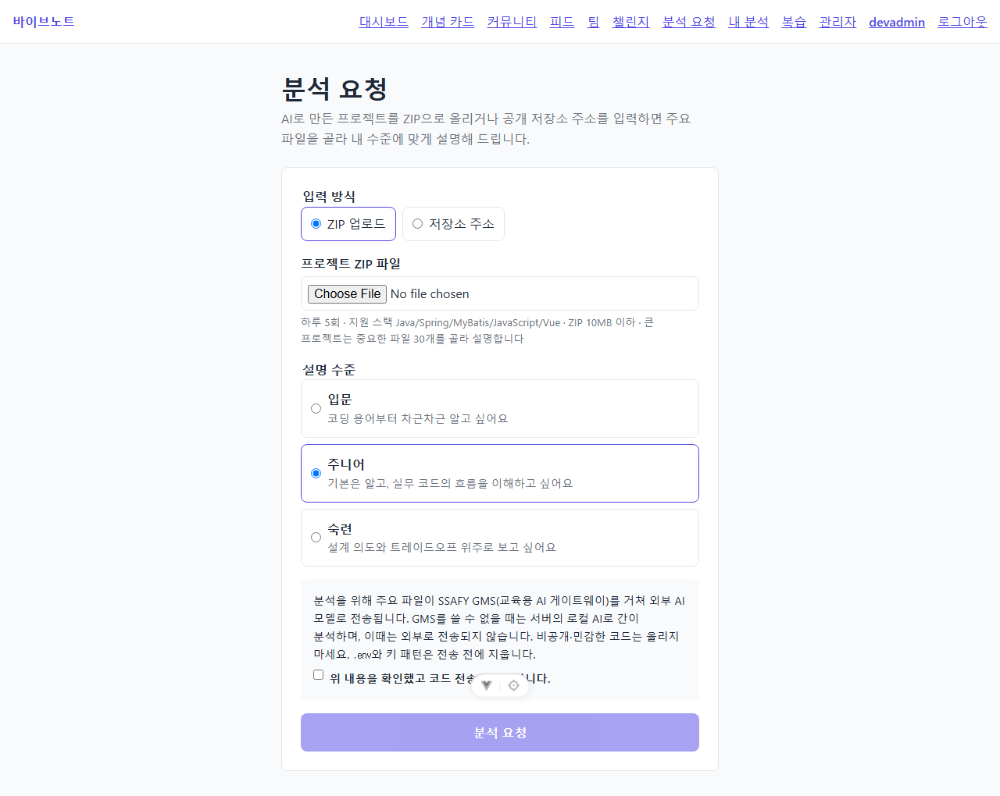
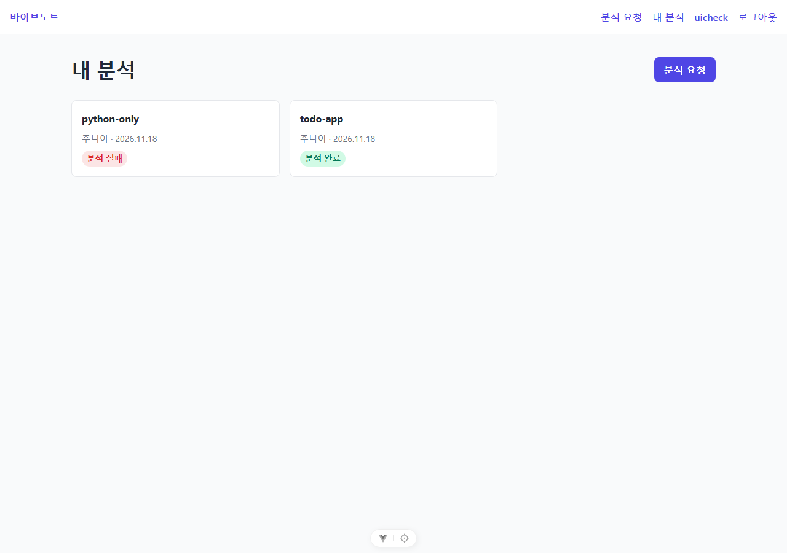
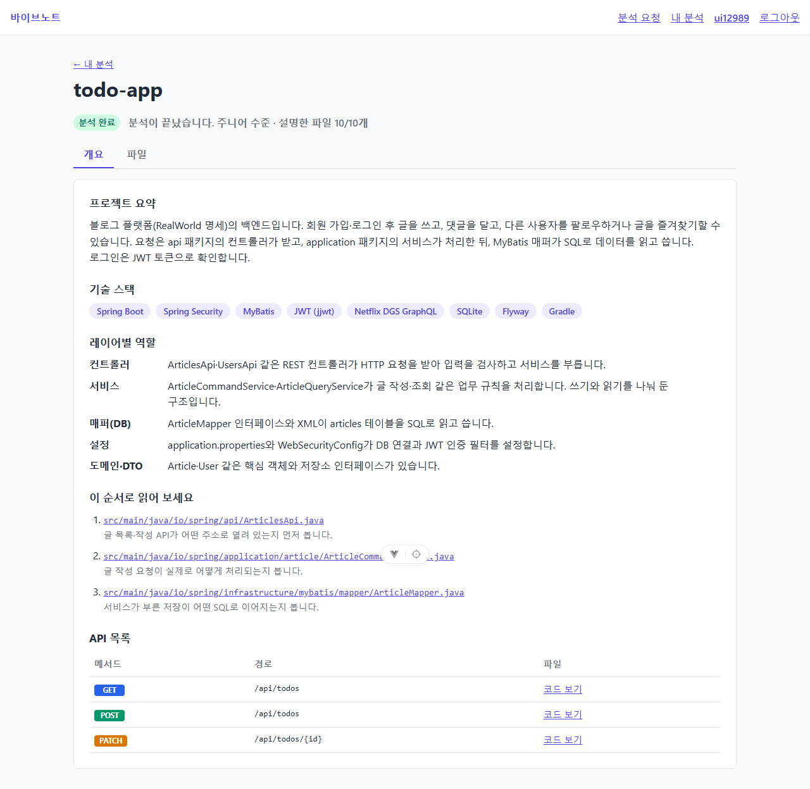
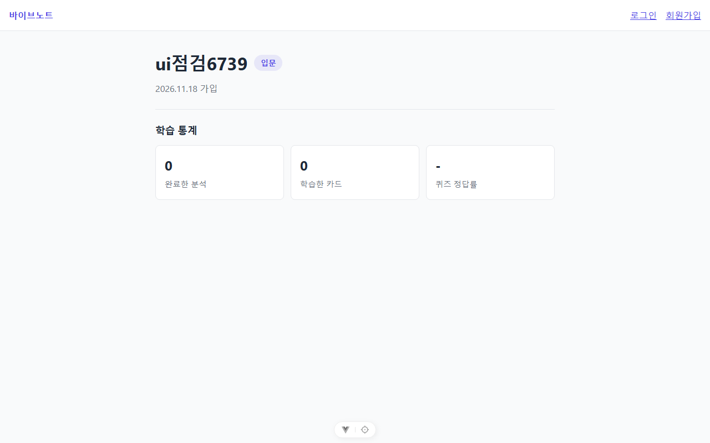
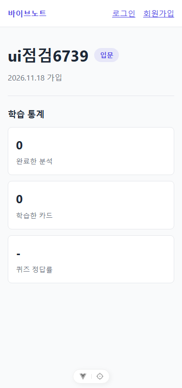

# 화면 설계서 — 바이브노트

> 작성 상태: 🟡 초안 (2026-11-18, SC-02·03·05·06·07·18·19 작성) · 초안 W2(WBS 1.8), 최종본 W5(WBS 5.2)
> 스크린샷은 기능 PR마다 ui-verifier 결과(`.harness/screens/`)를 [`screens/`](screens/)에 `SC-xx-이름-{desktop,mobile}.png`로 옮겨 각 화면 절에 넣는다 (`/pr-review` 5단계). 최종본(W5)에서 다시 찍어 교체한다.

## 1. 화면 목록

| ID | 화면 | 라우트 | 권한 | 주요 구성 요소 | 연결 API | 기능 |
|---|---|---|---|---|---|---|
| SC-01 | 랜딩 | `/` | 공개 | 서비스 소개, 샘플 분석 미리보기, 시작하기 | - | NF-01 |
| SC-02 | 로그인 | `/login` | 공개 | 이메일·비밀번호, 회원가입 링크 | `POST /api/auth/login` | F-02 |
| SC-03 | 회원가입 | `/signup` | 공개 | 이메일·비밀번호·닉네임, 학습 수준 선택 | `POST /api/auth/signup` | F-01 |
| SC-04 | 대시보드 | `/dashboard` | 회원 | 오늘 복습할 카드, 맞춤 추천 카드, 최근 분석, 참여 중 챌린지 | `/api/review-plans`, `/api/recommendations`, `/api/analyses`, `/api/users/me/challenges` | F-15, F-16, F-25 |
| SC-05 | 분석 요청 | `/analyses/new` | 회원 | ZIP 업로드(URL 입력은 F-05b), 수준 선택, Gemini 전송 고지·동의, 제한 안내 | `POST /api/analyses` | F-05a, F-05b |
| SC-06 | 내 분석 목록 | `/analyses` | 회원 | 분석 카드(상태·진행률), 공개 설정, 제목 수정, 삭제 | `GET·PATCH·DELETE /api/analyses` | F-05a(목록), F-19 |
| SC-07 | 분석 결과 | `/analyses/:id` | 회원(공개 분석은 공개) | 진행 상태 폴링, 탭: 개요 / 파일 / 실행 흐름 / 개념 / 퀴즈 | `/api/analyses/{id}/*` | F-05a(진행 상태), F-06~F-08, F-14 |
| SC-08 | 퀴즈 풀이·결과 | `/analyses/:id/quiz` | 회원 | 문항, 제출, 채점·해설, 오답을 복습에 추가 | `/api/analyses/{id}/quiz`, `POST /api/quizzes/{id}/attempts` | F-14, F-15 |
| SC-09 | 개념 카드 목록 | `/concepts` | 공개 | 검색창, 카테고리·난이도 필터, 정렬, 카드 그리드 | `GET /api/concepts` | F-09 |
| SC-10 | 개념 카드 상세 | `/concepts/:id` | 공개(일부 회원) | 설명, 예제 코드, 내 코드 등장 위치, 관련 카드, 리뷰, 찜 | `/api/concepts/{id}`, `/reviews`, `/wish` | F-10~F-12 |
| SC-11 | 복습 계획 | `/review-plans` | 회원 | 날짜별 목록, 완료 체크, 추가·삭제 | `/api/review-plans` | F-15 |
| SC-12 | 챌린지 목록 | `/challenges` | 공개 | 진행 중·예정·종료 탭, 챌린지 카드(이미지·기간·참여자 수) | `GET /api/challenges` | F-25 |
| SC-13 | 챌린지 상세 | `/challenges/:id` | 공개(참여는 회원) | 설명, 기간, 목표, 참여·취소, 내 달성도 바 | `/api/challenges/{id}`, `/participation` | F-25 |
| SC-14 | 커뮤니티 목록 | `/community` | 공개 | 게시판 탭(Q&A·학습 후기·자유), 검색, 글쓰기 | `GET /api/posts` | F-17 |
| SC-15 | 게시글 상세 | `/community/:id` | 공개(댓글 작성은 회원) | 본문, 첨부(분석·카드), 수정·삭제, 댓글 CRUD | `/api/posts/{id}`, `/comments` | F-17, F-18 |
| SC-16 | 게시글 작성·수정 | `/community/write` | 회원 | 게시판 선택, 제목, 본문, 첨부 선택 | `POST·PUT /api/posts` | F-17 |
| SC-17 | 피드 | `/feed` | 회원 | 팔로우한 사람의 공개 활동 | `GET /api/feed` | F-04 |
| SC-18 | 프로필 | `/users/:id` | 공개 | 프로필, 학습 통계, 팔로우 버튼, 팔로워·팔로잉, 찜, 참여 챌린지 | `/api/users/{id}`, `/stats`, `/follow` | F-03, F-04, F-12 |
| SC-19 | 내 정보 수정·탈퇴 | `/me/settings` | 회원 | 닉네임·소개·수준 수정, 회원 탈퇴(확인 단계) | `PATCH·DELETE /api/users/me` | F-03 |
| SC-20 | 관리자 카드 관리 | `/admin/concepts` | 관리자 | 카드 목록(상태 필터), 등록·수정, AI 초안 검수 | `/api/admin/concepts` | F-13 |
| SC-21 | 관리자 챌린지 관리 | `/admin/challenges` | 관리자 | 챌린지 목록, 등록·수정(이미지 업로드)·삭제 | `/api/admin/challenges` | F-24 |

## 2. 화면 흐름 (User Flow)

## 3. 화면별 설계

> 각 화면: 와이어프레임(초안) → 스크린샷(최종), 구성 요소 설명, 상태별 UI(로딩·빈 목록·에러), 모바일 배치.

### SC-01 랜딩
(W2 초안 작성 예정)

### SC-02 로그인 (`/login`, F-02)

- 구성: 이메일, 비밀번호, 로그인 버튼, "계정이 없나요? 회원가입" 링크. 상단 헤더에는 비로그인 시 로그인·회원가입 링크, 로그인 시 닉네임과 로그아웃 버튼
- 상태별 UI: 제출 중 버튼 비활성화("로그인 중…") / 빈 입력은 필드 아래 안내 / 로그인 실패(AUTH_001)는 폼 위 빨간 문구, 입력 유지
- 동작: 성공 시 `redirect` 쿼리(앱 내부 경로만) 또는 홈으로 이동. 로그인 상태로 들어오면 홈으로
- 모바일: 한 열, 최대 폭 420px

| 데스크톱 (1280px) | 모바일 (375px) |
|---|---|
|  |  |

### SC-03 회원가입 (`/signup`, F-01)

- 구성: 이메일, 비밀번호(규칙 힌트), 닉네임(규칙 힌트), 학습 수준 라디오 카드 3개(입문·주니어·숙련 + 한 줄 설명), 가입하기 버튼, 로그인 링크
- 상태별 UI: 클라이언트 검증 실패와 서버 `details`(COMMON_400, USER_409)는 해당 필드 아래 빨간 문구 / 그 밖의 에러는 폼 위 문구 / 제출 중 버튼 비활성화
- 동작: 가입 성공 → 자동 로그인 → `redirect` 또는 홈
- 모바일: 한 열, 최대 폭 480px

| 데스크톱 (1280px) | 모바일 (375px) |
|---|---|
|  |  |

### SC-05 분석 요청 (`/analyses/new`, F-05a · URL 입력 F-05b)

- 구성: 프로젝트 ZIP 파일 선택, 설명 수준 라디오 카드 3개(내 수준이 기본 선택), Gemini 무료 등급 전송 고지와 동의 체크, 제한 안내("하루 5회 · 지원 스택 Java/Spring/MyBatis/JavaScript/Vue · 코드 파일 200개 · 10MB 이하"), 분석 요청 버튼. 헤더(로그인 시)에 "분석 요청"·"내 분석" 링크
- 상태별 UI: 파일과 동의가 모두 있어야 버튼 활성화 / 10MB 초과 파일은 업로드 전에 필드 아래 안내 / 요청 중 버튼 비활성화("요청 중…") / 429·413·400은 폼 위 서버 문구, `details`는 해당 필드 아래
- 동작: 202면 SC-07(`/analyses/{analysisId}`)로 이동. 회원가입 직후 이동하는 첫 화면(NF-01)
- 모바일: 한 열, 최대 폭 560px

| 데스크톱 (1280px) | 모바일 (375px) |
|---|---|
|  |  |

### SC-06 내 분석 목록 (`/analyses`, F-05a · 수정·삭제·공개 F-19)

- 구성: 분석 카드(제목, 수준, 요청일, 상태 배지, 진행 중이면 진행률 막대), 상단 "분석 요청" 버튼, 20개 단위 이전·다음
- 상태별 UI: 로딩 문구 / 빈 목록은 "아직 분석이 없습니다" + "첫 분석 요청하기" / 에러는 서버 문구
- 동작: 카드를 누르면 SC-07
- 모바일: 카드 한 열(최소 폭 260px 그리드). 헤더 링크는 줄바꿈된다

| 데스크톱 (1280px) | 모바일 (375px) |
|---|---|
|  |  |

### SC-07 분석 결과 — 진행 상태 (`/analyses/:id`, F-05a · 결과 탭 F-06~)

- 구성: 단계 배지(코드 수집 중 → 파일 검사 중 → 주요 파일 선별 중 → … → 분석 완료/실패), 진행률 막대, "내 분석"으로 돌아가기
- 상태별 UI: 로딩 / 진행 중(2초마다 폴링) / 완료 "분석이 끝났습니다." / 실패는 `errorMessage`와 "다시 요청하기"(SC-05) / 404 "분석을 찾을 수 없습니다."
- 동작: DONE·FAILED·404이거나 화면을 떠나면 폴링을 멈춘다. 일시적 오류는 문구를 보이고 다음 주기에 다시 조회
- 스크린샷: 실패 상태(지원 스택 밖 ZIP, ANALYSIS_415)

| 데스크톱 (1280px) | 모바일 (375px) |
|---|---|
|  |  |

### SC-07 분석 결과 — 개요·파일 탭 (`/analyses/:id?tab=overview|files&file=:fileId`, F-06)

- 진입: 상태가 DONE이면(처음부터든 폴링 중 전환이든) `GET /api/analyses/{id}`를 1회 불러와 제목(h1), 완료 배지, "분석이 끝났습니다. {수준} 수준 · 설명한 파일 n/m개", 탭을 보여 준다. 기본 탭은 개요
- 개요 탭: 프로젝트 요약, 기술 스택 칩, 레이어별 역할(컨트롤러·서비스·매퍼(DB)·화면(Vue)·스크립트·설정·도메인·DTO·기타, 선별 우선순위 순), "이 순서로 읽어 보세요"(누르면 파일 탭에서 그 파일 선택), API 표(메서드 색 배지·경로·"코드 보기" 링크)
- 파일 탭: 왼쪽 레이어별 파일 목록(경로·한 줄 역할, 선택 강조) / 오른쪽 레이어 배지·경로·역할·설명·줄 번호가 붙은 코드(`CodeViewer`, 하이라이트 없음)
- 상태별 UI: 상세·목록·단건 각각 로딩 문구 / 에러는 서버 `message` + "다시 시도" / 빈 API 목록 "탐지된 API가 없습니다." / 설명 없는 파일 "이 파일은 설명을 만들지 못했습니다." / 없는 파일(ANALYSIS_001) "파일을 찾을 수 없습니다."(목록은 유지) / 파일 미선택 안내
- 동작: 탭과 선택 파일은 쿼리에 남아 새로고침·뒤로 가기로 복원된다
- 모바일: 768px 이하에서 목록 위·내용 아래 한 열. 긴 코드는 코드 상자 안에서만 가로 스크롤(페이지 가로 스크롤 없음)
- 스크린샷: mock LLM fixture로 만든 분석 (ui-check 측정: 375px에서 페이지 scrollWidth 375 = clientWidth, 코드 상자만 스크롤)

| 화면 | 데스크톱 (1280px) | 모바일 (375px) |
|---|---|---|
| 개요 탭 |  |  |
| 파일 탭 |  |  |

### SC-07 분석 결과 — 실행 흐름 탭 (`/analyses/:id?tab=flows`, F-07)

- 진입: 탭을 열면 `GET /api/analyses/{id}/flows`를 불러온다. 왼쪽은 개요 API 목록 체크박스(메서드 색 배지·경로, 이미 흐름이 있으면 "생성 중"·"완료"·"실패" 배지와 함께 체크 불가), 오른쪽은 흐름 카드
- 선택: 남은 개수(3 − FAILED가 아닌 흐름 수)까지만 체크되고 "실행 흐름 만들기 (n개)"는 1개 이상 고를 때만 켜진다. 누르면 `POST /flows`(202)
- 흐름 카드: PENDING "실행 흐름을 만드는 중입니다…" / DONE 요약 + 단계 목록(번호, 레이어 라벨, 제목, `Class.method`, 설명, 경로. 분석 파일이면 경로를 눌러 파일 탭으로) / FAILED 사유 + "다시 만들기"(그 API 하나만 POST)
- 상태별 UI: 로딩 / API 없음 "탐지된 API가 없어 실행 흐름을 만들 수 없습니다." / 남은 개수 0 "실행 흐름은 분석 하나에 3개까지 만들 수 있습니다." / 흐름 없음 안내 / 요청·조회 실패는 서버 `message` + "다시 시도"(체크한 선택 유지)
- 동작: PENDING이 있으면 3초마다 목록을 다시 불러오고, 모두 끝나거나 탭·화면을 떠나면 멈춘다
- 모바일: 768px 이하에서 API 선택 위·카드 아래 한 열, 긴 경로는 `/` 뒤에서 줄바꿈
- 스크린샷: mock LLM fixture로 만든 흐름이라 단계 경로가 이 분석 파일이 아니어서 링크가 아니다 (ui-verifier 측정: 375px에서 scrollWidth 375 = innerWidth)

| 화면 | 데스크톱 (1280px) | 모바일 (375px) |
|---|---|---|
| 실행 흐름 탭 |  |  |

### SC-18 프로필 (`/users/:id`, F-03 · 팔로우 F-04 · 찜 F-12 · 챌린지 F-25)

- 구성(F-03): 닉네임, 학습 수준 배지, 가입일, 소개, 학습 통계 타일 3개(완료한 분석 / 학습한 카드 / 퀴즈 정답률). 내 프로필이면 "정보 수정" 링크(SC-19). 헤더의 내 닉네임을 누르면 이 화면으로 온다
- 상태별 UI: 불러오는 중 / 없거나 탈퇴한 회원(USER_404)은 "탈퇴했거나 없는 사용자입니다." / 그 밖의 에러는 서버 메시지 / 정답률은 풀이가 없으면 "-"
- 동작: 비로그인도 볼 수 있다(email 비공개). 팔로우 버튼·팔로워 목록, 찜, 참여 챌린지 영역은 각 기능에서 추가
- 모바일: 통계 타일을 한 열로 쌓는다

| 데스크톱 (1280px) | 모바일 (375px) |
|---|---|
|  |  |

### SC-19 내 정보 수정·탈퇴 (`/me/settings`, F-03)

- 구성: 정보 수정 카드(이메일 읽기 전용, 닉네임, 소개 300자 카운터, 학습 수준 라디오 카드 3개, 저장하기) + 회원 탈퇴 카드(안내 문구, 현재 비밀번호, "되돌릴 수 없음" 확인 체크, 빨간 탈퇴하기 버튼)
- 상태별 UI: 클라이언트 검증·서버 `details`(COMMON_400, USER_409)는 필드 아래 / 저장 성공 시 "저장했습니다." / 비밀번호 불일치(USER_001)는 비밀번호 아래 / 탈퇴 버튼은 비밀번호와 확인 체크가 있어야 활성화
- 동작: 저장하면 헤더 닉네임·수준이 바로 바뀐다. 탈퇴 성공 시 이 기기의 세션을 비우고 홈으로 이동 (서버가 모든 기기의 Refresh 토큰을 폐기)
- 모바일: 한 열, 최대 폭 560px

| 데스크톱 (1280px) | 모바일 (375px) | 탈퇴 실패 (USER_001) |
|---|---|---|
|  |  |  |

<!-- 나머지 화면도 같은 형식으로 추가 -->
