# 화면 설계서 — 바이브노트

> 작성 상태: 🟡 초안 (2026-11-18, SC-02·03·05·06·07·18·19 작성 · 11-19 SC-09·10·14~17·20 와이어프레임) · 초안 W2(WBS 1.8), 최종본 W5(WBS 5.2)
> 스크린샷은 기능 PR마다 ui-verifier 결과(`.harness/screens/`)를 [`screens/`](screens/)에 `SC-xx-이름-{desktop,mobile}.png`로 옮겨 각 화면 절에 넣는다 (`/pr-review` 5단계). 최종본(W5)에서 다시 찍어 교체한다.

## 1. 화면 목록

| ID | 화면 | 라우트 | 권한 | 주요 구성 요소 | 연결 API | 기능 |
|---|---|---|---|---|---|---|
| SC-01 | 랜딩 | `/` | 공개 | 서비스 소개, 샘플 분석 미리보기, 시작하기 | - | NF-01 |
| SC-02 | 로그인 | `/login` | 공개 | 이메일·비밀번호, 회원가입 링크 | `POST /api/auth/login` | F-02 |
| SC-03 | 회원가입 | `/signup` | 공개 | 이메일·비밀번호·닉네임, 학습 수준 선택 | `POST /api/auth/signup` | F-01 |
| SC-04 | 대시보드 | `/dashboard` | 회원 | 오늘 복습할 카드, 맞춤 추천 카드, 최근 분석, 참여 중 챌린지 | `/api/review-plans`, `/api/recommendations`, `/api/analyses`, `/api/users/me/challenges` | F-15, F-16, F-25 |
| SC-05 | 분석 요청 | `/analyses/new` | 회원 | ZIP 업로드(URL 입력은 F-05b), 수준 선택, Gemini 전송 고지·동의, 제한 안내 | `POST /api/analyses` | F-05a, F-05b |
| SC-06 | 내 분석 목록 | `/analyses` | 회원 | 분석 카드(상태·진행률), 공개 설정, 제목 수정, 삭제 | `GET·PATCH·DELETE /api/analyses` | F-05a(목록), F-19 |
| SC-07 | 분석 결과 | `/analyses/:id` | 회원(공개 분석은 공개) | 진행 상태 폴링, 탭: 개요 / 파일 / 실행 흐름 / 개념 / 퀴즈 | `/api/analyses/{id}/*` | F-05a(진행 상태), F-06~F-08, F-14 |
| SC-08 | 퀴즈 풀이·결과 | `/analyses/:id/quiz` | 회원 | 문항, 제출, 채점·해설, 오답을 복습에 추가 | `/api/analyses/{id}/quiz`, `POST /api/quizzes/{id}/attempts` | F-14, F-15 |
| SC-09 | 개념 카드 목록 | `/concepts` | 공개 | 검색창, 카테고리·난이도 필터, 정렬, 카드 그리드 | `GET /api/concepts` | F-09 |
| SC-10 | 개념 카드 상세 | `/concepts/:id` | 공개(일부 회원) | 설명, 예제 코드, 내 코드 등장 위치, 관련 카드, 리뷰, 찜 | `/api/concepts/{id}`, `/reviews`, `/wish` | F-10~F-12 |
| SC-11 | 복습 계획 | `/review-plans` | 회원 | 날짜별 목록, 완료 체크, 추가·삭제 | `/api/review-plans` | F-15 |
| SC-12 | 챌린지 목록 | `/challenges` | 공개 | 진행 중·예정·종료 탭, 챌린지 카드(이미지·기간·참여자 수) | `GET /api/challenges` | F-25 |
| SC-13 | 챌린지 상세 | `/challenges/:id` | 공개(참여는 회원) | 설명, 기간, 목표, 참여·취소, 내 달성도 바 | `/api/challenges/{id}`, `/participation` | F-25 |
| SC-14 | 커뮤니티 목록 | `/community` | 공개 | 게시판 탭(Q&A·학습 후기·자유), 검색, 글쓰기 | `GET /api/posts` | F-17 |
| SC-15 | 게시글 상세 | `/community/:id` | 공개(댓글 작성은 회원) | 본문, 첨부(분석·카드), 수정·삭제, 댓글 CRUD | `/api/posts/{id}`, `/comments` | F-17, F-18 |
| SC-16 | 게시글 작성·수정 | `/community/write`, `/community/:id/edit` | 회원 | 게시판 선택, 제목, 본문, 첨부 선택 | `POST·PUT /api/posts` | F-17 |
| SC-17 | 피드 | `/feed` | 회원 | 팔로우한 사람의 공개 활동 | `GET /api/feed` | F-04 |
| SC-18 | 프로필 | `/users/:id` | 공개 | 프로필, 학습 통계, 팔로우 버튼, 팔로워·팔로잉, 찜, 참여 챌린지 | `/api/users/{id}`, `/stats`, `/follow` | F-03, F-04, F-12 |
| SC-19 | 내 정보 수정·탈퇴 | `/me/settings` | 회원 | 닉네임·소개·수준 수정, 회원 탈퇴(확인 단계) | `PATCH·DELETE /api/users/me` | F-03 |
| SC-20 | 관리자 카드 관리 | `/admin/concepts` | 관리자 | 카드 목록(상태 필터), 등록·수정, AI 초안 검수 | `/api/admin/concepts` | F-13 |
| SC-21 | 관리자 챌린지 관리 | `/admin/challenges` | 관리자 | 챌린지 목록, 등록·수정(이미지 업로드)·삭제 | `/api/admin/challenges` | F-24 |

> 관리자 화면 공통 구조 (F-00b): SC-20·21은 `/admin` 아래 자식 화면이다. `AdminLayout`이 왼쪽 사이드 메뉴(좁은 폭에서는 본문 위 가로 메뉴)와 본문을 나누고, `/admin` 첫 화면은 "관리할 항목을 고르세요" 안내다. 헤더의 "관리자" 메뉴는 ADMIN에게만 보인다.

## 2. 화면 흐름 (User Flow)

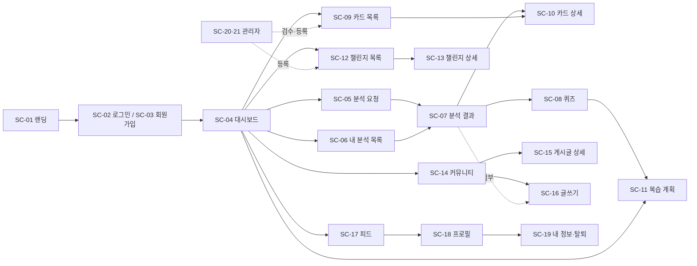

## 3. 화면별 설계

> 각 화면: 와이어프레임(초안) → 스크린샷(최종), 구성 요소 설명, 상태별 UI(로딩·빈 목록·에러), 모바일 배치.

### SC-01 랜딩
(W2 초안 작성 예정)

### SC-02 로그인 (`/login`, F-02)

- 구성: 이메일, 비밀번호, 로그인 버튼, "계정이 없나요? 회원가입" 링크. 상단 헤더에는 비로그인 시 로그인·회원가입 링크, 로그인 시 닉네임과 로그아웃 버튼
- 상태별 UI: 제출 중 버튼 비활성화("로그인 중…") / 빈 입력은 필드 아래 안내 / 로그인 실패(AUTH_001)는 폼 위 빨간 문구, 입력 유지
- 동작: 성공 시 `redirect` 쿼리(앱 내부 경로만) 또는 홈으로 이동. 로그인 상태로 들어오면 홈으로
- 모바일: 한 열, 최대 폭 420px

| 데스크톱 (1280px) | 모바일 (375px) |
|---|---|
|  |  |

### SC-03 회원가입 (`/signup`, F-01)

- 구성: 이메일, 비밀번호(규칙 힌트), 닉네임(규칙 힌트), 학습 수준 라디오 카드 3개(입문·주니어·숙련 + 한 줄 설명), 가입하기 버튼, 로그인 링크
- 상태별 UI: 클라이언트 검증 실패와 서버 `details`(COMMON_400, USER_409)는 해당 필드 아래 빨간 문구 / 그 밖의 에러는 폼 위 문구 / 제출 중 버튼 비활성화
- 동작: 가입 성공 → 자동 로그인 → `redirect` 또는 홈
- 모바일: 한 열, 최대 폭 480px

| 데스크톱 (1280px) | 모바일 (375px) |
|---|---|
|  |  |

### SC-05 분석 요청 (`/analyses/new`, F-05a · URL 입력 F-05b)

- 구성: 프로젝트 ZIP 파일 선택, 설명 수준 라디오 카드 3개(내 수준이 기본 선택), Gemini 무료 등급 전송 고지와 동의 체크, 제한 안내("하루 5회 · 지원 스택 Java/Spring/MyBatis/JavaScript/Vue · 코드 파일 200개 · 10MB 이하"), 분석 요청 버튼. 헤더(로그인 시)에 "분석 요청"·"내 분석" 링크
- 상태별 UI: 파일과 동의가 모두 있어야 버튼 활성화 / 10MB 초과 파일은 업로드 전에 필드 아래 안내 / 요청 중 버튼 비활성화("요청 중…") / 429·413·400은 폼 위 서버 문구, `details`는 해당 필드 아래
- 동작: 202면 SC-07(`/analyses/{analysisId}`)로 이동. 회원가입 직후 이동하는 첫 화면(NF-01)
- 모바일: 한 열, 최대 폭 560px

| 데스크톱 (1280px) | 모바일 (375px) |
|---|---|
|  | 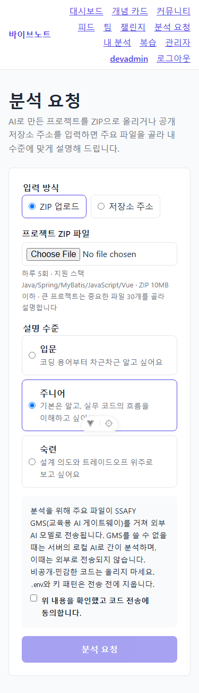 |

### SC-06 내 분석 목록 (`/analyses`, F-05a · 수정·삭제·공개 F-19)

- 구성: 분석 카드(제목, 수준, 요청일, 상태 배지, 진행 중이면 진행률 막대), 상단 "분석 요청" 버튼, 20개 단위 이전·다음
- 상태별 UI: 로딩 문구 / 빈 목록은 "아직 분석이 없습니다" + "첫 분석 요청하기" / 에러는 서버 문구
- 동작: 카드를 누르면 SC-07
- 모바일: 카드 한 열(최소 폭 260px 그리드). 헤더 링크는 줄바꿈된다

| 데스크톱 (1280px) | 모바일 (375px) |
|---|---|
|  |  |

### SC-07 분석 결과 — 진행 상태 (`/analyses/:id`, F-05a · 결과 탭 F-06~)

- 구성: 단계 배지(코드 수집 중 → 파일 검사 중 → 주요 파일 선별 중 → … → 분석 완료/실패), 진행률 막대, "내 분석"으로 돌아가기
- 상태별 UI: 로딩 / 진행 중(2초마다 폴링) / 완료 "분석이 끝났습니다." / 실패는 `errorMessage`와 "다시 요청하기"(SC-05) / 404 "분석을 찾을 수 없습니다."
- 동작: DONE·FAILED·404이거나 화면을 떠나면 폴링을 멈춘다. 일시적 오류는 문구를 보이고 다음 주기에 다시 조회
- 스크린샷: 실패 상태(지원 스택 밖 ZIP, ANALYSIS_415)

| 데스크톱 (1280px) | 모바일 (375px) |
|---|---|
| 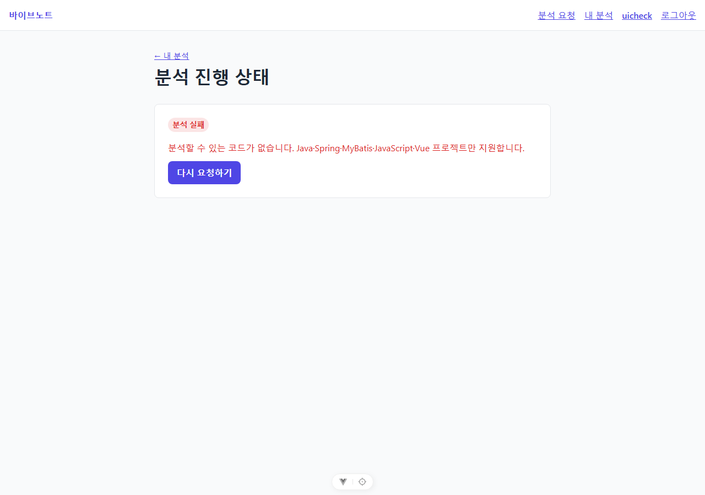 | 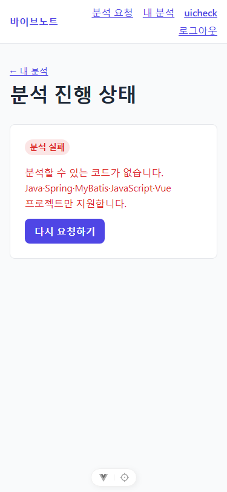 |

### SC-07 분석 결과 — 개요·파일 탭 (`/analyses/:id?tab=overview|files&file=:fileId`, F-06)

- 진입: 상태가 DONE이면(처음부터든 폴링 중 전환이든) `GET /api/analyses/{id}`를 1회 불러와 제목(h1), 완료 배지, "분석이 끝났습니다. {수준} 수준 · 설명한 파일 n/m개", 탭을 보여 준다. 기본 탭은 개요
- 개요 탭: 프로젝트 요약, 기술 스택 칩, 레이어별 역할(컨트롤러·서비스·매퍼(DB)·화면(Vue)·스크립트·설정·도메인·DTO·기타, 선별 우선순위 순), "이 순서로 읽어 보세요"(누르면 파일 탭에서 그 파일 선택), API 표(메서드 색 배지·경로·"코드 보기" 링크)
- 파일 탭: 왼쪽 레이어별 파일 목록(경로·한 줄 역할, 선택 강조) / 오른쪽 레이어 배지·경로·역할·설명·줄 번호가 붙은 코드(`CodeViewer`, 하이라이트 없음)
- 상태별 UI: 상세·목록·단건 각각 로딩 문구 / 에러는 서버 `message` + "다시 시도" / 빈 API 목록 "탐지된 API가 없습니다." / 설명 없는 파일 "이 파일은 설명을 만들지 못했습니다." / 없는 파일(ANALYSIS_001) "파일을 찾을 수 없습니다."(목록은 유지) / 파일 미선택 안내
- 동작: 탭과 선택 파일은 쿼리에 남아 새로고침·뒤로 가기로 복원된다
- 모바일: 768px 이하에서 목록 위·내용 아래 한 열. 긴 코드는 코드 상자 안에서만 가로 스크롤(페이지 가로 스크롤 없음)
- 스크린샷: mock LLM fixture로 만든 분석 (ui-check 측정: 375px에서 페이지 scrollWidth 375 = clientWidth, 코드 상자만 스크롤)

| 화면 | 데스크톱 (1280px) | 모바일 (375px) |
|---|---|---|
| 개요 탭 |  |  |
| 파일 탭 | 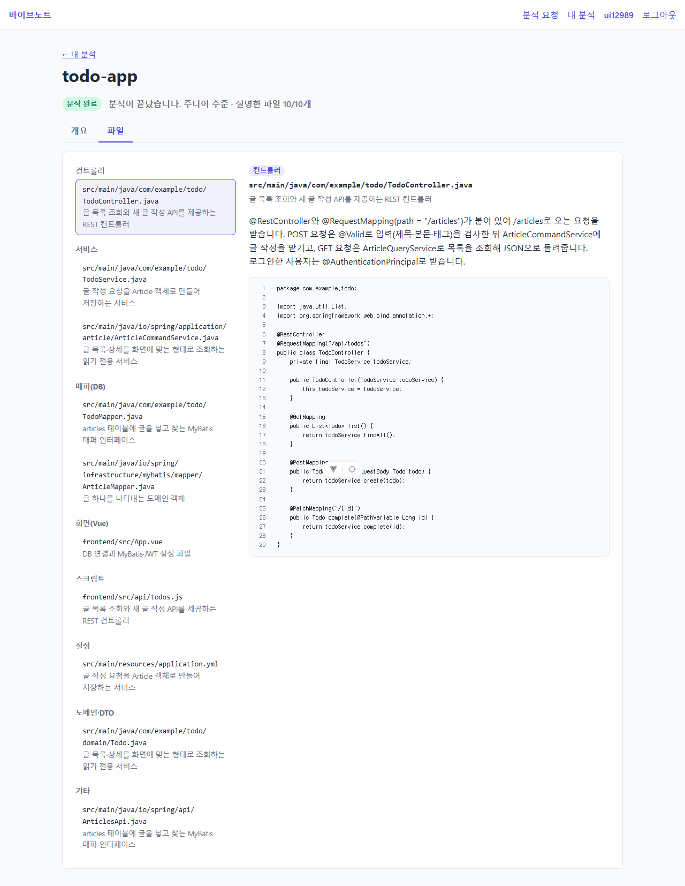 | 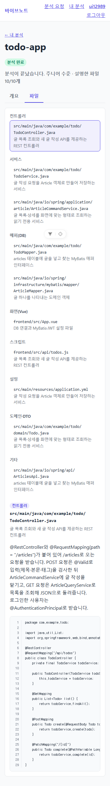 |

### SC-07 분석 결과 — 실행 흐름 탭 (`/analyses/:id?tab=flows`, F-07)

- 진입: 탭을 열면 `GET /api/analyses/{id}/flows`를 불러온다. 왼쪽은 개요 API 목록 체크박스(메서드 색 배지·경로, 이미 흐름이 있으면 "생성 중"·"완료"·"실패" 배지와 함께 체크 불가), 오른쪽은 흐름 카드
- 선택: 남은 개수(3 − FAILED가 아닌 흐름 수)까지만 체크되고 "실행 흐름 만들기 (n개)"는 1개 이상 고를 때만 켜진다. 누르면 `POST /flows`(202)
- 흐름 카드: PENDING "실행 흐름을 만드는 중입니다…" / DONE 요약 + 단계 목록(번호, 레이어 라벨, 제목, `Class.method`, 설명, 경로. 분석 파일이면 경로를 눌러 파일 탭으로) / FAILED 사유 + "다시 만들기"(그 API 하나만 POST)
- 상태별 UI: 로딩 / API 없음 "탐지된 API가 없어 실행 흐름을 만들 수 없습니다." / 남은 개수 0 "실행 흐름은 분석 하나에 3개까지 만들 수 있습니다." / 흐름 없음 안내 / 요청·조회 실패는 서버 `message` + "다시 시도"(체크한 선택 유지)
- 동작: PENDING이 있으면 3초마다 목록을 다시 불러오고, 모두 끝나거나 탭·화면을 떠나면 멈춘다
- 모바일: 768px 이하에서 API 선택 위·카드 아래 한 열, 긴 경로는 `/` 뒤에서 줄바꿈
- 스크린샷: mock LLM fixture로 만든 흐름이라 단계 경로가 이 분석 파일이 아니어서 링크가 아니다 (ui-verifier 측정: 375px에서 scrollWidth 375 = innerWidth)

| 화면 | 데스크톱 (1280px) | 모바일 (375px) |
|---|---|---|
| 실행 흐름 탭 |  | 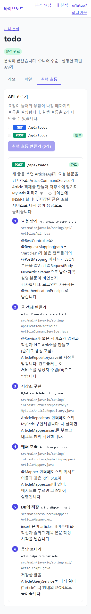 |

### SC-07 분석 결과 — 개념 탭 (`/analyses/:id?tab=concepts`, F-08)

- 진입: 실행 흐름 다음 탭. 열면 `GET /api/analyses/{id}/concepts`를 1회 불러온다
- 구성: 공개 카드마다 `ConceptCard`(카테고리·난이도·이름·요약·별점·찜, 누르면 `/concepts/{id}` 상세 F-10) + 그 아래 위치("파일 경로 · L12-L30", 누르면 파일 탭에서 그 파일 선택) + 맥락 문장. 파일이 없는 개념은 위치 줄을 그리지 않는다
- 상태별 UI: 로딩 "개념을 불러오는 중…" / 검수 대기 초안이 있으면 "새 개념 n개는 관리자 검수 후 카드로 공개됩니다." / 연결 없음 "이 분석에서 연결된 개념 카드가 없습니다."(추출 실패도 이 문구) / 실패는 서버 `message` + "다시 시도"
- 모바일: 카드 한 열(데스크톱은 폭에 따라 2~3열 그리드), 긴 경로는 `/` 뒤에서 줄바꿈
- 스크린샷: dev 저장소(DS-02-01 realworld) ZIP을 mock LLM으로 분석한 결과다. fixture는 시드 카드를 이름으로 가리키고 Mock이 카드 목록에서 id로 바꾸므로(#49) DB가 달라도 카드와 맥락 문장이 맞는다. 위치의 파일은 fixture의 파일 번호(`fileNo`)로 정해져 맥락 문장의 파일과 다를 수 있다 (ui-check: 375px 가로 스크롤·콘솔 에러 없음)

| 화면 | 데스크톱 (1280px) | 모바일 (375px) |
|---|---|---|
| 개념 탭 |  |  |

### SC-07 분석 결과 — 퀴즈 탭 (`/analyses/:id?tab=quiz`, F-14)

- 진입: 개념 다음 탭. 열면 `GET /api/analyses/{id}/quiz`를 1회 불러온다
- 구성: "객관식 n문항", 지난 풀이가 있으면 "지난 풀이 {점수}/{문항 수} · {M/D HH:mm}", 버튼 "퀴즈 풀기"(지난 풀이가 있으면 "다시 풀기") → SC-08
- 상태별 UI: 로딩 "퀴즈를 불러오는 중…" / 퀴즈 없음(`QUIZ_404`, 생성 실패) "이 분석은 퀴즈를 만들지 못했습니다." / 그 밖의 실패는 서버 `message` + "다시 시도"
- 모바일: 탭 5개는 한 줄을 유지하고 넘치면 가로로 스크롤하며, 선택된 탭이 보이게 스크롤한다
- 스크린샷: dev 저장소(DS-02-01 realworld)를 mock LLM으로 분석한 결과다. quiz fixture도 시드 카드를 이름으로 가리켜(#49 방식) DB가 달라도 문항 5개가 카드에 연결되고 1개는 카드가 없다 (ui-check: 375px 가로 스크롤·콘솔 에러 없음)

| 화면 | 데스크톱 (1280px) | 모바일 (375px) |
|---|---|---|
| 퀴즈 탭 |  |  |

### SC-08 퀴즈 풀이·결과 (`/analyses/:id/quiz`, F-14)

- 진입: SC-07 퀴즈 탭의 "퀴즈 풀기". 로그인 필요, 본인 분석만
- 풀이: 위에 "{답한 수}/{n} 답함", 문항마다 번호·질문(줄바꿈 유지)과 4지선다 라디오(한 열). 모든 문항에 답해야 "제출"이 켜지고, 제출 중에는 "채점 중…"으로 꺼진다
- 결과: 점수 "{맞힌 수}/{문항 수}", 문항마다 정답·오답 표시, 선택지에 "정답"·"내 답" 표시, 해설, 관련 공개 개념이 있으면 `ConceptCard`(누르면 `/concepts/{id}`). 틀린 공개 개념을 복습 계획에 넣었으면 "틀린 개념 k개를 M월 D일 복습 계획에 추가했습니다."와 그 아래 "복습 계획 보기"(SC-11 링크, F-15)
- 동작: "다시 풀기"는 답을 비우고 풀이로 돌아간다(새 풀이로 기록). "← 분석으로 돌아가기"는 `/analyses/{id}?tab=quiz`. 제출이 실패하면 서버 `message`를 보여 주고 고른 답은 유지한다
- 조회 상태별 UI: SC-07 퀴즈 탭과 같다
- 모바일: 선택지 한 열, 긴 질문·선택지·코드 이름은 줄바꿈 (375px 가로 스크롤 없음)
- 스크린샷: 위와 같은 분석. 결과는 일부 문항을 일부러 틀려 복습 추가 안내가 보이게 했다

| 화면 | 데스크톱 (1280px) | 모바일 (375px) |
|---|---|---|
| 풀이 | 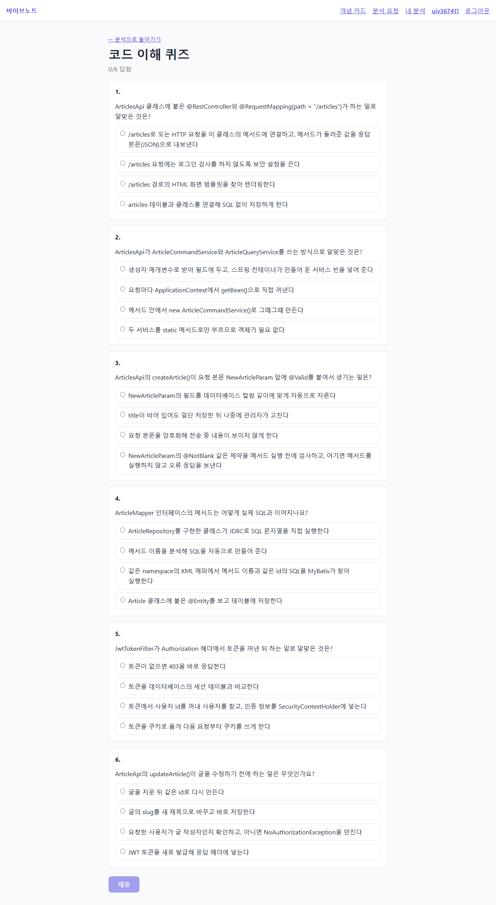 |  |
| 결과 | 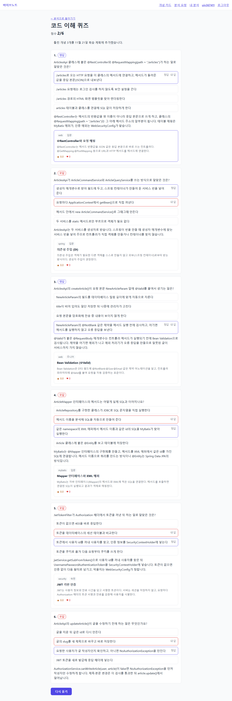 | 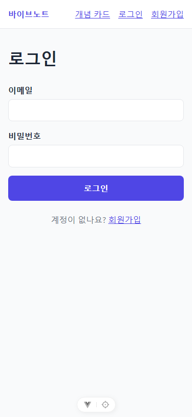 |

### SC-09 개념 카드 목록 (`/concepts?keyword=&category=&difficulty=&sort=&page=`, F-09)

- 진입: 상단 nav "개념 카드"(비로그인에도 보임), 대시보드, 랜딩. 공개 화면이라 로그인 없이 볼 수 있고, `PUBLISHED` 카드만 나온다
- 구성: 제목 "개념 카드"와 전체 개수("n개"), 필터 바(검색창 + 검색 버튼, 카테고리 선택(전체·Java·Spring·Web·Security·MyBatis·Vue), 난이도 선택(전체·입문·주니어·숙련), 정렬 선택(인기순·최신순)), 카드 그리드, 이전·다음 페이지(20개 단위)
- 카드(`ConceptCard`): 이름, 카테고리 칩, 난이도 배지, 요약(2줄에서 말줄임), 찜 수 ♥, 평점 ★. 카드를 누르면 SC-10 카드 상세
- 상태별 UI: 로딩 문구 / 0건은 "조건에 맞는 개념 카드가 없습니다" + "필터 초기화"(조건 없이 `/concepts`로) / 에러는 서버 `message` / 잘못된 쿼리(COMMON_400)도 서버 `message`
- 동작: 검색은 Enter나 검색 버튼을 누를 때 한다(입력할 때마다 조회하지 않음). 필터·정렬은 바꾸는 즉시 다시 조회한다. 검색·필터·정렬을 바꾸면 1페이지로 돌아간다. 모든 조건은 URL 쿼리에 남아 새로고침·뒤로 가기·링크 공유로 복원되고, 기본값(인기순, 1페이지, 빈 값)은 쿼리에 넣지 않는다
- 정렬 기준: 인기순 = 찜 수 → 평점 → 등록 순서(동점이면 시드 순서), 최신순 = 등록일 역순. 키워드는 카드 이름과 요약에서 찾는다(대소문자 무시)
- 모바일: 카드 그리드 최소 폭 260px(`auto-fill`)라 375px에서 한 열. 필터 바는 검색창 한 줄, 선택 상자 3개는 다음 줄에 줄바꿈. 가로 스크롤 없음
- 구현: `views/concept/ConceptListView.vue`, 필터 바 `components/concept/ConceptFilterBar.vue`, 카테고리 상수 `utils/conceptCategories.js` (F-09 PR)
- 스크린샷: 아래 와이어프레임 뒤에 둔 F-09 구현 화면 (ui-verifier)

```
데스크톱 (1280px)
┌──────────────────────────────────────────────────────────────────────┐
│ 바이브노트   분석  개념 카드  커뮤니티 ...                 닉네임 ▾ │
├──────────────────────────────────────────────────────────────────────┤
│ 개념 카드  85개                                                      │
│ ┌──────────────────────────────┐[검색] [카테고리 ▾][난이도 ▾][인기순 ▾]│
│ │ 🔍 개념 이름이나 설명으로 검색 │                                    │
│ └──────────────────────────────┘                                     │
│ ┌──────────────────┐ ┌──────────────────┐ ┌──────────────────┐       │
│ │ JWT 기반 인증    │ │ 트랜잭션 전파와… │ │ 반응성 (ref·…)   │       │
│ │ security · 숙련  │ │ spring · 숙련    │ │ vue · 입문       │       │
│ │ JWT는 사용자 정보│ │ 트랜잭션 메서드가│ │ ref와 reactive로 │       │
│ │ 와 만료 시간을...│ │ 다른 트랜잭션... │ │ 바뀌는 값을 ...  │       │
│ │ ♥ 12   ★ 4.5     │ │ ♥ 8    ★ 4.2     │ │ ♥ 5    ★ 0.0     │       │
│ └──────────────────┘ └──────────────────┘ └──────────────────┘       │
│                     ...                                              │
│                      [‹ 이전]  1 / 5  [다음 ›]                       │
└──────────────────────────────────────────────────────────────────────┘

모바일 (375px)             0건
┌─────────────────────┐    ┌─────────────────────┐
│ 바이브노트       ☰  │    │ 개념 카드  0개      │
├─────────────────────┤    │ [ python      ][검색]│
│ 개념 카드  85개     │    │                     │
│ [🔍 검색어   ][검색]│    │  조건에 맞는 개념   │
│ [카테고리▾][난이도▾]│    │  카드가 없습니다    │
│ [인기순▾]           │    │   [필터 초기화]     │
│ ┌─────────────────┐ │    └─────────────────────┘
│ │ JWT 기반 인증   │ │
│ │ security · 숙련 │ │
│ │ JWT는 사용자... │ │
│ │ ♥ 12   ★ 4.5    │ │
│ └─────────────────┘ │
│ [‹ 이전] 1/5 [다음›]│
└─────────────────────┘
```

| 데스크톱 (1280px) | 모바일 (375px) | 0건 (375px) |
|---|---|---|
|  | 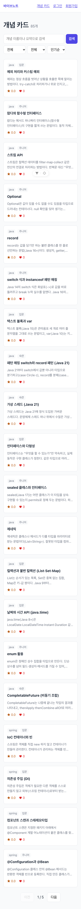 |  |

### SC-10 개념 카드 상세 (`/concepts/:id`, F-10 · 리뷰 F-11 · 찜 F-12)

- 진입: SC-09 카드, SC-07 개념 탭, 대시보드의 복습·추천 카드, 게시글에 첨부된 카드(SC-15), 프로필 찜 목록(SC-18). 공개 화면이라 비로그인도 볼 수 있지만 `PUBLISHED` 카드만 열린다
- 구성 (위에서 아래로)
  - 헤더: "← 목록으로"(직전 화면이 SC-09면 뒤로 가서 검색 조건을 그대로 복원, 아니면 `/concepts`), 카드 이름, 카테고리 칩, 난이도 배지, ♥ 찜 수, ★ 평균 평점(소수 1자리), "· 리뷰 N"(F-11). 찜 버튼은 F-12에서 붙인다
  - 요약(한두 문장) → 쉬운 설명 본문(`body`, Markdown 렌더링) → 예제 코드(코드 블록, 복사 버튼. 누르면 2초간 "복사됨", 실패하면 "복사하지 못했습니다.") → 출처(`reference_url`, 공식 문서 새 창 링크). 값이 없는 절은 제목째 숨긴다. 언어 표시·문법 강조는 언어 컬럼이 없어 넣지 않는다 (F-10 spec 8절)
  - 본문 렌더링: 의존성 없는 자체 최소 렌더러(`v-html` 없음). `##`·`###` 제목, `-` 목록(한 단계 중첩), ``` 코드 블록, 문단, 인라인 코드·굵게만 지원하고 링크·표·HTML은 글자 그대로 보인다
  - 내 코드에서 등장한 위치 (회원 전용): 내 분석(삭제되지 않은 완료 분석, 최신 10개) 중 이 개념이 나온 곳을 "분석 제목 · 파일 경로 · 줄 힌트 · 한 줄 맥락"으로 나열한다(빈 값은 건너뜀). 누르면 SC-07 파일 탭(`/analyses/:id?tab=files&file=:fileId`), 파일이 없으면 분석 상세로 간다. 등장한 곳이 없거나 비로그인이면 영역 전체를 숨긴다
  - 관련 카드: `ConceptCard` 최대 4개(같은 분석에 함께 등장한 횟수순, 모자라면 같은 카테고리 인기순). 누르면 해당 카드 상세로 가고 맨 위로 스크롤한다
  - 리뷰 (F-11): 맨 위는 상태에 따라 하나만 보인다 — 비로그인 "로그인하고 리뷰 남기기" 버튼 / 리뷰를 안 쓴 회원은 작성 폼(별 버튼 1~5 + "이해에 도움이 됐나요?" 입력(앞뒤 공백 제외 1~200자, "n/200") + "등록", 별 미선택·공백뿐이면 비활성) / 쓴 회원은 "내 리뷰" 상자(별점, 내용, "수정"·"삭제"). "수정"은 값이 채워진 폼("저장"·"취소"), "삭제"는 확인 대화상자 후 지운다. 아래는 리뷰 목록(별점, 내용, 닉네임, 작성일 `YYYY-MM-DD`, 최신순 10개씩 "더 보기"). 닉네임을 누르면 SC-18 프로필로 가고, 탈퇴한 작성자는 링크 없는 "탈퇴한 사용자"다. 카드당 1인 1리뷰
- 권한: 비로그인은 설명·예제·관련 카드·리뷰 목록을 본다. 찜 버튼이나 리뷰 폼을 누르면 로그인 화면(SC-02)으로 보내고, 로그인한 뒤 이 화면으로 돌아온다
- 상태별 UI: 불러오는 중 / 없거나 공개되지 않은 카드(`CONCEPT_404`)는 "개념 카드를 찾을 수 없습니다." + "목록으로" / 리뷰 "리뷰를 불러오는 중…" / 리뷰 0건은 "아직 리뷰가 없습니다. 첫 리뷰를 남겨 주세요" / 리뷰 목록 실패는 리뷰 절 안에만 서버 `message`(카드 본문은 그대로) / 리뷰 입력 검증 실패(`COMMON_400`)는 필드 아래에 서버 `details` / 이미 쓴 카드(`CONCEPT_409`)는 메시지와 함께 내 리뷰 상자로 바뀐다 / 그 밖의 에러는 서버 `message`
- 동작: 찜은 누르는 즉시 하트·숫자를 바꾸고(낙관적 갱신) 요청이 실패하면 되돌리면서 메시지를 띄운다. 리뷰를 등록하면 목록 맨 위에 붙고, 등록·수정·삭제 때마다 헤더의 평균 평점·리뷰 수가 서버 응답 값으로 갱신된다(카드 상세를 다시 부르지 않는다). 관련 카드로 이동하면 리뷰 절을 초기화하고 다시 불러온다
- 모바일: 한 열. 헤더의 찜·평점은 이름 아래 줄로 내린다. 긴 예제 코드는 페이지가 아니라 코드 블록 안에서만 가로 스크롤한다. 관련 카드는 한 열
- 정한 것 (F-10 spec): 관련 카드 기준(함께 등장 횟수 + 같은 카테고리 인기순), 본문 렌더러, 언어 표시 제외. 정한 것 (F-11 spec): 1인 1리뷰 + 내 리뷰 수정·삭제(`/reviews/me`), 내용 필수 1~200자, "더 보기" 10개씩
- 구현: `views/concept/ConceptDetailView.vue`, 본문 `components/concept/MarkdownBody.vue`·`markdown.js`, 예제 `CodeBlock.vue`, 등장 위치 `ConceptAppearances.vue` (F-10 PR), 리뷰 `ConceptReviews.vue`·`ReviewForm.vue`·`StarRating.vue` (F-11 PR)
- 복습에 추가 (F-15): 헤더 요약 아래 "복습에 추가" 버튼(로그인 회원만). 누르면 내일 날짜로 복습 계획(MANUAL)에 넣고 "M월 D일 복습 계획에 추가했습니다." + "복습 계획 보기"(SC-11), 이미 있으면 서버 `message`(`REVIEW_PLAN_409`)를 버튼 옆에 보여 준다. 요청 중 버튼을 끈다 (`components/reviewplan/ReviewPlanAddButton.vue`)
- 스크린샷: 아래 와이어프레임 뒤에 둔 구현 화면. 첫 줄은 F-10(리뷰·찜 없음), 둘째 줄은 F-11 리뷰 절(비로그인, 리뷰 1건). 찜 버튼은 F-12에서 붙는다

```
데스크톱 (1280px)
┌──────────────────────────────────────────────────────────────────────┐
│ 바이브노트   분석  개념 카드  커뮤니티 ...                 닉네임 ▾ │
├──────────────────────────────────────────────────────────────────────┤
│ ← 목록으로                                                           │
│ JWT 기반 인증   [security] [숙련]               [♥ 12]  ★ 4.5 (8)   │
│ JWT는 사용자 정보와 만료 시간을 서명된 토큰에 담아 ...               │
│ ─────────────────────────────────────────────────────────────────── │
│ 쉬운 설명                                                            │
│ 로그인하면 서버가 "출입증"을 발급하고, 이후 요청마다 ...             │
│ 예제 코드                                                 [복사]     │
│ ┌──────────────────────────────────────────────────────────────────┐ │
│ │ String token = Jwts.builder().subject(email)...                  │ │
│ └──────────────────────────────────────────────────────────────────┘ │
│ 출처: Spring Security Reference ↗                                    │
│ ─────────────────────────────────────────────────────────────────── │
│ 내 코드에서 등장한 위치                                              │
│  · 쇼핑몰 과제 · security/JwtProvider.java · L24-40 · 토큰 생성      │
│  · 쇼핑몰 과제 · config/SecurityConfig.java · L18 · 필터 등록        │
│ 관련 카드                                                            │
│ [Spring Security 필터] [Refresh 토큰] [CORS] [비밀번호 해싱]         │
│ ─────────────────────────────────────────────────────────────────── │
│ 리뷰 8                                                               │
│ ☆☆☆☆☆ [이해에 도움이 됐나요? 한 줄로 남겨 주세요        ] [등록]   │
│ ★★★★★ 출입증 비유 덕분에 바로 이해했어요 · 코딩초보 · 11/20       │
│ ★★★★☆ 예제가 짧아서 좋았습니다 · java러버 · 11/19                 │
│                           [더 보기]                                  │
└──────────────────────────────────────────────────────────────────────┘

모바일 (375px)             없는 카드 (CONCEPT_404)
┌─────────────────────┐    ┌─────────────────────┐
│ 바이브노트       ☰  │    │ 바이브노트       ☰  │
├─────────────────────┤    ├─────────────────────┤
│ ← 목록으로          │    │                     │
│ JWT 기반 인증       │    │ 개념 카드를 찾을 수 │
│ [security] [숙련]   │    │ 없습니다.           │
│ [♥ 12]  ★ 4.5 (8)   │    │    [목록으로]       │
│ JWT는 사용자 정보...│    └─────────────────────┘
│ 쉬운 설명 ...       │
│ ┌─────────────────┐ │
│ │ String token =→ │ │  ← 코드 블록 안에서만 가로 스크롤
│ └─────────────────┘ │
│ 내 코드에서 등장... │
│ 관련 카드 (한 열)   │
│ 리뷰 8  ☆☆☆☆☆      │
│ [한 줄 리뷰   ][등록]│
└─────────────────────┘
```

| 데스크톱 (1280px) | 모바일 (375px) |
|---|---|
|  |  |
| 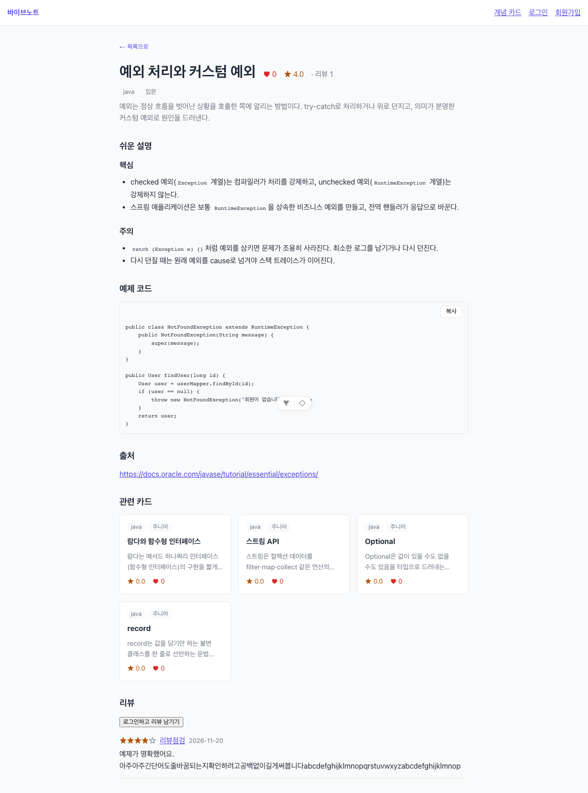 (F-11 리뷰 절, 비로그인) |  |

### SC-11 복습 계획 (`/review-plans`, F-15)

- 진입: 헤더 "복습" 메뉴(로그인 회원), SC-08 결과·SC-10 추가 안내의 "복습 계획 보기". 비로그인으로 주소를 열면 로그인 화면으로 간다
- 구성: 제목 "복습 계획", 기간 "M월 D일 ~ M월 D일"과 "◀ 이전 7일"·"오늘"·"다음 7일 ▶". 기간이 오늘부터일 때만 맨 위에 "밀린 복습 {n}개"(지난 날짜의 TODO, 없으면 숨김). 그 아래 항목이 있는 날짜마다 "M월 D일 (요일)" 머리글(오늘이면 " · 오늘")과 항목
- 항목: 완료 체크박스 · `ConceptCard`(누르면 `/concepts/{id}`) · 이유 배지(오답·찜·직접) · "삭제". DONE은 흐리게, 체크된 채로 보인다
- 동작: 체크·삭제 요청 중에는 그 항목의 체크박스·버튼을 끈다. 성공하면 응답으로 항목을 바꾸고(밀린 복습을 완료하면 그 절에서 빠지고 개수가 준다), 삭제는 목록에서 뺀다. 실패하면 체크를 되돌리고 서버 `message`를 항목 아래에 보여 준다. 확인 대화상자는 없다. 기간 이동은 서버가 준 `today`·`from` 기준 ±7일
- 상태별 UI: "불러오는 중…" / 밀린 복습과 기간 안에 항목이 없으면 "이 기간에 복습할 카드가 없습니다." + "개념 카드 둘러보기"(`/concepts`, F-16이 추천 카드로 바꾼다) / 조회 실패는 서버 `message` + "다시 시도"
- 모바일: 본문 최대 폭 760px. 375px에서는 배지·삭제가 카드 아래 줄로 내려간다 (가로 스크롤 없음)
- 구현: `views/reviewplan/ReviewPlanView.vue`, 항목 `components/reviewplan/ReviewPlanItem.vue`, API `api/reviewPlans.js` (F-15 PR). 대시보드(SC-04)의 "오늘 복습할 카드"는 F-16에서 만든다

| 데스크톱 (1280px) | 모바일 (375px) |
|---|---|
| 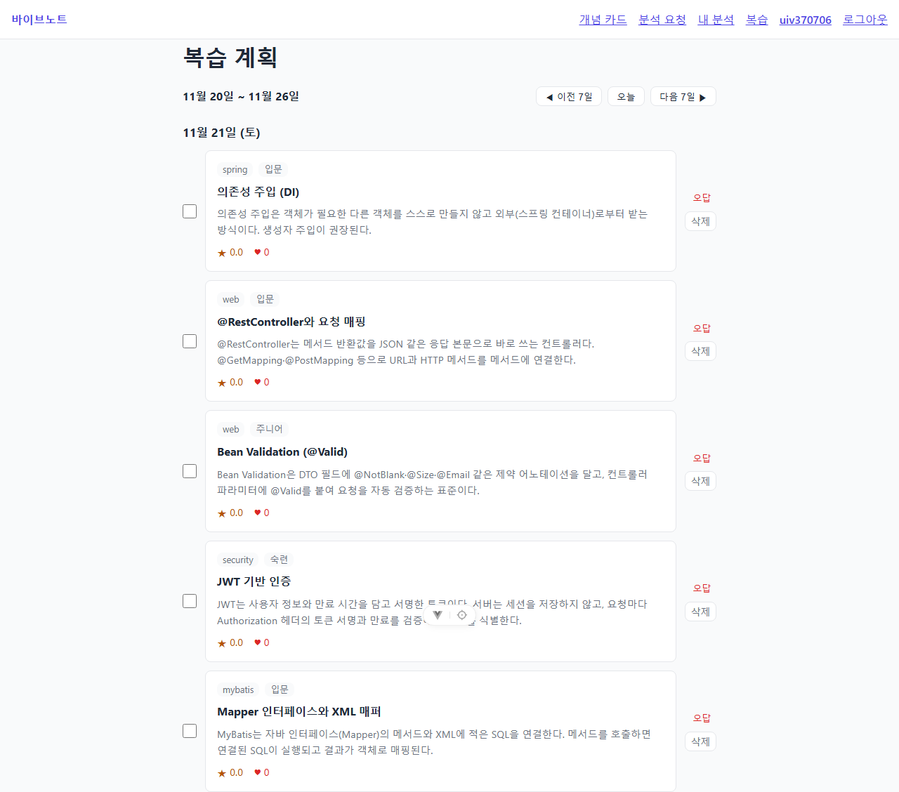 | 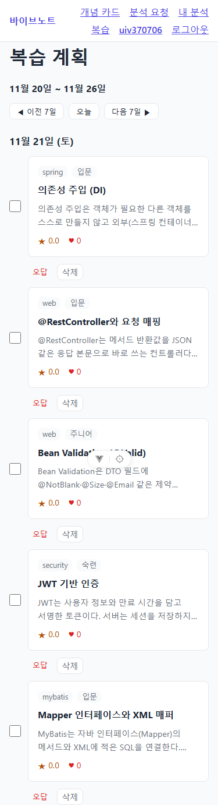 |

### SC-14 커뮤니티 목록 (`/community?boardType=&keyword=&page=`, F-17)

- 진입: 상단 nav "커뮤니티"(비로그인에도 보임), 대시보드. 공개 화면이다
- 구성: 제목 "커뮤니티", 게시판 탭(전체 · 코드 이해 Q&A · 학습 후기 · 자유), 검색창 + 검색 버튼, "글쓰기" 버튼(SC-16), 게시글 목록, 이전·다음 페이지
- 게시글 행: 게시판 칩, 제목, 첨부 표시(📎 분석 / 🃏 카드), 댓글 수 `[3]`, 작성자 닉네임(탈퇴했으면 "탈퇴한 사용자"), 작성일, 조회수. 행을 누르면 SC-15
- 상태별 UI: 불러오는 중 / 0건은 "게시글이 없습니다" + (검색 중이면) "검색 초기화" / 에러는 서버 `message`
- 동작: 탭은 누르는 즉시, 검색은 Enter나 버튼을 누를 때 다시 조회하고 1페이지로 돌아간다. 탭·검색어·페이지는 URL 쿼리에 남는다(SC-09와 같은 규칙). 비로그인이 "글쓰기"를 누르면 로그인 화면으로 보낸다
- 모바일: 탭은 한 줄 가로 스크롤 칩. 게시글 행은 두 줄(1줄: 칩·제목, 2줄: 작성자·날짜·조회·댓글). 글쓰기는 오른쪽 아래 떠 있는 버튼
- spec에서 정할 것: 검색 대상(제목만 / 제목+본문), 페이지 크기, 정렬(최신순 고정 여부) (F-17 spec)

```
데스크톱 (1280px)
┌──────────────────────────────────────────────────────────────────────┐
│ 커뮤니티                                                  [글쓰기]   │
│ [전체] [코드 이해 Q&A] [학습 후기] [자유]   [🔍 검색어      ][검색]  │
│ ──────────────────────────────────────────────────────────────────── │
│ [Q&A]  @Transactional이 안 먹는 이유가 뭔가요? 📎[3]  코딩초보 11/20 42│
│ [후기] JWT 카드 보고 드디어 이해했습니다 🃏 [1]       java러버 11/19 18│
│ [자유] 스터디 같이 하실 분                    [0]  탈퇴한 사용자 11/18 7│
│                      [‹ 이전]  1 / 3  [다음 ›]                       │
└──────────────────────────────────────────────────────────────────────┘

모바일 (375px)
┌─────────────────────┐
│ 커뮤니티            │
│ [전체][Q&A][후기][→ │
│ [🔍 검색어   ][검색]│
│ [Q&A] @Transactiona…│
│ 코딩초보·11/20·42 [3]│
│ [후기] JWT 카드 보고…│
│ java러버·11/19·18 [1]│
│ [‹ 이전] 1/3 [다음›]│
│                 (✎) │
└─────────────────────┘
```

### SC-15 게시글 상세 (`/community/:id`, F-17 · 댓글 F-18)

- 구성: 게시판 칩, 제목, 작성자(누르면 SC-18)·작성일·조회수, 본문, 첨부 카드(있을 때만: 분석이면 제목·프로젝트명·"분석 보기"로 SC-07, 개념 카드면 `ConceptCard` 축소형으로 SC-10), 내 글이면 "수정"(SC-16)·"삭제", "← 목록으로"
- 댓글 (F-18): 댓글 수, 작성 폼(회원만, 비로그인은 "로그인하고 댓글 남기기" 링크), 댓글 목록(닉네임, 작성일, 내용, 수정됨 표시). 내 댓글에만 "수정"·"삭제"가 보이고, 수정은 그 자리에서 입력창으로 바뀐다
- 상태별 UI: 불러오는 중 / 없거나 삭제된 글(`POST_404`)은 "게시글을 찾을 수 없습니다." + 목록으로 / 첨부한 분석이 비공개로 바뀌었거나 삭제됐으면 첨부 영역에 "볼 수 없는 분석입니다" / 댓글 0건은 "첫 댓글을 남겨 주세요" / 남의 글·댓글 수정·삭제 요청이 403이면 서버 `message`
- 동작: 글·댓글 삭제는 확인 대화상자를 거친다. 글을 지우면 목록으로 돌아간다. 댓글 등록·수정·삭제 후 댓글 목록만 다시 불러온다. 상세를 열 때 조회수가 1 오른다
- 모바일: 한 열. 첨부 카드는 전체 폭. 댓글 수정·삭제는 각 댓글의 ⋯ 메뉴로 모은다
- spec에서 정할 것: 조회수 중복 방지 여부, 댓글 정렬·페이지, 댓글이 달린 글 삭제 시 처리 (F-17·F-18 spec)

```
데스크톱 (1280px)
┌──────────────────────────────────────────────────────────────────────┐
│ ← 목록으로                                            [수정] [삭제]  │
│ [Q&A] @Transactional이 안 먹는 이유가 뭔가요?                        │
│ 코딩초보 · 11/20 14:02 · 조회 42                                     │
│ ──────────────────────────────────────────────────────────────────── │
│ 같은 클래스 안에서 메서드를 호출하면 트랜잭션이 안 걸린다는데 ...    │
│ ┌ 첨부한 분석 ─────────────────────────────────────┐                 │
│ │ 쇼핑몰 과제 · shop-backend         [분석 보기 →] │                 │
│ └──────────────────────────────────────────────────┘                 │
│ ──────────────────────────────────────────────────────────────────── │
│ 댓글 3                                                               │
│ [댓글을 입력하세요                                        ] [등록]   │
│ java러버 · 11/20 · 프록시를 거치지 않아서 그래요. 트랜잭션 전파 카드…│
│ 코딩초보 · 11/20 (수정됨) · 감사합니다!                  [수정][삭제]│
└──────────────────────────────────────────────────────────────────────┘
```

### SC-16 게시글 작성·수정 (`/community/write`, 수정 `/community/:id/edit`, F-17)

- 진입: SC-14 "글쓰기", SC-15 "수정". 제안: SC-07 분석 결과의 "커뮤니티에 질문하기"(분석을 첨부한 채 Q&A로 열림)와 SC-10의 "이 카드로 글쓰기"(카드 첨부) 진입 버튼 — SC-07은 A 화면이라 F-17 spec에서 김동환과 정한다
- 구성: 게시판 선택(라디오 3개: 코드 이해 Q&A · 학습 후기 · 자유), 제목, 본문(여러 줄 입력, 글자 수 표시), 첨부 선택(없음 / 내 분석 고르기 / 개념 카드 고르기 — 선택 상자에서 검색해 하나만 고름, 선택하면 미리보기 칩과 ✕), 취소·등록(수정이면 "저장")
- 상태별 UI: 필수 입력·길이 검증은 필드 아래 / 서버 `details`(`COMMON_400`)도 필드 아래 / 남의 글 수정 화면에 들어오면(403) 서버 `message` 후 상세로 / 저장 중에는 버튼 비활성화
- 동작: 등록·저장에 성공하면 SC-15로 이동한다. 작성 중에 화면을 벗어나려 하면 "작성 중인 내용이 사라집니다" 확인을 띄운다. 첨부는 분석과 카드 중 하나만 고른다
- 모바일: 한 열, 등록 버튼은 아래쪽 고정
- spec에서 정할 것: 위 진입 버튼 추가 여부, 첨부할 수 있는 분석 범위(내 분석 중 완료된 것만, 공개 분석만 등), 분석과 카드를 동시에 첨부할 수 있는지(ERD상으로는 둘 다 nullable), 제목·본문 길이 제한 (F-17 spec)

```
데스크톱 (1280px)
┌──────────────────────────────────────────────────────────────────────┐
│ 글쓰기                                                               │
│ 게시판  (●) 코드 이해 Q&A  ( ) 학습 후기  ( ) 자유                   │
│ 제목    [                                                       ]   │
│ 본문    ┌──────────────────────────────────────────────────────┐    │
│         │                                                      │    │
│         └──────────────────────────────────────────────── 0/5000┘    │
│ 첨부    ( ) 없음  (●) 내 분석 [쇼핑몰 과제 ✕]  ( ) 개념 카드 [고르기▾]│
│                                              [취소]  [등록]          │
└──────────────────────────────────────────────────────────────────────┘
```

### SC-17 피드 (`/feed`, F-04)

- 진입: 상단 nav "피드"(회원만 보임), 대시보드. 비로그인이 URL로 들어오면 로그인 화면으로 보낸다
- 구성: 제목 "피드", 팔로우한 사람들의 공개 활동 목록(최신순), 아래쪽 "더 보기"
- 활동 항목: 프로필 이니셜·닉네임(누르면 SC-18), 행동 문장, 대상 링크, 시각("3시간 전")
  - `ANALYSIS` "새 분석을 공개했어요 · 쇼핑몰 과제" → SC-07 / `REVIEW` "카드에 리뷰를 남겼어요 · JWT 기반 인증 ★5" → SC-10 / `WISH` "카드를 찜했어요" → SC-10 / `POST` "글을 썼어요 · 제목" → SC-15 / `CHALLENGE_JOIN`·`CHALLENGE_COMPLETE` "챌린지에 참여했어요 / 달성했어요" → SC-13
- 상태별 UI: 불러오는 중 / 팔로우가 0명이면 "아직 팔로우한 사람이 없어요" + "커뮤니티 둘러보기"(SC-14) / 팔로우는 있는데 활동이 없으면 "새 활동이 없습니다" / 대상이 비공개로 바뀌었거나 삭제된 항목은 목록에서 빠진다 / 에러는 서버 `message`
- 모바일: 한 열, 항목은 두 줄(1줄: 닉네임·시각, 2줄: 행동 문장·대상)
- spec에서 정할 것: 페이지 방식(커서 / 페이지 번호), 비공개·삭제 대상 걸러내기를 서버에서 할지, 내 활동도 섞을지 (F-04 spec)

```
데스크톱 (1280px)                          팔로우 0명
┌─────────────────────────────────────┐    ┌──────────────────────────┐
│ 피드                                │    │ 피드                     │
│ (코) 코딩초보 · 3시간 전            │    │ 아직 팔로우한 사람이     │
│      카드에 리뷰를 남겼어요         │    │ 없어요                   │
│      JWT 기반 인증 ★★★★★          │    │ [커뮤니티 둘러보기]      │
│ (j)  java러버 · 어제                │    └──────────────────────────┘
│      새 분석을 공개했어요 · 쇼핑몰… │
│ (j)  java러버 · 어제                │
│      글을 썼어요 · 스터디 같이 …    │
│              [더 보기]              │
└─────────────────────────────────────┘
```

### SC-18 프로필 (`/users/:id`, F-03 · 팔로우 F-04 · 찜 F-12 · 챌린지 F-25)

- 구성(F-03): 닉네임, 학습 수준 배지, 가입일, 소개, 학습 통계 타일 3개(완료한 분석 / 학습한 카드 / 퀴즈 정답률). 내 프로필이면 "정보 수정" 링크(SC-19). 헤더의 내 닉네임을 누르면 이 화면으로 온다
- 상태별 UI: 불러오는 중 / 없거나 탈퇴한 회원(USER_404)은 "탈퇴했거나 없는 사용자입니다." / 그 밖의 에러는 서버 메시지 / 정답률은 풀이가 없으면 "-"
- 동작: 비로그인도 볼 수 있다(email 비공개). 팔로우 버튼·팔로워 목록, 찜, 참여 챌린지 영역은 각 기능에서 추가
- 모바일: 통계 타일을 한 열로 쌓는다

| 데스크톱 (1280px) | 모바일 (375px) |
|---|---|
|  |  |

### SC-19 내 정보 수정·탈퇴 (`/me/settings`, F-03)

- 구성: 정보 수정 카드(이메일 읽기 전용, 닉네임, 소개 300자 카운터, 학습 수준 라디오 카드 3개, 저장하기) + 회원 탈퇴 카드(안내 문구, 현재 비밀번호, "되돌릴 수 없음" 확인 체크, 빨간 탈퇴하기 버튼)
- 상태별 UI: 클라이언트 검증·서버 `details`(COMMON_400, USER_409)는 필드 아래 / 저장 성공 시 "저장했습니다." / 비밀번호 불일치(USER_001)는 비밀번호 아래 / 탈퇴 버튼은 비밀번호와 확인 체크가 있어야 활성화
- 동작: 저장하면 헤더 닉네임·수준이 바로 바뀐다. 탈퇴 성공 시 이 기기의 세션을 비우고 홈으로 이동 (서버가 모든 기기의 Refresh 토큰을 폐기)
- 모바일: 한 열, 최대 폭 560px

| 데스크톱 (1280px) | 모바일 (375px) | 탈퇴 실패 (USER_001) |
|---|---|---|
|  | 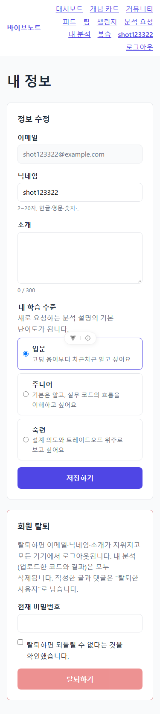 | 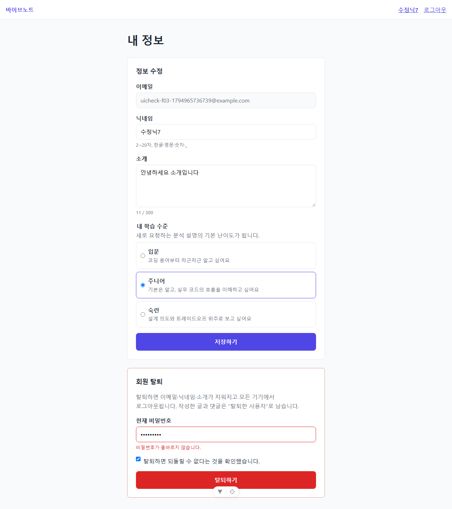 |

### SC-20·21 관리자 공통 레이아웃 (`/admin`, F-00b)

- 구성: 왼쪽 사이드 메뉴(자식 route의 `meta.adminNav`) + 본문. `/admin` 첫 화면은 "관리자" 제목과 "관리할 항목을 고르세요." 안내
- 상태별 UI: 자식 화면이 아직 없으면 메뉴 자리에 "아직 관리 메뉴가 없습니다."
- 동작: 비로그인은 `/login?redirect=/admin`, USER는 홈으로 보낸다. 헤더의 "관리자" 메뉴는 ADMIN에게만 보인다. SC-20 카드 관리(F-13)·SC-21 챌린지 관리(F-24)가 자식 화면으로 들어온다
- 모바일: 사이드 메뉴가 본문 위 가로 메뉴로 바뀐다

| 데스크톱 (1440px) | 모바일 (375px) |
|---|---|
|  |  |

### SC-20 관리자 카드 관리 (`/admin/concepts?status=&source=&keyword=&page=`, F-13)

- 진입: SC-20·21 관리자 공통 레이아웃의 자식 화면. 헤더 "관리자" 메뉴(ADMIN에게만 보임) → 사이드 메뉴 "개념 카드"(`meta.adminNav`). 권한 처리는 공통 레이아웃을 따른다(비로그인은 `/login?redirect=…`, USER는 홈)
- 목록 구성: 상태 탭(검수 대기 `DRAFT` n · 공개 `PUBLISHED` · 숨김 `HIDDEN` · 전체), 출처 필터(전체 · 시드 · AI 초안), 검색창, "새 카드" 버튼, 표(이름, 카테고리, 난이도, 출처, 상태, 찜·평점, 수정일, 관리 버튼)
- 편집 화면(`/admin/concepts/new`, `/admin/concepts/:id/edit`): 이름, 카테고리 선택(6종), 난이도 선택, 요약, 본문(Markdown, 오른쪽에 미리보기), 예제 코드, 출처 URL, 상태 선택. AI 초안이면 위쪽에 "AI가 만든 초안입니다. 사실관계·예제를 확인한 뒤 공개하세요" 안내를 보여 준다 (제안: 처음 추출된 분석 링크도 — `concepts`에 출처 분석 컬럼이 없어 `analysis_concepts`로 찾는다)
- AI 초안 검수 동작: 검수 대기 탭에서 행의 "검수"를 누르면 편집 화면이 열린다. 고친 뒤 "공개"(`PUBLISHED`로 저장), "숨김", "삭제" 중 하나를 고른다. 공개된 카드만 SC-09·SC-10에 나온다(NF-04)
- 상태별 UI: 불러오는 중 / 탭에 카드가 없으면 "검수할 초안이 없습니다" 등 탭별 문구 / 이름 중복(409)·검증 실패(`COMMON_400`)는 필드 아래 / 삭제는 확인 대화상자(찜·리뷰가 달린 카드는 "숨김을 권장합니다" 경고)
- 모바일: 관리자 화면은 데스크톱 우선. 375px에서는 표 대신 카드형 행(이름·상태·관리 버튼)으로 바꾸고, 편집 화면의 미리보기는 탭으로 전환한다
- spec에서 정할 것: 삭제(물리) 허용 범위와 숨김과의 관계, 이름 중복 시 AI 초안 병합 방법, 검수 대기 수를 헤더 배지로 보일지 (F-13 spec)

```
데스크톱 (1280px) — 목록
┌──────────────────────────────────────────────────────────────────────┐
│ 개념 카드 관리                                           [새 카드]   │
│ [검수 대기 3] [공개 85] [숨김 2] [전체]  출처[전체▾] [🔍       ][검색]│
│ ┌────────────────┬─────────┬──────┬──────┬──────┬────────┬────────┐  │
│ │ 이름           │ 카테고리│ 난이도│ 출처 │ 상태 │ 수정일 │        │  │
│ ├────────────────┼─────────┼──────┼──────┼──────┼────────┼────────┤  │
│ │ 낙관적 락      │ spring  │ 숙련 │ AI   │ DRAFT│ 11/20  │ [검수] │  │
│ │ Pinia 스토어   │ vue     │ 입문 │ AI   │ DRAFT│ 11/20  │ [검수] │  │
│ └────────────────┴─────────┴──────┴──────┴──────┴────────┴────────┘  │
└──────────────────────────────────────────────────────────────────────┘

데스크톱 (1280px) — 검수(편집)
┌──────────────────────────────────────────────────────────────────────┐
│ ⚠ AI가 만든 초안입니다. 사실관계·예제를 확인한 뒤 공개하세요         │
│   처음 추출된 분석: 쇼핑몰 과제 ↗                                    │
│ 이름 [낙관적 락        ] 카테고리 [spring ▾] 난이도 [숙련 ▾]         │
│ 요약 [                                                         ]    │
│ 본문 (Markdown)               │ 미리보기                             │
│ ┌───────────────────────────┐ │ 낙관적 락은 충돌이 드물다고 보고 ... │
│ └───────────────────────────┘ │                                      │
│ 예제 코드 [...]   출처 URL [https://docs.spring.io/...]              │
│                          [삭제]   [숨김]   [저장]   [공개]           │
└──────────────────────────────────────────────────────────────────────┘
```

<!-- 나머지 화면도 같은 형식으로 추가 -->
